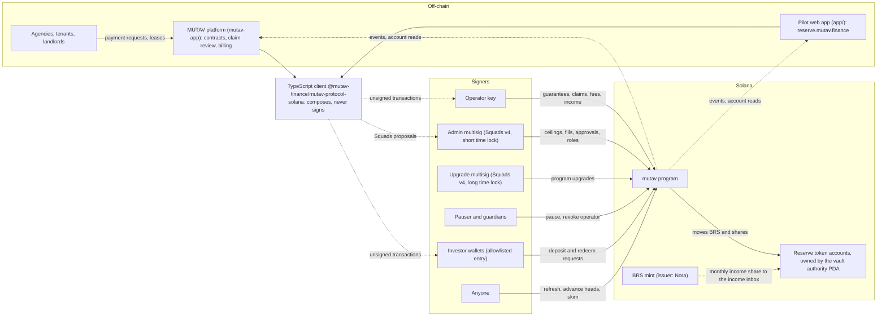

# Architecture

This section describes how MUTAV is built for the devnet release: the on-chain program, the systems around it, who signs what, where every account and every token lives, and how the program changes over time. It describes the decided design for that release, in the present tense.

MUTAV is an institutional fiador for Brazilian rental leases. One Solana program, `mutav`, holds a BRL reserve in BRS and records every guarantee MUTAV gives, with its remaining cover. It gates every capital movement and every new guarantee on a solvency check. It never gates a claim payment. The reserve is operational infrastructure that keeps the guarantees healthy. It is not a yield product.

## Pages in this section

| Page | What it covers |
|---|---|
| [System context](README.md) | This page. The systems, the trust boundary, repo boundaries and dependency direction |
| [Components](components.md) | Program modules, the TypeScript client, the pilot app, scripts and tests: what lives where and why |
| [Roles and trust](roles-and-trust.md) | Operator, reserve admin, pauser, guardians, investors and anyone. Who can move money, and the bound on a compromised operator |
| [Accounts](accounts.md) | Every PDA with its seeds, purpose, size and padding, and the fields carved for this release |
| [Money flows](money-flows.md) | Every path by which money enters and leaves the reserve |
| [State machines](state-machines.md) | Guarantee, claim filing, payout, and deposit and redemption requests |
| [Upgrades and layout](upgrades-and-layout.md) | The two multisigs and their time locks, the layout freeze, carves, IDL compatibility and the release workflow |

## The system at a glance

Agencies, tenants and landlords never sign on-chain. They work in the MUTAV platform. MUTAV acts on-chain through the **operator** key, which runs the guarantee and claim cycle. A separate **reserve admin**, a Squads v4 multisig, sets the ceilings the operator works within and fills the capital queues. A **pauser** and up to three **guardians** can stop capital flows at once. Investors hold reserve shares from their own wallets. Anyone can run the cranks that recompute the reserve's health.

## Systems

| System | Where it lives | What it does | Holds keys? |
|---|---|---|---|
| `mutav` program | [`programs/mutav/`](../../programs/mutav/) (Anchor) | Custody of the reserve, the share mint, on-chain NAV, the guarantee registry, the solvency gate, the deposit and redemption queues, roles, claim payments | Signs only through its own PDAs |
| TypeScript client | [`clients/js/`](../../clients/js/), published as `@mutav-finance/mutav-protocol-solana` | Codama instruction builders and account decoders generated from the IDL, plus PDAs, reads, an exact math mirror and previews | No. It composes; wallets and multisigs sign |
| Pilot web app | [`app/`](../../app/), live at [reserve.mutav.finance](https://reserve.mutav.finance) | Transparency page, operator console, investor view, admin proposal builder, guided demo, simulator | No. Connected wallets sign |
| MUTAV platform | [`mutav-finance/mutav-app`](https://github.com/mutav-finance/mutav-app), a separate repo | Contracts, agencies, claim review and the payment SLA, agency billing, the indexer. Later it sends operator instructions with a KMS-backed key | The operator key, once the operator moves off the hand-signed console |
| Admin multisig | Squads v4 | Holds `VaultConfig.admin`. Every admin action waits for its time lock | Members' own wallets |
| Upgrade multisig | Squads v4 | Holds the program upgrade authority and signs `initialize` | Members' own wallets |
| BRS issuer | Nora | Issues BRS, the BRL token the reserve holds. Holds the BRS freeze authority. Pays a monthly revenue share into the reserve's income inbox | Outside MUTAV |

## Trust boundary

Only amounts, timestamps and commitments (hashes) cross from the platform to the chain. No names, documents or addresses of tenants, landlords or agencies go on-chain. A lease is referenced by `id`, `agency_id` and `refs_hash`. A claim is referenced by `notice_ref_hash`. A Pix settlement is referenced by `pix_e2e_hash`.

The program prices nothing, underwrites nothing and decides no claim. Those duties stay in the MUTAV platform. The program enforces the ceilings: the cover of each guarantee, the claim caps, the coverage the reserve must hold, and the destinations money may go to.

## Repo boundaries and dependency direction

| Repo | Contents | Depends on |
|---|---|---|
| `mutav-finance/mutav-protocol-solana` (this repo) | The program, the TypeScript client, the pilot app, the deploy and release scripts, the tests | Anchor, `@solana/kit`, Squads v4 SDK (scripts and app only) |
| `mutav-finance/mutav-app` | Production user surfaces and the operator runtime | The published client `@mutav-finance/mutav-protocol-solana` |

Rules:

- **One direction.** `mutav-app` consumes the client published from this repo. Nothing in this repo imports from `mutav-app`.
- **Inside this repo**, the pilot app and the scripts both depend on `clients/js`. The app and the scripts never import each other. Where they need the same check (for example the cluster check), each keeps its own copy with a test.
- **The client follows the IDL.** It is regenerated with Codama in the same PR as any change to the program's interface. CI fails when the committed client differs from a fresh generation.
- **No keys in this repo.** No keypairs, no secret keys, no signing code in the client. CI scans for signing APIs. Only the deploy script takes keypair *paths*, which live outside the repo.

## Devnet release at a glance

| Item | Value |
|---|---|
| Cluster | Solana devnet. Every script and the app refuse any other cluster, checked by genesis hash |
| Program ID | `8scC79jkU7SPM9v6M4nB833R8EeqKknfwdRdjn73Qqv9` (declared in `lib.rs`) |
| Reserve mint | Nora's devnet BRS, `BRS2CELW6Cueo2mrMUVvAr5GDT7Pw8TeostC2JLMpBk4`. Classic SPL Token, 6 decimals |
| Admin multisig | Squads v4, 2-of-2. Two devnet wallets stand in for the founders' keys. Time lock 5 minutes |
| Upgrade multisig | Same members. Time lock 1 hour |
| Operator, pauser, guardian | Operator and pauser keys generated at deploy. One guardian key held by a founder, separate from the pauser |
| Reserve PDAs, treasury and payments accounts | Set at deploy |

On a real-money pilot, hardware-wallet keys replace the devnet stand-ins, and the time locks become 24 hours (admin) and 7 days (upgrade).

## Design principles

1. **The business model is the fixed requirement.** The program implements it and decides nothing the platform should decide.
2. **The reserve is verifiable on-chain.** The program tracks the amounts it moved, not raw token balances. Losses are recognised early: a filed claim is provisioned at once.
3. **MUTAV operates every chain touchpoint.** The operator is the only writer of guarantees and claims.
4. **The solvency gate protects the reserve and never stops a claim payment.**
5. **No arbitrary outflows.** Money leaves only to a fixed set of destinations (see [Money flows](money-flows.md)).
6. **Operator and admin are separate.** The most a compromised operator can cost is the admin-set claim caps. Every other operator change is reversible.
7. **No migrations.** Every account carries reserved space, so later features are carved from padding or added as new accounts.

## Related sections

- [Reserve framework](../reserve-framework/README.md)
- [Security and verification](../security/README.md)
- [Technical resources](../technical-resources/README.md)
- [Decisions](../meta/decisions.md)

## Sources

- [Protocol specification, §1 Principles](../spec.md#1-principles) and [§2 Roles and keys](../spec.md#2-roles-and-keys)
- [Litepaper, §6 Architecture on Solana](../litepaper.md#6-architecture-on-solana)
- [Repository README](../../README.md)
- [Pilot app spec](../../app/docs/spec.md)
- Program entry point: [`programs/mutav/src/lib.rs`](../../programs/mutav/src/lib.rs)
- Client package: [`clients/js/package.json`](../../clients/js/package.json)
- Decision log of 2026-10-09 and 2026-10-10 (internal notes, to be published as the pending ADRs below)
- [Squads v4 documentation](https://docs.squads.so/)
- [Anchor](https://www.anchor-lang.com/) and [Codama](https://github.com/codama-idl/codama)

## Decisions

- [ADR 0002: One core program plus adapter programs with capped sub-authorities](../decisions/0002-core-program-and-capped-adapters.md)
- [ADR 0003: Claim payments operated by MUTAV through a whitelisted payments account](../decisions/0003-payments-operated-by-mutav.md)
- [ADR 0004: NAV computed on-chain with internal accounting](../decisions/0004-onchain-nav-internal-accounting.md)
- [ADR 0005: Solvency gate scope](../decisions/0005-solvency-gate-scope.md)
- [ADR 0018: BRS-only pilot reserve](../decisions/0018-brs-only-pilot-reserve.md)
- Pending ADR: Operator/admin separation and operator-compromise recovery
- Pending ADR: 0019 v1 layout for the devnet release
