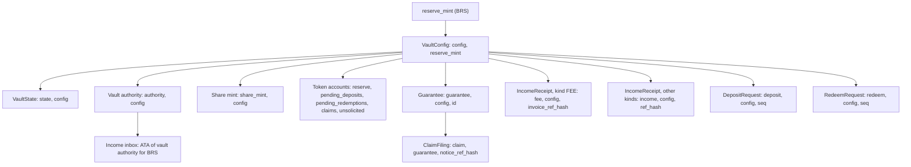

# Accounts

The account model of the `mutav` program for the devnet release: every PDA with its seeds and purpose, the token accounts, sizes and padding, and the fields carved for this release.

## Conventions

- **One reserve per mint.** `VaultConfig` is seeded by the reserve mint. Every other PDA includes the config address (or a record that does) in its seeds.
- **Header and padding.** Every program-owned account starts with `version: u8` and `bump: u8` and ends with a zeroed `_reserved: [u8; N]`. New fields are carved from the front of `_reserved`.
- **Fixed-size types only.** Statuses, legs, kinds and modes are `u8` constants, never Borsh enums. No `Option`, `Vec` or `String`. An unknown version or status fails closed with `UnsupportedVersion`.
- **Sizes include the 8-byte discriminator** and are pinned with a compile-time assertion per account.
- **Seed strings are distinct and fixed.** A seed-collision test covers every seed prefix.
- **Large accounts are boxed** in instruction contexts.

## How the PDAs derive

## Reserve-level accounts

| Account | Seeds | Purpose |
|---|---|---|
| `VaultConfig` | `["config", reserve_mint]` | Configuration, roles and pending handovers, guardians, caps, accounts, allowlist root. One per reserve. Written only by admin instructions, `pause`, `revoke_operator` and the role-acceptance instructions |
| `VaultState` | `["state", config]` | Internal accounting, queue sequences and heads, the 31-day claim window, lifetime counters, mode and halt flags |
| Vault authority | `["authority", config]` | No data. Owns every reserve token account. Mint and freeze authority of the share mint |
| Share mint | `["share_mint", config]` | Classic SPL Token mint, 6 decimals. Shares are minted only in `claim_shares`. The freeze authority is unused in v1 and kept so share-transfer restrictions stay possible without a new mint |

## Token accounts

All are ordinary SPL Token accounts owned by the vault authority. Money is split across separate accounts so that one issuer freeze does not trap every balance.

| Account | Seeds | Mint | Holds | Tracked by |
|---|---|---|---|---|
| `reserve` | `["reserve", config]` | BRS | The liquid reserve | `VaultState.brs_balance` |
| `pending_deposits` | `["pending_deposits", config]` | BRS | Escrowed deposit requests | `pending_deposits_total` |
| `pending_redemptions` | `["pending_redemptions", config]` | Share | Escrowed redeem requests | `pending_redeem_shares` |
| `claims` | `["claims", config]` | BRS | BRS owed to holders on filled redemptions | `claimable_assets_total` |
| `unsolicited` | `["unsolicited", config]` | BRS | Created at `initialize` and empty in this release. A later upgrade adds the instructions that move untracked BRS into it and let the admin book or return it ([ADR 0024](../decisions/0024-unsolicited-money-and-backstop.md)) | Not tracked |
| Income inbox | Associated token account of the vault authority for BRS | BRS | The issuer's monthly revenue share, waiting for `sweep_income` | Not tracked |

Untracked balances never count toward stable assets, NAV or coverage. `reserve` is a PDA, not the associated token account, so a mistaken send to the vault authority's "wallet" address lands in the income inbox, outside NAV. In this release the inbox's only exit is `reserve` (`sweep_income`); the route to `unsolicited` comes with the unsolicited-money upgrade. Nothing is ever returned from the inbox or from `reserve`.

## Record accounts

| Account | Seeds | Created by | Closed? | Purpose |
|---|---|---|---|---|
| `Guarantee` | `["guarantee", config, id]` | `register_guarantee` | Never | One per lease. Covers, paid and provisioned amounts per leg, status and close reason. A second registration of the same `id` fails at creation |
| `ClaimFiling` | `["claim", guarantee, notice_ref_hash]` | `file_claim` | Never | One claim: its leg, provision, approval, payment and settlement, and status. Makes payment idempotent per notice. Withdrawal and re-filing under the same notice (`refile_claim`) are future work |
| `IncomeReceipt` | `["fee", config, invoice_ref_hash]` for kind `FEE`; `["income", config, ref_hash]` for the other kinds | `contribute_fees` (`FEE`), `sweep_income` (`ISSUER_STATEMENT`). `UNSOLICITED` and `BACKSTOP` are reserved for the later `book_unsolicited` | Never | Each booked inflow counts once. The separate `fee` prefix keeps an invoice reference and a statement reference from ever colliding |
| `DepositRequest` | `["deposit", config, seq]`, `seq` as `u64` little-endian | `request_deposit` | On claim or the owner's cancel; rent to the owner. The admin's cancel parks it as `CANCELLED` and does not close it ([ADR 0030](../decisions/0030-admin-cancel-parks-the-request.md)) | One FIFO deposit request |
| `RedeemRequest` | `["redeem", config, seq]`, `seq` as `u64` little-endian | `request_redeem` | On claim or the owner's cancel; rent to the owner. The admin's cancel parks it as `CANCELLED` and does not close it | One FIFO redeem request. A head worth 0 BRS at fill time is never filled ([ADR 0029](../decisions/0029-claims-and-capital-rules-in-the-program.md)) |

**Removed before the freeze** ([ADR 0026](../decisions/0026-program-simplification-for-the-freeze.md), [ADR 0019](../decisions/0019-v1-layout-for-the-devnet-release.md)):

- `Payout` merged into `ClaimFiling` ([ADR 0021](../decisions/0021-claims-approval-amendment-exact-payment.md)).
- `FeeReceipt` became `IncomeReceipt` with `kind = FEE`.
- `HolderState`: exit uses the owner's share balance ([ADR 0023](../decisions/0023-capital-flows-and-exit-rights.md)).
- `AgencyExposure` and the per-agency cap ([ADR 0022](../decisions/0022-coverage-stress-buffer-underwater-reserve.md)). `Guarantee.agency_id` stays, and the app derives per-agency figures from guarantee accounts. A future concentration limit would return as a new account.

The retired seeds `agency`, `payout` and `holder` are never reused.

**Reserved seed prefixes**, never used by a v1 PDA: `exit_buffer`, `exit_limit`, `instant_exit`, `adapter_state`, `notice` (held for the planned claim notice).

## Sizes and padding

Every account carries reserved space so later features are carved from padding or added as new accounts. Exact sizes, discriminator included, and the `_reserved` left after each carve are pinned by the layout test and the golden v1 fixtures.

| Account | Padding | Notes |
|---|---|---|
| `VaultConfig` | 411 | Holds the role, guardian, adapter and attestation carves listed below. The payout-SLA bytes and the removed exit, price, income-take and inline-adapter fields are gone |
| `VaultState` | 224 | The 31 daily claim buckets and their day index take 256 bytes. Room is held for phase 2's `InstantExitState` (88 bytes) |
| `Guarantee` | 203 | Grown before the freeze to hold the fiança-lifecycle fields (88 bytes) without migration. The removed display fields (`rent` and the multipliers) returned their bytes; `close_reason` took one |
| `ClaimFiling` | 192 | Holds the payment and settlement fields from the former `Payout`, plus room for the lifecycle claim and settlement fields (114 bytes) |
| `IncomeReceipt` | 64 | Carries `kind` |
| `DepositRequest`, `RedeemRequest` | 56, 48 | Carry the requester price limits (`min_shares_out`, `min_assets_out`) and `RedeemRequest.shares_filled`; the rest of the partial-fill fields are carved later |
| Nested `Caps` | inside `VaultConfig` | Carves `stress_buffer`, `max_queue_wait_secs`, `max_reinstate_age` |

Rent is about 6,960 lamports per byte.

## Fields carved for the devnet release

Every carved field reads zero as the safe default on an account written before the carve.

| Account | Field | Type | Meaning | Zero means |
|---|---|---|---|---|
| `VaultConfig` | `pending_operator`, `pending_pauser` | `Pubkey` ×2 | Keys proposed by `propose_role` | No pending handover |
| `VaultConfig` | `pending_operator_expires_at`, `pending_pauser_expires_at` | `i64` ×2 | When each pending key stops being acceptable, 72 hours after the proposal | No pending handover |
| `VaultConfig` | `pending_admin`, `pending_admin_expires_at` | `Pubkey`, `i64` | Admin proposed by `propose_admin`, and its expiry | No pending handover |
| `VaultConfig` | `guardians` | `[Pubkey; 3]` | Guardian keys, appointed by the admin in one step | Empty slot |
| `VaultConfig` | `adapter_count`, `adapter_bitmap` | `u8` ×2 | Number and slots of whitelisted adapters, each described by its own `AdapterState` account | BRS only |
| `VaultConfig` | `disabled_ops`, `kyc_attester`, `attestation_program`, `required_attestation_type`, `attester_epoch` | | Per-direction capital stops and the KYC-attestation path. Read by no instruction of this binary | Off |
| `Guarantee` | `close_reason` | `u8` | `RELEASED` (1) or `VOID` (2), written by `close_guarantee` | Active, or closed before the reason was recorded |
| `Caps` | `stress_buffer` | `u64` | R$ amount added on top of provisions in `coverage_required` | No stress term |
| `Caps` | `max_reinstate_age` | `i64` | How long after a close the future `reinstate_guarantee` is allowed. Read by no instruction of this binary; 0 on devnet | No reinstatement |
| `Caps` | `max_queue_wait_secs` | `i64` | Wait after which the future exit fallback may fill the head redemption | Off. Shipped at 0 |
| `VaultState` | `claim_day_buckets`, `claim_day_anchor` | `[u64; 31]`, `i64` | Payment totals per day for the last 31 days, and the day of the last write | No payments in the window |
| `ClaimFiling` | `approved_amount` | `u64` | Amount the admin approves with `approve_claim`, always the filing's provision. Zero until approved | No approval; the per-call cap applies |
| `ClaimFiling` | `payments_account`, `paid_at`, `paid_amount`, `pix_e2e_hash`, `settled_at` | | Payment and settlement record, formerly on `Payout` | Not paid, not settled |
| `IncomeReceipt` | `kind` | `u8` | `ISSUER_STATEMENT` (0), `FEE` (1), `UNSOLICITED` (2, reserved), `BACKSTOP` (3, reserved) | An issuer statement |

Names, types and offsets are pinned by the layout test.

Fields **removed** before the freeze: `VaultConfig.payout_sla_secs`, `VaultState.late_payouts`, the `late` flag, `Caps.max_cover_per_agency`, `Caps.claim_period_secs`, the phase-2 `ExitParams` and the buffer earmark, the global TESOURO `PriceParams` and `tesouro_units`, `tesouro_price` and `tesouro_price_ts`, the cached `stable_assets`, `income_take_bps` and `income_take_total`, `min_fill_assets` and the partial-fill request fields, `pending_notices`, the inline `adapters[8]` and `max_allocated_bps`. Retired `ConfigUpdated` field ids are never reused.

## Account contents

### `VaultConfig`

| Group | Fields |
|---|---|
| Header | `version`, `bump`, `authority_bump` |
| Roles | `admin`, `operator`, `pauser`, the pending keys and their expiry times, `guardians` |
| Mint | `reserve_mint`, `reserve_token_program`, `reserve_decimals` (immutable after `initialize`; 6), `share_mint` |
| Economics | `coverage_ratio_bps` (c, from 1,000 to 10,000), `fee_take_bps` (at most 3,000) |
| Accounts | `payments_account`, `treasury_account` (distinct, owned by none of the vault authority, the operator or the capital wallet), `mutav_capital_wallet` |
| Allowlist | `investor_allowlist_root` |
| Limits | `caps`: `max_tvl`, `max_cover_per_guarantee`, `max_claim_per_call`, `max_claim_per_period` (per 31-day window), `min_request`, `max_request`, `max_nav_move_bps`, `stress_buffer`, `max_queue_wait_secs`, `max_reinstate_age` |
| Flags | `paused`, `feature_flags` (0 in v1, fail-closed) |
| Later | `adapter_count` and `adapter_bitmap` (0); `disabled_ops`, `kyc_attester`, `attestation_program`, `required_attestation_type`, `attester_epoch` (unused) |

### `VaultState`

| Group | Fields |
|---|---|
| Health | `mode` (`NORMAL` 0, `UNDER_COVERED` 1), `remaining_cover_total`, `coverage_required`, `provisions`, `fulfil_halted`, `last_refresh_ts`, `last_refresh_slot`. Stable assets are computed at every gate, not stored |
| Tracked balances | `brs_balance`, `pending_deposits_total`, `pending_redeem_shares`, `claimable_assets_total` |
| Shares and NAV | `shares_outstanding`, `nav_per_share`, `inflow_nav` |
| Queues | `next_deposit_seq`, `deposit_head`, `next_redeem_seq`, `redeem_head` |
| Claim window | `claim_day_buckets`, `claim_day_anchor` |
| Counters | `active_guarantees`, `fees_in_total`, `fee_take_total`, `claims_paid_total`, `income_total`, `deposited_assets_total`, `minted_shares_total`, `redeemed_shares_total`, `redeemed_assets_total` |

### `Guarantee`

`id`, `agency_id`, `refs_hash`; `default_cover`, `exit_cover` (absolute leg sub-limits, never changed after registration); `default_paid`, `exit_paid`; `provision_default`, `provision_exit`; `open_claims`; `status` (`ACTIVE` 0, `CLOSED` 1); `registered_at`, `closed_at` (0 while active); `close_reason` (`RELEASED` 1, `VOID` 2; 0 while active).

### `ClaimFiling`

`guarantee`, `leg` (`DEFAULT` 1 for rent arrears, `EXIT` 2 for end-of-occupation debts; 0 is invalid), `notice_ref_hash`, `provision`, `filed_at`, `status` (`FILED` 0, `PAID` 1, `WITHDRAWN` 2 reserved and refused by this binary, `SETTLED` 3), `approved_amount` (zero until the admin's `approve_claim`), `revision`, `payments_account` at payment time, `paid_at`, `paid_amount`, `pix_e2e_hash`, `settled_at`.

### Requests

- `DepositRequest`: `owner`, `seq`, `assets`, `shares_out`, `nav_at_fulfil`, `requested_at`, `fulfilled_at`, `status` (`PENDING`, `FULFILLED`), `min_shares_out`.
- `RedeemRequest`: `owner`, `seq`, `shares`, `assets_out`, `nav_at_fill`, `requested_at`, `filled_at`, `status` (`PENDING`, `FILLED`), `shares_filled`, `min_assets_out`. Whole fills only.

### Receipts

- `IncomeReceipt`: `kind`, `ref_hash` (the invoice or statement commitment), `period` (`YYYYMM`, 0 for a fee), `gross`, `take` (the guarantee-fee take to the treasury; 0 for every other kind), `net` (to `reserve`), `slot`.

## Sources

- [Protocol specification, §3 Accounts](../spec.md#3-accounts) and [§14.2 Padding and version](../spec.md#142-padding-and-version)
- [Litepaper, Appendix F Accounts (PDAs)](../litepaper.md#f-accounts-pdas)
- Seeds and sizes: [`programs/mutav/src/constants.rs`](../../programs/mutav/src/constants.rs)
- Structs: [`programs/mutav/src/state/`](../../programs/mutav/src/state/)
- Layout fixtures: [`tests/fixtures/layout/`](../../tests/fixtures/layout/)
- [Solana documentation: program-derived addresses](https://solana.com/docs/core/pda)
- [Anchor account space](https://www.anchor-lang.com/docs/references/space)

## Decisions

- [ADR 0004: NAV computed on-chain with internal accounting](../decisions/0004-onchain-nav-internal-accounting.md)
- [ADR 0006: Per-lease coverage stored as absolute amounts](../decisions/0006-per-lease-absolute-coverage.md)
- [ADR 0011: Upgrade readiness](../decisions/0011-phase2-instant-exit-and-upgrade-readiness.md)
- [ADR 0012: Guarantees aligned with a limited fiança onerosa](../decisions/0012-fianca-aligned-guarantee-lifecycle.md)
- [ADR 0017: BRS income intake](../decisions/0017-brs-income-intake.md)
- [ADR 0018: BRS-only pilot reserve](../decisions/0018-brs-only-pilot-reserve.md)
- [ADR 0019: v1 layout for the devnet release](../decisions/0019-v1-layout-for-the-devnet-release.md) (padding, removals and carved fields)
- [ADR 0020: Operator/admin separation and operator-compromise recovery](../decisions/0020-operator-admin-separation-and-recovery.md)
- [ADR 0021: Claims: approval, amendment and exact payment](../decisions/0021-claims-approval-amendment-exact-payment.md)
- [ADR 0022: Coverage: stress buffer and underwater reserve](../decisions/0022-coverage-stress-buffer-underwater-reserve.md) (amends 0016)
- [ADR 0023: Capital flows and exit rights](../decisions/0023-capital-flows-and-exit-rights.md)
- [ADR 0024: Unsolicited money and backstop contributions](../decisions/0024-unsolicited-money-and-backstop.md)
- [ADR 0025: Exit fallback: a cooldown exit after `max_queue_wait_secs`](../decisions/0025-exit-fallback-cooldown-exit.md)
- [ADR 0026: Program simplification for the freeze](../decisions/0026-program-simplification-for-the-freeze.md)
- [ADR 0029: Claims and capital rules in the program](../decisions/0029-claims-and-capital-rules-in-the-program.md)
- [ADR 0030: The admin's cancel parks the request](../decisions/0030-admin-cancel-parks-the-request.md)
