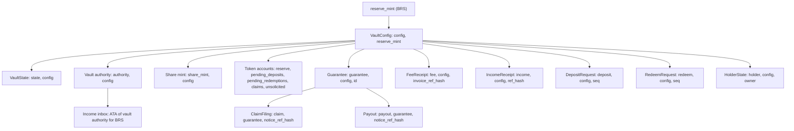

# Accounts

The account model of the `mutav` program for the devnet release: every PDA with its seeds and purpose, the token accounts, sizes and padding, and the fields carved for this release.

## Conventions

- **One reserve per mint.** `VaultConfig` is seeded by the reserve mint. Every other PDA includes the config address (or a record that does) in its seeds.
- **Header and padding.** Every program-owned account starts with `version: u8` and `bump: u8` and ends with a zeroed `_reserved: [u8; N]`. New fields are carved from the front of `_reserved`.
- **Fixed-size types only.** Statuses, legs, kinds and modes are `u8` constants, never Borsh enums. No `Option`, `Vec` or `String`. An unknown version or status fails closed with `UnsupportedVersion`.
- **Sizes include the 8-byte discriminator** and are pinned with a compile-time assertion per account.
- **Seed strings are distinct and fixed.** A seed-collision test covers every seed prefix.
- **Large accounts are boxed** in instruction contexts.

## How the PDAs derive

## Reserve-level accounts

| Account | Seeds | Purpose |
|---|---|---|
| `VaultConfig` | `["config", reserve_mint]` | Configuration, roles, caps, accounts, allowlist root. One per reserve. Written only by admin instructions, `pause`, `revoke_operator` and the role-acceptance instructions |
| `VaultState` | `["state", config]` | Internal accounting, queue sequences and heads, the claim window, lifetime counters, mode and halt flags |
| Vault authority | `["authority", config]` | No data. Owns every reserve token account. Mint and freeze authority of the share mint. Never passed into an adapter CPI |
| Share mint | `["share_mint", config]` | Classic SPL Token mint, 6 decimals. Shares are minted only in `claim_shares`. The freeze authority is unused in v1 and kept so share-transfer restrictions stay possible without a new mint |

## Token accounts

All are ordinary SPL Token accounts owned by the vault authority. Money is split across separate accounts so that one issuer freeze does not trap every balance.

| Account | Seeds | Mint | Holds | Tracked by |
|---|---|---|---|---|
| `reserve` | `["reserve", config]` | BRS | The liquid reserve | `VaultState.brs_balance` |
| `pending_deposits` | `["pending_deposits", config]` | BRS | Escrowed deposit requests | `pending_deposits_total` |
| `pending_redemptions` | `["pending_redemptions", config]` | Share | Escrowed redeem requests | `pending_redeem_shares` |
| `claims` | `["claims", config]` | BRS | BRS owed to holders on filled redemptions | `claimable_assets_total` |
| `unsolicited` | `["unsolicited", config]` (proposed seed, pinned at implementation) | BRS | Untracked BRS that arrived outside a booking path. The only account money can be returned from | Not tracked |
| Income inbox | Associated token account of the vault authority for BRS | BRS | The issuer's monthly revenue share, waiting for `sweep_income` | Not tracked |

Untracked balances never count toward stable assets, NAV or coverage. `reserve` is a PDA, not the associated token account, so a mistaken send to the vault authority's "wallet" address lands in the income inbox, outside NAV.

## Record accounts

| Account | Seeds | Created by | Closed? | Purpose |
|---|---|---|---|---|
| `Guarantee` | `["guarantee", config, id]` | `register_guarantee` | Never | One per lease. Covers, paid and provisioned amounts per leg, status. A second registration of the same `id` fails at creation |
| `ClaimFiling` | `["claim", guarantee, notice_ref_hash]` | `file_claim` | Never | One filed claim: its leg, provision, approval and status. A withdrawn filing can be filed again under the same notice |
| `Payout` | `["payout", guarantee, notice_ref_hash]` | `pay_claim` | Never | One paid notice. Makes payment idempotent per notice. Holds the Pix settlement hash |
| `FeeReceipt` | `["fee", config, invoice_ref_hash]` | `contribute_fees` | Never | Each agency bill's guarantee fee counts once |
| `IncomeReceipt` | `["income", config, ref_hash]` | `sweep_income`, `book_unsolicited`, backstop booking | Never | Each booked inflow counts once. Carries a `kind` |
| `DepositRequest` | `["deposit", config, seq]`, `seq` as `u64` little-endian | `request_deposit` | On claim, cancel or refund; rent to the owner | One FIFO deposit request |
| `RedeemRequest` | `["redeem", config, seq]`, `seq` as `u64` little-endian | `request_redeem` | When nothing is left to claim; rent to the owner | One FIFO redeem request |
| `HolderState` | `["holder", config, owner]` | `request_deposit` or `claim_shares` | Never | One per investor wallet |

**Removed for this release.** The `AgencyExposure` account, its `["agency", config, agency_id]` seed and the per-agency cap are gone. `Guarantee.agency_id` stays, and the app derives per-agency figures from guarantee accounts. A future concentration limit would return as a new account.

**Reserved seed prefixes**, never used by a v1 PDA: `exit_buffer`, `exit_limit`, `instant_exit`, `adapter_state`. The `notice` prefix is held for the planned `ClaimNotice`.

## Sizes and padding

Target sizes for the devnet release, discriminator included. The remaining `_reserved` after each carve is pinned by the layout test.

| Account | Size (bytes) | Padding budget | Notes |
|---|---|---|---|
| `VaultConfig` | 2,756 | 512 | Carves for this release listed below. The payout-SLA bytes return to padding |
| `VaultState` | 480 | 256 | Carves the sliding claim window. The late-payout counter's bytes return to padding. Phase 2 later carves `InstantExitState` (88 bytes) |
| `Guarantee` | 377 | 192 | Grown from 64 before the freeze, to hold the fiança-lifecycle fields (88 bytes) without migration |
| `ClaimFiling` | 220 | 128 | Grown from 64. Carves `approved_amount`. Room for the lifecycle fields (49 bytes) |
| `Payout` | 293 | 128 | Grown from 64. The `late` byte returns to padding. Room for the lifecycle fields (74 bytes) |
| `FeeReceipt` | 138 | 64 | |
| `IncomeReceipt` | 142 | 64 | Carves `kind: u8` |
| `DepositRequest` | 155 | 64 | |
| `RedeemRequest` | 181 | 64 | Partial-fill fields are real fields from v1, because live request accounts cannot be migrated |
| `HolderState` | 114 | 64 | |
| Nested `Caps`, `PriceParams`, `ExitParams` | inside `VaultConfig` | 32 each | `Caps` carves `stress_buffer` |
| Nested `AdapterEntry` (×8) | inside `VaultConfig` | 64 each | Carves `max_share_bps`; 62 bytes left. All zero in v1 |

Padding is sized at about three times the known later need. Rent is about 6,960 lamports per byte.

## Fields carved for the devnet release

Every carved field reads zero as the safe default on an account written before the carve.

| Account | Field | Type | Meaning | Zero means |
|---|---|---|---|---|
| `VaultConfig` | `pending_operator`, `pending_pauser` | `Pubkey` ×2 | Keys proposed by `propose_roles` | No pending handover |
| `VaultConfig` | `pending_admin` | `Pubkey` | Admin proposed by `propose_admin` | No pending handover |
| `VaultConfig` | `pending_expires_at` | `i64` | When pending keys stop being acceptable | No pending handover |
| `VaultConfig` | `guardians` | `[Pubkey; 3]` | Pause-only keys | Empty slot |
| `VaultConfig` | `max_reinstate_age` | `i64` | How long after a close `reinstate_guarantee` is allowed. Admin-set | Set at deploy |
| `VaultConfig` | `max_queue_wait_secs` | `i64` | Wait after which the exit fallback may fill the head redemption | Off. Shipped at 0 |
| `Caps` | `stress_buffer` | `u64` | R$ amount added on top of provisions in `coverage_required` | No stress term |
| `VaultState` | Previous claim-window bucket (about 16 bytes) | `u64`, `i64` | The previous bucket's paid total and what is needed to weight it | Empty previous bucket |
| `ClaimFiling` | `approved_amount` | `u64` | Amount the admin approved with `approve_claim` | No approval; the per-call cap applies |
| `ClaimFiling` | `status` constant `WITHDRAWN = 2` | `u8` | Filing withdrawn by the operator | n/a (new constant) |
| `IncomeReceipt` | `kind` | `u8` | `NORA_STATEMENT` (0), `UNSOLICITED`, `BACKSTOP` | An issuer statement |

Names, types and offsets of the carved fields are pinned by the layout test at implementation. The types above are indicative.

Fields **removed** before the freeze: `VaultConfig.payout_sla_secs`, `VaultState.late_payouts`, `Payout.late`, `Caps.max_cover_per_agency`. The `ConfigUpdated` field id of the payout SLA is never reused.

## Account contents

### `VaultConfig`

| Group | Fields |
|---|---|
| Header | `version`, `bump`, `authority_bump` |
| Roles | `admin`, `operator`, `pauser`, the pending keys, `guardians` |
| Mint | `reserve_mint`, `reserve_token_program`, `reserve_decimals` (immutable after `initialize`; 6), `share_mint` |
| Economics | `coverage_ratio_bps` (c, at least 1,000), `fee_take_bps` (at most 3,000), `income_take_bps` (0) |
| Accounts | `payments_account`, `treasury_account` (distinct, owned by none of the vault authority, the operator or the capital wallet), `mutav_capital_wallet` |
| Allowlist | `investor_allowlist_root` |
| Limits | `caps`: `max_tvl`, `max_cover_per_guarantee`, `max_claim_per_call`, `max_claim_per_period`, `claim_period_secs` (at most 90 days), `max_allocated_bps` (stored complement of `min_settlement_bps`), `min_request`, `max_request`, `min_fill_assets`, `stress_buffer` |
| Price | `price`: bounds for a later priced asset, and `max_nav_move_bps` for the NAV-move guard |
| Flags | `paused`, `feature_flags` (0 in v1), `max_reinstate_age`, `max_queue_wait_secs` |
| Later | `adapters` (8 entries, all zero), `exit` (phase-2 instant exit, all zero) |

### `VaultState`

| Group | Fields |
|---|---|
| Health | `mode` (`NORMAL` 0, `UNDER_COVERED` 1), `stable_assets`, `remaining_cover_total`, `coverage_required`, `provisions`, `fulfil_halted`, `last_refresh_ts`, `last_refresh_slot` |
| Tracked balances | `brs_balance`, `pending_deposits_total`, `pending_redeem_shares`, `claimable_assets_total`, `tesouro_units` and price fields (0 in v1) |
| Shares and NAV | `shares_outstanding`, `nav_per_share`, `inflow_nav` |
| Queues | `next_deposit_seq`, `deposit_head`, `next_redeem_seq`, `redeem_head` |
| Claim window | `claim_period_start`, `claim_period_paid`, the previous bucket |
| Counters | `active_guarantees`, `fees_in_total`, `fee_take_total`, `claims_paid_total`, `income_total`, `income_take_total` |
| Later | `buffer_earmark` (always 0), `pending_notices` (0 until the claim-notice gate is built) |

### `Guarantee`

`id`, `agency_id`, `refs_hash`; `rent`; `default_multiplier_bps`, `exit_multiplier_bps` (display only); `default_cover`, `exit_cover` (absolute leg sub-limits, never changed after registration); `default_paid`, `exit_paid`; `provision_default`, `provision_exit`; `open_claims`; `status` (`ACTIVE` 0, `CLOSED` 1); `registered_at`, `closed_at` (0 while active, reset by `reinstate_guarantee`).

### `ClaimFiling` and `Payout`

- `ClaimFiling`: `guarantee`, `leg` (`DEFAULT` 0 for rent arrears, `EXIT` 1 for end-of-occupation debts), `notice_ref_hash`, `provision`, `filed_at`, `status` (`FILED` 0, `PAID` 1, `WITHDRAWN` 2), `approved_amount`.
- `Payout`: `guarantee`, `leg`, `amount`, `notice_ref_hash`, `payments_account` at payment time, `status` (`PENDING` 0, `SETTLED` 1), `paid_at`, `settled_at`, `pix_e2e_hash`.

### Requests and holders

- `DepositRequest`: `owner`, `seq`, `assets`, `shares_out`, `nav_at_fulfil`, `requested_at`, `fulfilled_at`, `status` (`PENDING` 0, `FULFILLED` 1).
- `RedeemRequest`: `owner`, `seq`, `shares_requested` (immutable), `shares_remaining`, `shares_filled`, `assets_filled`, `assets_claimable`, `fill_count`, `last_fill_nav`, `requested_at`, `last_fill_at`, `status` (`PENDING` 0, `PARTIALLY_FILLED` 1, `FILLED` 2, `CANCELLED` 3).
- `HolderState`: `owner`, `last_shares_in_ts`.

### Receipts

- `FeeReceipt`: `invoice_ref_hash`, `gross`, `take` (to treasury), `net` (to reserve), `slot`.
- `IncomeReceipt`: `income_ref_hash`, `period` (`YYYYMM`), `gross`, `take`, `net`, `slot`, `kind`.

## Sources

- [Protocol specification, §3 Accounts](../spec.md#3-accounts) and [§14.2 Padding and version](../spec.md#142-padding-and-version)
- [Litepaper, Appendix F Accounts (PDAs)](../litepaper.md#f-accounts-pdas)
- Seeds and sizes: [`programs/mutav/src/constants.rs`](../../programs/mutav/src/constants.rs)
- Structs: [`programs/mutav/src/state/`](../../programs/mutav/src/state/)
- Layout fixtures: [`tests/fixtures/layout/`](../../tests/fixtures/layout/)
- Decision log of 2026-10-09 and 2026-10-10 (internal notes, to be published as the pending ADRs below)
- [Solana documentation: program-derived addresses](https://solana.com/docs/core/pda)
- [Anchor account space](https://www.anchor-lang.com/docs/references/space)

## Decisions

- [ADR 0004: NAV computed on-chain with internal accounting](../decisions/0004-onchain-nav-internal-accounting.md)
- [ADR 0006: Per-lease coverage stored as absolute amounts](../decisions/0006-per-lease-absolute-coverage.md)
- [ADR 0011: Upgrade readiness](../decisions/0011-phase2-instant-exit-and-upgrade-readiness.md)
- [ADR 0012: Guarantees aligned with a limited fiança onerosa](../decisions/0012-fianca-aligned-guarantee-lifecycle.md)
- [ADR 0017: BRS income intake](../decisions/0017-brs-income-intake.md)
- [ADR 0018: BRS-only pilot reserve](../decisions/0018-brs-only-pilot-reserve.md)
- Pending ADR: 0019 v1 layout for the devnet release (padding, SLA removal, agency-cap removal, carved fields)
- Pending ADR: Operator/admin separation and operator-compromise recovery
- Pending ADR: Claims: approval, amendment, exact payment, sliding window
- Pending ADR: Coverage: stress buffer and underwater reserve (amends 0016)
- Pending ADR: Unsolicited money and backstop contributions
- Pending ADR: Exit fallback
