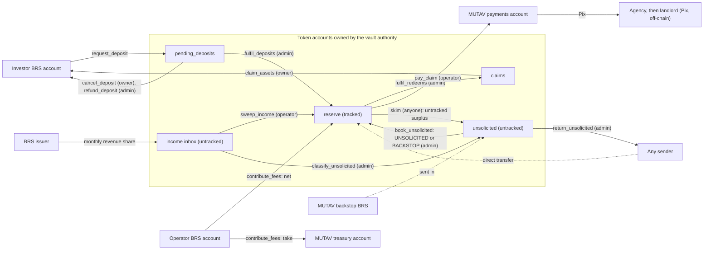
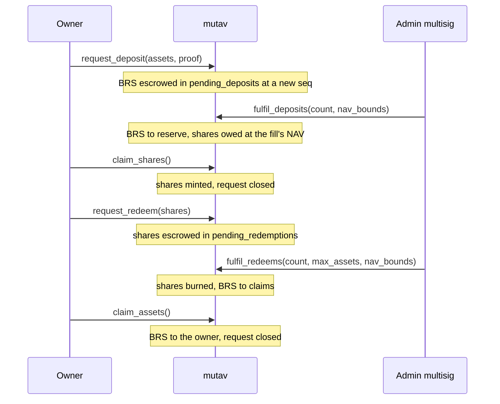
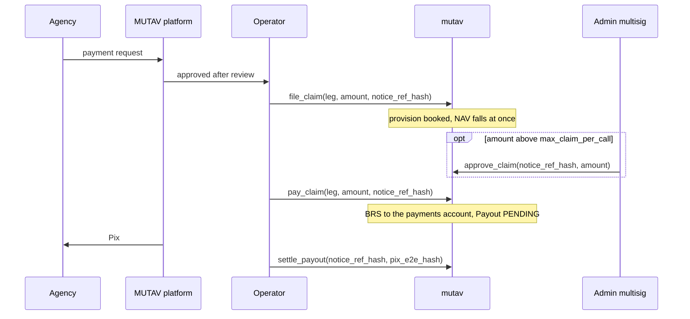

# Money flows

Every path by which money enters and leaves the reserve, who signs it, and what it does to the reserve's numbers.

## Principles

- **Internal accounting.** The program tracks the amounts it moved, not raw token balances. Money that arrives outside a booking path changes nothing until an authorised instruction books it. A direct transfer cannot move NAV.
- **Separate flows never mix.** Guarantee fees, MUTAV's take, MUTAV's own capital and issuer income each have their own instruction, account and counter.
- **Fixed exits.** BRS leaves the reserve's accounts only to: MUTAV's payments account, the treasury (fee take), the `claims` escrow and on to its owner, the owner of a returned pending deposit, or, from `unsolicited` only, the original sender.
- **No inflow while no shares exist.** Guarantee fees, issuer income and bookings that raise NAV without minting shares are refused while `shares_outstanding == 0`. The money waits until the first deposit is filled.

## Overview



Shares move separately: `claim_shares` mints shares to the owner, `request_redeem` escrows them in `pending_redemptions`, a redemption fill burns them, and `cancel_redeem` returns unfilled shares.

## Inflows

| Flow | Instruction | Signer | From | To | Shares minted |
|---|---|---|---|---|---|
| Capital deposit | `request_deposit`, then `fulfil_deposits` | Investor, then admin | Investor's BRS account | `pending_deposits`, then `reserve` | Yes, at the fill's NAV |
| Guarantee fee | `contribute_fees(invoice_ref_hash, amount)` | Operator | Operator's BRS account | Net to `reserve`, take to the treasury | Never |
| Issuer income | `sweep_income(income_ref_hash, period, amount)` | Operator | Income inbox | Net to `reserve`, take (0) to the treasury | Never |
| Unsolicited money | `skim` or `classify_unsolicited`, then `book_unsolicited` | Anyone or admin, then admin | Any tracked account or the inbox | `unsolicited`, then `reserve` | Never |
| Backstop | Backstop booking (route pinned at implementation) | Admin | MUTAV's BRS | `reserve` | Never |

## Outflows

| Flow | Instruction | Signer | From | To | Bound |
|---|---|---|---|---|---|
| Claim payment | `pay_claim` | Operator | `reserve` | MUTAV payments account | Exactly the filing's provision. Per-call cap unless approved. Sliding 30-day cap. Liquid BRS. Never solvency-gated |
| Redemption | `fulfil_redeems`, then `claim_assets` | Admin, then owner | `reserve` | `claims`, then the owner | Free capital and liquid budget. Strict FIFO. Inside the admin's `nav_bounds` |
| Fee take | `contribute_fees` | Operator | Operator's BRS account | Treasury | `fee_take_bps` (at most 30%) |
| Deposit cancel or refund | `cancel_deposit`, `refund_deposit` | Owner, admin | `pending_deposits` | The owner's own BRS account | The escrowed amount |
| Return to sender | `return_unsolicited` | Admin | `unsolicited` | The source of the original transfer | Screened; within the runbook window |
| Foreign tokens | `return_foreign` | Admin | A foreign token account, or SOL above rent-exempt | A destination | Classic SPL tokens only. Never BRS, the share mint or an adapter mint |

## Capital: deposits and redemptions



- **Entry is allowlisted, exit is open.** A wallet that holds shares can redeem without a proof.
- **Strict FIFO, whole fills.** The admin fills up to 8 requests per call from the queue head. In the devnet release a head that does not fit the budget stops the batch. Partial fills are deferred.
- **Pricing.** Each fill is priced at the NAV of that fill and rounds in the reserve's favour. Every deposit fill must mint more than 0 shares.
- **Gates.** Redemption fills need normal mode and fit within free capital and liquid BRS. Deposit fills are allowed in under-coverage (they recapitalise the reserve), stop at `max_tvl`, and are refused with `ReserveUnderwater` when net assets are 0 while shares are outstanding, so new money never pays for old losses.
- **Fills carry `nav_bounds`**, a NAV range composed by `/admin` with the proposal.
- **Dust.** A full exit (all of the owner's shares) may be below `min_request`. A head redemption worth 0 fills as a 0-asset fill: the shares are burned and the request closes.
- **Refunds.** A pending deposit from a wallet removed from the allowlist is returned by `refund_deposit`, which unblocks the queue.

MUTAV's own capital uses the same queues and gets no special treatment.

## Guarantee fees

The tenant pays the guarantee fee with the rent. The agency pays MUTAV one consolidated bill a month. MUTAV converts the BRL it receives 1:1 into BRS, and the operator calls `contribute_fees` once per paid bill.

```text
take = floor(amount × fee_take_bps / 10,000)   → treasury account
net  = amount − take                           → reserve   (NAV rises, no shares minted)
```

- A `FeeReceipt` keyed by `invoice_ref_hash` makes each bill count once.
- The treasury account is MUTAV's operating revenue. It is never part of the reserve or NAV.
- Fees are never paused and never solvency-gated. They are refused while no shares exist.
- Devnet `fee_take_bps`: 2,000 (20%). Program maximum: 3,000.

## Issuer income

The BRS issuer shares revenue with its partners. MUTAV gives the issuer the reserve's **income inbox** address (the vault authority's associated token account for BRS). Money in the inbox counts toward nothing.

Each month the operator sweeps exactly the amount on the issuer's statement with `sweep_income`:

- net to `reserve`, take to the treasury (`income_take_bps` is 0, and the program caps it at 0 until the take is decided);
- an `IncomeReceipt` with `kind = NORA_STATEMENT` makes each statement count once;
- post-transfer balance deltas are checked; a frozen inbox or reserve is refused;
- refused while no shares exist.

Issuer income is shown as issuer partnership revenue, apart from guarantee fees. It never enters `fees_in_total` or the coverage math. Income is never returned to a sender.

## Claim payments



- **Destination.** Claim payments go only to MUTAV's payments account. MUTAV pays the agency by Pix, and the agency pays the landlord.
- **Exact payment.** `pay_claim` pays exactly the filing's provision. To settle for less, the operator first lowers the filing with `amend_claim`, then pays.
- **Caps.** Up to `max_claim_per_call` (R$10k on devnet) the operator pays alone. Above it, the admin approves the exact amount with `approve_claim`. Every payment, approved or not, counts toward `max_claim_per_period` over a sliding 30-day window (R$20k on devnet). For an unusually large claim, the admin raises the period cap in the same proposal and lowers it again later.
- **Never solvency-gated.** Only the filing checks, the cover bound, the caps, liquid BRS or a frozen reserve can stop a payment. Pause does not.
- **Bank-first.** MUTAV may pay the agency from its own bank account first. The reserve then reimburses the payments account through `pay_claim`. This keeps payments on time while an approval waits on the time lock, or while a frozen reserve blocks the payment.
- **No SLA in the program.** Payment deadlines live in the MUTAV platform. `settle_payout` only records the Pix settlement hash.

## Unsolicited money and backstop

Money can arrive outside a booking path: BRS sent straight into a tracked account, or BRS in the income inbox that is not on an issuer statement. No money gets stuck, and unsolicited money is the reserve admin's responsibility.

| Step | Instruction | Signer | Effect |
|---|---|---|---|
| Sweep aside | `skim(account)` on `reserve`, `pending_deposits` or `claims` | Anyone (run by a monitor) | Moves balance minus tracked total into `unsolicited`. Books nothing. Refuses frozen accounts |
| Classify | `classify_unsolicited(amount)` | Admin | Moves non-statement money from the income inbox into `unsolicited`, after the operator has swept the statements |
| Book | `book_unsolicited(amount, ref_hash)` | Admin | Moves BRS from `unsolicited` into `reserve` as an inflow. `IncomeReceipt.kind = UNSOLICITED`. NAV rises; no shares minted |
| Return | `return_unsolicited(amount, destination, ref_hash)` | Admin | Returns BRS from `unsolicited` to the source of the original transfer, after screening. The transaction signature is committed in `ref_hash` |
| Foreign | `return_foreign(mint, amount, destination)` | Admin | Returns classic SPL tokens of other mints, and SOL above rent-exempt |
| Surplus shares | Return or burn (instruction pinned at implementation) | Admin | Handles shares sent into `pending_redemptions` outside a request |

Runbook: screen the source. If the sender is identified and asks within 30 days, return it. Otherwise book it. Dust below R$10 is booked directly. The app never lists foreign tokens.

**Backstop.** When the reserve is underwater (net assets 0 with shares outstanding), deposit fills stop. MUTAV recapitalises by sending its own BRS, which the admin books with `kind = BACKSTOP`. No shares are minted, so the money raises NAV for every holder. The exact booking instruction is pinned at implementation.

## What moves the numbers

| Event | `brs_balance` | Provisions | NAV per share | Shares |
|---|---|---|---|---|
| Deposit fill | Rises by the assets | | Unchanged (priced at NAV) | Rise |
| Redemption fill | Falls by the assets | | Unchanged (priced at NAV) | Fall (burned) |
| Guarantee fee | Rises by the net | | Rises | |
| Issuer income | Rises by the net | | Rises | |
| Booked unsolicited or backstop | Rises | | Rises | |
| `file_claim` | | Rise | Falls | |
| `amend_claim` | | Rise or fall | Moves the other way | |
| `withdraw_claim` | | Fall | Rises back | |
| `pay_claim` | Falls by the payment | Fall by the same amount | Unchanged | |
| `skim`, direct transfer | | | Unchanged | |

Every fee, income and booking inflow is also counted in `inflow_nav`, so the NAV-move guard does not mistake a verified inflow for a price shock.

## Sources

- [Protocol specification, §2.1 Three separate MUTAV money flows](../spec.md#21-three-separate-mutav-money-flows-adr-0009-and-issuer-income-adr-0017), [§4 Invariants and formulas](../spec.md#4-invariants-and-formulas), [§5.4 Claims and payouts](../spec.md#54-claims-and-payouts-operator), [§5.5 Investor capital](../spec.md#55-investor-capital-async)
- [Litepaper, §7 Guarantee lifecycle](../litepaper.md#7-guarantee-lifecycle) and [§9 Capital flows](../litepaper.md#9-capital-flows)
- Instructions: [`contribute_fees.rs`](../../programs/mutav/src/instructions/operator/contribute_fees.rs), [`sweep_income.rs`](../../programs/mutav/src/instructions/operator/sweep_income.rs), [`pay_claim.rs`](../../programs/mutav/src/instructions/operator/pay_claim.rs), [`fulfil_deposits.rs`](../../programs/mutav/src/instructions/capital/fulfil_deposits.rs), [`fulfil_redeems.rs`](../../programs/mutav/src/instructions/capital/fulfil_redeems.rs)
- Solvency math: [`programs/mutav/src/solvency.rs`](../../programs/mutav/src/solvency.rs)
- Decision log of 2026-10-09 and 2026-10-10 (internal notes, to be published as the pending ADRs below)

## Decisions

- [ADR 0003: Claim payments operated by MUTAV through a whitelisted payments account](../decisions/0003-payments-operated-by-mutav.md)
- [ADR 0004: NAV computed on-chain with internal accounting](../decisions/0004-onchain-nav-internal-accounting.md)
- [ADR 0005: Solvency gate scope](../decisions/0005-solvency-gate-scope.md)
- [ADR 0007: MUTAV's fee take goes directly to the treasury](../decisions/0007-fee-take-direct-to-treasury.md)
- [ADR 0008: One capital flow for everyone; FIFO deposits; pause never blocks claims](../decisions/0008-uniform-capital-flow-and-pause-scope.md)
- [ADR 0009: Separate MUTAV money flows](../decisions/0009-separate-mutav-money-flows.md)
- [ADR 0010: Partial fills at the head of the redemption queue](../decisions/0010-partial-fills-at-queue-head.md) (deferred; the devnet release fills whole requests)
- [ADR 0014: `pay_claim` bound with concurrent filings on one leg](../decisions/0014-pay-claim-bound-with-concurrent-filings.md)
- [ADR 0017: BRS income intake](../decisions/0017-brs-income-intake.md)
- Pending ADR: Claims: approval, amendment, exact payment, sliding window
- Pending ADR: Coverage: stress buffer and underwater reserve (amends 0016)
- Pending ADR: Exit rights (open exit, full exit below minimum, refunds)
- Pending ADR: Unsolicited money and backstop contributions
