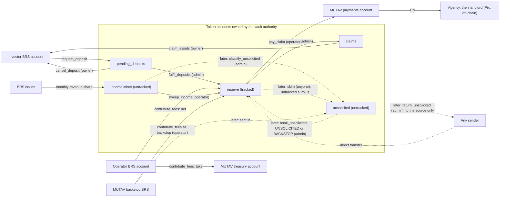
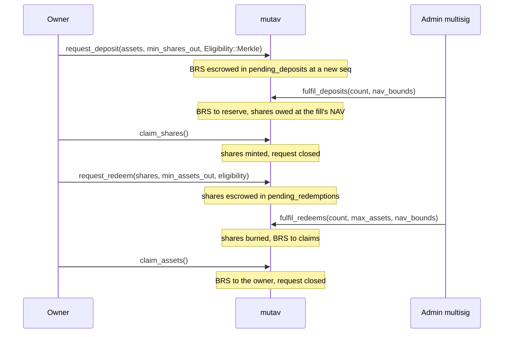
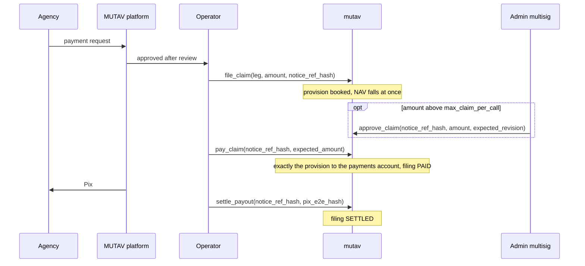

# Money flows

Every path by which money enters and leaves the reserve, who signs it, and what it does to the reserve's numbers. Dashed edges and rows marked *later* are decided but not in the devnet binary.

## Principles

- **Internal accounting.** The program tracks the amounts it moved, not raw token balances. Money that arrives outside a booking path changes nothing until an authorised instruction books it. A direct transfer cannot move NAV.
- **Separate flows never mix.** Guarantee fees, MUTAV's take, MUTAV's own capital and issuer income each have their own instruction, account and counter.
- **Fixed exits.** BRS leaves the reserve's accounts only to: MUTAV's payments account, the `claims` escrow and on to its owner, or the owner of a cancelled pending deposit. A later upgrade adds a return from `unsolicited` to the original sender. The guarantee-fee take goes from the operator's account straight to the treasury and never enters the reserve.
- **No inflow while no shares exist.** `contribute_fees` and `sweep_income` are refused with `NoSharesOutstanding` while `shares_outstanding == 0` (the later `book_unsolicited` follows the same rule). Fees wait with the operator and income waits in the inbox until the first deposit is filled ([ADR 0023](../decisions/0023-capital-flows-and-exit-rights.md), [ADR 0029](../decisions/0029-claims-and-capital-rules-in-the-program.md)).

## Overview



Shares move separately: `claim_shares` mints shares to the owner, `request_redeem` escrows them in `pending_redemptions`, a redemption fill burns them, and `cancel_redeem` returns unfilled shares.

## Inflows

| Flow | Instruction | Signer | From | To | Shares minted |
|---|---|---|---|---|---|
| Capital deposit | `request_deposit`, then `fulfil_deposits` | Investor, then admin | Investor's BRS account | `pending_deposits`, then `reserve` | Yes, at the fill's NAV |
| Guarantee fee | `contribute_fees(invoice_ref_hash, amount)` | Operator | Operator's BRS account | Net to `reserve`, take to the treasury | Never |
| Issuer income | `sweep_income(income_ref_hash, period, amount)` | Operator | Income inbox | The whole amount to `reserve`; no take | Never |
| Unsolicited money (*later*) | `skim` or `classify_unsolicited`, then `book_unsolicited(kind = UNSOLICITED)` | Anyone or admin, then admin | `reserve`, `pending_deposits`, `claims` or the inbox | `unsolicited`, then `reserve` | Never |
| Backstop (interim) | `contribute_fees` with a fresh `invoice_ref_hash` recorded as a backstop | Operator | MUTAV's BRS | Net to `reserve`, take to the treasury | Never |
| Backstop (*later*) | MUTAV sends BRS to `unsolicited`, then `book_unsolicited(kind = BACKSTOP)` | Admin | MUTAV's BRS | `unsolicited`, then `reserve` | Never |

## Outflows

| Flow | Instruction | Signer | From | To | Bound |
|---|---|---|---|---|---|
| Claim payment | `pay_claim` | Operator | `reserve` | MUTAV payments account | Exactly the filing's provision. Per-call cap (admin approval above it). Rolling 31-day window cap. Liquid BRS. Never coverage-gated |
| Redemption | `fulfil_redeems`, then `claim_assets` | Admin, then owner | `reserve` | `claims`, then the owner | Free capital and liquid budget. Strict FIFO. Inside the admin's `nav_bounds` |
| Fee take | `contribute_fees` | Operator | Operator's BRS account | Treasury | `fee_take_bps` (at most 30%) |
| Deposit cancel | `cancel_deposit` | Owner (the admin's cancel parks the request and moves nothing) | `pending_deposits` | The owner's own BRS associated token account | The escrowed amount |
| Redemption cancel (shares) | `cancel_redeem` | Owner (the admin's cancel parks the request and moves nothing) | `pending_redemptions` | The owner's share account | The escrowed shares |
| Return to sender (*later*) | `return_unsolicited(source, amount, destination, ref_hash)` | Admin | `unsolicited` (BRS), surplus in `pending_redemptions` (shares), a foreign token account, or lamports above rent-exempt | The source of the original transfer | Screened; within the runbook window. Never from the income inbox or `reserve`. Foreign tokens: classic SPL Token mints only, never BRS, the share mint or an adapter mint |

## Capital: deposits and redemptions



- **Entry is allowlisted, exit is open.** A wallet that holds shares can redeem without a proof: the allowlist is checked only when the debited share account is empty ([ADR 0029](../decisions/0029-claims-and-capital-rules-in-the-program.md)).
- **Strict FIFO, whole fills.** The admin fills up to 8 requests per call from the queue head (`count` from 1 to 8). In the devnet release a head that does not fit the budget stops the batch. Partial fills come in the first upgrade after the hackathon.
- **Pricing.** Each fill is priced at the NAV of that fill and rounds in the reserve's favour. Every deposit fill must mint more than 0 shares.
- **Gates.** Redemption fills need normal mode and fit within free capital and liquid BRS. Deposit fills are allowed in under-coverage (they recapitalise the reserve) and stop at `max_tvl`. Both fills are refused with `ReserveUnderwater` while the reserve is underwater: NAV per share below the smallest published unit while shares are outstanding (`net_assets × NAV_SCALE < shares_outstanding`). New money never pays for old losses. An empty reserve (no shares) is not underwater.
- **Fills carry `nav_bounds`**, a NAV range composed by `/admin` with the proposal. A fill outside it is refused with `NavOutOfBounds`. The NAV-move guard also runs inline at the start of both fills and refuses with `FulfilHalted`. The inline refusal does not latch; the next `refresh` (anyone) latches `fulfil_halted`.
- **Small exits.** A redemption worth from `min_request` to `max_request` at the current NAV is normal; 0 or above `max_request` is refused. Below `min_request` only an exit of the balance is accepted: it debits the owner's canonical share associated token account, leaves a remainder worth less than `min_request`, and is worth at least `max(1, min_request / 10)` (R$100 at the R$1,000 minimum). A smaller balance waits; it stays transferable and valued at NAV.
- **Zero-value heads.** A head redemption worth 0 BRS at fill time is never filled. `fulfil_redeems` stops with the head untouched (`RequestTooSmall` if nothing was filled); the owner cancels it, or the admin parks it.
- **Baseline.** The deposit fill that mints the first shares seeds the NAV-move guard's baseline; the redemption fill that burns the last shares clears it.
- **Admin parks, owner collects.** The admin can take a pending deposit from a wallet removed from the allowlist, an unreachable owner, or a stuck redemption head out of the queue with `cancel_deposit` or `cancel_redeem`. The admin's cancel parks the request (`CANCELLED`) and moves nothing: the escrow stays in `pending_deposits` or `pending_redemptions` and in the tracked totals, fills and `advance_queue_head` move past it, and only the owner collects it later with the same instruction. The owner cannot make the park fail, and a parked request has no expiry ([ADR 0030](../decisions/0030-admin-cancel-parks-the-request.md)).

MUTAV's own capital uses the same queues and gets no special treatment.

## Guarantee fees

The tenant pays the guarantee fee with the rent. The agency pays MUTAV one consolidated bill a month. MUTAV converts the BRL it receives 1:1 into BRS, and the operator calls `contribute_fees` once per paid bill.

```text
take = floor(amount × fee_take_bps / 10,000)   → treasury account
net  = amount − take                           → reserve   (NAV rises, no shares minted)
```

- An `IncomeReceipt` with `kind = FEE`, keyed by `invoice_ref_hash` under its own `fee` seed prefix, makes each bill count once.
- The treasury account is MUTAV's operating revenue. It is never part of the reserve or NAV.
- Fees are never paused and never coverage-gated. They are refused with `NoSharesOutstanding` while no shares exist.
- Devnet `fee_take_bps`: 2,000 (20%). Program maximum: 3,000.

## Issuer income

The BRS issuer shares revenue with its partners. MUTAV gives the issuer the reserve's **income inbox** address (the vault authority's associated token account for BRS). Money in the inbox counts toward nothing.

Each month the operator sweeps exactly the amount on the issuer's statement with `sweep_income`:

- the whole amount goes to `reserve`; v1 has no take on issuer income, and a take returns as a carve only when one is decided (spec §12 Q47, see [open questions](../meta/open-questions.md#open-questions));
- an `IncomeReceipt` with `kind = ISSUER_STATEMENT` makes each statement count once;
- post-transfer balance deltas are checked; a frozen inbox or reserve is refused;
- refused with `NoSharesOutstanding` while no shares exist.

Issuer income is shown as issuer partnership revenue, apart from guarantee fees. It never enters `fees_in_total` or the coverage math. Income is never returned to a sender.

## Claim payments



- **Destination.** Claim payments go only to MUTAV's payments account. MUTAV pays the agency by Pix, and the agency pays the landlord.
- **Exact payment.** `pay_claim` pays exactly the filing's provision and refuses unless `expected_amount` equals it. To settle for less, the operator will first lower the filing with `amend_claim` (Wave 2), then pay.
- **Caps.** Up to `max_claim_per_call` (R$15k on devnet and the pilot) the operator pays alone. Above it, the admin approves the exact amount with `approve_claim`, and `pay_claim` then pays it. Every payment, approved ones included, counts toward `max_claim_per_period` over a rolling window of 31 UTC-day buckets (R$20k on devnet and the pilot), so no 31-day span exceeds the cap. For an unusually large claim, the admin raises the period cap in the same proposal and lowers it again later.
- **Never coverage-gated.** Only the filing checks, the cover bound, the caps, liquid BRS or a frozen reserve can stop a payment. Pause does not.
- **Bank-first.** MUTAV may pay the agency from its own bank account first. The reserve then reimburses the payments account through `pay_claim`. This keeps payments on time while an approval waits on the time lock, or while a frozen reserve blocks the payment.
- **No service level in the program.** Payment deadlines live in the MUTAV platform. `settle_payout` only records the Pix settlement hash on the filing.

## Unsolicited money and backstop

Money can arrive outside a booking path: BRS sent straight into a tracked account, or BRS in the income inbox that is not on an issuer statement. Such money changes nothing in this release. The instructions below are decided ([ADR 0024](../decisions/0024-unsolicited-money-and-backstop.md)) and arrive in a later upgrade; only the `unsolicited` account exists today. Unsolicited money is the reserve admin's responsibility.

| Step | Instruction | Signer | Effect |
|---|---|---|---|
| Sweep aside | `skim(account)` on `reserve`, `pending_deposits` or `claims` (*later*) | Anyone (run by a monitor) | Moves balance minus tracked total into `unsolicited`. Books nothing. Refuses frozen accounts |
| Classify | `classify_unsolicited(amount)` | Admin | Moves non-statement money from the income inbox into `unsolicited`, after the operator has swept the statements |
| Book | `book_unsolicited(amount, ref_hash, kind)` | Admin | Moves BRS from `unsolicited` into `reserve` as an inflow. `kind` is `UNSOLICITED` or `BACKSTOP`, written on an `IncomeReceipt`. NAV rises; no shares minted. Refused while no shares exist |
| Return | `return_unsolicited(source, amount, destination, ref_hash)` | Admin | `Source` is `Unsolicited` (BRS from the PDA), `PendingRedemptionsSurplus` (shares above escrowed requests), `Foreign` (classic SPL Token mints other than BRS, the share mint or an adapter mint) or `Lamports` (SOL above rent-exempt). Only to the source of the original transfer, after screening; `ref_hash` commits to its transaction signature |
| Burn surplus shares | Burn of surplus escrowed shares | Admin | Instead of returning them, burns shares in `pending_redemptions` above escrowed requests. NAV per share rises for every holder |

None of these instructions is pause-gated. Runbook: screen the source. If the sender is identified and asks within 30 days, return it. Otherwise book it. Dust below R$10 is booked directly; the threshold lives in the runbook and the app, not on-chain. The app never lists foreign tokens.

**Backstop.** When the reserve is underwater (NAV per share below the smallest published unit with shares outstanding), both fills stop; `cancel_deposit` and `cancel_redeem` stay open. Until `book_unsolicited` ships, MUTAV recapitalises with `contribute_fees` (operator), under a fresh `invoice_ref_hash` recorded as a backstop. No shares are minted, so the money raises NAV for every holder. The fee take applies, so MUTAV sends `needed / (1 − take)`. Later the admin books it with `book_unsolicited(kind = BACKSTOP)`.

## What moves the numbers

| Event | `brs_balance` | Provisions | NAV per share | Shares |
|---|---|---|---|---|
| Deposit fill | Rises by the assets | | Unchanged (priced at NAV) | Rise |
| Redemption fill | Falls by the assets | | Unchanged (priced at NAV) | Fall (burned) |
| Guarantee fee | Rises by the net | | Rises | |
| Issuer income | Rises by the net | | Rises | |
| Booked unsolicited or backstop (*later*) | Rises | | Rises | |
| `file_claim` | | Rise | Falls | |
| `amend_claim` (*Wave 2*) | | Rise or fall | Moves the other way | |
| `amend_claim` to 0, withdraw (*Wave 2*) | | Fall | Rises back | |
| `pay_claim` | Falls by the payment | Fall by the same amount | Unchanged | |
| Direct transfer, later `skim` | | | Unchanged | |

Every fee, income and booking inflow is also counted in `inflow_nav`, so the NAV-move guard does not mistake a verified inflow for a price shock.

## Sources

- [Protocol specification, §2.1 Three separate MUTAV money flows](../spec.md#21-three-separate-mutav-money-flows-adr-0009-and-issuer-income-adr-0017), [§4 Invariants and formulas](../spec.md#4-invariants-and-formulas), [§5.4 Claims and payouts](../spec.md#54-claims-and-payouts-operator), [§5.5 Investor capital](../spec.md#55-investor-capital-async)
- [Litepaper, §7 Guarantee lifecycle](../litepaper.md#7-guarantee-lifecycle) and [§9 Capital flows](../litepaper.md#9-capital-flows)
- Instructions: [`contribute_fees.rs`](../../programs/mutav/src/instructions/operator/contribute_fees.rs), [`sweep_income.rs`](../../programs/mutav/src/instructions/operator/sweep_income.rs), [`pay_claim.rs`](../../programs/mutav/src/instructions/operator/pay_claim.rs), [`fulfil_deposits.rs`](../../programs/mutav/src/instructions/capital/fulfil_deposits.rs), [`fulfil_redeems.rs`](../../programs/mutav/src/instructions/capital/fulfil_redeems.rs)
- Coverage math: [`programs/mutav/src/coverage.rs`](../../programs/mutav/src/coverage.rs)

## Decisions

- [ADR 0003: Claim payments operated by MUTAV through a whitelisted payments account](../decisions/0003-payments-operated-by-mutav.md)
- [ADR 0004: NAV computed on-chain with internal accounting](../decisions/0004-onchain-nav-internal-accounting.md)
- [ADR 0005: Coverage gate scope](../decisions/0005-solvency-gate-scope.md)
- [ADR 0007: MUTAV's fee take goes directly to the treasury](../decisions/0007-fee-take-direct-to-treasury.md)
- [ADR 0008: One capital flow for everyone; FIFO deposits; pause never blocks claims](../decisions/0008-uniform-capital-flow-and-pause-scope.md)
- [ADR 0009: Separate MUTAV money flows](../decisions/0009-separate-mutav-money-flows.md)
- [ADR 0010: Partial fills at the head of the redemption queue](../decisions/0010-partial-fills-at-queue-head.md) (deferred; the devnet release fills whole requests)
- [ADR 0014: `pay_claim` bound with concurrent filings on one leg](../decisions/0014-pay-claim-bound-with-concurrent-filings.md)
- [ADR 0017: BRS income intake](../decisions/0017-brs-income-intake.md)
- [ADR 0021: Claims: approval, amendment and exact payment](../decisions/0021-claims-approval-amendment-exact-payment.md)
- [ADR 0022: Coverage: stress buffer and underwater reserve](../decisions/0022-coverage-stress-buffer-underwater-reserve.md) (amends 0016)
- [ADR 0023: Capital flows and exit rights](../decisions/0023-capital-flows-and-exit-rights.md)
- [ADR 0024: Unsolicited money and backstop contributions](../decisions/0024-unsolicited-money-and-backstop.md)
- [ADR 0026: Program simplification for the freeze](../decisions/0026-program-simplification-for-the-freeze.md)
- [ADR 0028: Pilot parameters](../decisions/0028-pilot-parameters.md)
- [ADR 0029: Claims and capital rules in the program](../decisions/0029-claims-and-capital-rules-in-the-program.md)
- [ADR 0030: The admin's cancel parks the request](../decisions/0030-admin-cancel-parks-the-request.md)
