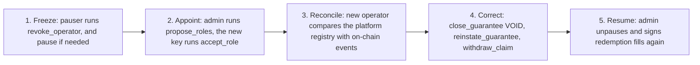

# Roles and trust

Who can sign what, who can move money, and what each key can cost if it is lost. The core rule is the separation of the operator from the reserve admin.

## The separation

| | Operator | Reserve admin |
|---|---|---|
| Owns | Contracts, agencies and the whole guarantee and claim cycle | The reserve's financial health and security |
| Acts through | Registry actions: register, close, reinstate, file, amend, withdraw, pay, settle; booking guarantee fees and issuer income | Ceilings: caps, coverage ratio, stress buffer, roles, accounts, allowlist, capital fills, approval of claim amounts above the per-call cap, unsolicited money, unpause |
| Judges | Whether a lease is valid and whether a claim is owed. It holds the information | How much may leave the reserve. It does not judge contracts |
| Key | A hot key | A Squads v4 multisig vault with a time lock |

The two may be separate companies. In the devnet release MUTAV holds both.

Two properties follow from the split:

1. **The most a compromised operator can cost is the admin-set claim caps.** Claim payments are the only irreversible operator action, and they land in MUTAV's own payments account.
2. **Every other registry change is reversible by another operator action.** No money gets stuck, and no admin rollback instruction is needed.

## Roles

| Role | Key and custody | Powers | Time lock |
|---|---|---|---|
| **Upgrade authority** | Upgrade multisig vault (Squads v4) | Program upgrades, IDL writes, `initialize` | Long: 1 hour on devnet, 7 days on a real-money pilot |
| **Reserve admin** (`VaultConfig.admin`) | Admin multisig vault (Squads v4), same members as the upgrade multisig | Configuration, roles, guardians, accounts, allowlist, capital fills, `approve_claim`, `refund_deposit`, unsolicited money, `unpause`, `clear_fulfil_halt` | Short: 5 minutes on devnet, 24 hours on a real-money pilot |
| **Operator** (`VaultConfig.operator`) | Hot key. On devnet, a keypair generated at deploy and used by hand from `/operator`. Later a KMS-backed key in `mutav-app` | The guarantee and claim cycle, guarantee fees, issuer income | None. Bounded by caps |
| **Pauser** (`VaultConfig.pauser`) | A separate key generated at deploy | `pause`, `revoke_operator` | None |
| **Guardians** | Up to 3 keys set by the admin. One on devnet, held by a founder, separate from the pauser | `pause` only | None |
| **Investor** | Own wallet. Entry needs an allowlist Merkle proof (KYC off-chain) | Own requests: deposit, redeem, cancel, claim | None |
| **Anyone** | Any signer | Cranks that need no judgment: `refresh`, `advance_queue_heads`, `skim` | None |

Roles are distinct keys. The operator and pauser can never equal the admin or each other. The default public key is never accepted as a guardian. The share mint's mint and freeze authority, and the owner of every reserve token account, is the vault authority PDA: no person holds it.

On devnet the two multisigs are 2-of-2 with two devnet wallets standing in for the founders. Hardware-wallet keys replace them before real money.

## Instruction matrix

"Under pause" says whether the instruction runs while the reserve is paused. "Solvency gate" says whether it is refused when the reserve cannot back it.

| Instruction | Signer | Under pause | Solvency gate |
|---|---|---|---|
| `initialize` | Upgrade authority | n/a | No |
| `set_config`, `set_payments_account`, `set_allowlist_root`, `set_guardians` | Admin | Runs | No |
| `propose_roles` / `accept_role` | Admin proposes; the proposed key accepts | Runs | No |
| `propose_admin` / `accept_admin` | Admin proposes; the proposed admin accepts | Runs | No |
| `pause` | Pauser, guardian or admin | n/a | No |
| `unpause`, `clear_fulfil_halt` | Admin | Runs | No |
| `revoke_operator` | Pauser or admin | Runs | No |
| `register_guarantee` | Operator | **Stopped** | **Yes** |
| `close_guarantee(reason)` | Operator | Runs | No |
| `reinstate_guarantee` | Operator | Runs | No, and no caps. Only within `max_reinstate_age` |
| `contribute_fees`, `sweep_income` | Operator | Runs | No. Refused while no shares exist |
| `file_claim`, `amend_claim`, `withdraw_claim` | Operator | Runs | Never |
| `approve_claim` | Admin | Runs | Never |
| `pay_claim`, `settle_payout` | Operator | Runs | Never |
| `request_deposit`, `request_redeem` | Investor | **Stopped** | No |
| `cancel_deposit`, `claim_shares`, `cancel_redeem`, `claim_assets` | Investor | Runs | No |
| `fulfil_deposits` | Admin | **Stopped** | No. Bound by the TVL cap and refused when the reserve is underwater |
| `fulfil_redeems` | Admin | **Stopped** | **Yes** |
| `refund_deposit` | Admin | Runs | No |
| `skim` | Anyone | Runs | No |
| `classify_unsolicited`, `book_unsolicited`, backstop booking, `return_unsolicited`, `return_foreign` | Admin | Runs | No |
| `refresh`, `advance_queue_heads` | Anyone | Runs | No |

**Pause scope.** Pause stops only capital flows (requests and fills) and new guarantees. It never stops a claim, never stops an owner from cancelling or collecting, and never stops admin configuration. Only the admin unpauses.

## Who can move money

Every path by which BRS or shares leave a program-owned account, and who signs it. See [Money flows](money-flows.md) for the full picture.

| From | To | Instruction | Signer | Bound |
|---|---|---|---|---|
| `reserve` | MUTAV payments account | `pay_claim` | Operator | Exactly the filing's provision. Per-call cap unless the admin approved that amount. Sliding 30-day cap. Liquid BRS |
| `reserve` | `claims` escrow | `fulfil_redeems` | Admin | Free capital, liquid budget, strict FIFO, inside the admin's `nav_bounds` |
| `claims` | Owner's BRS account | `claim_assets` | Owner | What the owner is owed |
| `pending_deposits` | `reserve` | `fulfil_deposits` | Admin | TVL cap, strict FIFO, inside `nav_bounds` |
| `pending_deposits` | Owner's own BRS account | `cancel_deposit` (owner), `refund_deposit` (admin) | Owner or admin | The escrowed amount, to the owner only |
| `pending_redemptions` | Owner's share account | `cancel_redeem` | Owner | Unfilled shares |
| Income inbox | `reserve` and treasury | `sweep_income` | Operator | The amount on one issuer statement. The take is 0 |
| Income inbox | `unsolicited` | `classify_unsolicited` | Admin | Money not on an issuer statement |
| `reserve`, `pending_deposits`, `claims` | `unsolicited` | `skim` | Anyone | Only the untracked surplus over the tracked total |
| `unsolicited` | `reserve` | `book_unsolicited`, backstop booking | Admin | Books an inflow; mints no shares |
| `unsolicited` | The original sender | `return_unsolicited` | Admin | Only to the source of the original transfer |
| Foreign tokens, excess SOL | A destination | `return_foreign` | Admin | Classic SPL tokens only; never BRS, the share mint or an adapter mint |

The operator cannot send reserve money anywhere except the payments account. The admin cannot send reserve BRS to an arbitrary address: it can only fill queues, refund an owner, or return unsolicited money to its source. Changing the payments account is an admin action and waits for the time lock.

## What each key can cost

| Key | What it can do alone | Bound |
|---|---|---|
| Operator | Pay claims into MUTAV's payments account. Every other action is a reversible registry change | The claim caps: R$10k per call and R$20k per sliding 30 days on devnet |
| Pauser | Pause capital flows and new guarantees. Revoke the operator, which stops claim payments until a new operator accepts | Time until the admin's handover proposal executes. MUTAV pays agencies from its bank in the meantime and is reimbursed after |
| Guardian | Pause capital flows and new guarantees | Only the admin unpauses |
| Admin multisig | Change ceilings, roles and accounts; fill queues | Every action waits for the time lock. Members can reject or cancel. The pauser and guardians can pause at any time |
| Upgrade multisig | Replace the program | The long time lock. The planned exit fallback lets holders leave inside that window (see [State machines](state-machines.md#exit-fallback)) |

### Reversible operator actions

| Operator action | Reversed by |
|---|---|
| `register_guarantee` | `close_guarantee(VOID)` (nothing paid, no open claim) |
| `close_guarantee` | `reinstate_guarantee`, within `max_reinstate_age` |
| `file_claim` | `withdraw_claim`. The notice can be filed again later |
| `amend_claim` | Another `amend_claim` |
| `pay_claim` | Not reversible. This is the accepted loss, bounded by the caps |

Two more design rules keep the loss within the caps:

- **Fills carry `nav_bounds`.** `fulfil_deposits` and `fulfil_redeems` take a minimum and maximum NAV that `/admin` composes when it builds the proposal. A fill outside that range is refused with `NavOutOfBounds`.
- **An above-cap payment needs an exact approval.** `approve_claim` binds one amount on one filing. Re-filing or amending a claim resets the approval.

## Operator-compromise recovery

Only the operator knows the contracts, so recovery uses ordinary operator actions. There is no admin rollback instruction and no time-window argument.

1. **Freeze.** The pauser runs `revoke_operator` at once, and `pause` if needed. `revoke_operator` also clears any pending role keys. Operator instructions fail from the next slot.
2. **Appoint.** The admin proposes a new operator with `propose_roles`, and the new key accepts with `accept_role`. If the pauser key is also suspect, it is replaced in the same proposal.
3. **Reconcile.** The new operator compares the platform's contract registry and audit trail with on-chain events since the compromise. The operator-activity feed in the app (registrations, closes, filings and payments in the last 24 hours) helps spot it early.
4. **Correct.** Fake registrations are closed with `close_guarantee(VOID)`. Wrongful closes are undone with `reinstate_guarantee`. Fake filings are withdrawn with `withdraw_claim`.
5. **Accept the bounded loss.** Claim payments made with the stolen key stay paid. They are bounded by the caps and sit in MUTAV's payments account.

The admin signs no redemption fill until reconciliation is done.

## Two-step handover

Every role change takes two signatures: one to propose, one from the new key to accept.

| Change | Propose | Accept |
|---|---|---|
| Operator or pauser | `propose_roles` (admin) stores `pending_operator` / `pending_pauser` | `accept_role`, signed by the pending key |
| Reserve admin | `propose_admin` (admin) stores `pending_admin` | `accept_admin`, signed by the pending admin |

- A typo can never appoint an address nobody controls.
- Pending keys expire (`pending_expires_at`).
- `revoke_operator` clears every pending role key.
- Revocation is immediate. Appointment is not.
- When rotating multisig members, the runbook keeps both old and new keys live until the handover completes.

## Investors

- **Entry is allowlisted.** `request_deposit` needs a Merkle proof against `investor_allowlist_root`. KYC happens off-chain.
- **Exit is open.** A wallet that already holds shares can request a redemption without a proof, so a wallet removed from the allowlist can still leave.
- **A full exit can be below the minimum request,** from the owner's canonical share account only.
- **A pending deposit from a de-listed wallet** is returned by the admin with `refund_deposit`, to the owner's own BRS account only.
- MUTAV's own capital wallet uses the same queues with no special treatment. Its address is disclosed in `VaultConfig.mutav_capital_wallet`.

## Trust outside the program

| Party | What the design trusts it with | How the trust is bounded |
|---|---|---|
| BRS issuer | BRS stays redeemable 1:1 for BRL. The issuer's freeze authority (a single key on devnet) can freeze any BRS account | Disclosed on `/reserve`. Reserve money is split across separate token accounts. A frozen reserve counts as 0 BRS in every solvency check. If a freeze blocks `pay_claim`, MUTAV pays from its bank and is reimbursed later. Mainnet freeze rules are to be confirmed with the issuer |
| MUTAV platform | The contract registry, claim review and the payment SLA | Commitments (`refs_hash`, `notice_ref_hash`, `pix_e2e_hash`) on-chain. The audit trail is kept where the operator key cannot write. Settlement attestation becomes required once operator and admin are separate companies |
| Squads v4 | Multisig execution and time locks | Both multisigs have no config authority, so members, threshold and time lock change only through their own proposals. The deploy scripts check the exact member set, threshold and owner program |

## Sources

- [Protocol specification, §2 Roles and keys](../spec.md#2-roles-and-keys) and [§5 Instructions](../spec.md#5-instructions)
- [Litepaper, §11 Security and governance](../litepaper.md#11-security-and-governance)
- Role checks: [`programs/mutav/src/instructions/admin/`](../../programs/mutav/src/instructions/admin/), [`operator/`](../../programs/mutav/src/instructions/operator/), [`capital/`](../../programs/mutav/src/instructions/capital/)
- Devnet deploy and checks: [`scripts/devnet/`](../../scripts/devnet/)
- Decision log of 2026-10-09 and 2026-10-10 (internal notes, to be published as the pending ADRs below)
- [Squads v4 documentation](https://docs.squads.so/)
- [OWASP Smart Contract Top 10](https://scs.owasp.org/sctop10/)

## Decisions

- [ADR 0003: Claim payments operated by MUTAV through a whitelisted payments account](../decisions/0003-payments-operated-by-mutav.md)
- [ADR 0005: Solvency gate scope](../decisions/0005-solvency-gate-scope.md)
- [ADR 0008: One capital flow for everyone; FIFO deposits; pause never blocks claims](../decisions/0008-uniform-capital-flow-and-pause-scope.md)
- [ADR 0009: Separate MUTAV money flows](../decisions/0009-separate-mutav-money-flows.md)
- [ADR 0015: Admin clear for the NAV-move halt](../decisions/0015-admin-clear-fulfil-halt.md)
- Pending ADR: Operator/admin separation and operator-compromise recovery
- Pending ADR: Claims: approval, amendment, exact payment, sliding window
- Pending ADR: Exit rights
- Pending ADR: Unsolicited money and backstop contributions
- Pending ADR: Exit fallback
