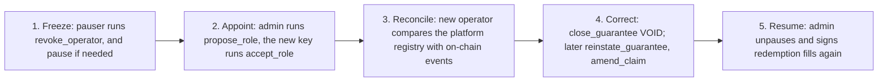

# Roles and trust

Who can sign what, who can move money, and what each key can cost if it is lost. The core rule is the separation of the operator from the reserve admin. Instructions marked *later* are decided but not in the devnet binary.

## The separation

| | Operator | Reserve admin |
|---|---|---|
| Owns | Contracts, agencies and the whole guarantee and claim cycle | The reserve's financial health and security |
| Acts through | Registry actions: register, close, file, pay, settle; booking guarantee fees and issuer income. Later: reinstate, amend (including withdraw), re-file | Ceilings: caps, coverage ratio, stress buffer, roles, accounts, allowlist, capital fills, cancels on an owner's behalf, unpause. Later: approval of claim amounts above the per-call cap, unsolicited money |
| Judges | Whether a lease is valid and whether a claim is owed. It holds the information | How much may leave the reserve. It does not judge contracts |
| Key | A hot key | A Squads v4 multisig vault with a time lock |

The two may be separate companies. In the devnet release MUTAV holds both.

Two properties follow from the split:

1. **The most a compromised operator can cost is the admin-set claim caps.** Claim payments are the only irreversible operator action, and they land in MUTAV's own payments account.
2. **Every other registry change is reversible by another operator action** once the Wave 2 claim instructions and `reinstate_guarantee` ship. In the devnet binary a fake registration is reversed with `close_guarantee(VOID)`; a fake filing stays provisioned (NAV falls, nothing is paid) until withdrawal ships. No money gets stuck, and no admin rollback instruction is needed.

## Roles

| Role | Key and custody | Powers | Time lock |
|---|---|---|---|
| **Upgrade authority** | Upgrade multisig vault (Squads v4) | Program upgrades, IDL writes, `initialize` | Long: 1 hour on devnet, 7 days on a real-money pilot |
| **Reserve admin** (`VaultConfig.admin`) | Admin multisig vault (Squads v4), same members as the upgrade multisig | Configuration, roles, guardians, `revoke_pauser`, accounts, allowlist, capital fills, `cancel_deposit` and `cancel_redeem` on an owner's behalf, `unpause`, `clear_fulfil_halt`. Later: `approve_claim`, unsolicited money | Short: 5 minutes on devnet, 24 hours on a real-money pilot |
| **Operator** (`VaultConfig.operator`) | Hot key. On devnet, a keypair generated at deploy and used by hand from `/operator`. Later a KMS-backed key in `mutav-app` | The guarantee and claim cycle, guarantee fees, issuer income | None. Bounded by caps |
| **Pauser** (`VaultConfig.pauser`) | A separate key generated at deploy. The admin removes it at once with `revoke_pauser` | `pause`, `revoke_operator` | None |
| **Guardians** | Up to 3 keys set by the admin in one step with `set_guardians`. One on devnet, held by a founder, separate from the pauser | `pause` only. With the first adapter upgrade, also the risk-reducing adapter actions of [ADR 0027](../decisions/0027-multi-asset-adapters-liquidity-floor-rebalancing.md) | None |
| **Investor** | Own wallet. Entry needs an allowlist Merkle proof (KYC off-chain) | Own requests: deposit, redeem, cancel, claim | None |
| **Anyone** | Any signer | Cranks that need no judgment: `refresh`, `advance_queue_head`. Later: `skim` | None |

Roles are distinct keys. The operator and pauser can never equal the admin or each other, and none can be the default public key; acceptance re-checks this. `set_guardians` treats the default key as an empty slot and refuses a repeated key or any current role key (admin, operator, pauser) with `RolesNotDistinct`. The share mint's mint and freeze authority, and the owner of every reserve token account, is the vault authority PDA: no person holds it.

On devnet the two multisigs are 2-of-2 with two devnet wallets standing in for the founders. Hardware-wallet keys replace them before real money.

## Instruction matrix

"Under pause" says whether the instruction runs while the reserve is paused. "Coverage gate" says whether it is refused when the reserve cannot back it.

| Instruction | Signer | Under pause | Coverage gate |
|---|---|---|---|
| `initialize` | Upgrade authority | n/a | No |
| `set_config`, `set_payments_account`, `set_treasury_account`, `set_allowlist_root`, `set_guardians` | Admin | Runs | No. `set_config` fails closed if the new coverage required cannot be computed |
| `propose_role` / `accept_role` | Admin proposes; the proposed key accepts | Runs | No |
| `propose_admin` / `accept_admin` | Admin proposes; the proposed admin accepts | Runs | No |
| `cancel_pending`, `revoke_pauser` | Admin | Runs | No |
| `pause` | Pauser, guardian or admin | n/a | No |
| `unpause`, `clear_fulfil_halt` | Admin | Runs | No |
| `revoke_operator` | Pauser or admin | Runs | No |
| `register_guarantee` | Operator | **Stopped** | **Yes** |
| `close_guarantee(id, reason)` | Operator | Runs | No |
| `reinstate_guarantee` (*later*) | Operator | Runs | No, and no caps. Only within `max_reinstate_age` |
| `contribute_fees`, `sweep_income` | Operator | Runs | No. Refused with `NoSharesOutstanding` while no shares exist |
| `file_claim` (later also `amend_claim`, `refile_claim`) | Operator | Runs | Never |
| `approve_claim` (*later*, Wave 2) | Admin | Runs | Never |
| `pay_claim`, `settle_payout` | Operator | Runs | Never |
| `request_deposit`, `request_redeem` | Investor | **Stopped** | No |
| `cancel_deposit`, `cancel_redeem` | Owner or admin | Runs | No |
| `claim_shares`, `claim_assets` | Investor | Runs | No |
| `fulfil_deposits` | Admin | **Stopped** | No. Bound by the TVL cap and `nav_bounds`, and refused when the reserve is underwater |
| `fulfil_redeems` | Admin | **Stopped** | **Yes**, and refused when the reserve is underwater |
| `skim` (*later*) | Anyone | Runs | No |
| `classify_unsolicited`, `book_unsolicited`, `return_unsolicited`, burn of surplus escrowed shares (*later*) | Admin | Runs | No. `book_unsolicited` is refused while no shares exist |
| `refresh`, `advance_queue_head` | Anyone | Runs | No |

**Pause scope.** Pause stops only capital flows (requests and fills) and new guarantees. It never stops a claim, never stops an owner from cancelling or collecting, and never stops admin configuration. Only the admin unpauses.

## Who can move money

Every path by which BRS or shares leave a program-owned account, and who signs it. See [Money flows](money-flows.md) for the full picture.

| From | To | Instruction | Signer | Bound |
|---|---|---|---|---|
| `reserve` | MUTAV payments account | `pay_claim` | Operator | Exactly the filing's provision (`expected_amount` must match). Per-call cap (above it, an admin approval, Wave 2). Rolling 31-day window cap. Liquid BRS |
| `reserve` | `claims` escrow | `fulfil_redeems` | Admin | Free capital, liquid budget, strict FIFO, inside the admin's `nav_bounds` |
| `claims` | Owner's BRS account | `claim_assets` | Owner | What the owner is owed |
| `pending_deposits` | `reserve` | `fulfil_deposits` | Admin | TVL cap, strict FIFO, inside `nav_bounds` |
| `pending_deposits` | Owner's own BRS account | `cancel_deposit` | Owner or admin | The escrowed amount, to the owner's associated token account only |
| `pending_redemptions` | Owner's share account | `cancel_redeem` | Owner or admin | Unfilled shares |
| Income inbox | `reserve` | `sweep_income` | Operator | The amount on one issuer statement, once per statement. No take on issuer income |
| Income inbox | `unsolicited` | `classify_unsolicited` (*later*) | Admin | Money not on an issuer statement |
| `reserve`, `pending_deposits`, `claims` | `unsolicited` | `skim` (*later*) | Anyone | Only the untracked surplus over the tracked total |
| `unsolicited` | `reserve` | `book_unsolicited(kind)` (*later*), kind `UNSOLICITED` or `BACKSTOP` | Admin | Books an inflow; mints no shares |
| `unsolicited`, surplus in `pending_redemptions`, foreign tokens, lamports above rent-exempt | The original sender | `return_unsolicited(source, ...)` (*later*) | Admin | Only to the source of the original transfer. Never from the income inbox or `reserve`. Foreign tokens: classic SPL Token mints only, never BRS, the share mint or an adapter mint |
| Surplus in `pending_redemptions` | Burned | Burn of surplus escrowed shares (*later*) | Admin | Only shares above escrowed requests |

The operator cannot send reserve money anywhere except the payments account. The admin cannot send reserve BRS to an arbitrary address: it can only fill queues and cancel a request back to its owner (later also return unsolicited money to its source). With the first adapter upgrade it also moves value between `reserve` and whitelisted adapters ([ADR 0027](../decisions/0027-multi-asset-adapters-liquidity-floor-rebalancing.md)). Changing the payments account is an admin action and waits for the time lock.

## What each key can cost

| Key | What it can do alone | Bound |
|---|---|---|
| Operator | Pay claims into MUTAV's payments account. Every other action is a reversible registry change | The claim caps: R$15k per call and R$20k per rolling 31-day window on devnet and the pilot ([ADR 0028](../decisions/0028-pilot-parameters.md)) |
| Pauser | Pause capital flows and new guarantees. Revoke the operator, which stops claim payments until a new operator accepts | Time until the admin's handover proposal executes. MUTAV pays agencies from its bank in the meantime and is reimbursed after |
| Guardian | Pause capital flows and new guarantees. With the first adapter upgrade, also disable or impair an adapter and sell an impaired position back into `reserve` | Only the admin unpauses. Undoing an adapter action goes through the admin time lock; an emergency sale is bounded by `max_emergency_discount_bps` |
| Admin multisig | Change ceilings, roles and accounts; fill queues | Every action waits for the time lock. Members can reject or cancel. The pauser and guardians can pause at any time |
| Upgrade multisig | Replace the program | The long time lock. Once the exit fallback ships and is on, the upgrade time lock is at least `max_queue_wait_secs`, so holders can leave inside that window (see [State machines](state-machines.md#exit-fallback)) |

### Reversible operator actions

| Operator action | Reversed by |
|---|---|
| `register_guarantee` | `close_guarantee(VOID)` (nothing paid, no open claim) |
| `close_guarantee` | `reinstate_guarantee` (*later*), within `max_reinstate_age` |
| `file_claim` | `amend_claim` with 0 (*later*, Wave 2), which sets the filing to `WITHDRAWN`. `refile_claim` can file the notice again later |
| `amend_claim` (*later*) | Another `amend_claim` |
| `pay_claim` | Not reversible. This is the accepted loss, bounded by the caps |

Two more design rules keep the loss within the caps:

- **Fills carry `nav_bounds`.** `fulfil_deposits` and `fulfil_redeems` take a minimum and maximum NAV that `/admin` composes when it builds the proposal. A fill outside that range is refused with `NavOutOfBounds`.
- **An above-cap payment needs an exact approval.** In the devnet binary the operator cannot pay above `max_claim_per_call` at all; MUTAV pays bank-first. With Wave 2, `approve_claim` binds one amount on one filing, and re-filing or amending a claim resets the approval.

## Operator-compromise recovery

Only the operator knows the contracts, so recovery uses ordinary operator actions. There is no admin rollback instruction and no time-window argument.

1. **Freeze.** The pauser runs `revoke_operator` at once, and `pause` if needed. `revoke_operator` also clears the pending operator key (not the pending pauser key). Operator instructions fail from the next slot. If the pauser key itself is suspect, the admin runs `revoke_pauser`, which removes it at once.
2. **Appoint.** The admin proposes a new operator with `propose_role(OPERATOR, key)`, and the new key accepts with `accept_role`. If the pauser key is also suspect, a new pauser is proposed in the same proposal with `propose_role(PAUSER, key)`.
3. **Reconcile.** The new operator compares the platform's contract registry and audit trail with on-chain events since the compromise. The operator-activity feed in the app (registrations, closes, filings and payments in the last 24 hours) helps spot it early.
4. **Correct.** Fake registrations are closed with `close_guarantee(VOID)`. Once Wave 2 ships, wrongful closes are undone with `reinstate_guarantee`, fake filings are withdrawn with `amend_claim` to 0, and wrong amounts are amended. Until then a fake filing stays provisioned and is never paid.
5. **Accept the bounded loss.** Claim payments made with the compromised key stay paid. They are bounded by the caps and sit in MUTAV's payments account.

The admin signs no redemption fill until reconciliation is done.

## Two-step handover

Every role change takes two signatures: one to propose, one from the new key to accept.

| Change | Propose | Accept |
|---|---|---|
| Operator or pauser | `propose_role(role, key)` (admin) stores `pending_operator` or `pending_pauser` with its own expiry | `accept_role(role)`, signed by the pending key |
| Reserve admin | `propose_admin(key)` (admin) stores `pending_admin` with its own expiry | `accept_admin`, signed by the pending admin |

- A typo can never appoint an address nobody controls.
- Each pending key expires 72 hours after the proposal (`pending_operator_expires_at`, `pending_pauser_expires_at`, `pending_admin_expires_at`). An accept after expiry fails with `HandoverExpired`; an accept with nothing pending fails with `NoPendingHandover`.
- `cancel_pending(role)` by the admin clears a pending handover of any of the three roles. A new proposal while an unexpired one waits fails with `HandoverPending`; the admin cancels first, in the same proposal if needed.
- `accept_admin` clears the pending operator and pauser handovers the old admin proposed.
- `revoke_operator` (pauser or admin) clears the operator and the pending operator key. `revoke_pauser` (admin) clears the pauser and the pending pauser key.
- An unknown role value fails.
- Guardians are the exception: the admin sets all three slots in one step with `set_guardians`, because a mistyped guardian key can only pause and costs nothing the admin cannot fix in the next proposal.
- Revocation is immediate. Appointment is not.
- When rotating multisig members, the runbook keeps both old and new keys live until the handover completes.

## Investors

- **Entry is allowlisted.** `request_deposit` needs `Eligibility::Merkle { proof }` against `investor_allowlist_root`. KYC happens off-chain. The KYC-attestation fields are carved in the config but unused.
- **Exit is open.** `request_redeem` checks the allowlist only when the debited share account is empty, so a holder, including a wallet removed from the allowlist, can always leave.
- **An exit of the balance can be below the minimum request,** from the owner's canonical share associated token account only, if it leaves a remainder worth less than `min_request` and is worth at least `max(1, min_request / 10)` ([ADR 0029](../decisions/0029-claims-and-capital-rules-in-the-program.md)).
- **A pending request from a de-listed or unreachable wallet** is returned by the admin with `cancel_deposit` or `cancel_redeem`, to the owner's own account only.
- MUTAV's own capital wallet uses the same queues with no special treatment. Its address is disclosed in `VaultConfig.mutav_capital_wallet`.

## Trust outside the program

| Party | What the design trusts it with | How the trust is bounded |
|---|---|---|
| BRS issuer | BRS stays redeemable 1:1 for BRL. The issuer's freeze authority (a single key on devnet) can freeze any BRS account | Disclosed on `/reserve`. Reserve money is split across separate token accounts. A frozen reserve counts as 0 BRS in every coverage check. If a freeze blocks `pay_claim`, MUTAV pays from its bank and is reimbursed later. Mainnet freeze rules are to be confirmed with the issuer |
| MUTAV platform | The contract registry, claim review and the payment service level | Commitments (`refs_hash`, `notice_ref_hash`, `pix_e2e_hash`) on-chain. The audit trail is kept where the operator key cannot write. Settlement attestation becomes required once operator and admin are separate companies |
| Squads v4 | Multisig execution and time locks | Both multisigs have no config authority, so members, threshold and time lock change only through their own proposals. The deploy scripts check the exact member set, threshold and owner program |

## Sources

- [Protocol specification, §2 Roles and keys](../spec.md#2-roles-and-keys) and [§5 Instructions](../spec.md#5-instructions)
- [Litepaper, §11 Security and governance](../litepaper.md#11-security-and-governance)
- Role checks: [`programs/mutav/src/instructions/admin/`](../../programs/mutav/src/instructions/admin/), [`operator/`](../../programs/mutav/src/instructions/operator/), [`capital/`](../../programs/mutav/src/instructions/capital/)
- Devnet deploy and checks: [`scripts/devnet/`](../../scripts/devnet/)
- [Squads v4 documentation](https://docs.squads.so/)
- [OWASP Smart Contract Top 10](https://scs.owasp.org/sctop10/)

## Decisions

- [ADR 0003: Claim payments operated by MUTAV through a whitelisted payments account](../decisions/0003-payments-operated-by-mutav.md)
- [ADR 0005: Coverage gate scope](../decisions/0005-solvency-gate-scope.md)
- [ADR 0008: One capital flow for everyone; FIFO deposits; pause never blocks claims](../decisions/0008-uniform-capital-flow-and-pause-scope.md)
- [ADR 0009: Separate MUTAV money flows](../decisions/0009-separate-mutav-money-flows.md)
- [ADR 0015: Admin clear for the NAV-move halt](../decisions/0015-admin-clear-fulfil-halt.md)
- [ADR 0020: Operator/admin separation and operator-compromise recovery](../decisions/0020-operator-admin-separation-and-recovery.md)
- [ADR 0021: Claims: approval, amendment and exact payment](../decisions/0021-claims-approval-amendment-exact-payment.md)
- [ADR 0023: Capital flows and exit rights](../decisions/0023-capital-flows-and-exit-rights.md)
- [ADR 0024: Unsolicited money and backstop contributions](../decisions/0024-unsolicited-money-and-backstop.md)
- [ADR 0025: Exit fallback: a cooldown exit after `max_queue_wait_secs`](../decisions/0025-exit-fallback-cooldown-exit.md)
- [ADR 0026: Program simplification for the freeze](../decisions/0026-program-simplification-for-the-freeze.md)
- [ADR 0028: Pilot parameters](../decisions/0028-pilot-parameters.md)
- [ADR 0029: Claims and capital rules in the program](../decisions/0029-claims-and-capital-rules-in-the-program.md)
- [ADR 0027: Multi-asset adapters, liquidity floor and rebalancing](../decisions/0027-multi-asset-adapters-liquidity-floor-rebalancing.md) (Proposed; the emergency path and who moves assets are decided)
