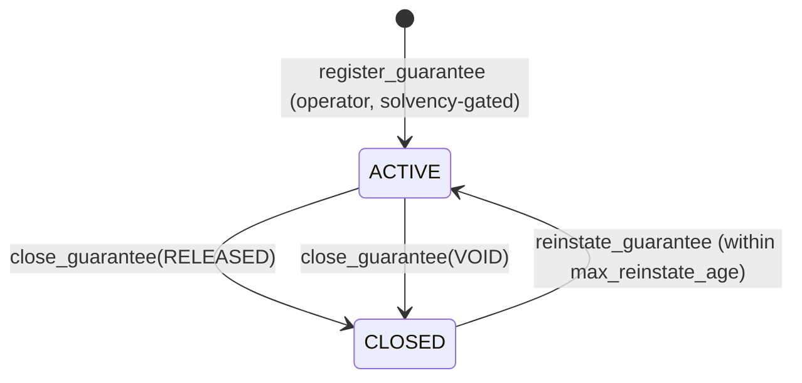
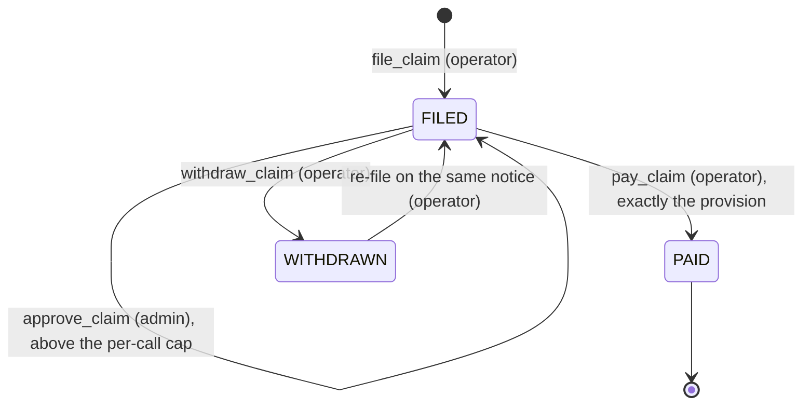
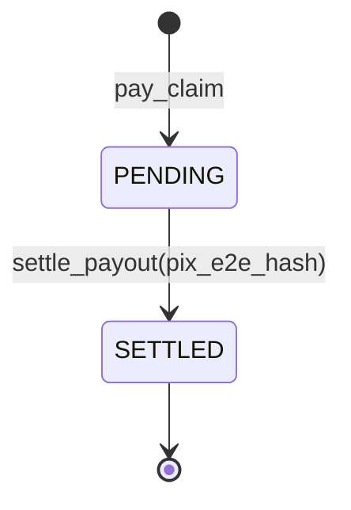
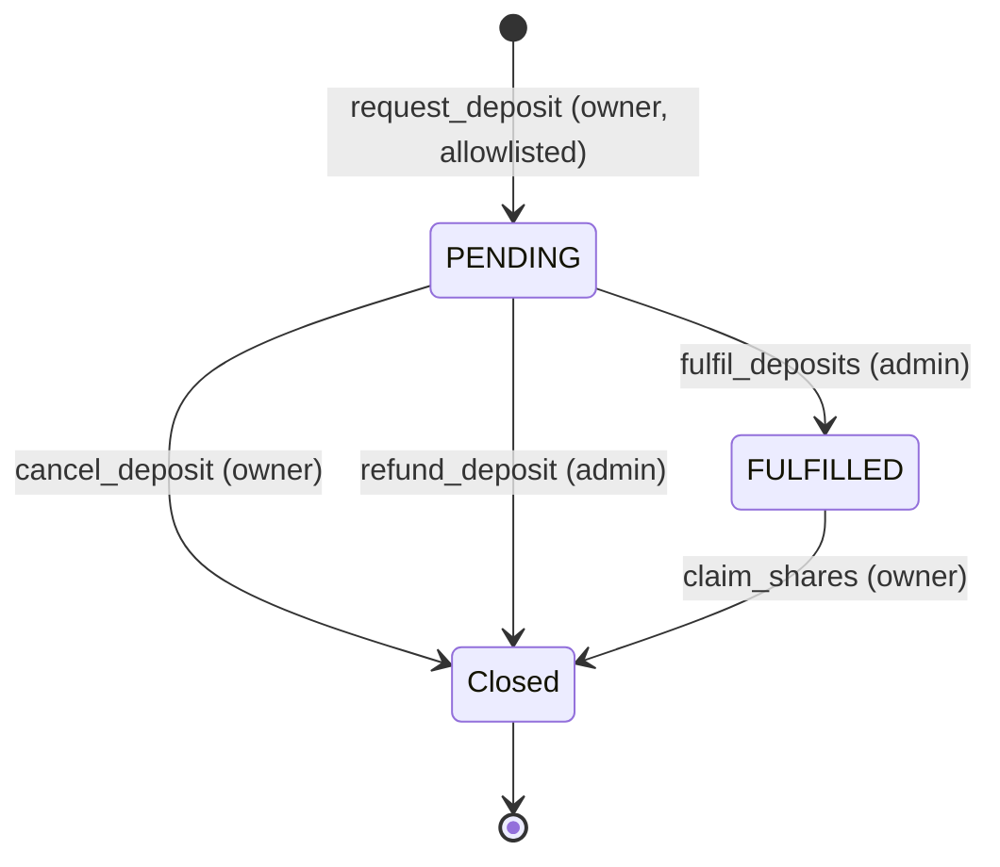
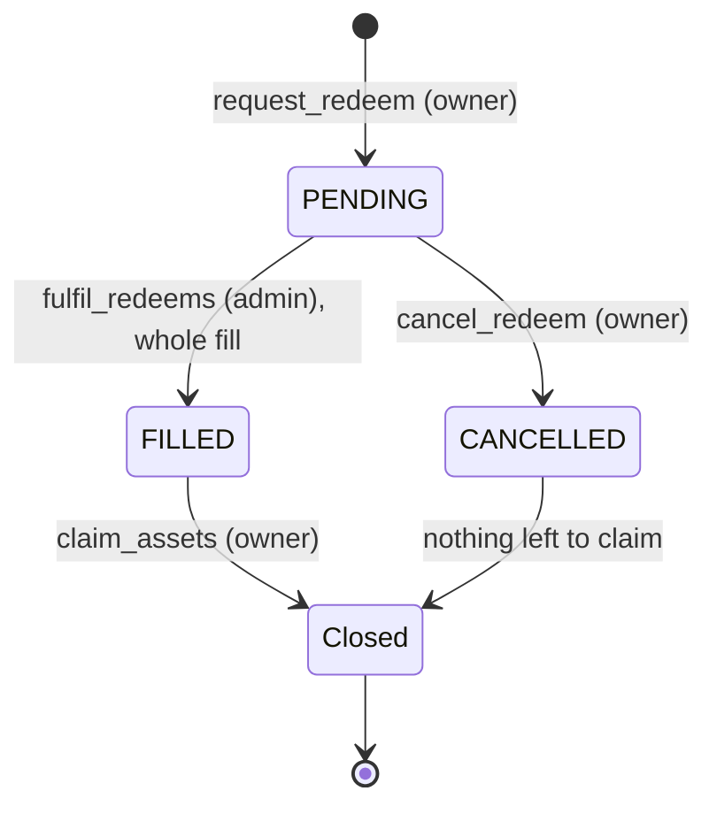
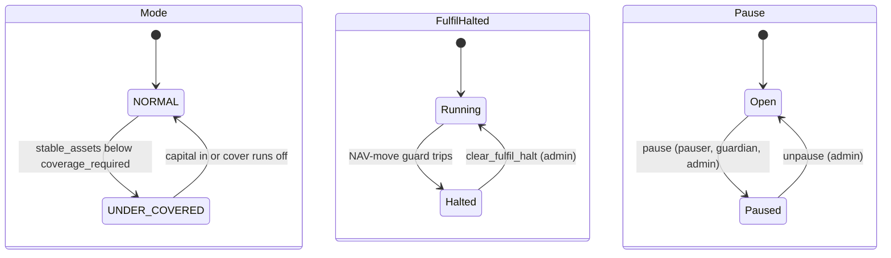

# State machines

The lifecycles the program enforces in the devnet release: guarantees, claim filings and payouts, deposit and redemption requests, and the reserve-level flags that gate them. Statuses are `u8` constants. An unknown value fails closed.

## Guarantee

One `Guarantee` account per lease. It is never closed, so the public claims history stays readable.



| Transition | Signer | Rules | Effect |
|---|---|---|---|
| Register | Operator | Not paused. Reserve not frozen. Rent and cover above 0. Cover within `max_cover_per_guarantee`. Normal mode. The new `coverage_required` fits in stable assets | `ACTIVE`. Cover added to `remaining_cover_total` at once |
| Close, `RELEASED` (0) | Operator | `ACTIVE`, no open claim | `CLOSED`, `closed_at = now`. Remaining cover released. Never solvency-gated |
| Close, `VOID` (1) | Operator | `ACTIVE`, no open claim, and nothing paid on either leg | Same as above. Used when the lease never took effect or the registration was an error |
| Reinstate | Operator | `CLOSED`, and the close is no older than `max_reinstate_age`. Not pause-gated, not solvency-gated, no caps | `ACTIVE`, `closed_at = 0`, remaining cover restored. Emits `GuaranteeReinstated` |

Covers never change after registration. The two legs are sub-limits of one fiança: `default_cover` for rent and charges in arrears, `exit_cover` for end-of-occupation debts.

The fuller fiança lifecycle (exoneration notice, keys returned, claims tail, exhaustion) is planned work. Its fields fit in the grown `Guarantee` padding, and its states arrive as new status constants.

## Claim filing

A `ClaimFiling` is keyed by guarantee and `notice_ref_hash`. Each filing is one event, such as one month's rent.



| Transition | Signer | Rules | Effect |
|---|---|---|---|
| File | Operator | Guarantee `ACTIVE`. Amount above 0 and within the leg's unprovisioned cover (`leg_cover − leg_paid − leg_provision`). Never paused, never solvency-gated | `FILED`. Provision booked on the leg and in `provisions`. `open_claims` rises. NAV falls at once |
| Amend | Operator | `FILED`. A higher amount stays within the leg's unprovisioned cover | Lower: the difference is released. Higher: more is booked. Any approval is reset. Emits `ClaimAmended { old, new }` |
| Approve | Admin | `FILED`. Needed only when the provision is above `max_claim_per_call` | Records `approved_amount`, binding that exact amount. The admin approves the amount leaving the reserve, not the claim's validity |
| Pay | Operator | `FILED`, leg matches. Pays exactly the provision. At or below `max_claim_per_call`, or equal to the approved amount. Sliding-window total plus the payment within `max_claim_per_period`. Destination is the payments account. Reserve not frozen and enough liquid BRS. No solvency, mode, pause or NAV-guard check | `PAID`. Leg paid rises, provision released, BRS to the payments account. Creates a `Payout` in `PENDING` |
| Withdraw | Operator | `FILED`. Not pause-gated, never solvency-gated | `WITHDRAWN`. Provision released, `open_claims` falls, coverage recomputed |
| Re-file | Operator | `WITHDRAWN` only | `FILED` again with a fresh `provision`, `filed_at` and `approved_amount = 0`. An old approval is never reused |

### Payout



`settle_payout` records the hash of the Pix end-to-end ID after MUTAV pays the agency. It is a settlement record only. The program has no payout deadline; the payment SLA lives in the MUTAV platform.

### The sliding claim window

The claim window keeps two buckets of length `claim_period_secs` (30 days on devnet): the current one and the previous one. A payment is checked against the current bucket plus the previous bucket weighted by the share of it still inside the trailing window, rounded up:

```text
estimate = prev_paid × (period − elapsed) / period + current_paid
require    estimate + amount ≤ max_claim_per_period
```

The goal is that no 30-day span exceeds `max_claim_per_period`, approved payments included.

## Deposit request



| Transition | Signer | Rules | Effect |
|---|---|---|---|
| Request | Owner | Not paused. Allowlist proof. `min_request ≤ assets ≤ max_request` | BRS escrowed in `pending_deposits` at the next `seq`. `HolderState` stamped |
| Fill | Admin | Not paused. Strict FIFO from `deposit_head`. Not halted; the NAV-move guard runs inline. NAV inside `nav_bounds`. Reserve not frozen. Within `max_tvl`. Not underwater. Mints more than 0 shares. Up to 8 per call | `FULFILLED`. BRS to `reserve`. `shares_out` owed at the fill's NAV |
| Claim | Owner | `FULFILLED`. Runs under pause | Shares minted to the owner's account. Request closed, rent to the owner |
| Cancel | Owner | `PENDING`. Runs under pause | BRS back to the owner. Request closed |
| Refund | Admin | `PENDING`. Runs under pause. Destination is the owner's own BRS account | BRS back to the owner. Request closed. The queue is unblocked |

## Redemption request



| Transition | Signer | Rules | Effect |
|---|---|---|---|
| Request | Owner, never a delegate | Not paused. Shares above 0. No proof needed for a wallet that already holds shares. Value at the current NAV within `min_request` and `max_request`, except that a full exit skips `min_request` (value above 0, from the owner's canonical share account only) | Shares escrowed in `pending_redemptions` at the next `seq` |
| Fill | Admin | Not paused. Strict FIFO from `redeem_head`. Normal mode. Not halted; the guard runs inline. NAV inside `nav_bounds`. Each fill within `min(max_assets − paid, free_capital, liquid_budget)`. Up to 8 per call. A call with no fill fails | `FILLED`. Escrowed shares burned, BRS moved to `claims` |
| 0-value head | Admin | The head request is worth 0 at the current NAV | Filled as a 0-asset fill: shares burned, request closed. The queue keeps moving |
| Claim | Owner | Something claimable. Runs under pause | BRS from `claims` to the owner. Request closed when nothing is left |
| Cancel | Owner | Unfilled shares remain. Runs under pause | Unfilled shares returned. `CANCELLED`, closed when nothing is left |

`PARTIALLY_FILLED` (1) exists in the layout for partial fills at the queue head. The devnet release fills whole requests only, so a head larger than the budget waits until free capital grows. The consoles show what a stuck head needs against what is available.

### Queue mechanics

- Each request is its own PDA at a monotonically increasing `seq`. A `seq` is never reused. Two requests sent at once may race for the same `seq`; the client retries with the next one.
- `advance_queue_heads(max)` (anyone) moves the heads over closed or empty requests and stops at the first live one. It moves no money.
- Cancels and claims never pause, so holders' money is never trapped by a pause.
- The owner's associated token account is created idempotently by `cancel_*`, `claim_*` and `refund_deposit`; the caller pays the rent.

### Exit fallback

After `max_queue_wait_secs`, anyone may fill the head redemption under the same rules as the admin: free capital, FIFO, the NAV guard, the claim-notice gate and pause. The field ships at 0 (off) in the devnet release. The fill path is built together with the claim-notice gate, before any outside capital. The upgrade time lock is kept at or above the wait, so holders can leave before an upgrade executes.

## Reserve-level flags

Three independent flags gate what the program accepts.



| Flag | Set by | Cleared by | Stops |
|---|---|---|---|
| `mode = UNDER_COVERED` | `refresh`, when stable assets are below `coverage_required` | `refresh`, once capital comes in or cover runs off | New guarantees and redemption fills. Never claim payments. Public label: "reserve below target; MUTAV backstop active" |
| `fulfil_halted` | `refresh`, when NAV moves beyond `max_nav_move_bps` net of verified inflows. Both fill instructions also evaluate the guard inline and refuse with `FulfilHalted` | `clear_fulfil_halt` (admin), which resets the guard baseline. Refused while the reserve is frozen | Deposit and redemption fills. The halt is sticky |
| `paused` | `pause` | `unpause` (admin) | Requests, fills and new guarantees only |

Coverage required is:

```text
coverage_required = max( ceil(c × remaining_cover_total),
                         provisions + min(stress_buffer, unprovisioned_cover) )
```

with c = 0.10 and `stress_buffer` = R$19k on devnet. A frozen reserve counts as 0 BRS in every solvency computation that reads it. Devnet keeps `max_nav_move_bps` at 10,000 so a claim against a small demo reserve does not halt fills; the guard is proven in tests and is lowered for a real pilot.

## Sources

- [Protocol specification, §3.5.1 Guarantee lifecycle](../spec.md#351-lifecycle), [§5.4 Claims and payouts](../spec.md#54-claims-and-payouts-operator), [§5.5 Investor capital](../spec.md#55-investor-capital-async), [§6 Under-coverage mode](../spec.md#6-under-coverage-mode), [§8 Caps](../spec.md#8-caps)
- [Litepaper, §7 Guarantee lifecycle](../litepaper.md#7-guarantee-lifecycle) and [§9 Capital flows](../litepaper.md#9-capital-flows)
- Status constants: [`programs/mutav/src/constants.rs`](../../programs/mutav/src/constants.rs)
- Structs: [`state/guarantee.rs`](../../programs/mutav/src/state/guarantee.rs), [`state/claim.rs`](../../programs/mutav/src/state/claim.rs), [`state/payout.rs`](../../programs/mutav/src/state/payout.rs), [`state/request.rs`](../../programs/mutav/src/state/request.rs)
- Decision log of 2026-10-09 and 2026-10-10 (internal notes, to be published as the pending ADRs below)

## Decisions

- [ADR 0005: Solvency gate scope](../decisions/0005-solvency-gate-scope.md)
- [ADR 0008: One capital flow for everyone; FIFO deposits; pause never blocks claims](../decisions/0008-uniform-capital-flow-and-pause-scope.md)
- [ADR 0010: Partial fills at the head of the redemption queue](../decisions/0010-partial-fills-at-queue-head.md) (deferred in the devnet release)
- [ADR 0012: Guarantees aligned with a limited fiança onerosa](../decisions/0012-fianca-aligned-guarantee-lifecycle.md)
- [ADR 0014: `pay_claim` bound with concurrent filings on one leg](../decisions/0014-pay-claim-bound-with-concurrent-filings.md)
- [ADR 0015: Admin clear for the NAV-move halt](../decisions/0015-admin-clear-fulfil-halt.md)
- [ADR 0016: Coverage ratio below 1.0](../decisions/0016-coverage-ratio-below-one.md)
- Pending ADR: Operator/admin separation and operator-compromise recovery
- Pending ADR: Claims: approval, amendment, exact payment, sliding window
- Pending ADR: Coverage: stress buffer and underwater reserve (amends 0016)
- Pending ADR: Exit rights (open exit, full exit below minimum, refunds)
- Pending ADR: Exit fallback
