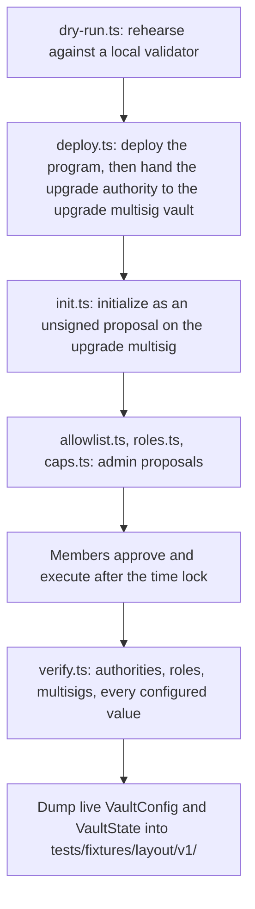
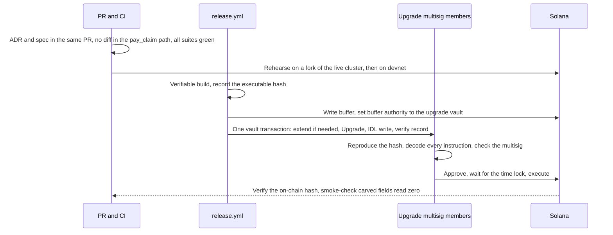

# Upgrades and layout

How the program changes after the devnet deploy: who can upgrade it, how long each change waits, which account changes are allowed, and how a release moves from a tagged commit to an executed upgrade.

## Two multisigs

Authority is split across two Squads v4 multisigs with the same members.

| Multisig | Holds | Time lock: devnet | Time lock: real-money pilot |
|---|---|---|---|
| **Admin multisig** | `VaultConfig.admin`: configuration, roles, fills, approvals, unsolicited money, unpause | 5 minutes | 24 hours |
| **Upgrade multisig** | The program upgrade authority, the IDL, `initialize` | 1 hour | 7 days |

Why two:

- Day-to-day admin work (filling queues, approving an above-cap claim amount) needs a short wait.
- Replacing the program needs a long wait, so holders and observers can react before it executes.
- The exit fallback ties the two together: the upgrade time lock is kept at or above `max_queue_wait_secs`, so a holder can leave through the fallback before an upgrade lands (7 days and 7 days on a real-money pilot).

Rules for both multisigs:

- **No config authority.** `config_authority` is the default key, so members, threshold and time lock change only through the multisig's own time-locked proposals.
- **The time lock counts from approval.**
- **No multisig config change during an upgrade window,** because it makes in-flight proposals stale.
- **Pause is not time-locked.** The pauser and guardians can stop capital flows at any time, including during a pending upgrade.
- On devnet both are 2-of-2 with two devnet wallets standing in for the founders. Hardware-wallet keys replace them before real money.

The deploy scripts check each multisig before use: owner program is Squads v4, the exact member set, the exact threshold, and a time lock at or above the floor (300 seconds for admin and 3,600 seconds for upgrade on devnet).

## First deploy

- `deploy.ts` is the only script that touches keys, and only by passing keypair paths kept outside the repo to the Solana CLI. It derives the upgrade vault from config and refuses any other authority.
- `initialize` can only be signed by the program's upgrade authority, so it cannot be front-run. It sets the admin straight to the admin multisig vault.
- `initialize` and `verify.ts` require a 6-decimal reserve mint.
- Every script refuses a cluster other than devnet, checked by genesis hash.

## Layout rules

Every program-owned account follows these rules, so later versions add fields without migrating live accounts.

| Rule | Statement |
|---|---|
| R1 | The first fields are `version: u8` (1 in v1) and `bump: u8` |
| R1b | An account with a version above the binary's, or an unknown status, is refused with `UnsupportedVersion` |
| R2 | Fixed-size types only. Statuses are `u8` constants. No `Option`, `Vec`, `String` or enums with data. Nested config structs end with their own `_reserved: [u8; 32]` |
| R3 | Carved fields read zero as the safe default. Carved flags are `u8` or bits in a `u64`, never `bool` |
| R4 | `_reserved` is the last field, initialised to zero, never read or written by logic. Fields are carved from its front |
| R5 | Append-only. Never reorder, retype or delete a field; a retired field becomes `_deprecated_<name>`. Never rename an account struct |
| R6 | Code updates accounts in place, so bytes written by a newer binary survive a rollback |
| R7 | Sizes are pinned with a compile-time assertion per account |
| R8 | Large accounts are boxed in instruction contexts |

**Zero means off.** Anchor decodes accounts with Borsh and ignores trailing bytes. Splitting `_reserved` into a new field plus a shorter `_reserved` reads the same bytes on a live account, and the new field reads zero. Every later field is designed so that zero is the correct behaviour before it is used.

## The layout freeze

The first devnet deploy freezes layout v1.

**Before the freeze**, these edits land together and the golden fixtures (`tests/fixtures/layout/v1/`) are regenerated once more:

- larger padding for `Guarantee` (192), `ClaimFiling` (128) and `Payout` (128);
- removal of the payout SLA fields and of the per-agency cap with the `AgencyExposure` account;
- the carves listed in [Accounts](accounts.md#fields-carved-for-the-devnet-release);
- account-list changes, such as the seeds-checked `reserve` in `register_guarantee` and `clear_fulfil_halt`;
- the `reason` argument of `close_guarantee` and the `nav_bounds` arguments of both fill instructions;
- the new instructions, events and errors.

**After the freeze**, every change is either a carve from padding or a new account, checked against the v1 fixtures. Existing instructions, events and errors keep their shape.

### Layout tests

| Test | What it proves |
|---|---|
| Golden layout | Frozen v1 copies of each struct match the committed sizes and field offsets, and v1 bytes decode under the current structs |
| v1 to v2 decode | A test-only v2 with carved fields decodes v1 bytes; carved fields read zero; v1 fields keep values and offsets |
| Live fixtures | Accounts dumped at launch decode in CI |
| Padding preservation | Random bytes injected into `_reserved` survive every instruction |
| Padding zero at init | Every `init` leaves `_reserved` all zero |
| Version guard | An account with `version = 2` or an unknown status is refused by every instruction that reads it |
| Feature flags | `set_config` refuses any bit outside `SUPPORTED_FEATURES` (0 in v1) |

## Client and IDL compatibility

| Change | Allowed |
|---|---|
| New instruction, account type, event or error (appended) | Yes. Publish the client as a minor version |
| Field carved from `_reserved` | Yes. Existing sizes and offsets unchanged. Regenerate the client |
| Changing an existing instruction's arguments or accounts | No. Add a `_v2` instruction |
| Changing an existing event's fields | No. Add a new event |
| Reordering, retyping or removing fields or errors; changing an account's size | No |

- The IDL lives in a Program Metadata account written by the upgrade authority, inside the same proposal as the upgrade.
- The `idl-compat` CI job diffs the IDL against the last release and fails on any "No" row.
- Errors are numbered from 6000 in enum order and are append-only. `ConfigUpdated` field ids are append-only; the payout-SLA id is never reused.
- Indexers decode accounts by discriminator and skip unknown events. `mutav-app` deploys decoders that tolerate the new fields and events before the program changes.

## Release workflow

1. **Before merge.** ADR and spec update in the same PR. New fields carved from `_reserved`. No diff in the `pay_claim` path. CI green: layout and fixture tests, padding preservation, `idl-compat`, Codama regenerated with no diff, the full LiteSVM suite.
2. **Rehearse.** Deploy the new binary over a Surfpool fork of the live cluster and run the fork tests against real accounts, including pending requests. Then run the full flow on devnet with the same threshold and time lock.
3. **Build and buffer.** `release.yml` (manual) runs a verifiable build, records the executable hash, writes the buffer and sets its authority to the upgrade vault. The buffer hash must equal the build hash.
4. **Propose.** One Squads vault transaction bundles `ExtendProgramChecked` first when the new binary is larger than ProgramData, then `Upgrade`, the IDL write and the verify record. [`upgrade-proposal.ts`](../../scripts/release/upgrade-proposal.ts) builds the upgrade instructions.
5. **Review.** Each signer reproduces the hash from the tag and decodes every instruction in the stored message. Only the loader, Program Metadata and the verify program are allowed. Any `SetAuthority` is a reason to reject. Each signer also checks that the multisig has no config authority and the agreed time lock.
6. **Execute and verify.** Execute after the time lock. The on-chain hash must equal the build hash. Smoke checks: `refresh` succeeds, `VaultConfig` and `VaultState` decode with the new client, and every carved field reads zero.
7. **Enable features later.** An optional feature is turned on by a separate, time-locked `set_config` after an observation period with the code live and the feature off.

The release workflow never executes an upgrade. Members execute after the time lock.

## Rollback

- **Fast.** The pauser or a guardian pauses. An admin proposal clears any feature flag.
- **Slow.** A time-locked upgrade back to the previous verified binary, whose artefact and hash are kept in the release notes. This is safe because older binaries preserve `_reserved` bytes they do not understand (R6) and refuse accounts a later migration rewrote (R1b).

## Planned carves after the freeze

These arrive without migration, as carves or new accounts:

| Item | Where it goes |
|---|---|
| Partial fills at the queue head | Fields already in `RedeemRequest` |
| Cumulative baseline for the NAV-move guard | Carved from padding |
| Requester price protection (`min_assets_out`) | Carved from request padding |
| Exit fallback fill path | Uses `max_queue_wait_secs`, already carved |
| Claim-notice gate | `pending_notices` already exists; `ClaimNotice` is a new account |
| Fiança lifecycle fields | The grown `Guarantee`, `ClaimFiling` and `Payout` padding |
| Adapters and a second reserve asset | `AdapterEntry` slots in config, an `AdapterState` PDA |
| Phase-2 instant exit | `ExitParams`, `InstantExitState` carved from `VaultState`; `SUPPORTED_FEATURES` stays 0 until then |

## Sources

- [Protocol specification, §14 Upgrade readiness](../spec.md#14-upgrade-readiness), [§14.2 Padding and version](../spec.md#142-padding-and-version), [§14.4 Client and IDL compatibility](../spec.md#144-client-and-idl-compatibility), [§14.5 Upgrade runbook](../spec.md#145-upgrade-runbook), [§14.6 Rollback](../spec.md#146-rollback), [§14.7 Layout-stability tests](../spec.md#147-layout-stability-tests-pilot), [§12 Open questions (Q15)](../spec.md#12-open-questions)
- Release: [`.github/workflows/release.yml`](../../.github/workflows/release.yml), [`scripts/release/upgrade-proposal.ts`](../../scripts/release/upgrade-proposal.ts)
- Compatibility: [`scripts/idl-compat.ts`](../../scripts/idl-compat.ts), [`.github/workflows/ci.yml`](../../.github/workflows/ci.yml)
- Deploy: [`scripts/devnet/`](../../scripts/devnet/) and the [repository README](../../README.md#deploying)
- Sizes and seeds: [`programs/mutav/src/constants.rs`](../../programs/mutav/src/constants.rs); fixtures in [`tests/fixtures/layout/`](../../tests/fixtures/layout/)
- Decision log of 2026-10-09 and 2026-10-10 (internal notes, to be published as the pending ADRs below)
- [Squads v4 documentation](https://docs.squads.so/), [solana-verify](https://github.com/Ellipsis-Labs/solana-verifiable-build), [Solana programs: deploying and upgrading](https://solana.com/docs/programs/deploying)

## Decisions

- [ADR 0001: Record architecture decisions](../decisions/0001-record-architecture-decisions.md)
- [ADR 0011: Phase-2 instant exit, earmark-aware solvency and upgrade readiness](../decisions/0011-phase2-instant-exit-and-upgrade-readiness.md)
- [ADR 0012: Guarantees aligned with a limited fiança onerosa](../decisions/0012-fianca-aligned-guarantee-lifecycle.md) (padding sized for its fields)
- [ADR 0018: BRS-only pilot reserve](../decisions/0018-brs-only-pilot-reserve.md) (adapter slots and the settlement floor)
- Pending ADR: 0019 v1 layout for the devnet release (padding, SLA removal, agency-cap removal, carved fields)
- Pending ADR: Operator/admin separation and operator-compromise recovery (two multisigs, two-step handover, guardians)
- Pending ADR: Exit fallback
