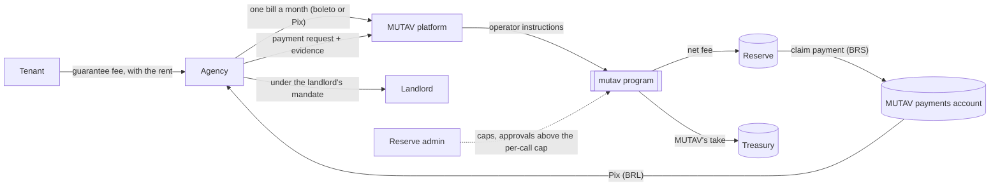

# For rental agencies

This section explains how a real-estate agency (*imobiliária*) works with MUTAV, and what the Solana program records about the guarantees it distributes. It describes the devnet release design.

## MUTAV in one paragraph

MUTAV is an institutional *fiador*. It gives tenants a paid rental guarantee (*fiança onerosa*, Lei 8.245/91 art. 37 II) through the agencies that already run their leases. The tenant needs no personal guarantor and no cash deposit. Every guarantee is backed by a BRL reserve held by the `mutav` program on Solana. The program records the cover of every guarantee, refuses any capital movement that would leave that cover under-backed, and never gates a claim payment on required coverage. The reserve is operational infrastructure that keeps the guarantees healthy. It is not a yield product.

## Agencies never sign on-chain

An agency works in the MUTAV platform, as it does with any guarantor today. It needs no wallet, no key and no SOL. MUTAV runs every chain touchpoint as the **operator**.

| What the agency does (off-chain, in the platform) | What MUTAV records on-chain (operator) |
|---|---|
| Activates a lease and sends the signed guarantee instrument | `register_guarantee`: one `Guarantee` account per lease, with its cover |
| Collects the guarantee fee with the rent, and pays MUTAV one consolidated bill a month | `contribute_fees`: one income receipt of kind `FEE` per paid bill, split between the reserve and MUTAV's treasury |
| Sends a payment request (*pedido de pagamento*) with evidence when the tenant defaults | `file_claim`: a `ClaimFiling` that sets the amount aside as a provision at once |
| Receives the claim payment by Pix and pays the landlord under the landlord's mandate | `pay_claim` (reserve to MUTAV's payments account), then `settle_payout` (the Pix record on the same `ClaimFiling`) |
| Reports the end of the lease | `close_guarantee(id, reason)` with reason `RELEASED`: the cover is released |

One designed option touches the chain from the agency's side: paying the monthly bill in BRS through a Solana Pay link. Even then the agency only signs a token transfer to MUTAV. It never calls the program. See [Guarantee fees](fees.md).

## Who does what

| Party | Role | Signs on-chain |
|---|---|---|
| Tenant (*locatário*) | Owes the guarantee fee (*taxa da fiança*) and pays it to the agency with the rent | No |
| Landlord (*locador*) | The creditor of the fiança. Signs the instrument, and gives the agency a mandate to receive payments and give *quitação* | No |
| Agency (*imobiliária*) | Distributes the guarantee, registers leases in the platform, collects the fee, pays MUTAV's monthly bill, files payment requests | No |
| MUTAV operator | Runs contracts, agencies and the whole guarantee and claim cycle. Holds the information | Yes, a hot key |
| Reserve admin | Looks after the reserve's financial health and security through ceilings (caps, coverage ratio, roles). It does not judge contracts | Yes, a Squads multisig with a time lock |
| Pauser and guardians | Emergency stop | Yes, separate keys |

The operator and the reserve admin are separate parties and may be separate companies. The operator decides which leases and which claims go on-chain. The admin decides how much the reserve may pay out and how much cover it may carry. During the pilot MUTAV's team signs operator actions by hand from the operator console. Later the MUTAV platform sends the same instructions with a key held in a key-management service.

## What the program promises an agency

- **Claim payments are never blocked by the coverage gate.** The gate protects the reserve from capital moving out. It never refuses a claim payment, and a pause does not stop claims either. Only the filed claim, the claim caps, liquid BRS or a frozen reserve can stop one.
- **Every claim is set aside the moment it is filed.** The filed amount becomes a provision. Filed claims are always held in full in the reserve's coverage requirement.
- **The payment clock is public.** Every filing, payment and Pix settlement is an on-chain account or event with a timestamp.
- **MUTAV can pay first.** MUTAV may pay the agency by Pix from its own bank account first, and the reserve then reimburses MUTAV's payments account. Agencies are paid on time even while a large claim waits for the admin's approval. Until the approval instruction ships, every claim above the per-call cap (R$15k in the pilot) is paid this way.
- **A compromised operator key has a hard ceiling.** The most a misused operator key can cost is the admin-set claim caps, and those payments can only reach MUTAV's own payments account. Every other change it could make can be undone by another operator action (some of those corrections, such as `amend_claim` and `reinstate_guarantee`, ship as upgrades).

## What the agency can check

Anyone, with no wallet, can read the public `/reserve` page of the pilot app at [reserve.mutav.finance](https://reserve.mutav.finance): reserve health, coverage, each claim's filed, paid and settled timestamps, money flows and every account on Solana Explorer. The pages read the pilot demo reserve on devnet; test activity is visible.

## Status

| Item | Status |
|---|---|
| `mutav` program on devnet | Live: [`GhPkq95RkY7PrJLsv74X73s6ozcwf6JqJtjFouqQeZbV`](https://explorer.solana.com/address/GhPkq95RkY7PrJLsv74X73s6ozcwf6JqJtjFouqQeZbV?cluster=devnet), the pilot demo reserve; test activity is visible. Addresses in the [README](../../README.md#devnet-addresses) |
| Pilot capital | MUTAV's own. The reserve is not open to public investment during the pilot |
| Agency platform (onboarding, registration, monthly bills) | Built in the MUTAV platform; Pix settlement in sandbox; boleto issuance waits on a licensed payment provider |
| Operator | Signed by hand from the pilot console; later a KMS-held key in the platform |

## Pages in this section

| Page | Summary |
|---|---|
| [Guarantee lifecycle](guarantee-lifecycle.md) | From registration to close (VOID or RELEASED), and what is public on-chain versus what stays private. |
| [Claims](claims.md) | How a payment request becomes a claim payment: filing, approval above the cap, exact payment, bank-first payment and the settlement record. |
| [Guarantee fees](fees.md) | Who pays the fee, the monthly agency bill, and where each real goes on-chain. |

## Related sections

- [Introduction](../introduction/README.md)
- [Glossary](../introduction/glossary.md)
- [Reserve framework](../reserve-framework/README.md)
- [Roles and trust](../architecture/roles-and-trust.md)
- [Decisions](../meta/decisions.md)

## Sources

- [Specification §1 Principles](../spec.md#1-principles), [§2 Roles and keys](../spec.md#2-roles-and-keys) and [§2.2 MUTAV as fiador: off-chain duties](../spec.md#22-mutav-as-fiador-off-chain-duties-adr-0012)
- [Litepaper §2 MUTAV in one page](../litepaper.md#2-mutav-in-one-page) and [§7 Guarantee lifecycle](../litepaper.md#7-guarantee-lifecycle)
- [Pilot app spec](../../app/docs/spec.md) (`/reserve`, `/operator`)
- [Repository README](../../README.md)
- Operator instructions: [`programs/mutav/src/instructions/operator/`](../../programs/mutav/src/instructions/operator/)
- Protocol overview and technical reference, devnet release design of 2026-10-10 (branch `docs/protocol-reference`, `docs/protocol-overview.html` and `docs/technical-reference.html`)

## Decisions

- [ADR 0003: Claim payments operated by MUTAV through a whitelisted payments account](../decisions/0003-payments-operated-by-mutav.md)
- [ADR 0005: Coverage gate scope](../decisions/0005-solvency-gate-scope.md)
- [ADR 0009: Guarantee fees, MUTAV operation and MUTAV's reserve share are separate flows](../decisions/0009-separate-mutav-money-flows.md)
- [ADR 0012: Guarantees aligned with a limited fiança onerosa](../decisions/0012-fianca-aligned-guarantee-lifecycle.md)
- [ADR 0019: v1 layout for the devnet release](../decisions/0019-v1-layout-for-the-devnet-release.md) (per-agency cap removed)
- [ADR 0020: Operator/admin separation and operator-compromise recovery](../decisions/0020-operator-admin-separation-and-recovery.md)
- [ADR 0021: Claims: approval, amendment and exact payment](../decisions/0021-claims-approval-amendment-exact-payment.md) (payout SLA removed from the program)
- [ADR 0028: Pilot parameters](../decisions/0028-pilot-parameters.md)
