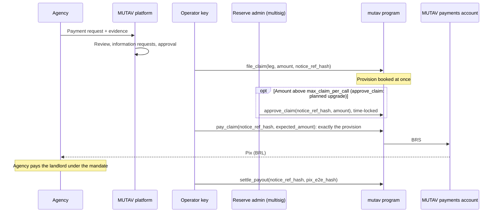
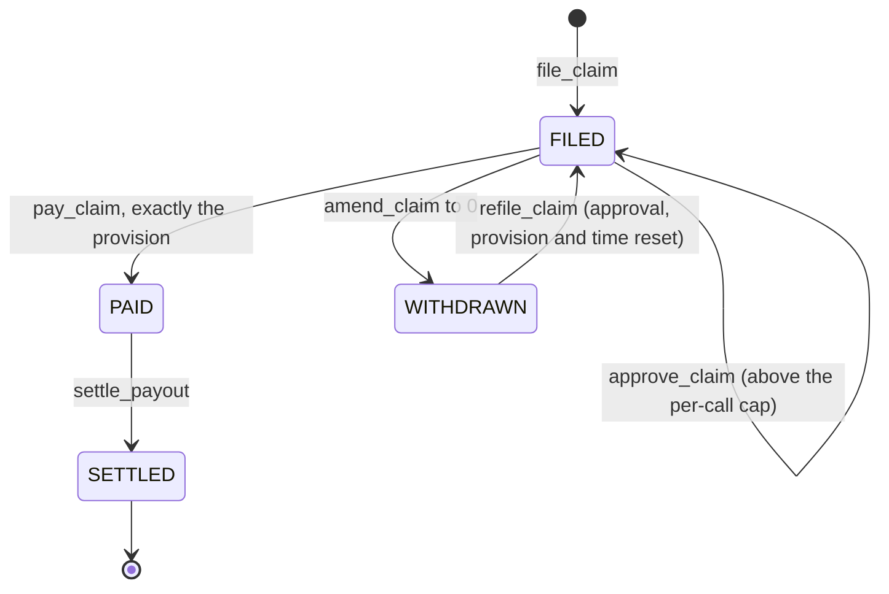

# Claims

When a tenant defaults, the agency asks MUTAV to pay. This page follows that request from the agency to the payment, and shows what the program records at each step.

A **claim** is a payment request from the agency on the landlord's behalf. A **claim payment** is the money MUTAV pays from the reserve for it. Each claim is one event: for example one month's rent on the default leg, or one payment of end-of-occupation debts on the exit leg.

## The flow at a glance

## 1. The agency files a payment request (off-chain)

The agency sends the payment request (*pedido de pagamento*) with its evidence in the MUTAV platform. MUTAV reviews it, asks for more information if needed, and approves or rejects it. This review is a platform duty. The program decides no claim.

The service levels for this work (review, information requests, approval, execution and the contractual deadline) live in the MUTAV platform, not in the program. The contractual payment term is open (spec §12 Q36). The agency's filing window is enforced in the platform; its length is to be reconciled between the working process and the spec (spec §12 Q14). Both are listed in the [open questions](../meta/open-questions.md#open-questions).

## 2. The operator files the claim (on-chain)

Once MUTAV approves the request, the operator calls `file_claim(leg, amount, notice_ref_hash)`. `leg` is 1 for the default leg and 2 for the exit leg; any other value is refused with `InvalidParameter`. `notice_ref_hash` is a commitment to the agency's payment request. It links the filing, the payment and the settlement record of that request.

| Rule | Refused with |
|---|---|
| The guarantee is `ACTIVE` | `GuaranteeNotActive` |
| The leg is 1 or 2, and the amount is above 0 | `InvalidParameter` |
| The amount fits in the leg's cover that is not yet paid or set aside for another claim | `ExceedsRemainingCover` |

The program creates a `ClaimFiling` with status `FILED` and books the amount as a **provision**. The provision lowers the reserve's net asset value at once and is always held in full in the reserve's coverage requirement. A leg can carry several open filings, each for its own payment request.

Filing is never paused and never coverage-gated. The event `ClaimFiled` records it.

## 3. Approval above the per-call cap

The program limits how much the operator key can pay:

| Cap | Devnet and pilot value ([ADR 0028](../decisions/0028-pilot-parameters.md)) | Rule |
|---|---|---|
| `max_claim_per_call` | R$15,000 | The most one claim payment may be without approval. A 6×-rent eviction (R$13,200 at a R$2,200 rent) fits |
| `max_claim_per_period` | R$20,000 per sliding 31-day window | The payments of the last 31 days plus this one may not exceed it, approved payments included, so no 30-day span exceeds it |

A claim above the per-call cap needs an admin-approved amount: the program refuses its payment with `ClaimCallCapExceeded` unless the provision equals the filing's `approved_amount`. That amount is set by the reserve admin's `approve_claim(notice_ref_hash, amount)`, a planned upgrade (Wave 2) that is not in the devnet binary. Once it ships, the admin multisig signs it through its time lock (devnet 5 minutes; real pilot 24 hours). The approval records an exact `approved_amount` on the filing. The admin approves how much may leave the reserve, not whether the claim is valid. That judgment stays with the operator.

If the payment would not fit in the window cap, the admin's proposal also raises `max_claim_per_period` in the same step, and a later configuration change lowers it back.

These caps bound what a misused operator key could move. They do not limit what MUTAV owes the landlord under the guarantee. Large claims go through the approval, and MUTAV's bank-first payment (below) keeps the agency paid while the approval waits. Until `approve_claim` ships, every claim above the per-call cap is filed in full and paid bank-first; the reserve reimburses MUTAV once the approval exists.

## 4. Payment: exactly the filed amount

The operator calls `pay_claim(notice_ref_hash, expected_amount)`. The program pays exactly the filing's provision, and refuses unless `expected_amount` equals it. No part of a provision is ever released without being paid or explicitly amended.

| Rule | Refused with |
|---|---|
| The filing is `FILED` | `ClaimNotFiled` |
| `expected_amount` equals the filing's provision | `ExpectedAmountMismatch` |
| The provision is within `max_claim_per_call`, or equals the admin's `approved_amount` | `ClaimCallCapExceeded` |
| The payments of the last 31 days plus this payment are within `max_claim_per_period` | `ClaimPeriodCapExceeded` |
| The destination is MUTAV's whitelisted payments account | `InvalidPaymentsAccount` |
| The reserve holds enough liquid BRS | `InsufficientLiquidBalance` |
| The reserve's BRS account is not frozen | `ReserveFrozen` |

`pay_claim` has **no** coverage check, no under-coverage check, no pause check and no share-value guard. Within the caps it is never refused because the reserve is below target.

The program sends BRS from the reserve to MUTAV's payments account, marks the filing `PAID`, releases its provision, lowers the guarantee's remaining cover, and records the payment (`paid_amount`, `paid_at`, `payments_account`) on the same `ClaimFiling`. There is no separate payout account. The event `ClaimPaid` records it.

BRS can leave the reserve for a claim only to that one payments account. It never goes to an arbitrary wallet.

## 5. Pix to the agency, then the settlement record

MUTAV converts the BRS to BRL and pays the agency by Pix. The agency pays the landlord under the landlord's mandate to receive payments and give *quitação*.

The operator then calls `settle_payout(notice_ref_hash, pix_e2e_hash)`. It stores a hash of the Pix end-to-end ID on the `ClaimFiling` and moves it to `SETTLED` with a timestamp. This is a settlement record. The program has no payout deadline of its own. Deadlines live in the operator platform.

| `ClaimFiling` field | Meaning |
|---|---|
| `guarantee`, `leg`, `notice_ref_hash` | Which guarantee and which request |
| `provision`, `approved_amount` | The amount set aside, and any admin-approved amount |
| `paid_amount`, `payments_account` | What was paid, and where the BRS went |
| `status` | `FILED` 0, `PAID` 1, `WITHDRAWN` 2, `SETTLED` 3 |
| `filed_at`, `paid_at`, `settled_at` | On-chain timestamps of the filing, the payment and the settlement |
| `pix_e2e_hash` | Hash of the Pix end-to-end ID |

## Bank-first payment

MUTAV may pay the agency by Pix from its own bank account first. The reserve then reimburses MUTAV's payments account through the ordinary `pay_claim`. This keeps the agency paid on time when the reserve's payment is delayed, for example:

- while an approval above the per-call cap waits on the admin's time lock;
- while the 31-day window cap is full;
- while the issuer has frozen the reserve's BRS account;
- while the operator key is being replaced.

The reimbursement follows every rule of `pay_claim`, so the reserve never pays more than the filed amount.

## Correcting a claim

The correction instructions below are planned upgrades (Wave 2); none is in the devnet binary. Until they ship, a filed claim stays `FILED` until it is paid. Once they ship, every correction is an operator action, and each runs while the reserve is paused.

| Instruction | What it does |
|---|---|
| `amend_claim(notice_ref_hash, new_amount)` | Changes the filed amount. Lower releases the difference. Higher sets more aside, within the leg's cover that is not yet paid or set aside. Emits `ClaimAmended { old, new }`. Any approval on the filing is reset, so a new amount above the cap needs a new approval |
| `amend_claim(notice_ref_hash, 0)` | Withdraws the claim: releases the whole provision, marks the filing `WITHDRAWN` and emits `ClaimWithdrawn`. Use it for a mistaken filing, or when the tenant pays before the claim is paid |
| `refile_claim` | Files a `WITHDRAWN` claim again on the same notice, with the same arguments as `file_claim` |

Amendments are refused once the filing is `PAID` or `SETTLED`.

To settle a claim for less than was filed, the operator amends it down, then pays the new amount.

`refile_claim` accepts only a `WITHDRAWN` filing and resets the approval, the provision and the filing time, so an old approval is never reused.

The diagram shows the full design. In the devnet binary only `file_claim`, `pay_claim` and `settle_payout` exist; the `approve_claim`, `amend_claim` and `refile_claim` transitions arrive with the upgrade.

## What can and cannot stop a claim payment

| Can stop a payment | Cannot stop a payment |
|---|---|
| The filing checks (status, exact amount) | The coverage gate |
| The per-call cap without an approved amount | A pause |
| The sliding 31-day window cap | The reserve being below target |
| Not enough liquid BRS | The share-value guard on capital fills |
| An issuer freeze of the reserve's BRS account | The state of the agency's monthly bill |

In every case in the left column, MUTAV's bank-first payment can keep the agency paid while the cause is resolved.

## If the operator key is compromised

Every claim action except payment is designed to be undone by another operator action: once `amend_claim` ships, a false filing is withdrawn with `amend_claim` to 0, and a wrong amendment is amended again. Until then a false filing stays provisioned and unpaid. Claim payments are the only irreversible operator action. They are bounded by the admin's caps and can only reach MUTAV's own payments account. The recovery steps are: the pauser revokes the operator key at once, the admin appoints a new operator in two steps (`propose_role`, then `accept_role` by the new key, within 72 hours), reconcile the platform's records with on-chain events, and correct with ordinary operator actions.

## Planned

- **Approval, amendment and re-filing.** `approve_claim`, `amend_claim` and `refile_claim` ([ADR 0021](../decisions/0021-claims-approval-amendment-exact-payment.md)) ship as an upgrade; their fields are already carved in `ClaimFiling`.
- **Claim categories and richer records.** With the ADR 0012 lifecycle, each claim names the guaranteed debt (rent arrears, charges, damage, court costs owed by the tenant, abandonment costs, other listed debts), and the records gain the time the request became complete, a commitment to the debt calculation, the landlord's receipt (*quitação*) and the mandate in force. Space is already reserved in the `ClaimFiling` account.
- **Settlement attestation.** It becomes required once the operator and the reserve admin are separate companies.
- **Claim notices.** A notice raised at the first missed rent, which holds capital fills while a known loss is not yet filed, is built before any outside capital, together with the exit fallback of ADR 0025.

## Sources

- [Specification §3.6 `ClaimFiling`](../spec.md#36-claimfiling-derived), [§5.4 Claims and payouts](../spec.md#54-claims-and-payouts-operator) and [§8 Caps](../spec.md#8-caps)
- [Specification §2.2 MUTAV as fiador: off-chain duties](../spec.md#22-mutav-as-fiador-off-chain-duties-adr-0012) and [§12 Open questions](../spec.md#12-open-questions) (Q14, Q36)
- [Litepaper §7 Guarantee lifecycle](../litepaper.md#7-guarantee-lifecycle)
- Code: [`programs/mutav/src/state/claim.rs`](../../programs/mutav/src/state/claim.rs), [`programs/mutav/src/instructions/operator/file_claim.rs`](../../programs/mutav/src/instructions/operator/file_claim.rs), [`programs/mutav/src/instructions/operator/pay_claim.rs`](../../programs/mutav/src/instructions/operator/pay_claim.rs), [`programs/mutav/src/instructions/operator/settle_payout.rs`](../../programs/mutav/src/instructions/operator/settle_payout.rs)
- Technical reference, devnet release design of 2026-10-10, §5.3, §7.2 and §9 (branch `docs/protocol-reference`, `docs/technical-reference.html`)

## Decisions

- [ADR 0003: Claim payments operated by MUTAV through a whitelisted payments account](../decisions/0003-payments-operated-by-mutav.md) (its settlement deadline flag is removed)
- [ADR 0005: Solvency gate scope: capital flows and new guarantees, never claim payments](../decisions/0005-solvency-gate-scope.md)
- [ADR 0008: One capital flow for everyone; FIFO deposits; pause never blocks claims](../decisions/0008-uniform-capital-flow-and-pause-scope.md)
- [ADR 0012: Guarantees aligned with a limited fiança onerosa](../decisions/0012-fianca-aligned-guarantee-lifecycle.md) (bank-first reimbursement; its admin payment path is replaced by `approve_claim`)
- [ADR 0014: `pay_claim` bound with concurrent filings on one leg](../decisions/0014-pay-claim-bound-with-concurrent-filings.md) (superseded by exact payment)
- [ADR 0019: v1 layout for the devnet release](../decisions/0019-v1-layout-for-the-devnet-release.md) (`approved_amount` and the claim-window buckets carved, padding for the ADR 0012 fields)
- [ADR 0020: Operator/admin separation and operator-compromise recovery](../decisions/0020-operator-admin-separation-and-recovery.md) (reversible filings, two-step role handover, recovery)
- [ADR 0021: Claims: approval, amendment and exact payment](../decisions/0021-claims-approval-amendment-exact-payment.md) (approval, exact payment, amendment, re-file, the 31-day window, payout SLA removed, `Payout` merged into `ClaimFiling`)
- [ADR 0025: Exit fallback: a cooldown exit after `max_queue_wait_secs`](../decisions/0025-exit-fallback-cooldown-exit.md) (the claim-notice gate is built with the exit fallback)
- [ADR 0026: Program simplification for the freeze](../decisions/0026-program-simplification-for-the-freeze.md)
- [ADR 0028: Pilot parameters](../decisions/0028-pilot-parameters.md) (the claim caps)
- [ADR 0029: Claims and capital rules in the program](../decisions/0029-claims-and-capital-rules-in-the-program.md) (exact payment, the approval check and the 31-day window shipped; the approval instructions follow)
