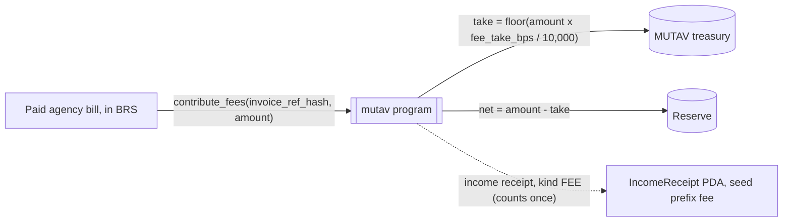

# Guarantee fees

The guarantee fee (*taxa da fiança*) is what the tenant pays for the guarantee. This page covers who pays it, how the agency passes it to MUTAV, and where each real goes once it reaches the chain.

## Who pays whom

| Step | Who | How |
|---|---|---|
| 1 | Tenant to agency | The tenant pays the guarantee fee with the rent, in the agency's own rent flow |
| 2 | Agency to MUTAV | One consolidated bill a month for all the agency's guarantees, paid by boleto or Pix through a licensed payment provider |
| 3 | MUTAV to the chain | MUTAV converts the BRL 1:1 into BRS and the operator records the paid bill with `contribute_fees` |

## The fee amount

MUTAV sets each lease's fee in the platform at signing, by the tenant's score band. Final pricing is not decided (listed in the [open questions](../meta/open-questions.md#open-questions)). The business plan's working parameter is 9%, 12% or 15% of monthly rent by score band. It is a working parameter, not final pricing.

The program does not price anything. It records the amount of each paid bill and splits it. Pricing changes need no program change.

## The monthly agency bill

| Item | Rule |
|---|---|
| Issued | On the 1st of each month by the MUTAV platform, one per agency |
| Lines | One line per guarantee in force, guarantees in arrears included, plus a one-time activation line in a guarantee's first month (working parameter) |
| Due | On a fixed day set in the partnership agreement. The platform uses the 10th |
| Paid by | Boleto or Pix through a licensed payment provider |
| Paid in BRS (designed) | The platform shows a Solana Pay link or QR carrying the bill's reference. The agency transfers BRS to MUTAV's operator BRS account. It still never calls the program |
| Third-party charges | Any third-party charge on the same bill is passed to its owner at settlement. It never enters MUTAV's accounts, the reserve or its share value |

Status: bill generation runs in the platform and Pix settlement in sandbox. Boleto issuance, the payment provider, the minter integration, stablecoin payment and automated `contribute_fees` are not live yet.

## Where the money goes on-chain

Once a bill is paid and converted, the operator calls `contribute_fees(invoice_ref_hash, amount)` once for that bill, for its guarantee-fee lines only. One instruction splits it in two:

| Part | Destination | Effect |
|---|---|---|
| MUTAV's take (`fee_take_bps`) | MUTAV's treasury account, directly | MUTAV's operating revenue. Never part of the reserve |
| Net fee | The reserve | Strengthens the reserve that backs every guarantee. Raises the value of every reserve share. Never mints shares |

| Parameter | Value |
|---|---|
| `fee_take_bps` on devnet and in the pilot | 2,000 (20%), [ADR 0028](../decisions/0028-pilot-parameters.md) |
| Program maximum | 3,000 (30%) |
| Real-pilot take | 2,000 (20%), set by [ADR 0028](../decisions/0028-pilot-parameters.md) (spec §12 Q4, marked resolved in the [open questions](../meta/open-questions.md#open-questions)). Any change is a time-locked admin action |

## Rules the program enforces

- **Each bill counts once.** `contribute_fees` creates an `IncomeReceipt` account of kind `FEE`, keyed by `invoice_ref_hash` under its own `"fee"` seed prefix, so a bill reference can never collide with an issuer statement. A second call for the same bill fails, even if a payment notice arrives twice.
- **Fees are never paused or gated.** Recording a fee is never paused and never coverage-gated, because fees only strengthen the reserve.
- **Fees wait for the first deposit.** While the reserve has no shares outstanding, `contribute_fees` is refused with `NoSharesOutstanding`, so no fee can be lost to share rounding. The operator records the bill once the first deposit is filled.
- **Fees never mint shares and never count as MUTAV capital.** MUTAV's own capital enters the reserve only through the ordinary deposit queue, like any other capital.
- **Three separate MUTAV accounts.** The treasury (fee take), the payments account (claim payments) and MUTAV's capital wallet are distinct accounts.

| Income receipt field (kind `FEE`) | Meaning |
|---|---|
| `kind` | `FEE` (1) |
| `ref_hash` | The bill's `invoice_ref_hash`, a commitment to the bill |
| `gross` | Amount recorded |
| `take` | MUTAV's take, sent to the treasury |
| `net` | Amount sent to the reserve |
| `period` | 0 for a fee (the statement month for issuer income) |
| `slot` | When it was recorded |

The event `FeesContributed { invoice_ref_hash, gross, take, net }` lets anyone check the split against `fee_take_bps`.

## Privacy of the bill

Only the bill's amount and a commitment to it go on-chain. The proposed design makes `invoice_ref_hash` a keyed hash of the bill's number, period and lines. The public then cannot link a receipt to an agency, while each agency, given its bill's reference data, can find its own receipt.

## If a bill is paid late

The guarantee stays in force. No claim, cover or payment rule depends on the bill being paid. An unpaid fee is MUTAV's own claim against the agency, never a defence against the landlord, and claim payments are never reduced by it.

On-chain, the guarantee's cover still counts in the reserve's coverage requirement, and no fee receipt exists for that bill until it is paid. Unpaid bills are never counted as reserve assets. Off-chain the bill is marked overdue.

The grace period, late charges, when MUTAV stops accepting an agency's new registrations, and who bears a defaulting tenant's fee belong in the partnership agreement. They are not decided yet (see the [open questions](../meta/open-questions.md#open-questions)).

## Reconciliation (proposed)

A bill is recorded on-chain only when the payment provider's settlement, or the BRS transfer carrying its reference, equals the bill's total. A mismatch or a reversal goes to manual review. At month end MUTAV compares totals billed, settled, converted and recorded on-chain. Converted BRS waits in the operator's public BRS account only until `contribute_fees`, normally the same day.

## Not a guarantee fee

The reserve also receives issuer income: the BRS issuer's monthly partnership revenue, booked with `sweep_income`. It is a separate, labelled flow. It never counts as a guarantee fee, never enters the fee totals and never enters the coverage math.

## Sources

- [Specification §2.1 Three separate MUTAV money flows](../spec.md#21-three-separate-mutav-money-flows-adr-0009-and-issuer-income-adr-0017), [§3.11 `FeeReceipt`](../spec.md#311-feereceipt) (now an `IncomeReceipt` kind, ADR 0026), [§5.3 Guarantee fees (operator)](../spec.md#53-guarantee-fees-operator) and [§8 Caps](../spec.md#8-caps)
- [Specification §12 Open questions](../spec.md#12-open-questions) (Q4 take rate)
- [Litepaper §2.1 Business model in one table](../litepaper.md#21-business-model-in-one-table) and [§7 Monthly billing of partner agencies](../litepaper.md#monthly-billing-of-partner-agencies)
- Code: [`programs/mutav/src/instructions/operator/contribute_fees.rs`](../../programs/mutav/src/instructions/operator/contribute_fees.rs), [`programs/mutav/src/state/income.rs`](../../programs/mutav/src/state/income.rs), [`programs/mutav/src/constants.rs`](../../programs/mutav/src/constants.rs) (`MAX_FEE_TAKE_BPS`)
- Technical reference, devnet release design of 2026-10-10, §5.2 and §6.5 (branch `docs/protocol-reference`, `docs/technical-reference.html`)

## Decisions

- [ADR 0007: MUTAV's fee take goes directly to the treasury](../decisions/0007-fee-take-direct-to-treasury.md)
- [ADR 0009: Guarantee fees, MUTAV operation and MUTAV's reserve share are separate flows](../decisions/0009-separate-mutav-money-flows.md)
- [ADR 0004: NAV computed on-chain with internal accounting, provisions at filing and bounded prices](../decisions/0004-onchain-nav-internal-accounting.md)
- [ADR 0017: BRS income intake: an income inbox and `sweep_income`](../decisions/0017-brs-income-intake.md) (issuer income is kept apart from guarantee fees)
- [ADR 0023: Capital flows and exit rights](../decisions/0023-capital-flows-and-exit-rights.md) (fees and income refused while no shares are outstanding)
- [ADR 0028: Pilot parameters](../decisions/0028-pilot-parameters.md) (the fee take)
- [ADR 0029: Claims and capital rules in the program](../decisions/0029-claims-and-capital-rules-in-the-program.md) (`NoSharesOutstanding`)
- [ADR 0024: Unsolicited money and backstop contributions](../decisions/0024-unsolicited-money-and-backstop.md) (income receipt kinds)
- [ADR 0026: Program simplification for the freeze](../decisions/0026-program-simplification-for-the-freeze.md) (`FeeReceipt` becomes an `IncomeReceipt` of kind `FEE`)
