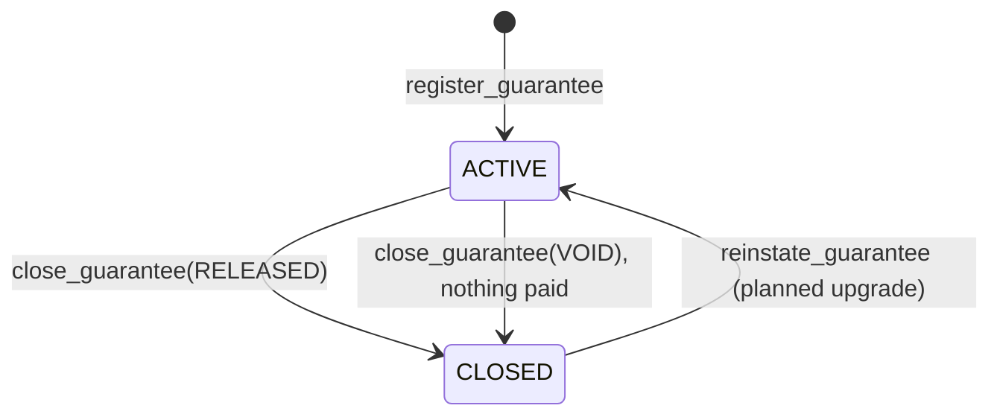
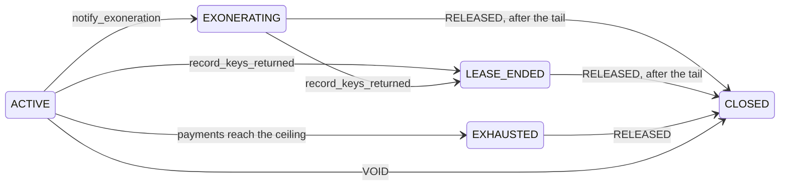

# Guarantee lifecycle

Each lease MUTAV guarantees becomes one `Guarantee` account on Solana. This page follows that account from registration to close, and lists what is public on-chain and what stays in the MUTAV platform.

## The guarantee in brief

Each guarantee is the on-chain record of one **limited fiança** (CC 823). Its R$ ceiling, the *valor afiançado*, is the sum of two sub-limits:

| Leg | Covers | Field |
|---|---|---|
| Default leg | Rent and charges in arrears while the lease runs | `default_cover` |
| Exit leg | The tenant's debts at the end of occupation | `exit_cover` |

Both covers are absolute R$ amounts set at registration. The rent and the rent multipliers behind them stay in the MUTAV platform; the program stores only the covers. No instruction changes the covers after registration. A change, such as a rent increase that should raise the cover, needs a signed addendum and an instruction that is not yet specified (spec §12 Q22, listed in the [open questions](../meta/open-questions.md#open-questions)).

## From lease to registration

1. **Off-chain.** The agency activates the lease in the MUTAV platform. MUTAV assesses it. The landlord signs the guarantee instrument with MUTAV, or the agency signs under a special power from the landlord. The tenant's fee contract is separate.
2. **On-chain.** The operator calls `register_guarantee({ id, agency_id, refs_hash, default_cover, exit_cover })`.

The program accepts the registration only if all of these hold:

| Check | Refused with |
|---|---|
| The reserve is not paused | `Paused` |
| The reserve is not under-covered | `UnderCovered` |
| The reserve's BRS account is not frozen by the issuer | `ReserveFrozen` |
| Total cover is above 0 | `InvalidParameter` |
| Total cover is within the per-guarantee cap (R$120,000 in the pilot, [ADR 0028](../decisions/0028-pilot-parameters.md)) | `GuaranteeCapExceeded` |
| The reserve can back the new cover: the coverage it needs after the registration fits in the capital it holds | `InsufficientFreeCapital` |
| The `id` is new | Account already in use |

The capital check is the **coverage gate**. When it refuses, the reserve cannot back more cover yet. New guarantees wait until capital comes in or existing guarantees close. Guarantees already registered are not affected.

There is no per-agency cap. The program limits cover per guarantee and in total through the reserve's coverage requirement. Per-agency figures are derived from the guarantee accounts, which carry the `agency_id`.

On success the guarantee is `ACTIVE`, and its cover counts in the reserve's coverage requirement at once. The event `GuaranteeRegistered` records it.

## States in the devnet release

| State | Meaning | New claims | Cover counted in the reserve's requirement |
|---|---|---|---|
| `ACTIVE` | The lease is running and the guarantee is live | Yes | All remaining cover |
| `CLOSED` | The guarantee has ended | No | None |

The account is never deleted. A closed guarantee stays on-chain so its public claims history remains readable.

## Closing a guarantee

The operator closes a guarantee with `close_guarantee(id, reason)`. Two reasons exist:

| Reason | When | Extra rule |
|---|---|---|
| `RELEASED` (1) | The guarantee ended (for example, the lease ended) | The guarantee is `ACTIVE` and has no open claim |
| `VOID` (2) | The lease never took effect, or the registration was an error | The guarantee is `ACTIVE`, has no open claim, and nothing was ever paid on either leg (`GuaranteeHasPayments`) |

Any other reason is refused with `InvalidParameter`; an open claim with `OpenClaims`. The reason is stored on the account as `close_reason`.

Closing releases the remaining cover from the reserve's requirement. It is never coverage-gated, because it reduces liability. It runs while the reserve is paused. The event `GuaranteeClosed { id, released_cover, reason }` records it.

A guarantee with an open claim cannot close. Every filed claim must be paid first, or withdrawn once `amend_claim` ships (see [Claims](claims.md)).

## Reinstating a guarantee (planned)

`reinstate_guarantee` is a planned upgrade; it is not in the devnet binary, and a close is final until it ships. As designed in ADR 0020, it undoes a close. It moves a `CLOSED` guarantee back to `ACTIVE` and restores its remaining cover. It is an operator action, allowed only within `max_reinstate_age` of the close. That age is set by the reserve admin (30 days on devnet). It is not paused, not coverage-gated and not subject to the claim caps. The event `GuaranteeReinstated` shows it in the operator-activity feed.

Its main use is recovery. If an operator key were ever compromised, a new operator corrects the registry with ordinary operator actions: a false registration is closed as `VOID`, and, once `reinstate_guarantee` ships, a wrongful close is reinstated. Claim payments are the only operator action that cannot be undone, and the admin's claim caps bound them.

## A guarantee and the monthly fee

The guarantee does not depend on the agency's bill being paid. If a bill is late, the guarantee stays in force, its cover still counts, and claims are not reduced. An unpaid fee is MUTAV's own claim against the agency, never a defence against the landlord. See [Guarantee fees](fees.md).

## What is on-chain and what stays private

Only amounts, timestamps and commitments (hashes) cross from the platform to the chain. No names, documents or addresses go on-chain. Hashes are salted or keyed wherever the original could identify a person.

**Public, on the `Guarantee` account and its events:**

| Field | What it is |
|---|---|
| `id` | The platform's reference for the guarantee. Its derivation, for example a keyed hash of the lease identity, stays off-chain |
| `agency_id` | A reference for the agency issued by the platform |
| `refs_hash` | A commitment to the lease and the signed instrument |
| `default_cover`, `exit_cover` | The two sub-limits |
| `default_paid`, `exit_paid` | Paid so far, per leg |
| `provision_default`, `provision_exit` | Open claims, per leg |
| `open_claims` | Filed claims not yet paid or withdrawn |
| `status`, `close_reason`, `registered_at`, `closed_at` | State, close reason and timestamps |

**Private, in the MUTAV platform:**

- the tenant's and the landlord's identity, and the property address;
- the lease and the signed instrument (only their hash is on-chain), the rent and the rent multipliers;
- tenant assessment and pricing of the guarantee fee;
- the agency's monthly bills and payment records;
- payment-request evidence and the review record.

Because a commitment is public, MUTAV can later prove which document an on-chain record refers to, without publishing the document.

## Planned: the full fiança lifecycle

The devnet release records `ACTIVE` and `CLOSED` only. The fuller lifecycle of ADR 0012 is planned work. It adds the exoneration notice (LI 40 X), the record of the keys being returned (LI 39), a claims tail after the guarantee's liability ends, extinction when the ceiling is exhausted, commitments to the signed cap schedule and to the landlord's mandate, and claim categories. Space for these fields is already reserved in the `Guarantee` account, so they arrive without migrating live accounts. The claims-tail length is open (spec §12 Q35, listed in the [open questions](../meta/open-questions.md#open-questions)).

## Sources

- [Specification §3.5 `Guarantee`](../spec.md#35-guarantee) and [§5.2 Guarantees (operator)](../spec.md#52-guarantees-operator)
- [Specification Conventions](../spec.md#conventions) (hashes and personal data)
- [Specification §2.2 MUTAV as fiador: off-chain duties](../spec.md#22-mutav-as-fiador-off-chain-duties-adr-0012)
- [Specification §12 Open questions](../spec.md#12-open-questions) (Q22, Q35, Q43)
- [Litepaper §6 Architecture on Solana](../litepaper.md#6-architecture-on-solana) and [§7 Guarantee lifecycle](../litepaper.md#7-guarantee-lifecycle)
- Code: [`programs/mutav/src/state/guarantee.rs`](../../programs/mutav/src/state/guarantee.rs), [`programs/mutav/src/instructions/operator/register_guarantee.rs`](../../programs/mutav/src/instructions/operator/register_guarantee.rs), [`programs/mutav/src/instructions/operator/close_guarantee.rs`](../../programs/mutav/src/instructions/operator/close_guarantee.rs)
- Technical reference, devnet release design of 2026-10-10, §5.2 and §7.1 (branch `docs/protocol-reference`, `docs/technical-reference.html`)

## Decisions

- [ADR 0005: Coverage gate scope](../decisions/0005-solvency-gate-scope.md)
- [ADR 0006: Per-lease coverage stored as absolute amounts](../decisions/0006-per-lease-absolute-coverage.md) (its per-agency cap is removed)
- [ADR 0008: One capital flow for everyone; FIFO deposits; pause never blocks claims](../decisions/0008-uniform-capital-flow-and-pause-scope.md)
- [ADR 0012: Guarantees aligned with a limited fiança onerosa](../decisions/0012-fianca-aligned-guarantee-lifecycle.md) (the lifecycle is planned; space is reserved now)
- [ADR 0016: Coverage ratio below 1.0, with a 0.10 floor and a provisions term](../decisions/0016-coverage-ratio-below-one.md)
- [ADR 0019: v1 layout for the devnet release](../decisions/0019-v1-layout-for-the-devnet-release.md) (padding for the ADR 0012 fields, per-agency cap and `AgencyExposure` removed)
- [ADR 0020: Operator/admin separation and operator-compromise recovery](../decisions/0020-operator-admin-separation-and-recovery.md) (`close_guarantee` reasons, `reinstate_guarantee`, `max_reinstate_age`, frozen-reserve check in registration)
- [ADR 0022: Coverage: stress buffer and underwater reserve](../decisions/0022-coverage-stress-buffer-underwater-reserve.md) (amends 0016; removes the per-agency cap from the devnet caps)
- [ADR 0028: Pilot parameters](../decisions/0028-pilot-parameters.md) (the per-guarantee cap)
