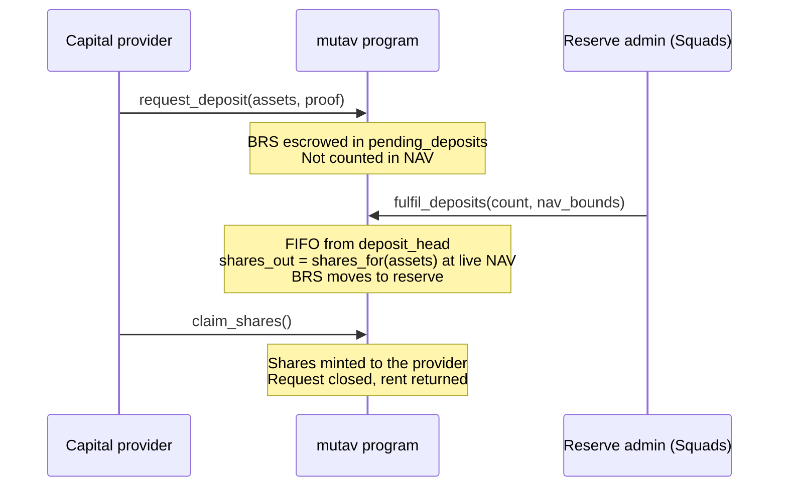
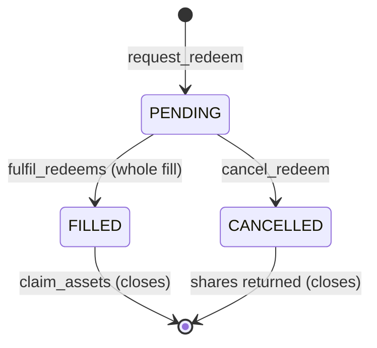

# Deposits and redemptions

Capital enters and leaves the reserve through two asynchronous, first-in first-out (FIFO) queues. A capital provider makes a request; the reserve admin fills the queue in order at the NAV of the fill; the provider then collects shares or BRS. Nobody, MUTAV included, can move capital in or out any other way.

## The two queues at a glance

| | Deposit | Redemption |
|---|---|---|
| Request | `request_deposit(assets, proof)` | `request_redeem(shares, proof)` |
| What is escrowed | BRS in `pending_deposits` | Shares in `pending_redemptions` |
| Who fills | Reserve admin, `fulfil_deposits(count, nav_bounds)` | Reserve admin, `fulfil_redeems(count, max_assets, nav_bounds)` |
| Price | NAV at the fill | NAV at the fill |
| Size of a fill | Whole request | Whole request in the pilot |
| Collect | `claim_shares()` | `claim_assets()` |
| Cancel before a fill | `cancel_deposit()` | `cancel_redeem()` |
| Entry check | Allowlist proof | Allowlist proof, skipped for wallets that already hold shares |

Each request is its own PDA, seeded `["deposit", config, seq]` or `["redeem", config, seq]`. The `seq` comes from a counter in `VaultState` and is never reused. Two requests sent at the same moment can race for the same `seq`; the client retries with the next one.

## Deposit flow



1. **Request.** The provider sends BRS from its own token account. The program checks that the reserve is not paused, that the Merkle proof is valid, and that the size is within `min_request` and `max_request`. The BRS waits in `pending_deposits`. It does not count in the reserve's assets or NAV.
2. **Fill.** The admin fills 1 to 8 requests per call (`count`), in strict FIFO order from `deposit_head`. Each fill mints shares at the live NAV and emits `DepositFilled`; a head that moves past closed requests with no fill emits an event too. A fill is refused when:
   - the reserve is paused, or fills are halted by the NAV-move guard, which runs inside the fill with the same rule as `refresh` (`FulfilHalted`);
   - the live NAV falls outside the `nav_bounds` the admin's proposal fixed;
   - a reserve token account is frozen;
   - the fill would take stable assets above `max_tvl`;
   - net assets are 0 while shares are outstanding (`ReserveUnderwater`);
   - the fill would mint 0 shares.
3. **Claim.** The provider calls `claim_shares` at any time after the fill. Shares from a filled but unclaimed deposit already count in `shares_outstanding`, so they share in every later NAV change.

Deposit fills are allowed while the reserve is below its coverage target. New capital is how the reserve recapitalises, and the new depositor buys at a NAV that already reflects the loss.

## Redemption flow



1. **Request.** The provider escrows shares from its own share token account; delegates are never used. The size is checked in BRS at the current NAV: `min_request ≤ assets_for(shares) ≤ max_request`. A full exit is the exception (see [Exit rights](#exit-rights)).
2. **Fill.** The admin fills up to 8 requests in strict FIFO order from `redeem_head`. Before every fill the program recomputes a budget:

   ```text
   budget = min(max_assets − assets_paid_in_this_call, free_capital, liquid_budget)
   ```

   - `free_capital` is the stable assets above what the guarantees require (`coverage_required`). Redemptions are paid only from this surplus.
   - `liquid_budget` is liquid BRS above the open claim provisions, so an exit never spends BRS a filed claim needs.
   - `max_assets` lets the admin fill less than the budget. It can never change the order.

   Each fill burns the escrowed shares and moves `assets_for(shares)` BRS into the `claims` escrow account. A fill is refused when the reserve is paused, below its coverage target, halted by the NAV-move guard (evaluated inside the fill), outside `nav_bounds`, or frozen. A call that fills nothing fails, so an empty batch is never recorded as a success.
3. **Claim.** The provider calls `claim_assets` to move the BRS from `claims` to its own BRS account.

### Whole fills in the pilot

The pilot fills whole requests only. If the head request is larger than the budget, the batch stops there and later requests wait. This is a deliberate pilot setting:

- request sizes in the pilot stay below the expected free capital;
- the operator and admin consoles show a stuck head with the amount needed and the amount available;
- partial fills at the head ([ADR 0010](../decisions/0010-partial-fills-at-queue-head.md)) come in the first upgrade after the hackathon. The request fields already exist, so no migration is needed. Any rounding or fee will be computed once per request, not once per fill.

### A head worth nothing

If a redemption request at the head is worth 0 BRS at the fill, the program fills it as a 0-asset fill: the shares are burned and the request is closed. The queue keeps moving.

## NAV bounds on every fill

Fills are signed by the admin multisig and run after its time lock. The NAV can change between the proposal and the execution. So each `fulfil_deposits` and `fulfil_redeems` call carries `nav_bounds (min, max)`, composed by the admin console when the proposal is created. If the live NAV at execution is outside that range, the fill is refused with `NavOutOfBounds`. Every fill therefore happens at a price the signers saw and approved.

## Cancel and claim rights

These owner actions never depend on the admin, and a pause does not stop them.

| Action | When | Effect |
|---|---|---|
| `cancel_deposit` | Request still pending | BRS returned to the owner; request closed. Signed by the owner, or by the admin on the owner's behalf |
| `claim_shares` | Deposit filled | Shares minted to the owner; request closed |
| `cancel_redeem` | Request still pending | Shares returned to the owner |
| `claim_assets` | Redemption filled | BRS paid from `claims` to the owner |

- `cancel_deposit`, `cancel_redeem`, `claim_shares` and `claim_assets` create the owner's associated token account if it does not exist. The caller pays its rent.
- Closed requests return their rent to the owner.
- A cancelled request leaves a gap in the queue. The permissionless `advance_queue_head(queue, max)` crank skips closed requests in one queue per call. It moves no money.

## Exit rights

Entry is gated; exit is open ([ADR 0023](../decisions/0023-capital-flows-and-exit-rights.md)).

| Situation | Rule |
|---|---|
| Holder removed from the allowlist | `request_redeem` skips the allowlist proof for a wallet that already holds shares (the program reads its share balance). The holder can always ask to exit. |
| Pending deposit from a removed or unreachable wallet | The admin signs `cancel_deposit` for that request. The BRS and the request's rent go to the owner's associated token account for BRS, created if needed with the admin as payer. The owner is bound to the address stored in the request, the event names who signed (`by`), and the deposit queue moves on. If the issuer has frozen the owner's token account, the cancel cannot complete and the runbook covers the case. |
| Balance below `min_request` | A full exit, meaning shares equal to the owner's whole balance, skips `min_request`. Its value must still be above 0. A full exit is made from the owner's canonical share account (its associated token account). Partial exits and deposits keep the minimum. |
| Reserve paused | New requests wait. Cancels and claims stay open, so escrowed money is never trapped. |
| Reserve below its coverage target | Redemption fills stop until capital comes in or guarantees run off. Requests can still be made and cancelled. |

The app's investor view has a "Redeem all" button for the full-exit case.

### What can delay an exit

An exit is a request, not an instant withdrawal. A filled redemption needs surplus over what the guarantees require. An exit waits when:

- there is not enough free capital or liquid BRS for the head request;
- the reserve is below its coverage target;
- fills are halted by the NAV-move guard until the admin clears it;
- the reserve is paused;
- a reserve token account is frozen by the BRS issuer;
- the admin multisig has not yet filled the queue.

Two planned features shorten these waits: partial fills at the head (first upgrade), and the exit fallback ([ADR 0025](../decisions/0025-exit-fallback-cooldown-exit.md), before outside capital). With the exit fallback, once the head redemption has waited longer than `max_queue_wait_secs`, counted from its own request time, anyone can fill it under the same rules: free capital only, FIFO, the program's NAV-move guard and halt, the claim-notice gate and the pause. A permissionless fill carries no `nav_bounds`; it relies on the program's guard. The field is carved now with value 0 (off), and the upgrade time lock is at least as long as that wait (7 days and 7 days on the real pilot).

## Pause scope for capital

| Stopped by a pause | Always open |
|---|---|
| `request_deposit`, `request_redeem` (including a removed holder's), `fulfil_deposits`, `fulfil_redeems` (and `register_guarantee`) | `cancel_deposit`, `cancel_redeem`, `claim_shares`, `claim_assets`, `refresh`, `advance_queue_head`, and every claim, unsolicited-money and role instruction |

The pauser and up to three guardians can pause with no time lock; the admin can also pause, through its multisig's time lock. Only the admin unpauses.

## Sources

- [Spec §3.8, request accounts](../spec.md#38-depositrequest-and-redeemrequest)
- [Spec §5.5, investor capital](../spec.md#55-investor-capital-async)
- [Spec §5.8, public instructions](../spec.md#58-public)
- [Spec §6, under-coverage mode](../spec.md#6-under-coverage-mode)
- [Litepaper §9, capital flows](../litepaper.md#9-capital-flows)
- Program: [`programs/mutav/src/instructions/capital/`](../../programs/mutav/src/instructions/capital/), [`programs/mutav/src/state/request.rs`](../../programs/mutav/src/state/request.rs)

## Decisions

- [ADR 0008: one capital flow for everyone; FIFO deposits; pause scope](../decisions/0008-uniform-capital-flow-and-pause-scope.md)
- [ADR 0009: separate MUTAV money flows](../decisions/0009-separate-mutav-money-flows.md)
- [ADR 0010: partial fills at the queue head](../decisions/0010-partial-fills-at-queue-head.md) (deferred; the pilot fills whole requests)
- [ADR 0011: phase-2 instant exit and upgrade readiness](../decisions/0011-phase2-instant-exit-and-upgrade-readiness.md) (instant exit designed, disabled)
- [ADR 0015: admin clear for the NAV-move halt](../decisions/0015-admin-clear-fulfil-halt.md)
- [ADR 0020: Operator/admin separation and operator-compromise recovery](../decisions/0020-operator-admin-separation-and-recovery.md) (pause scope)
- [ADR 0022: Coverage: stress buffer and underwater reserve](../decisions/0022-coverage-stress-buffer-underwater-reserve.md) (`ReserveUnderwater`)
- [ADR 0023: Capital flows and exit rights](../decisions/0023-capital-flows-and-exit-rights.md) (`nav_bounds`, inline guard, open exit, owner or admin cancel, whole fills)
- [ADR 0025: Exit fallback: a cooldown exit after `max_queue_wait_secs`](../decisions/0025-exit-fallback-cooldown-exit.md)
- [ADR 0026: Program simplification for the freeze](../decisions/0026-program-simplification-for-the-freeze.md) (`advance_queue_head`, no `refund_deposit`)
- ADR 0019: v1 layout for the devnet release
