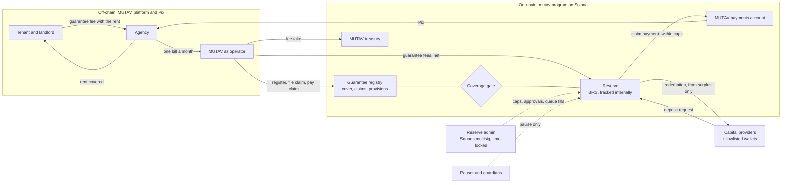
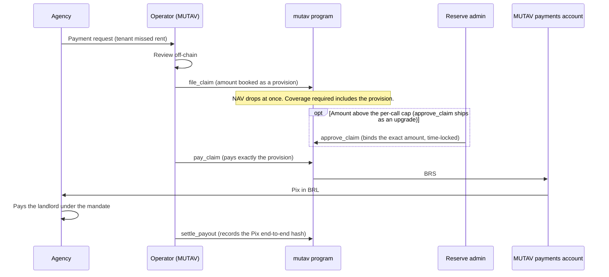
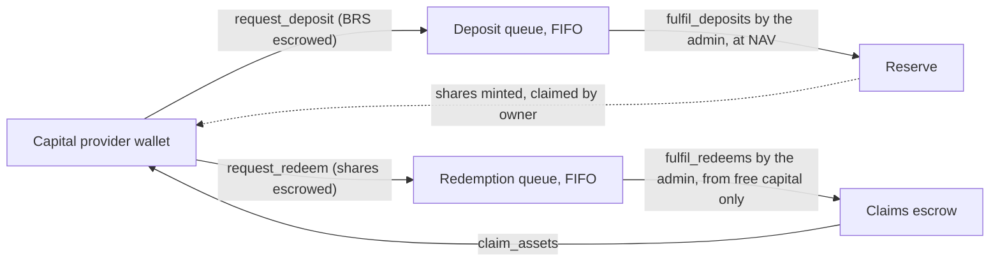

# How it works

This page follows a guarantee from signing to claim payment, then shows how capital enters and leaves the reserve. It names who signs each step. Formulas and account layouts are in the protocol framework and technical resources sections.

## The participants

| Participant | Role in MUTAV | Signs on-chain? |
|---|---|---|
| Tenant | Pays the guarantee fee with the rent. | No |
| Landlord | The creditor of the fiança. Paid through the agency. | No |
| Agency | Runs the lease, collects the fee, pays MUTAV one bill a month, sends payment requests when the tenant defaults. | No |
| **Operator** (MUTAV) | Runs contracts, agencies and the whole guarantee and claim cycle. Registers guarantees, books fees and issuer income, files and pays claims. | Yes, a hot key |
| **Reserve admin** | Looks after the reserve's financial health and security through ceilings: caps, coverage ratio, stress buffer, roles, the allowlist, capital fills, and, once those instructions ship, approval of large claim amounts and unsolicited money. It does not judge contracts. | Yes, a Squads v4 multisig with a time lock |
| **Pauser** | Emergency stop. Can pause and revoke the operator at once. | Yes, a separate key |
| **Guardians** | Up to three keys that can pause and do nothing else. | Yes |
| Capital providers | Hold reserve shares. Request deposits and redemptions. During the pilot this is MUTAV's own capital wallet only. | Yes, their own wallet |
| Anyone | Runs cranks that need no judgment: `refresh` and `advance_queue_head` (and `skim`, once the unsolicited-money instructions ship). | Any signer |

The operator and the reserve admin are separate parties and may be separate companies. That split is the core security rule. During the pilot MUTAV fills both roles with different keys.

## The big picture



Agencies never sign on-chain. They work in the MUTAV platform as they do today. MUTAV performs every chain action as the operator, inside limits the reserve admin sets.

## 1. A guarantee is registered

When a lease is signed, the operator calls `register_guarantee`. The guarantee records:

- its **cover**, split into a default leg (rent and charges in arrears) and an exit leg (the tenant's debts at the end of the lease);
- the agency it belongs to;
- hashes that bind the on-chain record to the signed instrument and the landlord's mandate.

No personal data goes on-chain.

Registration passes the **coverage gate**. The program computes what the reserve must hold after adding the new cover, and refuses if the reserve can't back it. Registration is also refused while the reserve is paused, if a BRS reserve account is frozen, or if the cover exceeds the per-guarantee cap.

The required amount is:

```text
coverage_required = max( c × remaining cover,
                         provisions + min(stress buffer, unprovisioned cover) )
```

- `c` is the coverage ratio, a share of all remaining cover. The program floor is 0.10; devnet and the pilot run at 0.25.
- **Provisions** are filed, unpaid claims. They are always held in full.
- The **stress buffer** is an admin-set R$ amount (R$19k in the pilot) for the claims that could be filed next. Claims arrive one event at a time (one month's rent, or one exit payment), so stress is the next few claims, not every full cover.

## 2. Guarantee fees come in

The tenant pays the guarantee fee to the agency with the rent. Each agency pays MUTAV one consolidated bill a month. Once the money is in BRS, the operator books the bill with `contribute_fees`:

- MUTAV's take goes straight to the treasury account.
- The rest goes into the reserve and raises the value of every share.
- Fees never mint shares.

MUTAV also receives issuer income from its partnership with Nora, the issuer of BRS. Nora pays it into a separate income inbox. Each month the operator books the amount on Nora's statement into the reserve with `sweep_income`. It is reported apart from guarantee fees and never enters the coverage math.

Fees and income are refused while no reserve shares exist, so they can't be lost to share rounding. They wait until the first deposit is filled.

## 3. A claim is filed and paid



The claim rules:

- **File.** The operator files a claim with `file_claim`. The program sets the amount aside as a provision immediately. Each claim is one event, such as one month's rent.
- **Approve, only for large claims.** A claim above the per-call cap (`max_claim_per_call`) needs the reserve admin's `approve_claim`, which binds an exact amount. The admin approves the amount leaving the reserve, not the validity of the claim. The program already refuses a payment above the per-call cap without that approval; `approve_claim` itself ships as an upgrade (see bank-first payment below).
- **Pay.** `pay_claim` pays exactly the filed provision to MUTAV's payments account. Every payment, approved or not, counts toward a strict cap per sliding 31-day window (`max_claim_per_period`), so no 30-day span pays out more than the cap. For an unusually large claim the admin raises that cap in the same proposal as the approval.
- **Amend or withdraw (planned upgrade).** The operator will be able to change the amount with `amend_claim`. Amending to 0 withdraws the claim and releases its provision. Any amendment resets an approval. A withdrawn claim can be filed again with `refile_claim`, which starts from scratch and never reuses an old approval. Neither instruction is in the devnet binary.
- **Settle.** After MUTAV pays the agency by Pix, the operator records the payment with `settle_payout`.

What can stop a claim payment: the filing checks, the cover bound, the caps, the liquid BRS in the reserve, or a frozen reserve account. The coverage gate never stops one, and neither does a pause.

**Bank-first payment.** MUTAV may pay the agency by Pix from its own bank account first. The reserve then reimburses MUTAV's payments account through `pay_claim`. This keeps payments on time while a large approval waits for the time lock, or while a reserve account is frozen. Until `approve_claim` ships, every claim above the per-call cap is paid this way and reimbursed once the approval exists.

The contractual payment deadline and its tracking live in the MUTAV platform. The program records when each claim was filed, paid and settled, all on the claim's own account.

## 4. A guarantee ends

The operator closes a guarantee with `close_guarantee`, giving a reason:

| Reason | When |
|---|---|
| `VOID` | The lease never took effect: nothing was paid and no claim is open. |
| `RELEASED` | The guarantee ended with no open claim. |

Closing releases the remaining cover from the coverage math. The account is never deleted, so the history stays readable. A planned upgrade, `reinstate_guarantee`, will let the operator undo a wrongful close within an admin-set maximum age; it is not in the devnet binary.

The fuller fiança lifecycle (exoneration notice, return of the keys, a claims tail after the lease ends, settlement receipts) is planned work. Space for it is already reserved in the accounts.

## 5. Capital comes in and goes out



- Capital providers hold **reserve shares**. A share is a pro-rata claim on the reserve's net assets.
- Deposits and redemptions are requests that wait in first-in, first-out queues. The reserve admin fills them at the NAV of the fill, inside price bounds set when the proposal is composed.
- **Entry is allowlisted.** Only allowlisted wallets can request a deposit.
- **Exit is open.** Any wallet that already holds shares can redeem, even if it was later removed from the allowlist. Below the minimum request size, a holder may still exit the rest of a small balance, down to a floor of a tenth of the minimum (R$100 in the pilot); a smaller balance waits and stays transferable.
- **Redemptions are paid only from surplus** over what the guarantees need. This is the coverage gate again. If the head request is larger than the free capital, the queue waits. The pilot fills whole requests only.
- Owners can cancel a request or claim what is owed to them at any time, including while paused.
- A pending request can be cancelled by its owner or by the admin, with `cancel_deposit` or `cancel_redeem`. Either way the BRS or the shares go back to the owner's own account.
- MUTAV's own capital uses the same queues with no special treatment.

During the pilot the only capital provider is MUTAV. The reserve is not open to public investment.

An **exit fallback** is part of the design: after a maximum queue wait, anyone can fill the head redemption under the same rules. Its parameter is reserved and set to off for devnet. It is built, together with the claim-notice gate, before any outside capital.

## 6. When things go wrong

| Situation | What happens |
|---|---|
| Claims push the reserve below target | New guarantees and redemptions stop. Claims keep being paid. Capital comes back through deposits, guarantee fees, or a MUTAV backstop. The public label is "reserve below target; MUTAV backstop active". |
| The reserve is underwater: the value of a share falls below the smallest published unit while shares are outstanding | Deposit and redemption fills are refused, so new money never pays for old losses. Holders can still cancel their requests. MUTAV recapitalises through `contribute_fees`, with a fresh reference recorded as a backstop; it mints no shares. |
| The share value moves sharply without a booked inflow | Capital fills refuse, and the next `refresh` latches a halt that only the admin clears. |
| Someone sends money straight to a reserve account | It does not change the share value. A planned upgrade lets anyone sweep it into a separate account for unsolicited money, and the admin return it to the sender or book it into the reserve. |
| The operator key is compromised | The pauser revokes the operator at once. The admin appoints a new operator, who reconciles the platform's records with on-chain events and corrects them with ordinary operator actions. The most a misused operator key can cost is the admin-set claim caps. |
| An emergency | The pauser, a guardian or the admin pauses. Pause stops only capital flows and new guarantees. It never stops claims and never traps holders' money. Only the admin unpauses. |

## Devnet and pilot values

Every value below is set by the reserve admin and changes only through the time-locked multisig. They are the pilot parameters of [ADR 0028](../decisions/0028-pilot-parameters.md).

| Parameter | Devnet value |
|---|---|
| Coverage ratio `c` | 0.25 (program floor 0.10) |
| Stress buffer | R$19k, set and locked |
| Maximum reserve (`max_tvl`) | R$1M |
| Cover per guarantee | R$120k |
| Claim payments | R$15k per call, R$20k per sliding 31-day window |
| Capital requests | R$1k to R$100k |
| Fee take | 20% (`fee_take_bps` 2000) |
| Reserve asset | BRS only, 100% settlement floor |
| Guardians | 1 |
| Admin multisig time lock | 5 minutes on devnet (24 hours on the real pilot) |
| Upgrade multisig time lock | 1 hour on devnet (7 days on the real pilot) |

## Sources

- [Specification §2 Roles and keys](../spec.md#2-roles-and-keys), [§2.1 Money flows](../spec.md#21-three-separate-mutav-money-flows-adr-0009-and-issuer-income-adr-0017), [§4 Invariants and formulas](../spec.md#4-invariants-and-formulas), [§5 Instructions](../spec.md#5-instructions), [§6 Under-coverage mode](../spec.md#6-under-coverage-mode), [§8 Caps](../spec.md#8-caps)
- [Litepaper §7 Guarantee lifecycle](../litepaper.md#7-guarantee-lifecycle), [§9 Capital flows](../litepaper.md#9-capital-flows)
- Program code: [`programs/mutav/src/solvency.rs`](../../programs/mutav/src/solvency.rs), [`programs/mutav/src/instructions/operator/`](../../programs/mutav/src/instructions/operator/), [`programs/mutav/src/instructions/capital/`](../../programs/mutav/src/instructions/capital/), [`programs/mutav/src/instructions/public/`](../../programs/mutav/src/instructions/public/)
- Squads v4: <https://github.com/Squads-Protocol/v4>
- Pix (Banco Central do Brasil): <https://www.bcb.gov.br/estabilidadefinanceira/pix>

## Decisions

- [ADR 0003: Claim payments operated by MUTAV through a whitelisted payments account](../decisions/0003-payments-operated-by-mutav.md)
- [ADR 0005: Solvency gate scope](../decisions/0005-solvency-gate-scope.md)
- [ADR 0006: Per-lease coverage stored as absolute amounts](../decisions/0006-per-lease-absolute-coverage.md)
- [ADR 0007: MUTAV's fee take goes directly to the treasury](../decisions/0007-fee-take-direct-to-treasury.md)
- [ADR 0008: One capital flow for everyone; FIFO deposits; pause never blocks claims](../decisions/0008-uniform-capital-flow-and-pause-scope.md)
- [ADR 0009: Separate MUTAV money flows](../decisions/0009-separate-mutav-money-flows.md)
- [ADR 0010: Partial fills at the queue head](../decisions/0010-partial-fills-at-queue-head.md) (deferred; the pilot fills whole requests)
- [ADR 0012: Guarantees aligned with a limited fiança onerosa](../decisions/0012-fianca-aligned-guarantee-lifecycle.md)
- [ADR 0014: `pay_claim` bound with concurrent filings](../decisions/0014-pay-claim-bound-with-concurrent-filings.md)
- [ADR 0015: Admin clear for the NAV-move halt](../decisions/0015-admin-clear-fulfil-halt.md)
- [ADR 0016: Coverage ratio below 1.0](../decisions/0016-coverage-ratio-below-one.md)
- [ADR 0017: BRS income intake](../decisions/0017-brs-income-intake.md)
- [ADR 0018: BRS-only pilot reserve](../decisions/0018-brs-only-pilot-reserve.md)
- [ADR 0019: v1 layout for the devnet release](../decisions/0019-v1-layout-for-the-devnet-release.md) (agency-cap removal, carved fields)
- [ADR 0020: Operator/admin separation and operator-compromise recovery](../decisions/0020-operator-admin-separation-and-recovery.md)
- [ADR 0021: Claims: approval, amendment and exact payment](../decisions/0021-claims-approval-amendment-exact-payment.md) (includes the payout SLA removal)
- [ADR 0022: Coverage: stress buffer and underwater reserve](../decisions/0022-coverage-stress-buffer-underwater-reserve.md) (amends 0016)
- [ADR 0023: Capital flows and exit rights](../decisions/0023-capital-flows-and-exit-rights.md)
- [ADR 0024: Unsolicited money and backstop contributions](../decisions/0024-unsolicited-money-and-backstop.md)
- [ADR 0025: Exit fallback: a cooldown exit after `max_queue_wait_secs`](../decisions/0025-exit-fallback-cooldown-exit.md)
- [ADR 0026: Program simplification for the freeze](../decisions/0026-program-simplification-for-the-freeze.md)
- [ADR 0028: Pilot parameters](../decisions/0028-pilot-parameters.md)
- [ADR 0029: Claims and capital rules in the program](../decisions/0029-claims-and-capital-rules-in-the-program.md)
