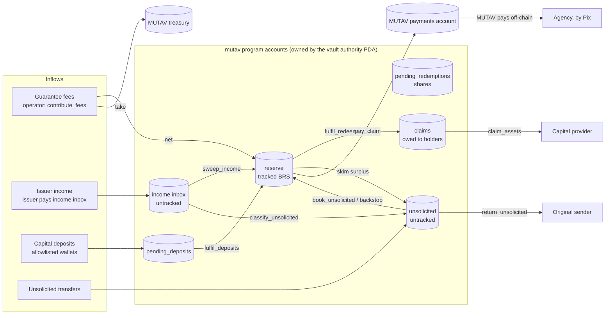

# Reserve framework

The MUTAV reserve is the money that backs MUTAV's rental guarantees. MUTAV is an institutional *fiador*: it gives a paid personal guarantee of a lease (a *fiança*) through the real-estate agency that runs the lease. The `mutav` program on Solana holds the reserve, records every guarantee and its remaining cover, and pays claims from it.

The reserve is operational infrastructure. Its job is to keep the guarantees healthy and to pay claims on time. It is not a yield product, and nothing in this section should be read as an investment offer.

This section describes the reserve as designed for the devnet release ([ADRs 0020 to 0027](../meta/decisions.md)). Where a value is chosen at deploy or still open, the page says so; open items are tracked in [Open questions](../meta/open-questions.md).

## What the reserve does

| Job | How the program does it |
|---|---|
| Holds the money that backs every guarantee | A program-owned BRS token account (`reserve`), tracked by an internal balance (`brs_balance`) |
| Knows how much it must hold | `coverage_required`, computed on-chain from the remaining cover of every guarantee, the open claim provisions and an admin-set stress buffer ([Coverage model](coverage-model.md)) |
| Pays claims | `pay_claim` sends BRS to MUTAV's whitelisted payments account. The solvency gate never refuses it ([Claims and payments](claims-and-payments.md)) |
| Protects the backing | A solvency gate refuses new guarantees and redemption fills that would leave the cover under-backed |
| Takes in money only through booking paths | Guarantee fees, issuer income, capital deposits and admin bookings. Anything else is held apart ([Assets and income](assets-and-income.md), [Unsolicited money](unsolicited-money.md)) |
| Stays recomputable by anyone | Every guarantee, provision, payment and capital movement is an account or an event. `refresh` is permissionless |

## Principles

1. **Claims are never blocked by the solvency gate.** The gate protects the reserve from capital leaving. It never stops a claim payment. Within the admin-set caps, a filed claim is always payable while liquid BRS is there.
2. **Capital leaves only from surplus.** Redemptions and new guarantees must fit in the free capital above `coverage_required`.
3. **Internal accounting.** The program counts the amounts it moved itself, not raw token balances. A direct transfer into a reserve account does not change the share value.
4. **Losses are recognised early.** A filed claim becomes a provision at once and lowers the share value before it is paid.
5. **Separate money flows.** Guarantee fees, MUTAV's operating take, MUTAV's own capital and issuer income each have their own instruction and their own account. They never mix.
6. **Operator and admin are separate.** The operator runs the guarantee and claim cycle. The reserve admin looks after financial health and security through ceilings. The most a compromised operator key can take is bounded by the admin-set claim caps.
7. **No stuck money.** Every token that reaches a program account has a defined way out: booked into the reserve, paid to its owner, or returned to its sender.

## Money map

## Accounts that hold money

All reserve token accounts are ordinary SPL Token accounts owned by the vault authority PDA (`["authority", config]`). Splitting them means one issuer freeze does not trap every balance.

| Account | Seeds | Holds | Counts toward NAV and coverage |
|---|---|---|---|
| `reserve` | `["reserve", config]` | The liquid reserve in BRS | Yes, through the tracked `brs_balance` |
| `pending_deposits` | `["pending_deposits", config]` | BRS escrowed by deposit requests | No, until a fill moves it to `reserve` |
| `pending_redemptions` | `["pending_redemptions", config]` | Shares escrowed by redeem requests | No (shares, not BRS) |
| `claims` | `["claims", config]` | BRS owed to holders on filled redemptions | No |
| Income inbox | Associated token account of the vault authority for BRS | Issuer income waiting to be swept | No, until `sweep_income` books a statement |
| `unsolicited` | `["unsolicited", config]` | Money that arrived outside a booking path | No, until the admin books it |

## Who acts on the reserve

| Role | Key | Reserve duties |
|---|---|---|
| Operator | Hot key (devnet: generated at deploy) | Registers, closes and reinstates guarantees, books guarantee fees and issuer income, files, amends (including to 0, a withdrawal), re-files and pays claims, records settlement |
| Reserve admin | Squads v4 multisig vault, time-locked | Sets caps, the coverage ratio and the stress buffer; approves claim amounts above the per-call cap; fills the capital queues; books or returns unsolicited money; books MUTAV's backstop; appoints roles and guardians |
| Pauser and guardians | Separate keys | Pause capital flows and new guarantees. The pauser can also revoke the operator. Up to three guardians, one on devnet |
| Anyone | Any signer | `refresh`, `advance_queue_head`, `skim` |

## Pages in this section

1. [Coverage model](coverage-model.md): how much the reserve must hold, the solvency gate, under-coverage and the backstop.
2. [Claims and payments](claims-and-payments.md): filing, approval, amendment, withdrawal and exact payment of claims, within per-call and sliding 31-day caps.
3. [Assets and income](assets-and-income.md): the BRS-only reserve, the settlement floor, adapters and the liquidity floor later, guarantee fees and issuer income.
4. [Unsolicited money](unsolicited-money.md): how money that arrives outside a booking path is held, returned or booked.
5. [Parameters](parameters.md): every devnet parameter, its value and who sets it.

## Related sections

- [Introduction](../introduction/README.md)
- [For rental agencies](../for-agencies/README.md)
- [For capital providers](../for-capital-providers/README.md)
- [Architecture](../architecture/README.md)
- [Invariants](../security/invariants.md)
- [Program reference](../technical-resources/program-reference.md)
- [Decisions](../meta/decisions.md)

## Sources

- [Specification §1 Principles](../spec.md#1-principles), [§2.1 Money flows](../spec.md#21-three-separate-mutav-money-flows-adr-0009-and-issuer-income-adr-0017), [§3.3 Vault authority and token accounts](../spec.md#33-vault-authority-and-token-accounts)
- [Litepaper](../litepaper.md)
- Program seeds: [`programs/mutav/src/constants.rs`](../../programs/mutav/src/constants.rs)
- Solvency math: [`programs/mutav/src/solvency.rs`](../../programs/mutav/src/solvency.rs)

## Decisions

- [ADR 0002: Core program and capped adapters](../decisions/0002-core-program-and-capped-adapters.md)
- [ADR 0003: Payments operated by MUTAV](../decisions/0003-payments-operated-by-mutav.md)
- [ADR 0004: On-chain NAV with internal accounting](../decisions/0004-onchain-nav-internal-accounting.md)
- [ADR 0005: Solvency gate scope](../decisions/0005-solvency-gate-scope.md)
- [ADR 0009: Separate MUTAV money flows](../decisions/0009-separate-mutav-money-flows.md)
- [ADR 0016: Coverage ratio below one](../decisions/0016-coverage-ratio-below-one.md)
- [ADR 0017: BRS income intake](../decisions/0017-brs-income-intake.md)
- [ADR 0018: BRS-only pilot reserve](../decisions/0018-brs-only-pilot-reserve.md)
- [ADR 0020: Operator/admin separation and operator-compromise recovery](../decisions/0020-operator-admin-separation-and-recovery.md)
- [ADR 0021: Claims: approval, amendment and exact payment](../decisions/0021-claims-approval-amendment-exact-payment.md)
- [ADR 0022: Coverage: stress buffer and underwater reserve](../decisions/0022-coverage-stress-buffer-underwater-reserve.md) (amends 0016)
- [ADR 0024: Unsolicited money and backstop contributions](../decisions/0024-unsolicited-money-and-backstop.md)
- [ADR 0027: Multi-asset adapters, liquidity floor and rebalancing](../decisions/0027-multi-asset-adapters-liquidity-floor-rebalancing.md) (proposed)
