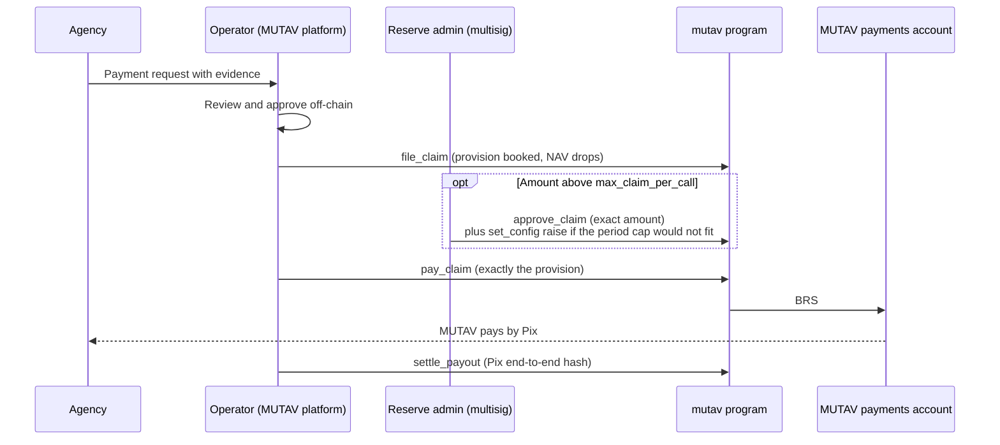
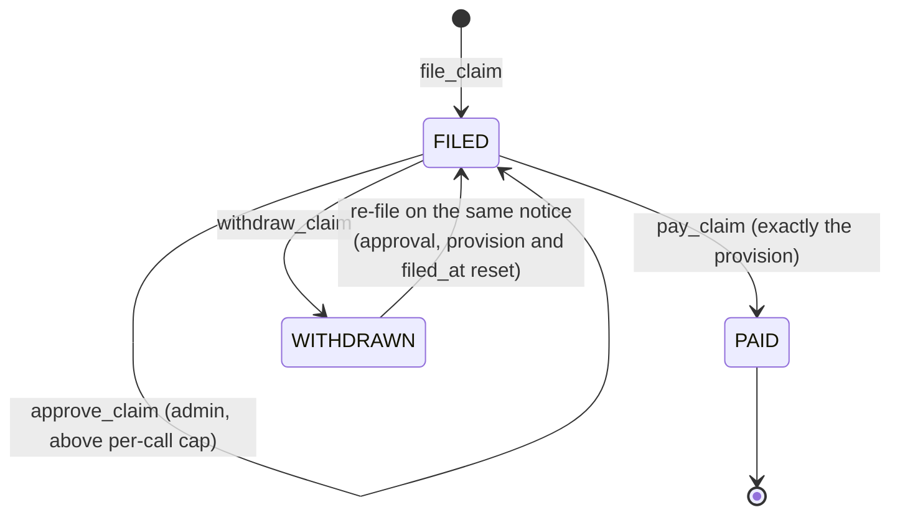

# Claims and payments

A claim is a payment request from the agency, on the landlord's behalf, under a guarantee. MUTAV reviews and approves it in its platform. The operator then records it on-chain, and the reserve pays it to MUTAV's payments account. MUTAV pays the agency by Pix.

The program does not judge claims. It enforces how much can leave the reserve, and how fast, through caps the reserve admin sets.

## The claim cycle



## Claim states



`ClaimFiling` lives at `["claim", guarantee, notice_ref_hash]`. Its statuses are `FILED = 0`, `PAID = 1` and `WITHDRAWN = 2`. A paid notice cannot be paid again: `pay_claim` creates the `Payout` account for that notice, and a second payment fails at account creation.

## Instructions

| Instruction | Signer | What it does | Pause | Solvency gate |
|---|---|---|---|---|
| `file_claim(leg, amount, notice_ref_hash)` | Operator | Books a provision of `amount` on the leg. NAV reflects the claim at once. Requires an active guarantee and `amount ≤ leg_cover − leg_paid − leg_provision` | Runs | Never |
| `amend_claim(notice_ref_hash, new_amount)` | Operator | Lowers or raises a filed claim. Lowering releases the difference. Raising books more, within the leg's unprovisioned cover. Resets any approval. Emits `ClaimAmended { old, new }` | Runs | Never |
| `withdraw_claim(notice_ref_hash)` | Operator | Releases the provision and marks the filing `WITHDRAWN`. The notice can be filed again | Runs | Never |
| `approve_claim(notice_ref_hash, amount)` | Reserve admin | Records `approved_amount` on a filed claim above the per-call cap. The admin approves the amount that may leave the reserve, not the claim's validity | Runs | Never |
| `pay_claim(leg, amount, notice_ref_hash)` | Operator | Pays exactly the filing's provision to the payments account | Runs | Never |
| `settle_payout(notice_ref_hash, pix_e2e_hash)` | Operator | Records the hash of the Pix end-to-end ID once MUTAV has paid the agency | Runs | Never |

Legs: `LEG_DEFAULT = 0` (rent and charges in arrears) and `LEG_EXIT = 1` (end-of-occupation debts). Each guarantee stores both leg covers as absolute amounts at registration, and they never change.

## Exact payment

`pay_claim` pays **exactly** the filing's provision. There is no partial payment and no hidden release.

- If the amount owed is smaller than filed, the operator runs `amend_claim` down, then pays.
- If the amount owed grew (for example another month of arrears), the operator runs `amend_claim` up, within the leg's unprovisioned cover, then pays.
- If the filing was a mistake, the operator runs `withdraw_claim`.

Because a payment equals its own provision, it can never spend cover that another open filing on the same leg has provisioned. Every open filing on a leg is always payable, and a guarantee can always reach zero open claims.

## `pay_claim` checks

In order:

1. The filing is `FILED` and its leg matches.
2. `amount == filing.provision`.
3. `amount ≤ max_claim_per_call`, or `amount == approved_amount` on this filing.
4. The sliding-window total plus `amount` ≤ `max_claim_per_period`. Approved payments count.
5. The destination is `config.payments_account`.
6. `reserve` is not frozen and `brs_balance ≥ amount`.

There is no solvency, mode, pause or NAV-guard check. The cached `coverage_required` write saturates, so it can never make a payment fail.

**Effects:** BRS moves from `reserve` to the payments account. The leg's paid amount rises, the provision is released, `open_claims` falls, and the filing becomes `PAID`. `remaining_cover_total` and `brs_balance` fall by the amount. The claim window and lifetime counters rise. A `Payout { PENDING }` account is created, and `ClaimPaid` is emitted.

## Caps

| Cap | Devnet value | Rule |
|---|---|---|
| `max_claim_per_call` | R$10,000 | Largest payment without an admin approval |
| `max_claim_per_period` | R$20,000 | Most paid in any sliding window of `claim_period_secs`, approved payments included |
| `claim_period_secs` | 30 days | Window length. Bounded above by 90 days, so the window always rolls |

`set_config` requires `max_claim_per_call > 0` and `max_claim_per_period ≥ max_claim_per_call`.

### Sliding 30-day window

The window keeps two buckets of length `claim_period_secs`: the current one and the previous one. A payment is checked against the current bucket plus the previous bucket, weighted by the share of it still inside the trailing window.

```text
elapsed   = now − claim_period_start                                  // after rolling buckets
estimate  = prev_paid × (period − elapsed) / period + current_paid    // rounded up
require     estimate + amount ≤ max_claim_per_period
```

No 30-day span pays more than `max_claim_per_period`. The previous bucket's weight rounds up, in the reserve's favour. Exact field names and rounding are pinned at implementation.

### Claims above the per-call cap

1. The operator files the claim as usual. The provision is booked at once.
2. The reserve admin proposes `approve_claim(notice_ref_hash, amount)` in the Squads multisig. The approval binds the exact amount.
3. If the payment would not fit in the sliding window, the same proposal also raises `max_claim_per_period` with `set_config`. A later `set_config` lowers it back.
4. After the time lock, the operator calls `pay_claim` for exactly that amount.

There is no separate threshold parameter: the threshold is `max_claim_per_call`. Amending the claim resets the approval, so a new amount needs a new approval. Re-filing a withdrawn notice also starts with no approval.

### What the caps bound

The claim caps bound what the operator key can move out of the reserve. They do not bound what MUTAV owes the landlord, which the guarantee's cover sets. `pay_claim` is the only irreversible operator action, so the claim caps are also the most a compromised operator key can take from the reserve. Every other operator action can be undone by another operator action:

| Operator action | Undone by |
|---|---|
| `register_guarantee` | `close_guarantee(VOID)` |
| `close_guarantee` | `reinstate_guarantee`, within `max_reinstate_age` |
| `file_claim` | `withdraw_claim` |
| `amend_claim` | Another `amend_claim` |

Claim payments land only in MUTAV's own payments account.

## Bank-first payment and reimbursement

MUTAV may pay the agency by Pix from its own bank account first. The reserve then reimburses MUTAV's payments account through the normal `pay_claim`. This keeps landlords paid on time when:

- a claim above the per-call cap waits for the admin's time-locked approval;
- the sliding window is full;
- the reserve's BRS account is frozen or liquid BRS is short.

The reimbursement follows every rule above: exact amount, caps, approval and the payments account.

## Settlement

`settle_payout` records `pix_e2e_hash`, the hash of the Pix end-to-end ID, and moves the `Payout` from `PENDING` to `SETTLED`. It is a settlement record only. The program keeps no payout deadline. Payment deadlines (review, information requests, approval and execution) live in the MUTAV platform.

## Recorded on-chain for every claim

| Record | Where |
|---|---|
| Filed amount and filing time | `ClaimFiling.provision`, `filed_at`; event `ClaimFiled` |
| Amendments | Event `ClaimAmended { old, new }` |
| Approved amount | `ClaimFiling.approved_amount` |
| Withdrawal | `ClaimFiling.status = WITHDRAWN` |
| Payment | `Payout` account; event `ClaimPaid` |
| Settlement | `Payout.pix_e2e_hash`, `settled_at`; event `PayoutSettled` |

## Not in this release

- Claim notices (`ClaimNotice`), which would hold capital fills while a missed rent is known but not yet filed, are built before any outside capital. Until then the runbook is to file the claim before any fill.
- The fuller *fiança* lifecycle (exoneration, lease end, claims tail, claim categories, a settlement receipt hash) arrives as carves into reserved account space.

## Sources

- [Specification §5.4 Claims and payouts](../spec.md#54-claims-and-payouts-operator), [§8 Caps](../spec.md#8-caps)
- Devnet release design decisions of 2026-10-10: `approve_claim`, `amend_claim`, `withdraw_claim`, exact payment, sliding window, bank-first payment, payout deadline removed from the program (MUTAV internal decision log)
- Program: [`programs/mutav/src/instructions/operator/`](../../programs/mutav/src/instructions/operator/) (`file_claim.rs`, `pay_claim.rs`, `settle_payout.rs`), [`programs/mutav/src/state/claim.rs`](../../programs/mutav/src/state/claim.rs), [`programs/mutav/src/state/payout.rs`](../../programs/mutav/src/state/payout.rs)
- [Pix, Banco Central do Brasil](https://www.bcb.gov.br/estabilidadefinanceira/pix)

## Decisions

- [ADR 0003: Payments operated by MUTAV](../decisions/0003-payments-operated-by-mutav.md) (settlement deadline flag superseded: removed from the program)
- [ADR 0005: Solvency gate scope](../decisions/0005-solvency-gate-scope.md)
- [ADR 0006: Per-lease absolute coverage](../decisions/0006-per-lease-absolute-coverage.md)
- [ADR 0012: *Fiança*-aligned guarantee lifecycle](../decisions/0012-fianca-aligned-guarantee-lifecycle.md) (admin path amended by the pending claims ADR)
- [ADR 0014: `pay_claim` bound with concurrent filings](../decisions/0014-pay-claim-bound-with-concurrent-filings.md) (superseded in effect by exact payment)
- Pending ADR: Claims: approval, amendment, exact payment, sliding window
- Pending ADR: Operator/admin separation and operator-compromise recovery
- Pending ADR: 0019 v1 layout for the devnet release (payout deadline removed, `approved_amount` carved)
