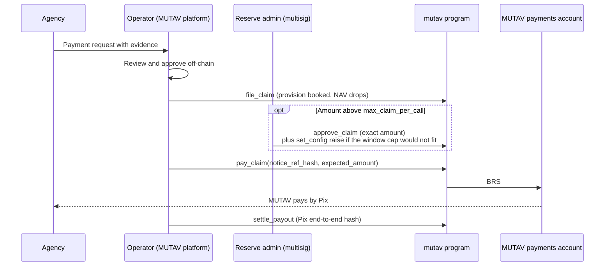
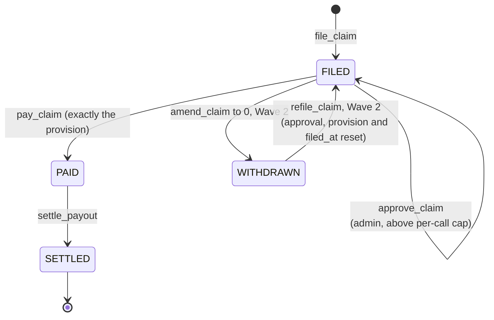

# Claims and payments

A claim is a payment request from the agency, on the landlord's behalf, under a guarantee. MUTAV reviews and approves it in its platform. The operator then records it on-chain, and the reserve pays it to MUTAV's payments account. MUTAV pays the agency by Pix.

The program does not judge claims. It enforces how much can leave the reserve, and how fast, through caps the reserve admin sets.

The devnet binary has `file_claim`, `approve_claim` (the admin approval above the per-call cap), `pay_claim` and `settle_payout`. Amendment and withdrawal (`amend_claim`) and re-filing (`refile_claim`) are Wave 2 ([ADR 0021](../decisions/0021-claims-approval-amendment-exact-payment.md), [ADR 0029](../decisions/0029-claims-and-capital-rules-in-the-program.md)); this page marks them where they appear.

## The claim cycle



## Claim states



`ClaimFiling` lives at `["claim", guarantee, notice_ref_hash]`. It holds the whole life of one claim: the filing, any approval, the payment and its settlement. There is no separate payout account. Its status is a `u8`, append-only:

| Value | Status | Meaning |
|---|---|---|
| 0 | `FILED` | Provisioned, awaiting payment |
| 1 | `PAID` | Paid by the reserve to `payments_account`; no longer amendable |
| 2 | `WITHDRAWN` | Provision released; may be filed again only through `refile_claim`. Reached only through `amend_claim` to 0, so unused until Wave 2 |
| 3 | `SETTLED` | Payment recorded as delivered off-chain; terminal |

A notice can be paid only once: `pay_claim` requires `FILED`, and a `PAID` or `SETTLED` filing never returns to `FILED`.

## Instructions

| Instruction | Signer | What it does | Pause | Coverage gate |
|---|---|---|---|---|
| `file_claim(leg, amount, notice_ref_hash)` | Operator | Books a provision of `amount` on the leg. NAV reflects the claim at once. Requires an active guarantee and `amount ≤ leg_cover − leg_paid − leg_provision`. No cap applies at filing | Runs | Never |
| `amend_claim(notice_ref_hash, new_amount)` (Wave 2) | Operator | Lowers or raises a `FILED` claim. Lowering releases the difference. Raising books more, within the leg's unprovisioned cover. `new_amount = 0` withdraws the claim: status `WITHDRAWN`, the whole provision released, event `ClaimWithdrawn`. Any amendment resets `approved_amount` to 0. Refused on `PAID` and `SETTLED`. Emits `ClaimAmended { old, new }` | Runs | Never |
| `refile_claim(leg, amount, notice_ref_hash)` (Wave 2) | Operator | Same arguments as `file_claim`. Accepts only a `WITHDRAWN` filing and returns it to `FILED`, resetting `approved_amount`, `provision` and `filed_at`. An old approval is never reused | Runs | Never |
| `approve_claim(notice_ref_hash, amount, expected_revision)` | Reserve admin | Records `approved_amount` on a `FILED` claim above the per-call cap. `amount` must be above 0 and equal the provision (`ExpectedAmountMismatch`), and `expected_revision` must equal the filing's revision (`ClaimRevisionMismatch`). No cap is read and no funds move; works with the operator revoked. The admin approves the amount that may leave the reserve, not the claim's validity. Emits `ClaimApproved` | Runs | Never |
| `pay_claim(notice_ref_hash, expected_amount)` | Operator | Pays exactly the filing's provision to the payments account. Refuses with `ExpectedAmountMismatch` unless `expected_amount` equals the provision | Runs | Never |
| `settle_payout(notice_ref_hash, pix_e2e_hash)` | Operator | Records the hash of the Pix end-to-end ID on the filing once MUTAV has paid the agency; status `SETTLED` | Runs | Never |

Legs: `LEG_DEFAULT = 1` (rent and charges in arrears) and `LEG_EXIT = 2` (end-of-occupation debts); `0` is refused with `InvalidParameter`. Each guarantee stores both leg covers as absolute amounts at registration, and they never change.

## Exact payment

`pay_claim` pays **exactly** the filing's provision. There is no partial payment and no hidden release.

With Wave 2:

- If the amount owed is smaller than filed, the operator runs `amend_claim` down, then pays.
- If the amount owed grew (for example another month of arrears), the operator runs `amend_claim` up, within the leg's unprovisioned cover, then pays.
- If the filing was a mistake, the operator runs `amend_claim` to 0, which withdraws it. A withdrawn notice can be filed again with `refile_claim`.

Until then a filing is paid as filed, so the operator files only the amount owed; a further amount owed on the same leg is filed as a new notice.

Because a payment equals its own provision, it can never spend cover that another open filing on the same leg has provisioned. Every open filing on a leg is always payable, and a guarantee can always reach zero open claims.

## `pay_claim` checks

In order:

1. The filing is `FILED` (`ClaimNotFiled`).
2. `expected_amount == filing.provision` (`ExpectedAmountMismatch`). The payment amount is the provision.
3. The [ADR 0014](../decisions/0014-pay-claim-bound-with-concurrent-filings.md) bound on the leg, which an exact payment always meets (`ExceedsRemainingCover`).
4. The provision is `≤ max_claim_per_call`, or `approved_amount == provision` on this filing (`ClaimCallCapExceeded`). Only the admin's `approve_claim` writes `approved_amount`.
5. The payments of the last 31 days plus this one stay `≤ max_claim_per_period` (`ClaimPeriodCapExceeded`). Approved payments count.
6. The destination is `config.payments_account` (`InvalidPaymentsAccount`).
7. `brs_balance ≥ amount` (`InsufficientLiquidBalance`) and `reserve` is not frozen (`ReserveFrozen`).

There is no coverage, mode, pause or NAV-guard check. The stress-buffer term and the cached `coverage_required` write saturate, so they can never make a payment fail.

**Effects:** BRS moves from `reserve` to the payments account. The leg's paid amount rises, the provision is released, `open_claims` falls, and the filing becomes `PAID` with `payments_account`, `paid_at` and `paid_amount` written on it. `remaining_cover_total` and `brs_balance` fall by the amount. Today's claim bucket and the lifetime counters rise, and `ClaimPaid` is emitted.

## Caps

| Cap | Devnet and pilot value ([ADR 0028](../decisions/0028-pilot-parameters.md)) | Rule |
|---|---|---|
| `max_claim_per_call` | R$15,000 | Largest payment without an admin approval |
| `max_claim_per_period` | R$20,000 | Most paid in any sliding 31-day window, approved payments included |

`set_config` requires `max_claim_per_call > 0` and `max_claim_per_period ≥ max_claim_per_call`. The window length is fixed by the program; there is no period-length parameter.

### Sliding 31-day window

`VaultState` keeps 31 daily buckets: a ring of 31 totals indexed by day number (`claim_day_buckets`), plus the day of the last write (`claim_day_anchor`). A bucket older than 31 days is cleared before it is reused.

```text
require  sum(payments of the last 31 days) + amount ≤ max_claim_per_period
```

The rule is exact, with no weighting or estimate. Every 30-day span lies inside some 31-day window of whole days, so no 30-day span ever pays out more than the cap. A property test checks this, including across bucket reuse and a cap change in the middle of a window.

### Claims above the per-call cap

The approval flow:

1. The operator files the claim as usual. The provision is booked at once.
2. The reserve admin proposes `approve_claim(notice_ref_hash, amount, expected_revision)` in the Squads multisig. The approval binds the exact amount, at the filing's current revision; a proposal composed against an earlier revision is refused when it executes (`ClaimRevisionMismatch`).
3. If the payment would not fit in the sliding window, the same proposal also raises `max_claim_per_period` with `set_config`. A later `set_config` lowers it back.
4. After the time lock, the operator calls `pay_claim` with `expected_amount` equal to that amount.

There is no separate threshold parameter: the threshold is `max_claim_per_call`. With Wave 2, amending the claim resets the approval, so a new amount needs a new approval. Re-filing a withdrawn notice with `refile_claim` also starts with no approval.

Such a claim is filed and provisioned in full (`file_claim` has no interim cap). While the approval waits on the time lock, MUTAV may pay it bank-first, and the reserve reimburses `payments_account` once the approval exists.

### What the caps bound

The claim caps bound what the operator key can move out of the reserve. They do not bound what MUTAV owes the landlord, which the guarantee's cover sets. `pay_claim` is the only irreversible operator action, so the claim caps are also the most a compromised operator key can take from the reserve. With Wave 2, every other operator action can be undone by another operator action:

| Operator action | Undone by |
|---|---|
| `register_guarantee` | `close_guarantee(id, CLOSE_VOID)` (an active guarantee with nothing paid on either leg and no open claim) |
| `close_guarantee` | `reinstate_guarantee`, within `max_reinstate_age` (Wave 2; planned 30 days) |
| `file_claim` | `amend_claim` to 0, `WITHDRAWN` (Wave 2) |
| `amend_claim` | Another `amend_claim` (Wave 2) |

In the devnet binary only the void close exists; a close or a filing is corrected off-chain until Wave 2. Close reasons are `CLOSE_RELEASED = 1` (no open claim) and `CLOSE_VOID = 2`.

Claim payments land only in MUTAV's own payments account.

## Bank-first payment and reimbursement

MUTAV may pay the agency by Pix from its own bank account first. The reserve then reimburses MUTAV's payments account through the normal `pay_claim`. This keeps landlords paid on time when:

- a claim above the per-call cap waits for the admin's time-locked approval (24 hours in the real pilot);
- the sliding window is full;
- the reserve's BRS account is frozen or liquid BRS is short.

The reimbursement follows every rule above: exact amount, caps, approval and the payments account.

## Settlement

`settle_payout` records `pix_e2e_hash`, the hash of the Pix end-to-end ID, and `settled_at` on the `ClaimFiling`, and moves it from `PAID` to `SETTLED`. It is a settlement record only. The program keeps no payout deadline. The service level (review, information requests, approval and execution, with the contractual term plus a 48-hour target) lives in the MUTAV platform. The reserve's only on-chain promise: within the caps, `pay_claim` is never refused by the coverage gate or a pause.

While MUTAV holds both the operator and admin roles, the Pix hash is the only settlement record. Once the roles are held by separate companies, an attestation of the registry and of claim settlements becomes required ([ADR 0020](../decisions/0020-operator-admin-separation-and-recovery.md)).

## Recorded on-chain for every claim

| Record | Where |
|---|---|
| Filed amount and filing time | `ClaimFiling.provision`, `filed_at`; event `ClaimFiled` |
| Amendments (Wave 2) | Event `ClaimAmended { old, new }` |
| Approved amount | `ClaimFiling.approved_amount` (0 = not approved) at `ClaimFiling.revision`; event `ClaimApproved` |
| Withdrawal (Wave 2) | `ClaimFiling.status = WITHDRAWN`; event `ClaimWithdrawn` |
| Payment | `ClaimFiling.payments_account`, `paid_at`, `paid_amount`, status `PAID`; event `ClaimPaid` |
| Settlement | `ClaimFiling.pix_e2e_hash`, `settled_at`, status `SETTLED`; event `PayoutSettled` |

## Not in this release

- Claim notices (`ClaimNotice`), which would hold capital fills while a missed rent is known but not yet filed, are built before any outside capital, together with the exit fallback ([ADR 0025](../decisions/0025-exit-fallback-cooldown-exit.md)). Until then the runbook is to file the claim before any fill.
- The fuller *fiança* lifecycle (exoneration, lease end, claims tail, claim categories, a settlement receipt hash) arrives as carves into reserved account space.

## Sources

- [Specification §5.4 Claims and payouts](../spec.md#54-claims-and-payouts-operator), [§8 Caps](../spec.md#8-caps)
- Program: [`programs/mutav/src/instructions/operator/`](../../programs/mutav/src/instructions/operator/) (`file_claim.rs`, `pay_claim.rs`, `settle_payout.rs`), [`programs/mutav/src/state/claim.rs`](../../programs/mutav/src/state/claim.rs)
- [Pix, Banco Central do Brasil](https://www.bcb.gov.br/estabilidadefinanceira/pix)

## Decisions

- [ADR 0003: Payments operated by MUTAV](../decisions/0003-payments-operated-by-mutav.md) (settlement deadline flag superseded: removed from the program)
- [ADR 0005: Coverage gate scope](../decisions/0005-solvency-gate-scope.md)
- [ADR 0006: Per-lease absolute coverage](../decisions/0006-per-lease-absolute-coverage.md)
- [ADR 0012: *Fiança*-aligned guarantee lifecycle](../decisions/0012-fianca-aligned-guarantee-lifecycle.md) (admin path superseded by ADR 0021)
- [ADR 0014: `pay_claim` bound with concurrent filings](../decisions/0014-pay-claim-bound-with-concurrent-filings.md) (superseded in effect by exact payment)
- [ADR 0020: Operator/admin separation and operator-compromise recovery](../decisions/0020-operator-admin-separation-and-recovery.md)
- [ADR 0021: Claims: approval, amendment and exact payment](../decisions/0021-claims-approval-amendment-exact-payment.md)
- [ADR 0026: Program simplification for the freeze](../decisions/0026-program-simplification-for-the-freeze.md) (`Payout` merged into `ClaimFiling`)
- [ADR 0028: Pilot parameters](../decisions/0028-pilot-parameters.md) (claim caps)
- [ADR 0029: Claims and capital rules in the program](../decisions/0029-claims-and-capital-rules-in-the-program.md) (ADR 0021 rules confirmed in the binary; approval, amendment and re-filing in Wave 2)
- ADR 0019: v1 layout for the devnet release (payout deadline removed, claim fields and window buckets carved)
