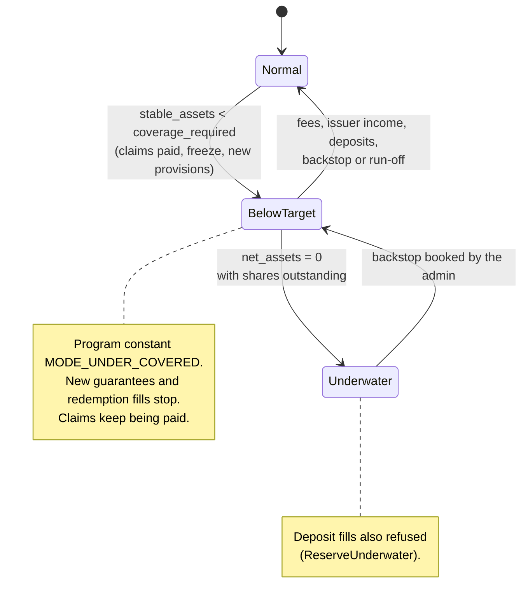

# Coverage model

The reserve does not hold the full cover of every lease. It holds a share of it, set by the coverage ratio `c`, or enough to pay every filed claim plus the claims that could be filed next, whichever is larger. The program computes this target on-chain and uses it to gate new guarantees and redemptions. It never uses it to refuse a claim payment.

## The formula

```text
remaining_cover(g)    = (default_cover − default_paid) + (exit_cover − exit_paid)
remaining_cover_total = Σ remaining_cover(g) over guarantees not CLOSED
unprovisioned_cover   = remaining_cover_total − provisions

coverage_required = max( ceil(c × remaining_cover_total / 10_000),
                         provisions + min(stress_buffer, unprovisioned_cover) )
```

| Term | Meaning | Set by |
|---|---|---|
| `remaining_cover_total` | Cover not yet paid across every guarantee that is not closed | Operator actions (register, close, reinstate, pay) |
| `c` (`coverage_ratio_bps`) | Share of remaining cover the reserve must hold. Program floor 0.10 (`MIN_COVERAGE_RATIO_BPS = 1_000`), upper cap 1.0 (10,000 bps) | Reserve admin, through `set_config` |
| `provisions` | Sum of open claim provisions | Operator actions (file, amend, including amend to 0, re-file, pay) |
| `stress_buffer` | A R$ amount for the claims that could be filed next | Reserve admin, through `set_config` |
| `unprovisioned_cover` | Cover not yet paid and not already provisioned | Derived |

The two terms answer different questions.

- **The ratio term** is the long-run backing of the whole book. At `c = 0.10`, R$1 of reserve backs R$10 of cover.
- **The claims term** makes sure filed claims are always held in full, plus a buffer for the next claims. It binds when the book is small or when many claims are open.

`coverage_required` is never below `provisions`. The `min` keeps the buffer from asking for more than the cover that could still be claimed.

### Worked examples

Values in R$, with `c = 0.10` and `stress_buffer = 19,000` (the devnet values).

| Book | Remaining cover | Provisions | Ratio term | Claims term | `coverage_required` |
|---|---|---|---|---|---|
| Small book | 120,000 | 4,000 | 12,000 | 4,000 + min(19,000, 116,000) = 23,000 | 23,000 (claims term binds) |
| Larger book | 1,000,000 | 5,000 | 100,000 | 5,000 + 19,000 = 24,000 | 100,000 (ratio term binds) |
| Book nearly claimed out | 10,000 | 6,000 | 1,000 | 6,000 + min(19,000, 4,000) = 10,000 | 10,000 (capped at remaining cover) |

## Why claims are per event

A claim is one event, not a full cover. A default claim is about one month's rent in arrears. An exit claim is one payment for end-of-occupation debts. The risk the reserve faces next is the claims that could be filed soon, not every full cover at once. That is what the stress buffer sizes.

## Sizing the stress buffer

The reserve admin sizes `stress_buffer` from the live book and resizes it with `set_config` as the book changes.

- **Rule used for devnet:** the three largest monthly rents in the book plus one exit payment.
- **Devnet value:** R$19,000.
- **Bounds:** `set_config` validates the whole resulting config and refuses an out-of-range value. The exact upper bound is set in the program's `validate_params`.
- **On the claim path** the stress-buffer term and the cached `coverage_required` write saturate, so they can never make a claim payment fail.

The formula applies wherever `coverage_required` is used: the `register_guarantee` gate, `refresh`, `fulfil_redeems`, and the recompute after `file_claim`, `amend_claim`, `refile_claim`, `pay_claim`, `close_guarantee` and `reinstate_guarantee`.

The buffer gates new guarantees and redemptions. It never gates a claim payment.

## Solvency quantities

```text
stable_assets  = brs_balance (+ adapter value, 0 in this release)   // computed at every gate; 0 for a frozen reserve
surplus        = max(0, stable_assets − coverage_required)
free_capital   = surplus                                            // no phase-2 earmark in v1
liquid_budget  = max(0, brs_balance − provisions)
net_assets     = max(0, stable_assets − provisions)
```

- `stable_assets` excludes pending deposits and BRS owed to holders on filled redemptions.
- A provision lowers `net_assets` (and so NAV) but never `stable_assets`. The claim is already inside the remaining cover, so nothing is counted twice.
- Rounding always favours the reserve: `coverage_required` rounds up.

## The solvency gate

| Instruction | Gate |
|---|---|
| `register_guarantee` | Mode normal, reserve not frozen (the instruction loads `reserve`; a frozen one counts as 0 and refuses with `ReserveFrozen`), and `coverage_required` after the new cover ≤ `stable_assets` |
| `fulfil_redeems` | Mode normal, and each fill within `min(free_capital, liquid_budget)`. With adapters (ADR 0027, decided point), also never below the BRS liquidity floor while any adapter holds value |
| `fulfil_deposits` | Not solvency-gated. Allowed in under-coverage, because new capital is the recapitalisation path. Refused when the reserve is underwater (below) |
| `file_claim`, `amend_claim`, `refile_claim`, `approve_claim`, `pay_claim`, `settle_payout` | Never gated |
| `contribute_fees`, `sweep_income`, `close_guarantee`, `reinstate_guarantee`, owner cancels and claims, `refresh`, `advance_queue_head`, `skim` | Never gated |

## Reserve modes



### Below target (under-coverage)

The mode is `MODE_UNDER_COVERED` when `stable_assets < coverage_required`. `refresh` records it and emits `ModeChanged`, and every gated instruction checks it inline. It can happen after claim payments (at `c < 1` a payment of `a` lowers stable assets by `a` but `coverage_required` only by about `c × a`), after new provisions, or after an issuer freeze.

| Stops | Keeps working |
|---|---|
| `register_guarantee`, `fulfil_redeems` | Every claim instruction, `contribute_fees`, `sweep_income`, `fulfil_deposits`, `close_guarantee`, owner cancels and claims, cranks, admin configuration |

The reserve returns to normal on the next `refresh` once `stable_assets ≥ coverage_required` again: through guarantee fees, swept issuer income, new deposits, a backstop booking, or the book running off.

Public surfaces label this state "reserve below target; MUTAV backstop active". Reserve health is an operational metric. The landlord's claim is against MUTAV Brasil as *fiador*, not against the reserve alone.

### Underwater

The reserve is underwater when `net_assets` is 0 while shares are outstanding: open provisions have used up every tracked asset. Published NAV is floored at 1 unit (10⁻⁹ BRS per share) whenever shares are outstanding.

- `fulfil_deposits` refuses with `ReserveUnderwater`. New money never pays for old losses.
- Claims keep being paid while liquid BRS is there. A filed claim already sits inside the provisions.
- **Recovery is MUTAV's backstop.** MUTAV sends its own BRS, and the reserve admin books it into the reserve with `book_unsolicited`, receipt kind `BACKSTOP`. No shares are minted, so the booking raises NAV for every holder. See [Unsolicited money](unsolicited-money.md#backstop-contributions).

### Frozen reserve

The issuer of BRS can freeze any BRS account. A frozen `reserve` counts as 0 BRS in `refresh`, `register_guarantee` and `clear_fulfil_halt`. Registrations, fills, `skim` and `clear_fulfil_halt` refuse with `ReserveFrozen`, and `refresh` emits `ReserveFrozenDetected`. A freeze also stops `pay_claim` from that account. MUTAV then pays the agency from its own bank account, and the reserve reimburses the payments account later ([Claims and payments](claims-and-payments.md#bank-first-payment-and-reimbursement)).

## Inflows and the share value

Inflows that raise NAV without minting shares are guarantee fees (`contribute_fees`), issuer income (`sweep_income`) and admin bookings of unsolicited or backstop money (`book_unsolicited`). These rules keep them safe:

- **No inflow while no shares exist.** All of these are refused while `shares_outstanding == 0`, so the first deposit always mints at a meaningful price. Every deposit fill must mint more than 0 shares.
- **NAV-move guard, net of verified inflows.** Each inflow adds `ceil(net × 10^9 / shares_outstanding)` to `inflow_nav`. The guard compares the published NAV net of `inflow_nav` with its baseline. It runs in `refresh` and inline in both fill instructions, and a trip halts fills until the admin runs `clear_fulfil_halt`. On devnet the bound is 100% (`max_nav_move_bps = 10_000`); see [Parameters](parameters.md).
- **Price bounds on fills.** `fulfil_deposits` and `fulfil_redeems` take `nav_bounds (min, max)` composed when the admin proposal is built, and refuse with `NavOutOfBounds` if the live NAV is outside them.

## Not in this release

- An on-chain tail floor per lease (bad years paid from capital alone) is a planning signal in the simulator, not a program rule.
- A cumulative baseline for the NAV-move guard is planned for the first upgrade after the hackathon, with a tighter bound for the real pilot.

## Sources

- [Specification §4 Invariants and formulas](../spec.md#4-invariants-and-formulas), [§6 Under-coverage mode](../spec.md#6-under-coverage-mode), [§7 Price safety](../spec.md#7-price-safety)
- Solvency math: [`programs/mutav/src/solvency.rs`](../../programs/mutav/src/solvency.rs), constants in [`programs/mutav/src/constants.rs`](../../programs/mutav/src/constants.rs)
- [Litepaper, reserve sizing and under-coverage](../litepaper.md)

## Decisions

- [ADR 0004: On-chain NAV with internal accounting](../decisions/0004-onchain-nav-internal-accounting.md)
- [ADR 0005: Solvency gate scope](../decisions/0005-solvency-gate-scope.md)
- [ADR 0006: Per-lease absolute coverage](../decisions/0006-per-lease-absolute-coverage.md)
- [ADR 0008: Uniform capital flow and pause scope](../decisions/0008-uniform-capital-flow-and-pause-scope.md) (deposit fills allowed in under-coverage)
- [ADR 0015: Admin clears the fulfil halt](../decisions/0015-admin-clear-fulfil-halt.md)
- [ADR 0016: Coverage ratio below one](../decisions/0016-coverage-ratio-below-one.md) (c floor 0.10; formula amended by ADR 0022)
- [ADR 0017: BRS income intake](../decisions/0017-brs-income-intake.md) (NAV-move guard net of inflows)
- [ADR 0020: Operator/admin separation and operator-compromise recovery](../decisions/0020-operator-admin-separation-and-recovery.md) (frozen reserve in registration and halt clearing)
- [ADR 0022: Coverage: stress buffer and underwater reserve](../decisions/0022-coverage-stress-buffer-underwater-reserve.md) (amends 0016)
- [ADR 0023: Capital flows and exit rights](../decisions/0023-capital-flows-and-exit-rights.md) (inflows refused while no shares exist, inline guard, `nav_bounds`)
- [ADR 0024: Unsolicited money and backstop contributions](../decisions/0024-unsolicited-money-and-backstop.md)
- [ADR 0027: Multi-asset adapters, liquidity floor and rebalancing](../decisions/0027-multi-asset-adapters-liquidity-floor-rebalancing.md) (proposed; floor on `fulfil_redeems` decided)
