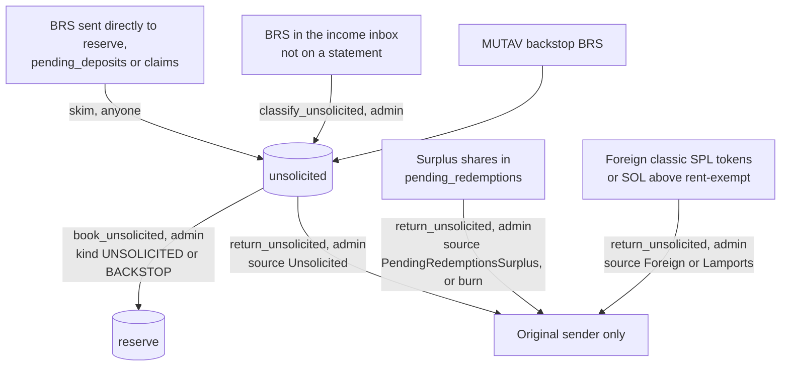

# Unsolicited money

Unsolicited money is any token that reaches a program account outside a booking path: BRS sent straight to a reserve account, BRS in the income inbox that is not on an issuer statement, other tokens, or extra SOL. The program never counts it toward NAV or coverage on arrival. It holds it apart until the reserve admin books it into the reserve or returns it.

Two rules frame the design:

- **No stuck money.** Every unsolicited balance has a way out.
- **Unsolicited money is the reserve admin's responsibility.** The operator never books or returns it.

## The `unsolicited` account

A dedicated BRS token account, a PDA at `["unsolicited", config]` with mint `reserve_mint`, owned by the vault authority and created at `initialize`. It is separate from the income inbox.

- It is the only BRS account from which money can be returned to a sender. A return never leaves from the income inbox or from `reserve`, so issuer income can never be "returned".
- Its balance is untracked: it moves neither NAV nor `coverage_required`.

## Flow

## Instructions

| Instruction | Signer | What it does |
|---|---|---|
| `skim(account)` | Anyone | Moves the untracked surplus (`balance − tracked total`) of `reserve`, `pending_deposits` or `claims` into `unsolicited`. Mechanical: books nothing and moves no tracked money. Refuses frozen accounts. Emits `UnsolicitedSkimmed` |
| `classify_unsolicited(amount)` | Reserve admin | Moves BRS that is not on an issuer statement from the income inbox into `unsolicited`, once the operator has swept every issuer statement for the period |
| `book_unsolicited(amount, ref_hash, kind)` | Reserve admin | Moves BRS from `unsolicited` into `reserve` as an inflow. `kind` is `UNSOLICITED` or `BACKSTOP`; any other kind is refused. `brs_balance` and NAV rise, counted in `inflow_nav`. No shares minted. Writes an `IncomeReceipt` of that kind |
| `return_unsolicited(source, amount, destination, ref_hash)` | Reserve admin | Returns money to the source of the original transfer, after screening. `source` says what leaves and from where (table below) |
| Burn of surplus shares | Reserve admin | Surplus shares in `pending_redemptions` (above the shares escrowed by open requests) may be burned instead of returned. Burning raises NAV per share for every holder |

| `Source` | What leaves | From |
|---|---|---|
| `Unsolicited` | BRS | The `unsolicited` PDA |
| `PendingRedemptionsSurplus` | Shares | The surplus of `pending_redemptions` above escrowed requests |
| `Foreign` | Tokens of any classic SPL Token mint other than the BRS, share or adapter mints | A token account owned by the vault authority |
| `Lamports` | SOL above the rent-exempt minimum | An account owned by the program or the vault authority |

Every booking or return is a Squads proposal under the admin time lock. `skim` is permissionless and run by a monitor, so untracked money never sits for long in an account the reserve depends on.

## Booking rules

- **No booking while no shares exist.** `book_unsolicited` is refused while `shares_outstanding == 0`, whatever its kind, like guarantee fees and issuer income.
- **One receipt per booking.** Each booking creates an `IncomeReceipt` seeded by its `ref_hash`, so it counts once.
- **Raises NAV for every holder.** A booking mints no shares. Its net counts in the NAV-move guard's `inflow_nav`, so it does not trip the guard.

## Return rules

| Return | Allowed | Never |
|---|---|---|
| Every source | Only to the source of the original transfer. The transaction signature is committed in `ref_hash` and checked when the admin console composes the proposal | To any other address; from the income inbox or `reserve` |
| `Foreign` | Classic SPL Token mints (the mint's owner is checked to be the SPL Token program) | Any Token-2022 mint; the BRS mint, the share mint or any adapter mint |
| `Lamports` | SOL above the rent-exempt minimum | Taking an account below its rent-exempt minimum |

## Runbook

1. **Screen** the source of every unsolicited balance before any return or booking.
2. **Return** it if the sender is identified and asks within **30 days**.
3. **Book** it otherwise, with kind `UNSOLICITED`.
4. **Dust** below **R$10** is booked directly, without waiting.

The 30-day window and the R$10 dust threshold are runbook and app values. There is no on-chain dust field.

## Backstop contributions

MUTAV stands behind the reserve as *fiador*. When the reserve needs capital that new deposits cannot provide, for example when it is underwater and deposit fills are refused ([Coverage model](coverage-model.md#underwater)), MUTAV sends its own BRS. The reserve admin books it with `book_unsolicited`, kind `BACKSTOP`.

- No shares are minted. The booking raises NAV for every holder.
- The receipt kind keeps backstop money apart from unsolicited money and issuer income in the public record.
- Like every other inflow, it is refused while no shares exist.

## What the public sees

- The `/reserve` page shows, per account, the on-chain balance, the tracked balance and the unbooked difference.
- The `/admin` console lists unsolicited balances that wait for a decision.
- Foreign tokens are never listed in the app.

## Pause and solvency

`skim`, `classify_unsolicited`, `book_unsolicited`, `return_unsolicited` and the burn of surplus shares are not stopped by pause and are never solvency-gated. `skim` still refuses frozen accounts.

## Sources

- [Specification §1 Principles](../spec.md#1-principles) (internal accounting), [§3.3 Vault authority and token accounts](../spec.md#33-vault-authority-and-token-accounts), [§12 Q49](../spec.md#12-open-questions) (earlier recovery design for untracked BRS)
- [ADR 0017: BRS income intake](../decisions/0017-brs-income-intake.md) (income inbox, untracked balances)
- Program: [`programs/mutav/src/state/income.rs`](../../programs/mutav/src/state/income.rs) (`IncomeReceipt`, where the kind is carved), [`programs/mutav/src/constants.rs`](../../programs/mutav/src/constants.rs) (seeds)
- [SPL Token program](https://spl.solana.com/token), [Token-2022 transfer hook](https://spl.solana.com/token-2022/extensions#transfer-hook)

## Decisions

- [ADR 0004: On-chain NAV with internal accounting](../decisions/0004-onchain-nav-internal-accounting.md)
- [ADR 0017: BRS income intake](../decisions/0017-brs-income-intake.md) (the inbox's exits extended by ADR 0024)
- [ADR 0020: Operator/admin separation and operator-compromise recovery](../decisions/0020-operator-admin-separation-and-recovery.md) (pause scope)
- [ADR 0022: Coverage: stress buffer and underwater reserve](../decisions/0022-coverage-stress-buffer-underwater-reserve.md) (backstop as the recovery path)
- [ADR 0023: Capital flows and exit rights](../decisions/0023-capital-flows-and-exit-rights.md) (bookings refused while no shares exist)
- [ADR 0024: Unsolicited money and backstop contributions](../decisions/0024-unsolicited-money-and-backstop.md)
- [ADR 0026: Program simplification for the freeze](../decisions/0026-program-simplification-for-the-freeze.md) (one generic return; no on-chain dust field)
- ADR 0019: v1 layout for the devnet release (`IncomeReceipt.kind` carved)
