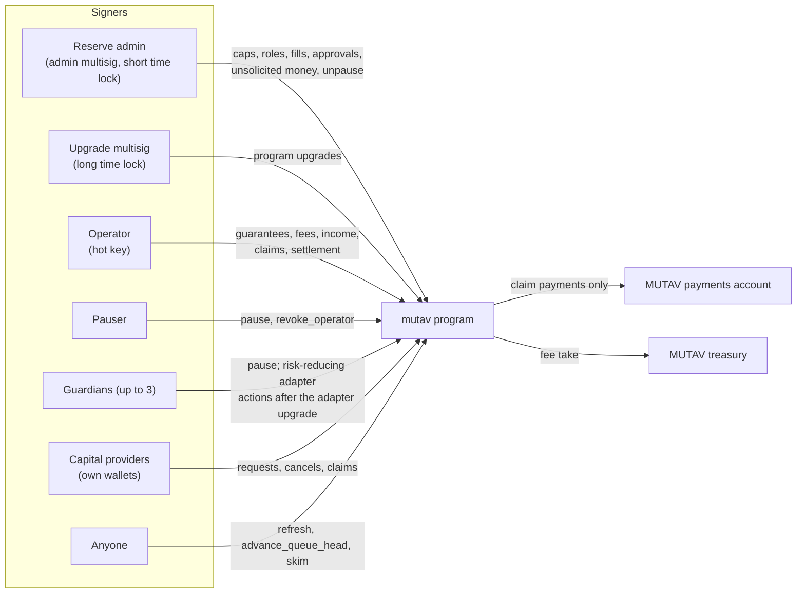

# Security and verification

This section describes how the MUTAV reserve program protects the reserve, who holds which authority, what happens in an incident, and how the design is verified. It describes the devnet release design as decided on 2026-10-10.

> The program is unaudited software. It runs on devnet first, with capped parameters, and holds no real money until the steps in [Reviews and audits](reviews-and-audits.md) are complete.

## Pages in this section

| Page | What it covers |
|---|---|
| [Invariants](invariants.md) | The numbered rules the program keeps after every instruction. |
| [Governance and keys](governance-and-keys.md) | Roles, multisigs, time locks, guardians, the pauser, and where every key lives. |
| [Incident response](incident-response.md) | Pause scope, the operator-compromise runbook, frozen reserve handling, unsolicited money. |
| [Reviews and audits](reviews-and-audits.md) | Test suites, layout fixtures, CI gates, the pre-devnet review cycle, the audit plan. |
| [Known limitations](known-limitations.md) | Features deferred from this release and when they are planned. |

## The security model in one page

MUTAV is a fiador for Brazilian rental leases. The program holds the reserve in BRS, records every guarantee and its remaining cover, and pays claims to MUTAV's payments account. It does not price guarantees or judge claims. Those duties stay in the MUTAV platform, which acts on-chain through the operator key.

The model rests on six rules.

| # | Rule | What it means in practice |
|---|---|---|
| 1 | **Operator and admin are separate.** | The operator runs the guarantee and claim cycle. The reserve admin looks after financial health and security through ceilings. They may be separate companies. |
| 2 | **A compromised operator can lose at most the claim caps.** | Every registry action the operator takes can be reversed by another operator action. Only `pay_claim` is irreversible, and it is bounded by admin-set caps and lands in MUTAV's own payments account. |
| 3 | **Claim payments are never solvency-gated.** | Within the caps, `pay_claim` goes through whatever the reserve's coverage, mode, pause state or NAV guard. The solvency gate applies to capital flows and new guarantees. |
| 4 | **Internal accounting.** | The program counts only money it moved itself. A transfer into a reserve account does not move NAV until an authorised instruction books it. |
| 5 | **No arbitrary outflows.** | BRS leaves the reserve only to a fixed list of destinations: the payments account, the treasury (fee take), the claims escrow on to its owner, a cancelled deposit back to its owner, or the original sender of unsolicited money (from the separate `unsolicited` account). |
| 6 | **No keys in the audited surface.** | The program, the client and the pilot app hold no signing keys. Wallets and multisigs sign. |

## Defence in layers

| Layer | Protection | Page |
|---|---|---|
| Program rules | Invariants, the solvency gate, caps, the NAV-move guard, admin `nav_bounds` on fills, internal accounting, strict account validation. | [Invariants](invariants.md) |
| Authority | Two-step role handover with expiring pending keys, distinct keys, two Squads multisigs with time locks, guardians limited to risk-reducing actions. | [Governance and keys](governance-and-keys.md) |
| Operations | Pause, operator revocation, reconciliation against on-chain events, bank-first claim payments, the unsolicited money runbook. | [Incident response](incident-response.md) |
| Verification | LiteSVM tests, property tests, golden layout fixtures, CI gates, verified builds, the review cycle and an independent audit before mainnet. | [Reviews and audits](reviews-and-audits.md) |

## Reporting a vulnerability

Follow [`SECURITY.md`](../../SECURITY.md). Use a private GitHub security advisory until `security@mutav.finance` is live. Test only on devnet or a local validator. There is no bug bounty at this stage.

## Related sections

- [Roles and trust](../architecture/roles-and-trust.md)
- [Reserve framework](../reserve-framework/README.md)
- [Risks](../for-capital-providers/risks.md)
- [Technical resources](../technical-resources/README.md)
- [Decisions](../meta/decisions.md)

## Sources

- [Specification §1 Principles](../spec.md#1-principles), [§2 Roles and keys](../spec.md#2-roles-and-keys), [§4 Invariants and formulas](../spec.md#4-invariants-and-formulas)
- [`SECURITY.md`](../../SECURITY.md)
- Technical reference, devnet release design, 2026-10-10 (`docs/technical-reference.html` on branch `docs/protocol-reference`, PR #32)
- Program code: [`programs/mutav/src/`](../../programs/mutav/src/)

## Decisions

- [ADR 0003: Claim payments operated by MUTAV through a whitelisted payments account](../decisions/0003-payments-operated-by-mutav.md)
- [ADR 0004: NAV computed on-chain with internal accounting](../decisions/0004-onchain-nav-internal-accounting.md)
- [ADR 0005: Solvency gate scope](../decisions/0005-solvency-gate-scope.md)
- [ADR 0008: One capital flow for everyone; pause never blocks claims](../decisions/0008-uniform-capital-flow-and-pause-scope.md)
- [ADR 0020: Operator/admin separation and operator-compromise recovery](../decisions/0020-operator-admin-separation-and-recovery.md)
- [ADR 0021: Claims: approval, amendment and exact payment](../decisions/0021-claims-approval-amendment-exact-payment.md)
- [ADR 0023: Capital flows and exit rights](../decisions/0023-capital-flows-and-exit-rights.md)
- [ADR 0024: Unsolicited money and backstop contributions](../decisions/0024-unsolicited-money-and-backstop.md)
- [ADR 0027: Multi-asset adapters, liquidity floor and rebalancing](../decisions/0027-multi-asset-adapters-liquidity-floor-rebalancing.md) (Proposed; the emergency path is decided)
