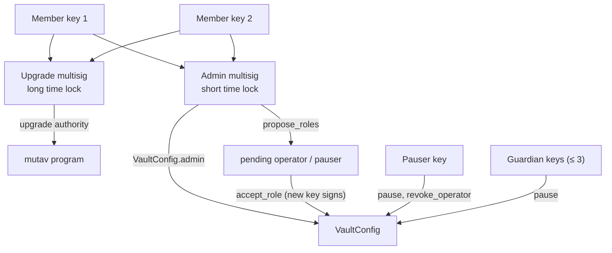

# Governance and keys

The core security rule is the split between the operator and the reserve admin. The operator holds the information about contracts and runs the guarantee and claim cycle. The reserve admin looks after the reserve's financial health and security through ceilings, and does not judge contracts. They may be separate companies.

## Roles

| Role | Holder | May do | Cannot do |
|---|---|---|---|
| **Reserve admin** | Admin multisig vault (Squads v4, short time lock) | Set caps, coverage ratio, stress buffer and other config; propose roles and a new admin; set guardians, the payments account and the allowlist root; fill the deposit and redemption queues (with `nav_bounds`); approve claim amounts above the per-call cap; refund pending deposits; classify, book and return unsolicited money; book backstop money; clear a NAV halt; pause and unpause; revoke the operator. | Register, close or reinstate guarantees; file, amend, withdraw or pay claims. |
| **Program upgrade authority** | Upgrade multisig vault (Squads v4, long time lock), same members as the admin multisig | Sign `initialize` and program upgrades. | Anything inside the reserve. It is not `VaultConfig.admin`. |
| **Operator** | Hot key | Register, close (VOID or RELEASED) and reinstate guarantees; book guarantee fees (`contribute_fees`) and issuer income (`sweep_income`); file, amend, withdraw and pay claims; record settlement (`settle_payout`). | Move money anywhere except a claim payment to the payments account; change caps or roles; fill queues; book unsolicited money. |
| **Pauser** | Separate key | `pause` and `revoke_operator`, with no time lock. | Unpause, appoint, change config. |
| **Guardians** | Up to 3 keys, set by the admin | `pause` only. | Revoke, unpause or change anything. |
| **Capital provider** | Own wallet | Request deposits (allowlisted), request redemptions (open to holders), cancel, claim. | Act for another wallet. Delegates are never used. |
| **Anyone** | Any signer | `refresh`, `advance_queue_heads`, `skim`. These need no judgment and move no tracked money. | Book or return money. |

The full instruction-by-role matrix is in the [specification](../spec.md#2-roles-and-keys) and the technical reference.

### Why the split matters

The operator key is a hot key. The design limits what it can do on its own:

- Every registry action is reversible by another operator action: `register_guarantee` by `close_guarantee(VOID)`, a close by `reinstate_guarantee` (within `max_reinstate_age`), `file_claim` by `withdraw_claim`, an amount by `amend_claim`.
- Only `pay_claim` is irreversible. It pays only to MUTAV's payments account, within the admin's per-call and sliding 30-day caps. A larger payment needs an admin `approve_claim` for that exact amount.
- Queue fills are admin actions and carry admin-set `nav_bounds`, so an operator change to the registry cannot move value through a fill.

The maximum financial loss from a compromised operator is therefore the admin-set claim caps.

## Multisigs and time locks

Two Squads v4 multisigs with the same members hold authority.

| Multisig | Holds | Devnet time lock | Real pilot and mainnet time lock |
|---|---|---|---|
| Admin multisig | `VaultConfig.admin` | 5 minutes | 24 hours |
| Upgrade multisig | Program upgrade authority | 1 hour | 7 days |

Rules:

- Every admin action is time-locked, the admin's own `pause` included; the pauser and guardians pause without delay. The Squads time lock counts from approval.
- Both multisigs have no config authority, so members, threshold and time lock change only through their own proposals.
- The deploy scripts check the exact member set, the exact threshold, that the multisig account is owned by Squads v4, and that the time lock meets the agreed floor (300 s and 3,600 s on devnet).
- On devnet the multisigs are 2-of-2, with two devnet wallets standing in for the founders. Hardware-held keys replace the stand-ins before real money.
- The upgrade time lock is at least the maximum queue wait of the exit fallback (7 days and 7 days on the real pilot), so holders can leave before an upgrade they disagree with takes effect. See [Known limitations](known-limitations.md) for when the exit fallback is built.

## Role changes

| Change | How | Notes |
|---|---|---|
| Operator or pauser | Admin `propose_roles`, then the new key signs `accept_role`. | A typo can never appoint a dead address. Pending keys expire. |
| Reserve admin | Admin `propose_admin`, then the new admin signs `accept_admin`. | Squads members are rotated through a Squads proposal while both old and new keys are live. |
| Remove the operator | Pauser or admin `revoke_operator`. | Immediate. Sets the operator to the default key and clears pending role keys. |
| Guardians | Admin sets up to 3 pause-only keys. | The default key never counts as a guardian. |
| Payments account | Admin `set_payments_account`. | BRS mint, distinct from the treasury, not owned by the operator, the capital wallet or the vault authority. |

All roles are distinct keys. The operator and pauser can never equal the admin or each other.

## Program-owned authority

| Authority | Holder | Purpose |
|---|---|---|
| Vault authority | PDA `["authority", config]`, no data | Owns every reserve token account. Mint and freeze authority of the share mint. Never passed into an adapter CPI. |
| Share mint authority | Vault authority PDA | Mints only in `claim_shares`. |
| Share freeze authority | Vault authority PDA | Unused in v1. Kept so share transfers can be restricted later without a new mint. |

The reserve's BRS is split across separate token accounts (`reserve`, `pending_deposits`, `pending_redemptions`, `claims`, `unsolicited`, plus the income inbox), so one freeze does not trap every balance.

## External authorities

| Authority | Holder | What it can do |
|---|---|---|
| BRS mint authority | The issuer's minting program | Mint BRS. |
| BRS freeze authority | A single issuer key | Freeze any BRS account, the reserve's included. See [Incident response](incident-response.md#frozen-reserve). |

This trust in the issuer is disclosed, not hidden. The single-key freeze authority is acceptable for devnet and is raised with the issuer before mainnet.

## Where keys live

No signing key exists in the program, the client or the pilot app.

| Surface | Rule | How it is checked |
|---|---|---|
| Program | Holds no keys. Authority comes from signers and PDAs. | Review. |
| TypeScript client (`@mutav-finance/mutav-protocol-solana`) | Composes instructions and reads accounts. Never signs. | [`scripts/check-no-keys.sh`](../../scripts/check-no-keys.sh) runs in CI. |
| Pilot app | The connected wallet signs. The server composes unsigned transactions. On devnet, transactions are sent through the wallet; the relay runs only on localnet and only forwards fully signed transactions. | Code review and app tests. |
| Deploy scripts | Only `deploy.ts` takes keypair paths. Keys inside the repository are refused. | Script tests. |
| Repository | No keypair files. `*.json` keypairs are gitignored. | [`SECURITY.md`](../../SECURITY.md) treats a committed key as a vulnerability. |

| Key | Devnet | Later |
|---|---|---|
| Operator | A keypair generated at deploy, stored outside the repository with owner-only file permissions, used by hand from the operator console. | A KMS-backed key in the MUTAV platform (`mutav-app`), used from Convex actions. |
| Pauser | A separate keypair generated at deploy, stored outside the repository. | Set at deploy for the real pilot. |
| Guardian | One key held by a founder, separate from the pauser. | An automated monitor may hold a guardian key. |
| Admin and upgrade members | Two devnet wallets standing in for the founders. | Hardware-held founder keys. |
| Program keypair | Outside the repository. | Same. |

## Sources

- [Specification §2 Roles and keys](../spec.md#2-roles-and-keys), [§2.1 Money flows](../spec.md#21-three-separate-mutav-money-flows-adr-0009-and-issuer-income-adr-0017), [§3.3 Vault authority and token accounts](../spec.md#33-vault-authority-and-token-accounts)
- [Specification §14.5 Upgrade runbook](../spec.md#145-upgrade-runbook)
- [`SECURITY.md`](../../SECURITY.md), [`CLAUDE.md`](../../CLAUDE.md) (no signing-key code)
- [`scripts/check-no-keys.sh`](../../scripts/check-no-keys.sh), [`scripts/devnet/`](../../scripts/devnet/)
- Code: [`programs/mutav/src/instructions/admin/`](../../programs/mutav/src/instructions/admin/), [`programs/mutav/src/state/config.rs`](../../programs/mutav/src/state/config.rs)
- Technical reference §2.5 and §3, devnet release design (branch `docs/protocol-reference`, PR #32)
- Pre-devnet design decisions log, 2026-10-09 to 2026-10-10 (internal notes)
- [Squads v4 documentation](https://docs.squads.so/)

## Decisions

- [ADR 0002: One core program plus adapter programs with capped sub-authorities](../decisions/0002-core-program-and-capped-adapters.md)
- [ADR 0003: Claim payments operated by MUTAV through a whitelisted payments account](../decisions/0003-payments-operated-by-mutav.md)
- [ADR 0009: Separate MUTAV money flows](../decisions/0009-separate-mutav-money-flows.md)
- Pending ADR: Operator/admin separation and operator-compromise recovery (two-step handover, pause-only guardians, two multisigs, `revoke_operator` clearing pending keys)
- Pending ADR: Claims: approval, amendment, exact payment, sliding window
- Pending ADR: Exit fallback
