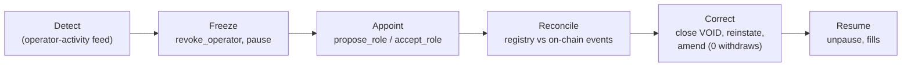

# Incident response

This page describes the tools the program gives MUTAV in an incident and the runbooks that use them. The aim is that no money gets stuck and that claims keep being paid.

## Pause

`pause` is the emergency stop. The pauser or any guardian can call it with no time lock; the admin can also call it, through its multisig's time lock. Only the admin unpauses, through the admin multisig's time lock.

| Stopped by pause | Always open |
|---|---|
| `request_deposit`, `request_redeem` (including holders who left the allowlist) | Every claim instruction: `file_claim`, `amend_claim` (an amendment to 0 withdraws), `refile_claim`, `approve_claim`, `pay_claim`, `settle_payout` |
| `fulfil_deposits`, `fulfil_redeems` | `close_guarantee`, `reinstate_guarantee` |
| `register_guarantee` | `contribute_fees`, `sweep_income` |
| | `cancel_deposit` (owner or admin), `cancel_redeem`, `claim_shares`, `claim_assets` |
| | `skim`, `classify_unsolicited`, `book_unsolicited` (both kinds, backstop included), `return_unsolicited` (every source) |
| | `refresh`, `advance_queue_head` |
| | Admin configuration, `propose_role` / `accept_role`, `propose_admin` / `accept_admin`, `cancel_pending`, guardian appointment, `revoke_operator` |

Pause never traps holders' money and never blocks a claim. After the first adapter upgrade, the same keys that can pause also have the risk-reducing adapter actions described in [Adapter emergency](#adapter-emergency).

### NAV halt

The NAV-move guard is a second, narrower stop. It runs in `refresh` and inline in both fill instructions. When NAV per share (net of booked inflows) moves more than `max_nav_move_bps` from the baseline, `fulfil_halted` is set and both queues refuse fills. The halt is sticky. Only the admin's `clear_fulfil_halt` clears it and resets the baseline, and it refuses while the reserve is frozen.

Each fill also carries `nav_bounds (min, max)` chosen by the admin when the proposal is composed. A fill outside them is refused.

```mermaid
stateDiagram-v2
    [*] --> Normal
    Normal --> Paused: pause (pauser, guardian, admin)
    Paused --> Normal: unpause (admin, time-locked)
    Normal --> Halted: NAV-move guard trips
    Halted --> Normal: clear_fulfil_halt (admin, time-locked)
    note right of Paused: capital flows and new guarantees stop; claims continue
    note right of Halted: queue fills stop; everything else continues
```

## Operator compromise

Only the operator knows the contracts, so every registry action is an operator action and is reversible by another operator action. The admin's role stays financial: it does not roll back the registry. There is no admin rollback instruction and no time-window argument.

| Step | Who | Action |
|---|---|---|
| 1. Freeze | Pauser (or admin) | `revoke_operator` at once. Operator instructions fail from the next slot, and the pending operator and pauser keys are cleared. `pause` as well if capital flows or new guarantees must stop. |
| 2. Appoint | Admin, then the new key | `propose_role(OPERATOR, key)`; the new key signs `accept_role(OPERATOR)` within 72 hours. If the pauser key is also suspect, propose a new pauser in the same Squads proposal. |
| 3. Reconcile | New operator | Compare the MUTAV platform's contract registry and audit trail (kept where the operator key cannot write) with on-chain events and `refs_hash` values since the compromise. |
| 4. Correct | New operator | Use ordinary operator actions. Fake registrations: `close_guarantee(VOID)`. Wrongful closes: `reinstate_guarantee`, within `max_reinstate_age`. Fake filings: `amend_claim(0)`, which sets the filing to `WITHDRAWN`. Wrong amounts: `amend_claim`. A withdrawn notice that turns out to be real: `refile_claim`, which starts it from scratch with no approval. |
| 5. Accept the bounded loss | MUTAV | Claim payments made with the compromised key are irreversible. They are bounded by the claim caps and landed in MUTAV's own payments account. |
| 6. Resume fills | Admin | The admin signs no redemption fill until reconciliation is done. |

**Detection.** The app shows an operator-activity feed: registrations, closes, filings and payments in the last 24 hours. A monitor also alerts when the owner of the payments account changes.

**Fills stay with the admin.** Queue fills are admin actions with admin-set `nav_bounds` and an inline NAV-move guard, and the admin signs no fill until reconciliation is done. Registry changes made with the operator key therefore cannot move value through the queues.

## Pauser compromise

The pauser can revoke the operator, which pauses operator actions, claim payments included, until the admin's time lock lets a new `propose_role` through and the new operator accepts. If the pauser key is ever lost to someone else, recovery follows the same path.

- Replace the pauser in the same Squads proposal that proposes the new operator.
- Bank-first payment covers the gap: MUTAV pays the agency by Pix from its own bank account, and the reserve reimburses the payments account once `pay_claim` runs again.

## Admin key compromise

A single member key cannot act alone: the admin multisig needs the threshold and runs every action through the time lock, during which members can reject or cancel and the pauser can pause. To rotate a member, run a Squads proposal while both keys are live. To move `VaultConfig.admin` to a new multisig, use `propose_admin` then `accept_admin`.

## Frozen reserve

The BRS issuer can freeze any BRS account, the reserve's included.

| Instruction | Behaviour with a frozen reserve |
|---|---|
| `refresh` | Emits `ReserveFrozenDetected`; counts the frozen reserve as 0 BRS. |
| `register_guarantee` | Counts it as 0 BRS; refuses with `ReserveFrozen`. |
| `fulfil_deposits`, `fulfil_redeems` | Refuse with `ReserveFrozen`. |
| `clear_fulfil_halt` | Refuses with `ReserveFrozen`. |
| `skim` | Refuses when the source or `unsolicited` is frozen. |
| `pay_claim` | Cannot transfer. MUTAV pays the agency by Pix from its own bank and the reserve reimburses the payments account after the freeze lifts. |

The reserve's money is split across separate token accounts, so one freeze does not trap every balance. Owners can still cancel requests and claim from accounts that are not frozen.

## Underwater reserve

When net assets reach 0 with shares outstanding, `fulfil_deposits` refuses with `ReserveUnderwater`, so new money never pays for old losses. Recovery is a MUTAV backstop: MUTAV sends BRS and the admin books it with `book_unsolicited` and receipt kind `BACKSTOP`. No shares are minted, so the money raises NAV for every holder. Claim payments continue within the caps throughout. Public copy says "reserve below target; MUTAV backstop active".

## Unsolicited money

Money that arrives outside a booking path does not move NAV. It is held apart and then returned or booked. Unsolicited money is the reserve admin's responsibility.

| Source | First step | Who |
|---|---|---|
| Untracked BRS in `reserve`, `pending_deposits` or `claims` | `skim` moves the surplus over the tracked total into `unsolicited`. Run by a monitor. It also removes tainted BRS before it can draw an issuer freeze on the reserve. | Anyone |
| BRS in the income inbox that is not on an issuer statement | `classify_unsolicited` moves it into `unsolicited`, after the operator has swept the statements. | Admin |
| Foreign classic SPL tokens | `return_unsolicited` with source `Foreign`. Never the BRS, share or any adapter mint; never a Token-2022 mint. Foreign tokens are never listed in the app. | Admin |
| SOL above the rent-exempt minimum | `return_unsolicited` with source `Lamports`. Never takes an account below its rent-exempt minimum. | Admin |
| Surplus shares in `pending_redemptions` | `return_unsolicited` with source `PendingRedemptionsSurplus`, or burned by the admin. | Admin |

Runbook for BRS in `unsolicited`:

1. Screen the source before any return or booking.
2. If the sender is identified and asks within 30 days, `return_unsolicited` (source `Unsolicited`) sends it back to the source of the original transfer. The transaction signature is committed in `ref_hash` and checked when the proposal is composed.
3. Otherwise `book_unsolicited` books it into the reserve with receipt kind `UNSOLICITED`. It raises NAV, counts in the NAV guard's inflows and mints no shares. Bookings are refused while no shares exist.
4. Dust below R$10 is booked directly. The threshold is a runbook and app value; there is no on-chain field.

A return never leaves from the income inbox or from `reserve`, so issuer income can never be "returned".

## Adapter emergency

The pilot reserve holds BRS only, so this path ships with the first adapter upgrade ([ADR 0027](../decisions/0027-multi-asset-adapters-liquidity-floor-rebalancing.md), decision 8, decided). Guardians, the pauser and the admin may act at once, and each action can only reduce risk:

| Action | Effect |
|---|---|
| `disable_adapter` | No new allocations into the adapter; `deallocate` stays open. |
| `impair_adapter(haircut_bps)` | Raises the adapter's valuation haircut. A lower value is refused. NAV, coverage and fills use the impaired value from the next call. |
| `pause` | As above. |
| `emergency_deallocate(adapter, units, min_out)` | Impaired adapters only. Proceeds land only in `reserve`. The price is bounded by `min_out` and by `max_emergency_discount_bps` from the bounded price. |

Undoing any of these (re-enabling, lowering a haircut, raising a limit) goes through the admin time lock. Claims keep paying from BRS throughout.

## Upgrade rollback

The fast response to a bad upgrade is `pause`. The slow response is a time-locked upgrade back to the previous verified build, whose artefact and hash are kept in the release notes. See [specification §14.6](../spec.md#146-rollback).

## Sources

- [Specification §5.1 Admin and roles](../spec.md#51-admin-and-roles), [§6 Under-coverage mode](../spec.md#6-under-coverage-mode), [§7 Price safety](../spec.md#7-price-safety), [§14.6 Rollback](../spec.md#146-rollback)
- Technical reference §5.5, §7.4 and §9, devnet release design (branch `docs/protocol-reference`, PR #32)
- Code: [`programs/mutav/src/instructions/admin/`](../../programs/mutav/src/instructions/admin/), [`programs/mutav/src/instructions/public/`](../../programs/mutav/src/instructions/public/), [`programs/mutav/src/token_guard.rs`](../../programs/mutav/src/token_guard.rs)
- Tests: [`tests/tests/roles_pause.rs`](../../tests/tests/roles_pause.rs), [`tests/tests/freeze.rs`](../../tests/tests/freeze.rs), [`tests/tests/under_coverage.rs`](../../tests/tests/under_coverage.rs)

## Decisions

- [ADR 0008: One capital flow for everyone; pause never blocks claims](../decisions/0008-uniform-capital-flow-and-pause-scope.md)
- [ADR 0015: Admin clear for the NAV-move halt](../decisions/0015-admin-clear-fulfil-halt.md)
- [ADR 0016: Coverage ratio below 1.0](../decisions/0016-coverage-ratio-below-one.md)
- [ADR 0017: BRS income intake](../decisions/0017-brs-income-intake.md)
- [ADR 0020: Operator/admin separation and operator-compromise recovery](../decisions/0020-operator-admin-separation-and-recovery.md)
- [ADR 0021: Claims: approval, amendment and exact payment](../decisions/0021-claims-approval-amendment-exact-payment.md)
- [ADR 0022: Coverage: stress buffer and underwater reserve](../decisions/0022-coverage-stress-buffer-underwater-reserve.md) (amends 0016)
- [ADR 0023: Capital flows and exit rights](../decisions/0023-capital-flows-and-exit-rights.md)
- [ADR 0024: Unsolicited money and backstop contributions](../decisions/0024-unsolicited-money-and-backstop.md)
- [ADR 0027: Multi-asset adapters, liquidity floor and rebalancing](../decisions/0027-multi-asset-adapters-liquidity-floor-rebalancing.md) (Proposed; the emergency path is decided)
