# Reviews and audits

This page lists the verification that exists for the mutav program, its client and the pilot app, and the reviews planned before devnet and before mainnet.

> **Status.** The program is unaudited. An internal pre-devnet review cycle is under way. Its report is published after its fixes land. An independent audit is planned before mainnet; its auditor and date are not yet chosen (see [open questions](../meta/open-questions.md#possible-improvements)).

## Test suites

| Suite | Tooling | What it covers | Where |
|---|---|---|---|
| Program integration tests | LiteSVM | Each instruction's happy path, its errors, and the gate and cap edge cases: initialize, config, roles and pause, guarantees, claims, fees, income, the capital queues, the coverage gate, under-coverage, refresh, freeze detection, mint guard, rounding, events. | [`tests/tests/`](../../tests/tests/) |
| Property tests | `proptest` inside LiteSVM | Randomised checks, among them that `pay_claim` is never refused by the coverage gate or under-coverage, and rounding in the reserve's favour. | [`tests/tests/claims.rs`](../../tests/tests/claims.rs), [`tests/tests/rounding.rs`](../../tests/tests/rounding.rs) |
| Invariant checks | LiteSVM | The specification's invariants asserted after instructions. See [Invariants](invariants.md). | [`tests/tests/claim_invariants.rs`](../../tests/tests/claim_invariants.rs) and the suites above |
| Layout tests | LiteSVM and Borsh | Golden v1 layouts, v1 to v2 carve decoding, padding preservation, padding zero at init, version guard. | [`tests/tests/layout/`](../../tests/tests/layout/), [`padding.rs`](../../tests/tests/padding.rs), [`version_guard.rs`](../../tests/tests/version_guard.rs) |
| Compute units | LiteSVM | A full fill batch fits the default compute budget. A regression guard. | [`tests/tests/compute.rs`](../../tests/tests/compute.rs) |
| Client tests | `bun test` | Math parity with the program through shared vectors, PDA derivation, instruction encoding, reads, previews, allowlist proofs, and a no-keys check. | [`clients/js/test/`](../../clients/js/test/), [`tests/fixtures/client/`](../../tests/fixtures/client/) |
| Script tests | `bun test` | Deploy and release script checks: cluster, config, Squads multisig, IDL compatibility, upgrade proposal. | [`scripts/test/`](../../scripts/test/) |
| App tests | Vitest, Playwright | Unit tests (including guards, cluster checks, simulator parity and a forbidden-words scan of UI copy). A Playwright smoke test runs locally against its own validator. | [`app/lib/__tests__/`](../../app/lib/__tests__/), [`app/e2e/`](../../app/e2e/) |
| Fork tests | Surfpool | A happy path against a local fork of devnet, with the real BRS mint. On demand only; nothing is sent to devnet. | [`tests-fork/`](../../tests-fork/) |

Each change in the pre-devnet fix waves adds its tests first, including the operator-compromise and recovery paths, which are proven in LiteSVM. Devnet is used for manual demonstration only.

## Layout fixtures and the freeze

Every program-owned account has a fixed layout with zeroed padding at the end. New fields are carved from the front of the padding and must read zero as the safe default.

- Golden fixtures live in [`tests/fixtures/layout/v1/`](../../tests/fixtures/layout/v1/). The tests check sizes, field offsets, and that v1 bytes decode under the current structs.
- The fixtures are regenerated one last time for the devnet release layout ([ADR 0019](../decisions/0019-v1-layout-for-the-devnet-release.md)). From the first devnet deploy, v1 is frozen. Every later change is a carve from padding or a new account, checked against the v1 fixtures.
- At devnet and mainnet launch, live accounts are dumped into the fixtures and decoded in CI.

See [specification §14.2](../spec.md#142-padding-and-version) and [§14.7](../spec.md#147-layout-stability-tests-pilot).

## CI gates

Every pull request to `main` runs [`ci.yml`](../../.github/workflows/ci.yml). A pull request merges only when it is green.

| Gate | Fails when |
|---|---|
| `cargo fmt --check` | Rust formatting differs. |
| `anchor build` | The program does not build. |
| `cargo test -p mutav-tests` | Any LiteSVM, property or layout test fails. |
| Codama client regeneration | The generated client in `clients/js` differs from the committed one. |
| Client typecheck and tests | Types or math parity, PDAs, encoding or reads fail. |
| No-keys check | [`scripts/check-no-keys.sh`](../../scripts/check-no-keys.sh) finds a secret-key or signing API in the client source. |
| Script tests and typecheck | A deploy or release script check fails. |
| App lint, typecheck, unit tests and build | The pilot app fails any of them. |
| `idl-compat` | From the first release tag, the IDL changes in a way that is not allowed (reordered, retyped or removed fields; changed instruction arguments or accounts; changed events). |

Release builds keep overflow checks on ([`Cargo.toml`](../../Cargo.toml)). Releases use a verified build: the [`release.yml`](../../.github/workflows/release.yml) workflow builds with `solana-verify`, records the executable hash, writes a buffer and prepares a Squads upgrade proposal. It never executes an upgrade. Squads members review, reproduce the hash, decode every instruction in the proposal, and execute after the time lock. See [specification §14.5](../spec.md#145-upgrade-runbook).

## The pre-devnet review cycle

```mermaid
flowchart LR
    R1["Adversarial review<br/>5 parallel read-only reviews"] --> R2["Whole-protocol review<br/>against published audits<br/>of a comparable program"]
    R2 --> R3["OWASP Smart Contract<br/>Top 10 (2026) pass"]
    R3 --> S["Simplification review"]
    S --> D["Decisions and ADRs 0020 to 0029"]
    D --> W["Fix wave<br/>bounded PRs, tests first"]
    W --> A["Internal security audit<br/>(fresh session)"]
    A --> DP["Devnet deploy"]
    DP --> P["Review report published<br/>after its fixes land"]
```

| Step | Scope | Status |
|---|---|---|
| Adversarial review (2026-10-09) | Five read-only reviews in parallel: program account checks and roles; program economics and math; program queues, lifecycle and layout; client and scripts; pilot app. Every proposed fix was tagged as code, ADR, spec or runbook. | Done. All decisions taken. |
| Whole-protocol review (2026-10-10) | Findings from three published audits of a comparable Solana program, mapped to MUTAV by vulnerability class, plus an area-by-area design comparison. | Done. Two-step role and admin handover, guardians, two multisigs and open owner cancels under pause were adopted from it. |
| OWASP Smart Contract Top 10 (2026) pass | The target design checked against each category. | Done. Its decisions are part of the design on these pages. |
| Simplification review (2026-10-10) | The planned v1 checked against Solana and Anchor guidance (transaction size, Borsh enum evolution, `init_if_needed`, sealevel attacks) to remove state the pilot does not use before the freeze. | Done. Recorded in [ADR 0026](../decisions/0026-program-simplification-for-the-freeze.md). |
| Fix wave | Bounded pull requests, each with tests first, an ADR and spec update for every economic change, and a regenerated client for every IDL change. | In progress. |
| Internal security audit #1 (2026-10-11) | A fresh review of the fixed code before deploy. | Done: the Wave 1 review (five finders plus verifiers). Every confirmed finding is fixed (#51, #52, #54, #58); the High finding is ADR 0030. |
| Review report | Published in this repository after its fixes land. | Pending. |

The report is held back until the fixes are merged, so these pages describe the decided design, not the findings.

## OWASP Smart Contract Top 10 (2026) as a checklist

The [OWASP Smart Contract Top 10](https://scs.owasp.org/sctop10/) is used as a checklist in every review. The table shows how the design addresses each category.

| ID | Category | How the design addresses it |
|---|---|---|
| SC01 | Access Control Vulnerabilities | Distinct roles checked with `has_one` and signer constraints. Two-step handover for every role and the admin. Pending keys expire after 72 hours and can be cancelled (`cancel_pending`); `revoke_operator` and `revoke_pauser` clear the matching pending key. Guardians can never repeat each other or hold a role key; the default key marks an empty slot. `initialize` is signed by the upgrade authority. See [Governance and keys](governance-and-keys.md). |
| SC02 | Business Logic Vulnerabilities | Numbered invariants tested after instructions. Claim caps bound the operator's irreversible power. Registry actions are reversible (fully once the Wave 2 claim instructions ship). A redemption head worth 0 BRS is never filled; the owner cancels it or the admin parks it, so the queue cannot stall. Both fills stop while the reserve is underwater. See [Invariants](invariants.md). |
| SC03 | Price Oracle Manipulation | v1 reads no oracle: BRS is valued at par and NAV comes from tracked balances. Fills carry admin `nav_bounds` and an inline NAV-move guard. A later priced asset uses a price MUTAV reads itself, bounded by a rate band, an accrual corridor, staleness limits and admin floors and caps ([spec §7](../spec.md#7-price-safety), [ADR 0027](../decisions/0027-multi-asset-adapters-liquidity-floor-rebalancing.md), Proposed). |
| SC04 | Flash Loan–Facilitated Attacks | NAV ignores raw balances, so a donation cannot move it. Deposits and redemptions are asynchronous and filled by the admin in FIFO order, never in the same transaction as the request. |
| SC05 | Lack of Input Validation | Seeds and canonical bumps, owners, mints and token programs checked on every account. `set_config` bounds every parameter. The mint guard refuses unsafe Token-2022 extensions and requires 6 decimals. |
| SC06 | Unchecked External Calls | CPIs only to the stored token program, with `transfer_checked`. `sweep_income` checks post-CPI balance deltas. Adapters, when added, run on a pinned program, with post-CPI reload and delta checks, and every adapter account required at every gate ([ADR 0027](../decisions/0027-multi-asset-adapters-liquidity-floor-rebalancing.md)). |
| SC07 | Arithmetic Errors | u128 math with explicit rounding, always in the reserve's favour. Every deposit fill must mint more than 0 shares. No NAV-raising inflow while no shares exist (`NoSharesOutstanding`). |
| SC08 | Reentrancy Attacks | v1 makes no CPI into an untrusted program. The vault authority is never passed into an adapter CPI. |
| SC09 | Integer Overflow and Underflow | Checked math (`MathOverflow`); overflow checks on in release builds; saturating writes only on the claim path, where a failure would block a payment. |
| SC10 | Proxy & Upgradeability Vulnerabilities | Upgrade authority on a separate multisig with a long time lock; verified builds; frozen layouts with append-only rules; `idl-compat` in CI; the exit fallback lets holders leave before an upgrade takes effect, once built. |

## Independent audit

An independent security audit is planned before mainnet. The auditor, scope and date are not yet chosen. The review each security level requires (internal, independent, full external audit) is set in the [security baseline](baseline.md#security-levels) (proposed). The mainnet pilot stays capped, and caps are raised only through time-locked admin proposals.

## Sources

- [Specification §14.5 Upgrade runbook](../spec.md#145-upgrade-runbook), [§14.7 Layout-stability tests](../spec.md#147-layout-stability-tests-pilot)
- [`.github/workflows/ci.yml`](../../.github/workflows/ci.yml), [`release.yml`](../../.github/workflows/release.yml), [`fork.yml`](../../.github/workflows/fork.yml)
- [`tests/`](../../tests/), [`tests-fork/README.md`](../../tests-fork/README.md), [`clients/js/test/`](../../clients/js/test/), [`scripts/test/`](../../scripts/test/)
- [`scripts/check-no-keys.sh`](../../scripts/check-no-keys.sh), [`scripts/idl-compat.ts`](../../scripts/idl-compat.ts)
- [`Cargo.toml`](../../Cargo.toml) (release profile)
- [`SECURITY.md`](../../SECURITY.md)
- [Open questions and possible improvements](../meta/open-questions.md)
- [OWASP Smart Contract Top 10, 2026 edition](https://scs.owasp.org/sctop10/)
- [LiteSVM](https://github.com/LiteSVM/litesvm), [Surfpool](https://surfpool.run/), [solana-verify](https://github.com/Ellipsis-Labs/solana-verifiable-build)

## Decisions

- [ADR 0001: Record architecture decisions](../decisions/0001-record-architecture-decisions.md)
- [ADR 0011: Phase-2 instant exit and upgrade readiness](../decisions/0011-phase2-instant-exit-and-upgrade-readiness.md) (layout rules, feature flags, upgrade runbook)
- [ADR 0019: v1 layout for the devnet release](../decisions/0019-v1-layout-for-the-devnet-release.md)
- [ADR 0020: Operator/admin separation and operator-compromise recovery](../decisions/0020-operator-admin-separation-and-recovery.md)
- [ADR 0025: Exit fallback: a cooldown exit after `max_queue_wait_secs`](../decisions/0025-exit-fallback-cooldown-exit.md)
- [ADR 0026: Program simplification for the freeze](../decisions/0026-program-simplification-for-the-freeze.md)
- [ADR 0027: Multi-asset adapters, liquidity floor and rebalancing](../decisions/0027-multi-asset-adapters-liquidity-floor-rebalancing.md) (Proposed)
- [ADR 0029: Claims and capital rules in the program](../decisions/0029-claims-and-capital-rules-in-the-program.md)
- [ADR 0031: Chain-neutral authority model and security levels](../decisions/0031-chain-neutral-authority-model-and-security-levels.md) (Proposed)
