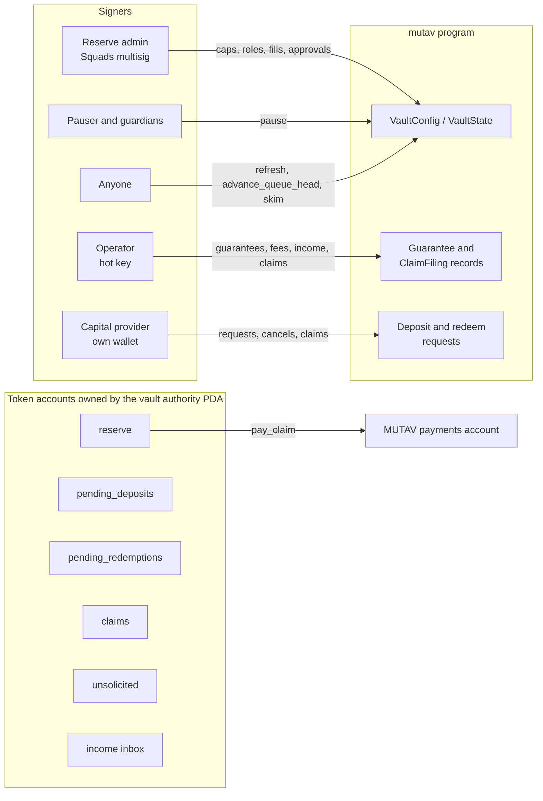

# Technical resources

Reference material for integrators, auditors and the people who run the MUTAV reserve program on Solana. These pages describe the **devnet release design**: the target design decided on 2026-10-10 for the first devnet deploy of the `mutav` program, layout v1.

> Unaudited software. The program is not yet deployed to devnet. Where a value is chosen at deploy time or is still open, these pages say so instead of guessing.

## Pages

Read them in this order.

| Page | What it covers |
|---|---|
| [Configuration and reference](configuration-and-reference.md) | Program ID, mints, token programs, every PDA with its seeds and devnet address, authorities, devnet parameters, program constants and account sizes. |
| [Program reference](program-reference.md) | Every instruction of the target design, grouped by signer: arguments, key rules, effects and events. The signer and pause matrix, the event list and the error list. |
| [Math reference](math-reference.md) | Solvency quantities, coverage required, NAV and share pricing, fee and income splits, the NAV-move guard, fill bounds and the sliding claim window, each with its rounding direction. |
| [Client SDK](client-sdk.md) | `@mutav-finance/mutav-protocol-solana`: PDAs, reads, the math mirror, previews and instruction composers. It composes unsigned transactions only. |
| [Deployment and operations](deployment-and-operations.md) | The guarded devnet deploy flow, post-deploy verification, upgrades, the `refresh` crank, monitoring and the runbooks. |
| [FAQ](faq.md) | Short answers to the questions integrators and reviewers ask most. |

## The system in one picture

The operator runs the guarantee and claim cycle. The reserve admin sets ceilings and fills the capital queues. The pauser and the guardians can stop capital flows and new guarantees at once. Anyone can run the cranks that need no judgment.

## Conventions used on these pages

| Convention | Meaning |
|---|---|
| Amounts | BRS base units. BRS has 6 decimals and is valued 1 BRS = R$1, so `1_000_000` base units = R$1. |
| bps | Basis points. `10_000` bps = 100%. |
| NAV scale | NAV per share and prices are fixed point with scale `10^9`. |
| `c` | The coverage ratio, `coverage_ratio_bps / 10_000`. |
| Rounding | Always in the reserve's favour: down for what the reserve pays or mints, up for what it requires or is owed. |
| "Pinned at implementation" | A name, offset or code the decisions do not fix. The code and the generated client are the reference once it lands. |
| "Set at deploy" | An address or value chosen during the devnet deploy. |
| Open items | Undecided values and deferred features are collected in [Open questions and possible improvements](../meta/open-questions.md). |

## What these pages do not cover

- Business rules, the guarantee product and the agency workflow. See the [litepaper](../litepaper.md) and the [specification](../spec.md).
- The rationale of each rule. See the [architecture decisions](../decisions/).
- The pilot app's pages. See [`app/docs/spec.md`](../../app/docs/spec.md).

## Related sections

- [Architecture](../architecture/README.md)
- [Reserve framework](../reserve-framework/README.md)
- [Security and verification](../security/README.md)
- [Glossary](../introduction/glossary.md)
- [Decisions](../meta/decisions.md)
- [Sources](../meta/sources.md)

## Sources

- [Specification](../spec.md)
- [Architecture decisions](../decisions/)
- [Litepaper](../litepaper.md)
- [Repository README](../../README.md)
- Program source: [`programs/mutav/src/`](../../programs/mutav/src/)
- Client: [`clients/js/README.md`](../../clients/js/README.md)

## Decisions

- [ADR 0001: Record architecture decisions](../decisions/0001-record-architecture-decisions.md)
- [ADR 0002: Core program and capped adapters](../decisions/0002-core-program-and-capped-adapters.md)
- [ADR 0018: BRS-only pilot reserve](../decisions/0018-brs-only-pilot-reserve.md)
- ADR 0019: v1 layout for the devnet release
- [ADR 0020: Operator/admin separation and operator-compromise recovery](../decisions/0020-operator-admin-separation-and-recovery.md)
- [ADR 0026: Program simplification for the freeze](../decisions/0026-program-simplification-for-the-freeze.md)
- [ADR 0027: Multi-asset adapters, liquidity floor and rebalancing](../decisions/0027-multi-asset-adapters-liquidity-floor-rebalancing.md) (Proposed)
