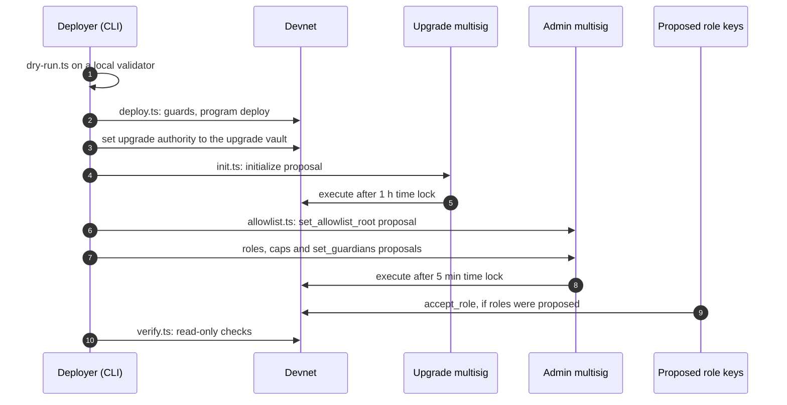
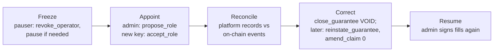

# Deployment and operations

How the `mutav` program is deployed to devnet, how the deployment is verified, how it is upgraded, and how the reserve is run day to day. The devnet deploy is pending; this page describes the planned flow and its guards.

## Environments

| Environment | Purpose | How it is deployed |
|---|---|---|
| Localnet | Rehearsal and end-to-end tests | `scripts/devnet/dry-run.ts` against a throwaway `solana-test-validator`. A throwaway in-memory key stands in for the Squads vault. |
| Devnet | The hackathon release, demonstrated by hand | `scripts/devnet/*` with every guard below. Proposals go through two Squads v4 multisigs. |
| Real pilot and mainnet | Capped pilot with real guarantees | Not by the devnet scripts. Through the release workflow (`.github/workflows/release.yml`) and the upgrade runbook in [spec §14.5](../spec.md#145-upgrade-runbook), after an independent audit. |

## Keys and custody

The scripts compose instructions and never open a key file, with one exception: `deploy.ts` passes keypair **paths** to the Solana CLI.

| Key | Where it lives | Notes |
|---|---|---|
| Program keypair | Outside the repo, for example `~/.config/solana/mutav/` | Holds the declared program ID. Only used by the CLI at deploy. |
| Deployer (payer) | Outside the repo, mode `600` | Temporary upgrade authority during the first deploy. `deploy.ts` refuses a file readable by group or other. |
| Admin multisig members | Their own wallets | Devnet: two wallets standing in for the founders. Hardware wallets before real money. |
| Operator | A devnet test key generated before the deploy and kept outside the repo, for example under `~/.config/solana/mutav/` (mode `600`) | Imported into a browser wallet for the operator console. Later a KMS-backed key in the MUTAV platform. |
| Pauser | Generated at deploy, separate key | |
| Guardian | A separate key held by a founder | Devnet starts with 1, set after `initialize` with a `set_guardians` proposal. |

Keypair files are gitignored and refused if found in the repo. The client, the scripts and the app contain no signing code; a CI check enforces it.

## The deploy config

Copy [`scripts/devnet/devnet.example.json`](../../scripts/devnet/devnet.example.json) to a path outside the repo and fill every `<FILL: …>`. It names addresses only, never keys.

| Section | Contents |
|---|---|
| Cluster and program | `cluster: "devnet"`, `programId`, `reserveMint`, `reserveTokenProgram` |
| `squads` | Admin multisig: address, vault index, exact members, threshold 2, time-lock floor 300 s |
| `upgradeSquads` | Upgrade multisig: same members, threshold 2, time-lock floor 3,600 s |
| Roles and accounts | `admin` and `upgradeAuthority` (the two vaults), `operator`, `pauser`, `mutavCapitalWallet`, `treasuryAccount`, `paymentsAccount`. Guardians are not in the config: the admin sets them with `set_guardians` after `initialize`. |
| Parameters | `coverageRatioBps` 2,500, `feeTakeBps` 2,000, `caps` per [ADR 0028](../decisions/0028-pilot-parameters.md): `maxTvl` R$1M, `maxCoverPerGuarantee` R$120k, `maxClaimPerCall` R$15k, `maxClaimPerPeriod` R$20k, `minRequest` R$1k, `maxRequest` R$100k, `maxNavMoveBps` 10,000, `stressBuffer` R$19k. `maxQueueWaitSecs` and `maxReinstateAge` are optional and default to 0. There is no price section and no dust threshold: the R$10 dust threshold is a runbook value. |
| `allowlist` | The capital wallet and any devnet capital-provider wallets |

Values without `<FILL>` are the locked devnet values. `verify.ts` checks them on-chain. See [Configuration and reference](configuration-and-reference.md#devnet-parameters).

## Deploy flow

| Step | Command | What it does |
|---|---|---|
| 0. Rehearse | `bun scripts/devnet/dry-run.ts --program-keypair <path>` | Full flow on a throwaway local validator, plus one allowlisted `request_deposit` that proves the root and proofs match the program. The validator always stops and its temp dir is deleted. |
| 1. Deploy | `bun scripts/devnet/deploy.ts --config <cfg> --url <rpc> --confirm-cluster devnet --payer <path> --upgrade-authority <upgrade vault> --expected-hash <hash>` | Refuses a `.so` whose executable hash (`solana-verify get-executable-hash`) is not `--expected-hash`. Runs the guards below, then `solana program deploy` with the deployer as temporary upgrade authority, then `set-upgrade-authority` to the upgrade vault. If the handover fails, it prints the exact retry command and exits non-zero. It re-reads ProgramData to confirm. Build with `solana-verify build` first so the hash is reproducible. |
| 2. Initialize | `bun scripts/devnet/init.ts --config <cfg> --url <rpc> --confirm-cluster devnet --out init.json` | Writes `initialize` as an unsigned proposal for the upgrade multisig, whose vault signs and pays rent. Send the vault about 0.1 SOL first. Reads the chain first: the reserve mint must be owned by the configured token program and have 6 decimals. |
| 3. Allowlist | `bun scripts/devnet/allowlist.ts --config <cfg> --proofs proofs.json --out allowlist.json` | Builds the Merkle tree, writes every owner's proof for the app to serve, and the `set_allowlist_root` proposal. |
| 4. Roles and caps | `roles.ts`, `caps.ts` | Optional. Role changes are two-step: the admin proposes (`propose_role`, with `cancel_pending` first when another handover is pending), the new key accepts with `accept_role` within 72 hours. `roles.ts` also cancels a pending operator or pauser handover the config does not ask for. A pending admin handover is kept if the config names it as `nextAdmin`; otherwise `roles.ts` refuses unless `--cancel-admin` is passed. Every cancellation is logged and named in the proposal title. `set_config` proposals are sparse: they carry only the fields they change, and are wrapped as `refresh, set_config, refresh` when `c`, the NAV-move bound or the stress buffer changes, and the proposal memo lists them. The config's optional `guardians` (up to 3; none when empty) are applied by `roles.ts`, which appends `set_guardians` when the chain differs. |
| 5. Verify | `bun scripts/devnet/verify.ts --config <cfg> --url <rpc> --confirm-cluster devnet --expected-hash <hash>` | Read-only post-deploy checks, below. `initialize` does not set the allowlist root, so run it only after the allowlist proposal (step 3) has executed, or the root check fails. |

Members create, approve and execute each proposal from the admin console or the Squads app. The time lock counts from approval.

### Guards before anything is sent

| Guard | Rule |
|---|---|
| Cluster | The RPC URL must parse as `http(s)`. Monikers and empty strings are refused. The cluster's genesis hash must be devnet's (`EtWTRABZaYq6iMfeYKouRu166VU2xqa1wcaWoxPkrZBG`). Mainnet's (`5eykt4UsFv8P8NJdTREpY1vzqKqZKvdpKuc147dw2N9d`) is always refused. The normalised URL is what the CLI receives. |
| Upgrade authority | `--upgrade-authority` must equal the config's `upgradeAuthority`, which must equal the vault derived from `upgradeSquads.multisig` and its vault index. `admin` must equal the admin multisig's vault. A vault index that is not an integer from 0 to 255 is refused. |
| Multisigs | Both are owned by the Squads v4 program, autonomous (`config_authority` is the default key), with exactly the configured members, each able to vote, exactly the configured threshold, and a time lock at or above the floor (300 s admin, 3,600 s upgrade on devnet). |
| Payer file | No group or other permission bits. |
| Reserve mint | Owned by the configured token program, 6 decimals. The program also requires 6 decimals in `initialize`. |
| Money accounts | Treasury and payments accounts hold the reserve mint, are distinct, and are not owned by the operator, the capital wallet or the vault authority. The program enforces the same rule. |

### Post-deploy checks (`verify.ts`)

- The deployed program is the verified build: the ProgramData program bytes hash to `--expected-hash` (computed as `solana-verify get-program-hash` does).
- Upgrade authority equals the configured upgrade vault.
- `feature_flags == 0`.
- Admin, operator, pauser and the allowlist root are as configured. No operator, pauser or admin handover is pending. The guardians are exactly the config's `guardians` (none when the list is empty or absent).
- Every other `VaultConfig` field equals the config file: `c`, fee take, every cap including `max_nav_move_bps` and the stress buffer, decimals 6, mint, token program, money accounts, capital wallet.
- On devnet, the locked devnet values of ADR 0028 (`DEVNET_LOCKED` in `scripts/devnet/lib/compare.ts`).
- The reserve mint is owned by the configured token program and has 6 decimals.
- Treasury and payments accounts hold the reserve mint and are not owned by the operator.
- Both multisigs: Squads v4 owner, no config authority, exact members and threshold, time lock at or above the floor.

After the deploy, live accounts are dumped into `tests/fixtures/layout/v1/` and decoded in CI, so every later upgrade is checked against real bytes.

### Turning on idl-compat at deploy

The `idl-compat` CI job stays inactive until a `v*` tag exists. Once it is active, it downloads `mutav.json` from that tag's GitHub release with `gh release download`, so the tag needs a release object, not only a git tag. Turn it on with the devnet deploy:

1. Tag the exact commit you deploy as `v1.0.0-devnet` and push the tag. Create its release: `gh release create v1.0.0-devnet --verify-tag --prerelease --notes "devnet deploy"`.
2. Run `release.yml` with `ref: v1.0.0-devnet`, `cluster: devnet` and `attach_to_release` on. The release then carries `mutav.json`, `mutav.so` and `mutav.hash` from the verified build. Deploy that `mutav.so`, and pass the contents of `mutav.hash` as `--expected-hash` to `deploy.ts` and `verify.ts`.
3. Confirm that `mutav.hash` equals `solana-verify get-program-hash 8scC79jkU7SPM9v6M4nB833R8EeqKknfwdRdjn73Qqv9 --url <rpc>`. `verify.ts` checks the same thing.

From then on, every PR's IDL is compared against that release. Enum variants, error codes and instruction accounts (including PDA seeds and fixed addresses) are append-only or frozen. Type forms the check does not model make it fail closed.

### First money in

The program refuses `contribute_fees` and `sweep_income` with `NoSharesOutstanding` while no shares exist. The first step after the deploy is therefore a deposit from the MUTAV capital wallet: `request_deposit`, then an admin `fulfil_deposits`, then `claim_shares`. Guarantee fees and issuer income wait until that fill.

## The layout freeze

From the first devnet deploy, layout v1 is frozen.

- Account changes are carves from `_reserved` or new accounts, checked against the v1 fixtures.
- Existing instructions keep their arguments and account lists; changes go in a `_v2` instruction. A CI job diffs the IDL against the last release.
- The error list and event fields are append-only.
- New instructions and logic-only changes can still ship as upgrades, through the upgrade multisig's time lock.

## Upgrades

Summary of [spec §14.5](../spec.md#145-upgrade-runbook).

1. **Before merge.** ADR and spec update in the same PR. No diff in the `pay_claim` path. Layout, padding-preservation, `idl-compat` and full test suites green. Client published as a minor version, and indexers updated to tolerate new fields and events before the program changes.
2. **Rehearse.** On a fork of the live cluster against real accounts, then on devnet with the same threshold and time lock.
3. **Build and buffer.** `solana-verify build`; write the buffer; set the buffer authority to the upgrade vault; the buffer hash must equal the build hash. `upgrade-proposal.ts --expected-hash` re-checks this at `confirmed`: buffer owner, buffer authority, buffer hash, and ProgramData's upgrade authority. It sizes `ExtendProgramChecked` from the buffer itself.
4. **Propose.** One Squads vault transaction: `ExtendProgramChecked` first if ProgramData is too small, then `Upgrade`, the IDL write and the verify record. Each signer reproduces the hash and decodes every instruction in the stored message. Any `SetAuthority` is a reason to reject.
5. **Execute and verify.** After the time lock. Check the on-chain hash with `solana-verify`, then smoke-check that `refresh` succeeds and carved fields read zero.
6. **Enable features separately.** A feature bit is set later by its own time-locked `set_config`, after an observation period.

| Time lock | Devnet | Real pilot and mainnet |
|---|---|---|
| Admin multisig | 5 min | 24 h |
| Upgrade multisig | 1 h | 7 days |

The exit fallback (any signer may fill the head redemption after `max_queue_wait_secs`) is off on devnet (`0`). When it is turned on, the upgrade time lock must be at least the wait, so holders can leave before an upgrade takes effect.

## Day-to-day operations

### Cranks

| Crank | Who runs it | When |
|---|---|---|
| `refresh` | Anyone; the MUTAV app in practice | Regularly, so the published NAV, mode and coverage stay current. The cadence is not yet set ([open questions](../meta/open-questions.md#possible-improvements)). Fills evaluate the NAV guard inline, so they do not depend on a fresh `refresh`. |
| `advance_queue_head(queue, max)` | Anyone; the MUTAV app in practice | Before every admin fill, once per queue, so the batch starts at a live head. Moves no money. |
| `skim` (later upgrade) | Anyone; a monitor | Not in this binary. Once it ships: whenever a tracked account holds more than its tracked total, it moves the surplus into `unsolicited`. |

### Monitoring and alerts

| Signal | Source | Action |
|---|---|---|
| Under-coverage | `ModeChanged { to: MODE_UNDER_COVERED, deficit }` | New guarantees and redemption fills stop. Claims keep being paid. Deposit fills still run. The admin decides on capital or a backstop. |
| NAV halt | `FulfilHaltRaised`; a fill refused with `FulfilHalted` before any `refresh` latched it | Fills stop. The admin investigates, then runs `clear_fulfil_halt(nav_bounds)`. |
| Frozen reserve account | `ReserveFrozenDetected { token_account }` | Contact the issuer. A frozen reserve blocks `pay_claim`, so MUTAV pays agencies by Pix from its own bank and the reserve reimburses the payments account later. |
| Untracked balance | Token balance above the tracked total, or a non-zero inbox outside a statement | Record it. It stays outside NAV until the unsolicited-money instructions ship. |
| Payments account owner change | Watcher on the payments token account | Investigate before the next `pay_claim`. |
| Operator activity | Feed of registrations, closes, filings, payments and settlements in the last 24 h | Early detection of unexpected operator actions. |
| Pending proposals | Scan of every live Squads proposal of both multisigs | Reject or cancel stale or unexpected proposals. A `set_config` proposal must not carry stale values over a newer one. |
| Pending handovers | `pending_operator`, `pending_pauser` and `pending_admin` with their expiry | Expect only handovers the admin proposed; cancel any other with `cancel_pending`. |

## Runbooks

### Operator compromise

1. **Freeze.** The pauser (or the admin) runs `revoke_operator` at once, and `pause` if needed. Operator instructions fail from the next slot. The pending operator key is cleared; the pending pauser key is left alone.
2. **Appoint.** The admin proposes a new operator with `propose_role(ROLE_OPERATOR, key)`; the new key accepts with `accept_role(ROLE_OPERATOR)` within 72 hours. If the pauser key is also suspect, the same Squads proposal runs `revoke_pauser` and `propose_role(ROLE_PAUSER, key)`.
3. **Reconcile.** The new operator compares the platform's contract registry with on-chain events since the compromise.
4. **Correct with ordinary operator actions.** Unknown registrations: `close_guarantee(CLOSE_VOID)`. Wrongful closes (`reinstate_guarantee`) and unknown or wrong filings (`amend_claim`, `amend_claim(0)` to withdraw) need the later upgrade; until it ships they cannot be reversed on-chain, and the reconciliation records them. There is no admin rollback instruction.
5. **Accept the bounded loss.** Claim payments are irreversible. They are bounded by the admin's claim caps and land in MUTAV's own payments account.
6. The admin signs no redemption fill until reconciliation is done.

### Pauser compromise

A pauser key can revoke the operator, which stops claim payments until the admin's time lock lets a new `propose_role` through and the new operator accepts. `revoke_operator` leaves the pending pauser alone, so a suspect pauser cannot cancel its own replacement. In that same Squads proposal the admin runs `revoke_pauser` and proposes a new pauser. Bank-first payment by Pix covers agencies in the meantime.

### Claims above the per-call cap

1. The operator files the claim for the full amount; `file_claim` has no per-call limit. NAV reflects it at once.
2. MUTAV may pay the agency by Pix from its own bank first. Until `approve_claim` ships, this bank-first payment is the path for every claim above the per-call cap: `pay_claim` refuses it with `ClaimCallCapExceeded`, and the filing stays `FILED` with its provision booked.
3. Once `approve_claim` ships (later upgrade), the admin proposal runs `approve_claim(notice, amount)` with the exact amount, plus a `set_config` raise of `max_claim_per_period` if the payment would not fit in the 31-day window.
4. After the time lock, the operator runs `pay_claim(notice, expected_amount)` for exactly the provision, which reimburses the payments account. A later `set_config` lowers the window cap back.

To settle for less than filed, the operator will amend the claim down first with the later `amend_claim`. An amendment resets the approval.

### Unsolicited money (later upgrade)

The instructions below are not in this binary. Until they ship, unsolicited BRS stays where it landed, outside NAV and coverage. Planned runbook:

1. Run `skim` on tracked accounts; the admin runs `classify_unsolicited` for inbox money that is on no issuer statement.
2. Screen the source.
3. If the sender is identified and asks within 30 days, the admin returns the money to the original source with `return_unsolicited` (source `Unsolicited`).
4. Otherwise the admin books it with `book_unsolicited` (kind `UNSOLICITED`). Amounts below R$10 are booked directly; the threshold is a runbook and app value, not an on-chain field.
5. Foreign classic SPL tokens go back with `return_unsolicited` (source `Foreign`), SOL above the rent-exempt minimum with source `Lamports`. Foreign tokens are never listed in the app.
6. Surplus shares in `pending_redemptions` go back with source `PendingRedemptionsSurplus`, or the admin burns them.

### Underwater reserve

The reserve is underwater when NAV per share falls below the smallest published unit while shares are outstanding (`net_assets × NAV_SCALE < shares_outstanding`). Both fills refuse with `ReserveUnderwater`; `cancel_deposit` and `cancel_redeem` stay open. Interim recovery ([ADR 0029](../decisions/0029-claims-and-capital-rules-in-the-program.md)): MUTAV recapitalises through `contribute_fees`, signed by the operator with a fresh `invoice_ref_hash` recorded as a backstop. No shares are minted, so the money raises NAV for every holder. The fee take applies, so MUTAV sends `needed / (1 − take)`. Booking backstop money with `book_unsolicited` (kind `BACKSTOP`) comes with a later upgrade.

### Stuck queue head

v1 fills whole requests only. A redemption head larger than the available budget blocks the queue until free capital grows. The consoles show the amount needed against the amount available. Devnet request sizes stay below free capital. A head worth 0 BRS at fill time is never filled, and a head whose price limit (`min_shares_out`, `min_assets_out`) is not met stops the batch: the owner or the admin cancels it with `cancel_deposit` or `cancel_redeem`.

### Capital provider removed from the allowlist

Exit stays open: a wallet that holds shares can still `request_redeem`. A pending deposit from that wallet is returned to the owner's own token account with `cancel_deposit`, signed by the owner or the admin.

### Claim notices are not built yet

The gate that holds capital fills while a missed-rent notice is open is not in v1; it is built with the exit fallback, before outside capital ([ADR 0025](../decisions/0025-exit-fallback-cooldown-exit.md)). Until then, the operator files the claim before any capital fill.

### Adapter emergency

Not in the pilot binary. With the first adapter upgrade, guardians, the pauser and the admin can disable an adapter, raise its haircut and sell an impaired position back into `reserve` at once; undoing any of it goes through the admin time lock. See [Incident response](../security/incident-response.md#adapter-emergency) and [ADR 0027](../decisions/0027-multi-asset-adapters-liquidity-floor-rebalancing.md).

## Sources

- [Repository README, Deploying](../../README.md#deploying)
- Devnet scripts: [`scripts/devnet/`](../../scripts/devnet/) (`deploy.ts`, `init.ts`, `allowlist.ts`, `roles.ts`, `caps.ts`, `verify.ts`, `dry-run.ts`, `devnet.example.json`)
- Upgrade proposal composer: [`scripts/release/upgrade-proposal.ts`](../../scripts/release/upgrade-proposal.ts)
- Key check: [`scripts/check-no-keys.sh`](../../scripts/check-no-keys.sh)
- Fork tests: [`tests-fork/README.md`](../../tests-fork/README.md)
- [Specification §6 Under-coverage mode](../spec.md#6-under-coverage-mode), [§14.5 Upgrade runbook](../spec.md#145-upgrade-runbook), [§14.6 Rollback](../spec.md#146-rollback), [§14.7 Layout-stability tests](../spec.md#147-layout-stability-tests-pilot)
- Pilot app spec: [`app/docs/spec.md`](../../app/docs/spec.md)
- [Solana CLI program deployment](https://solana.com/docs/programs/deploying)
- [solana-verify](https://github.com/Ellipsis-Labs/solana-verifiable-build)
- [Squads v4 documentation](https://docs.squads.so/)

## Decisions

- [ADR 0008: Uniform capital flow and pause scope](../decisions/0008-uniform-capital-flow-and-pause-scope.md)
- [ADR 0011: Phase-2 instant exit and upgrade readiness](../decisions/0011-phase2-instant-exit-and-upgrade-readiness.md)
- [ADR 0015: Admin clears the fulfil halt](../decisions/0015-admin-clear-fulfil-halt.md)
- [ADR 0018: BRS-only pilot reserve](../decisions/0018-brs-only-pilot-reserve.md)
- [ADR 0019: v1 layout for the devnet release](../decisions/0019-v1-layout-for-the-devnet-release.md)
- [ADR 0020: Operator/admin separation and operator-compromise recovery](../decisions/0020-operator-admin-separation-and-recovery.md)
- [ADR 0021: Claims: approval, amendment and exact payment](../decisions/0021-claims-approval-amendment-exact-payment.md)
- [ADR 0022: Coverage: stress buffer and underwater reserve](../decisions/0022-coverage-stress-buffer-underwater-reserve.md) (amends 0016)
- [ADR 0023: Capital flows and exit rights](../decisions/0023-capital-flows-and-exit-rights.md)
- [ADR 0024: Unsolicited money and backstop contributions](../decisions/0024-unsolicited-money-and-backstop.md)
- [ADR 0025: Exit fallback: a cooldown exit after `max_queue_wait_secs`](../decisions/0025-exit-fallback-cooldown-exit.md)
- [ADR 0026: Program simplification for the freeze](../decisions/0026-program-simplification-for-the-freeze.md)
- [ADR 0027: Multi-asset adapters, liquidity floor and rebalancing](../decisions/0027-multi-asset-adapters-liquidity-floor-rebalancing.md) (Proposed; who moves assets and the emergency path are decided)
- [ADR 0028: Pilot parameters](../decisions/0028-pilot-parameters.md)
- [ADR 0029: Claims and capital rules in the program](../decisions/0029-claims-and-capital-rules-in-the-program.md)
