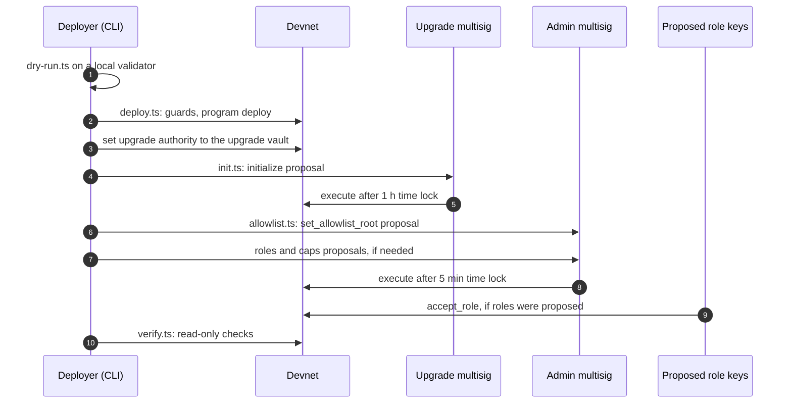
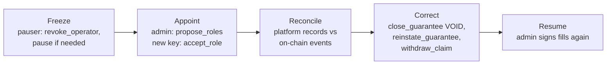

# Deployment and operations

How the `mutav` program is deployed to devnet, how the deployment is verified, how it is upgraded, and how the reserve is run day to day. The devnet deploy is pending; this page describes the planned flow and its guards.

## Environments

| Environment | Purpose | How it is deployed |
|---|---|---|
| Localnet | Rehearsal and end-to-end tests | `scripts/devnet/dry-run.ts` against a throwaway `solana-test-validator`. A throwaway in-memory key stands in for the Squads vault. |
| Devnet | The hackathon release, demonstrated by hand | `scripts/devnet/*` with every guard below. Proposals go through two Squads v4 multisigs. |
| Real pilot and mainnet | Capped pilot with real guarantees | Not by the devnet scripts. Through the release workflow (`.github/workflows/release.yml`) and the upgrade runbook in [spec §14.5](../spec.md#145-upgrade-runbook), after an independent audit. |

## Keys and custody

The scripts compose instructions and never open a key file, with one exception: `deploy.ts` passes keypair **paths** to the Solana CLI.

| Key | Where it lives | Notes |
|---|---|---|
| Program keypair | Outside the repo, for example `~/.config/solana/mutav/` | Holds the declared program ID. Only used by the CLI at deploy. |
| Deployer (payer) | Outside the repo, mode `600` | Temporary upgrade authority during the first deploy. `deploy.ts` refuses a file readable by group or other. |
| Admin multisig members | Their own wallets | Devnet: two wallets standing in for the founders. Hardware wallets before real money. |
| Operator | Generated at deploy into `~/.config/solana/mutav/operator-devnet.json` (mode `600`) | Imported into a browser wallet for the operator console. Later a KMS-backed key in the MUTAV platform. |
| Pauser | Generated at deploy, separate key | |
| Guardian | A separate key held by a founder | Devnet starts with 1. |

Keypair files are gitignored and refused if found in the repo. The client, the scripts and the app contain no signing code; a CI check enforces it.

## The deploy config

Copy [`scripts/devnet/devnet.example.json`](../../scripts/devnet/devnet.example.json) to a path outside the repo and fill every `<FILL: …>`. It names addresses only, never keys.

| Section | Contents |
|---|---|
| Cluster and program | `cluster: "devnet"`, `programId`, `reserveMint`, `reserveTokenProgram` |
| `squads` | Admin multisig: address, vault index, exact members, threshold 2, time-lock floor 300 s |
| `upgradeSquads` | Upgrade multisig: same members, threshold 2, time-lock floor 3,600 s |
| Roles and accounts | `admin` and `upgradeAuthority` (the two vaults), `operator`, `pauser`, guardians, `mutavCapitalWallet`, `treasuryAccount`, `paymentsAccount` |
| Parameters | `coverageRatioBps` 1,000, `feeTakeBps` 2,000, `caps` (including the stress buffer; the dust threshold too if it is enforced on-chain), `price` (placeholders; `maxNavMoveBps` 10,000) |
| `allowlist` | The capital wallet and any devnet capital-provider wallets |

Values without `<FILL>` are the locked devnet values. `verify.ts` checks them on-chain. See [Configuration and reference](configuration-and-reference.md#devnet-parameters).

## Deploy flow

| Step | Command | What it does |
|---|---|---|
| 0. Rehearse | `bun scripts/devnet/dry-run.ts --program-keypair <path>` | Full flow on a throwaway local validator, plus one allowlisted `request_deposit` that proves the root and proofs match the program. The validator always stops and its temp dir is deleted. |
| 1. Deploy | `bun scripts/devnet/deploy.ts --config <cfg> --url <rpc> --confirm-cluster devnet --payer <path> --upgrade-authority <upgrade vault>` | Runs the guards below, then `solana program deploy` with the deployer as temporary upgrade authority, then `set-upgrade-authority` to the upgrade vault. If the handover fails, it prints the exact retry command and exits non-zero. It re-reads ProgramData to confirm. Build with `solana-verify build` first so the hash is reproducible. |
| 2. Initialize | `bun scripts/devnet/init.ts --config <cfg> --url <rpc> --confirm-cluster devnet --out init.json` | Writes `initialize` as an unsigned proposal for the upgrade multisig, whose vault signs and pays rent. Send the vault about 0.1 SOL first. Reads the chain first: the reserve mint must be owned by the configured token program and have 6 decimals. |
| 3. Allowlist | `bun scripts/devnet/allowlist.ts --config <cfg> --proofs proofs.json --out allowlist.json` | Builds the Merkle tree, writes every owner's proof for the app to serve, and the `set_allowlist_root` proposal. |
| 4. Roles and caps | `roles.ts`, `caps.ts` | Optional. Role changes are two-step: the admin proposes, the new key accepts before the handover expires. `set_config` proposals carry every other field from chain. |
| 5. Verify | `bun scripts/devnet/verify.ts --config <cfg> --url <rpc> --confirm-cluster devnet` | Read-only post-deploy checks, below. |

Members create, approve and execute each proposal from the admin console or the Squads app. The time lock counts from approval.

### Guards before anything is sent

| Guard | Rule |
|---|---|
| Cluster | The RPC URL must parse as `http(s)`. Monikers and empty strings are refused. The cluster's genesis hash must be devnet's (`EtWTRABZaYq6iMfeYKouRu166VU2xqa1wcaWoxPkrZBG`). Mainnet's (`5eykt4UsFv8P8NJdTREpY1vzqKqZKvdpKuc147dw2N9d`) is always refused. The normalised URL is what the CLI receives. |
| Upgrade authority | `--upgrade-authority` must equal the config's `upgradeAuthority`, which must equal the vault derived from `upgradeSquads.multisig` and its vault index. `admin` must equal the admin multisig's vault. A vault index that is not an integer from 0 to 255 is refused. |
| Multisigs | Both are owned by the Squads v4 program, autonomous (`config_authority` is the default key), with exactly the configured members, each able to vote, exactly the configured threshold, and a time lock at or above the floor (300 s admin, 3,600 s upgrade on devnet). |
| Payer file | No group or other permission bits. |
| Reserve mint | Owned by the configured token program, 6 decimals. The program also requires 6 decimals in `initialize`. |
| Money accounts | Treasury and payments accounts hold the reserve mint, are distinct, and are not owned by the operator, the capital wallet or the vault authority. The program enforces the same rule. |

### Post-deploy checks (`verify.ts`)

- Upgrade authority equals the configured upgrade vault.
- `feature_flags == 0` and `buffer_earmark == 0`.
- Admin, operator, pauser, guardians and the allowlist root are as configured.
- Every other `VaultConfig` field equals the config file: `c`, fee take, every cap including the settlement floor and stress buffer, price bounds, income take 0, decimals 6, mint, token program, money accounts, capital wallet.
- On devnet, the locked devnet values.
- Treasury and payments accounts hold the reserve mint and are not owned by the operator.
- Both multisigs: Squads v4 owner, no config authority, exact members and threshold, time lock at or above the floor.

After the deploy, live accounts are dumped into `tests/fixtures/layout/v1/` and decoded in CI, so every later upgrade is checked against real bytes.

### First money in

The program refuses `contribute_fees`, `sweep_income` and `book_unsolicited` while no shares exist. The first step after the deploy is therefore a deposit from the MUTAV capital wallet: `request_deposit`, then an admin `fulfil_deposits`, then `claim_shares`. Guarantee fees and issuer income wait until that fill.

## The layout freeze

From the first devnet deploy, layout v1 is frozen.

- Account changes are carves from `_reserved` or new accounts, checked against the v1 fixtures.
- Existing instructions keep their arguments and account lists; changes go in a `_v2` instruction. A CI job diffs the IDL against the last release.
- The error list and event fields are append-only.
- New instructions and logic-only changes can still ship as upgrades, through the upgrade multisig's time lock.

## Upgrades

Summary of [spec §14.5](../spec.md#145-upgrade-runbook).

1. **Before merge.** ADR and spec update in the same PR. No diff in the `pay_claim` path. Layout, padding-preservation, `idl-compat` and full test suites green. Client published as a minor version, and indexers updated to tolerate new fields and events before the program changes.
2. **Rehearse.** On a fork of the live cluster against real accounts, then on devnet with the same threshold and time lock.
3. **Build and buffer.** `solana-verify build`; write the buffer; set the buffer authority to the upgrade vault; the buffer hash must equal the build hash.
4. **Propose.** One Squads vault transaction: `ExtendProgramChecked` first if ProgramData is too small, then `Upgrade`, the IDL write and the verify record. Each signer reproduces the hash and decodes every instruction in the stored message. Any `SetAuthority` is a reason to reject.
5. **Execute and verify.** After the time lock. Check the on-chain hash with `solana-verify`, then smoke-check that `refresh` succeeds and carved fields read zero.
6. **Enable features separately.** A feature bit is set later by its own time-locked `set_config`, after an observation period.

| Time lock | Devnet | Real pilot and mainnet |
|---|---|---|
| Admin multisig | 5 min | 24 h |
| Upgrade multisig | 1 h | 7 days |

The exit fallback (any signer may fill the head redemption after `max_queue_wait_secs`) is off on devnet (`0`). When it is turned on, the upgrade time lock must be at least the wait, so holders can leave before an upgrade takes effect.

## Day-to-day operations

### Cranks

| Crank | Who runs it | When |
|---|---|---|
| `refresh` | Anyone; the MUTAV app in practice | Regularly, so the published NAV, mode and coverage stay current. Cadence TBD. Fills evaluate the NAV guard inline, so they do not depend on a fresh `refresh`. |
| `advance_queue_heads` | Anyone; the MUTAV app in practice | Before every admin fill, so the batch starts at a live head. Moves no money. |
| `skim` | Anyone; a monitor | Whenever a tracked account holds more than its tracked total. Moves the surplus into `unsolicited`. |

### Monitoring and alerts

| Signal | Source | Action |
|---|---|---|
| Under-coverage | `ModeChanged { to: UNDER_COVERED, deficit }` | New guarantees and redemptions stop. Claims keep being paid. The admin decides on capital or a backstop. |
| NAV halt | `FulfilHaltRaised` | Fills stop. The admin investigates, then runs `clear_fulfil_halt`. |
| Frozen reserve account | `ReserveFrozenDetected { token_account }` | Contact the issuer. A frozen reserve blocks `pay_claim`, so MUTAV pays agencies by Pix from its own bank and the reserve reimburses the payments account later. |
| Untracked balance | Token balance above the tracked total, or a non-zero inbox outside a statement | `skim`, then the unsolicited-money runbook. |
| Payments account owner change | Watcher on the payments token account | Investigate before the next `pay_claim`. |
| Operator activity | Feed of registrations, closes, filings, amendments, withdrawals and payments in the last 24 h | Early detection of unexpected operator actions. |
| Pending proposals | Scan of every live Squads proposal of both multisigs | Reject or cancel stale or unexpected proposals. A `set_config` proposal must not carry stale values over a newer one. |

## Runbooks

### Operator compromise

1. **Freeze.** The pauser runs `revoke_operator` at once, and `pause` if needed. Operator instructions fail from the next slot. Pending role keys are cleared.
2. **Appoint.** The admin proposes a new operator with `propose_roles`; the new key accepts with `accept_role`. If the pauser key is also suspect, replace it in the same proposal.
3. **Reconcile.** The new operator compares the platform's contract registry with on-chain events since the compromise.
4. **Correct with ordinary operator actions.** Unknown registrations: `close_guarantee(VOID)`. Wrongful closes: `reinstate_guarantee`, within `max_reinstate_age`. Unknown filings: `withdraw_claim`. There is no admin rollback instruction.
5. **Accept the bounded loss.** Claim payments are irreversible. They are bounded by the admin's claim caps and land in MUTAV's own payments account.
6. The admin signs no redemption fill until reconciliation is done.

### Pauser compromise

A pauser key can revoke the operator, which stops claim payments until the admin's time lock lets a new `propose_roles` through. Replace the pauser in that same proposal. Bank-first payment by Pix covers agencies in the meantime.

### Claims above the per-call cap

1. The operator files the claim. NAV reflects it at once.
2. MUTAV may pay the agency by Pix from its own bank first.
3. The admin proposal runs `approve_claim(notice, amount)` with the exact amount, plus a `set_config` raise of `max_claim_per_period` if the payment would not fit in the sliding window.
4. After the time lock, the operator runs `pay_claim` for exactly the provision. A later `set_config` lowers the window cap back.

To settle for less than filed, the operator amends the claim down first. An amendment resets the approval.

### Unsolicited money

1. Run `skim` on tracked accounts; the admin runs `classify_unsolicited` for inbox money that is on no issuer statement.
2. Screen the source.
3. If the sender is identified and asks within 30 days, the admin returns the money to the original source with `return_unsolicited`.
4. Otherwise the admin books it with `book_unsolicited` (kind `UNSOLICITED`). Amounts below the dust threshold (R$10 on devnet) are booked directly.
5. Foreign classic SPL tokens and excess SOL go back with `return_foreign`. They are never listed in the app.

### Underwater reserve

When net assets reach 0 with shares outstanding, deposit fills are refused. MUTAV sends its own backstop BRS and the admin books it into the reserve with `book_unsolicited`, kind `BACKSTOP`. How the backstop transfer reaches the `unsolicited` account before booking is pinned at implementation. No shares are minted, so the money raises NAV for every holder.

### Stuck queue head

v1 fills whole requests only. A redemption head larger than the available budget blocks the queue until free capital grows. The consoles show the amount needed against the amount available. Devnet request sizes stay below free capital.

### Capital provider removed from the allowlist

Exit stays open: a wallet that holds shares can still `request_redeem`. A pending deposit from that wallet is returned with the admin's `refund_deposit(seq)`.

### Claim notices are not built yet

The gate that holds capital fills while a missed-rent notice is open exists but is inert. Until claim notices are built, the operator files the claim before any capital fill.

## Sources

- [Repository README, Deploying](../../README.md#deploying)
- Devnet scripts: [`scripts/devnet/`](../../scripts/devnet/) (`deploy.ts`, `init.ts`, `allowlist.ts`, `roles.ts`, `caps.ts`, `verify.ts`, `dry-run.ts`, `devnet.example.json`)
- Upgrade proposal composer: [`scripts/release/upgrade-proposal.ts`](../../scripts/release/upgrade-proposal.ts)
- Key check: [`scripts/check-no-keys.sh`](../../scripts/check-no-keys.sh)
- Fork tests: [`tests-fork/README.md`](../../tests-fork/README.md)
- [Specification §6 Under-coverage mode](../spec.md#6-under-coverage-mode), [§14.5 Upgrade runbook](../spec.md#145-upgrade-runbook), [§14.6 Rollback](../spec.md#146-rollback), [§14.7 Layout-stability tests](../spec.md#147-layout-stability-tests-pilot)
- Pilot app spec: [`app/docs/spec.md`](../../app/docs/spec.md)
- [Solana CLI program deployment](https://solana.com/docs/programs/deploying)
- [solana-verify](https://github.com/Ellipsis-Labs/solana-verifiable-build)
- [Squads v4 documentation](https://docs.squads.so/)

## Decisions

- [ADR 0008: Uniform capital flow and pause scope](../decisions/0008-uniform-capital-flow-and-pause-scope.md)
- [ADR 0011: Phase-2 instant exit and upgrade readiness](../decisions/0011-phase2-instant-exit-and-upgrade-readiness.md)
- [ADR 0015: Admin clears the fulfil halt](../decisions/0015-admin-clear-fulfil-halt.md)
- [ADR 0018: BRS-only pilot reserve](../decisions/0018-brs-only-pilot-reserve.md)
- Pending ADR 0019: v1 layout for the devnet release
- Pending ADR: Operator/admin separation and operator-compromise recovery (roles, recovery model, pause scope, two multisigs and time locks)
- Pending ADR: Claims: approval, amendment, exact payment, sliding window
- Pending ADR: Coverage: stress buffer and underwater reserve (amends 0016)
- Pending ADR: Exit rights (open exit, full exit below minimum, refunds)
- Pending ADR: Unsolicited money and backstop contributions
- Pending ADR: Exit fallback
