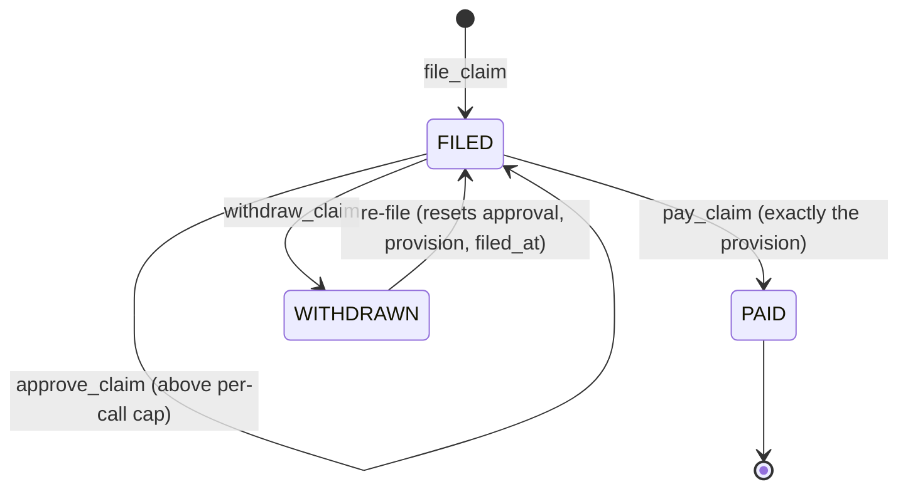
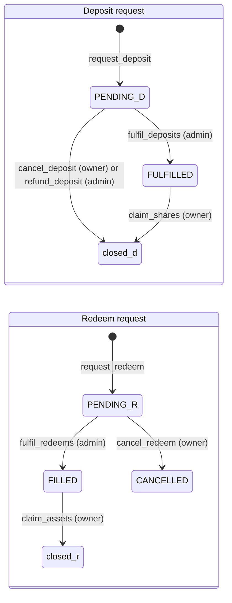

# Program reference

Every instruction of the `mutav` program in the devnet release design, grouped by the key that signs it. For each: arguments, key rules, effects and the event it emits. The signer matrix, events and errors close the page.

Addresses, seeds and parameter values are in [Configuration and reference](configuration-and-reference.md). Formulas are in [Math reference](math-reference.md).

## Common rules

These apply to every instruction.

- **Version guard.** An account whose `version` is above `PROGRAM_LAYOUT_VERSION` (1), or whose status, leg, kind or mode byte is unknown, is refused with `UnsupportedVersion`.
- **Checked transfers.** Every BRS transfer uses `transfer_checked` with the stored reserve mint and token program.
- **No delegates.** A debit from a capital provider requires the token account's owner to be the signer. Delegates are never used.
- **Seeds and owners.** Every program account is checked by seeds and canonical bump. Token accounts are checked for mint, owner and token program.
- **Math.** `u128` intermediates, checked, rounded in the reserve's favour. Overflow fails with `MathOverflow`.
- **Events.** Emitted with `emit_cpi!`. Every event carries `config: Pubkey` and `ts: i64`.
- **Owner token accounts.** `cancel_deposit`, `claim_shares`, `cancel_redeem`, `claim_assets` and `refund_deposit` create the owner's associated token account idempotently. The caller pays its rent.
- **Names marked "pinned at implementation".** The decisions fix the behaviour. The exact name, argument shape, event fields or error code are fixed when the code lands.

## Signer matrix

● may sign. "Under pause" says whether the instruction runs while the reserve is paused. "Solvency gate" says whether it is refused when the gate fails.

| Instruction | Admin | Operator | Pauser | Guardian | Owner | Anyone | Under pause | Solvency gate |
|---|---|---|---|---|---|---|---|---|
| `initialize` | Upgrade authority only | | | | | | n/a | No |
| `set_config` | ● | | | | | | Runs | No |
| `propose_roles` / `accept_role` | ● propose (the proposed key accepts) | | | | | | Runs | No |
| `propose_admin` / `accept_admin` | ● propose (the proposed admin accepts) | | | | | | Runs | No |
| `set_guardians` | ● | | | | | | Runs | No |
| `set_payments_account` | ● | | | | | | Runs | No |
| `set_allowlist_root` | ● | | | | | | Runs | No |
| `clear_fulfil_halt` | ● | | | | | | Runs | No |
| `pause` | ● | | ● | ● | | | n/a | No |
| `unpause` | ● | | | | | | n/a | No |
| `revoke_operator` | ● | | ● | | | | Runs | No |
| `fulfil_deposits` | ● | | | | | | Refused | No (see note) |
| `fulfil_redeems` | ● | | | | | | Refused | Yes |
| `refund_deposit` | ● | | | | | | Runs | No |
| `approve_claim` | ● | | | | | | Runs | Never |
| `classify_unsolicited` | ● | | | | | | Runs | No |
| `book_unsolicited` | ● | | | | | | Runs | No |
| `return_unsolicited` / `return_foreign` | ● | | | | | | Runs | No |
| Share return or burn | ● | | | | | | Runs | No |
| `register_guarantee` | | ● | | | | | Refused | Yes |
| `close_guarantee` | | ● | | | | | Runs | No |
| `reinstate_guarantee` | | ● | | | | | Runs | No |
| `contribute_fees` | | ● | | | | | Runs | No |
| `sweep_income` | | ● | | | | | Runs | No |
| `file_claim` | | ● | | | | | Runs | Never |
| `amend_claim` | | ● | | | | | Runs | Never |
| `withdraw_claim` | | ● | | | | | Runs | Never |
| `pay_claim` | | ● | | | | | Runs | Never |
| `settle_payout` | | ● | | | | | Runs | Never |
| `request_deposit` | | | | | ● | | Refused | No |
| `cancel_deposit` / `claim_shares` | | | | | ● | | Runs | No |
| `request_redeem` | | | | | ● | | Refused | No |
| `cancel_redeem` / `claim_assets` | | | | | ● | | Runs | No |
| `refresh` | | | | | | ● | Runs | No |
| `advance_queue_heads` | | | | | | ● | Runs | No |
| `skim` | | | | | | ● | Runs | No |

Note: `fulfil_deposits` is allowed while the reserve is under-covered, because it is the recapitalisation path. It is still refused with `ReserveUnderwater` when net assets are 0 with shares outstanding, and by the reserve-size cap.

Pause stops only capital flows and new guarantees. It never stops a claim and never traps a holder's money.

## Upgrade authority

### `initialize(args)`

| | |
|---|---|
| Signer | The program upgrade authority, checked against ProgramData. Cannot be front-run. |
| Args | `admin`, `operator`, `pauser`, `mutav_capital_wallet`, `coverage_ratio_bps`, `fee_take_bps`, `caps`, `price`, and the treasury and payments accounts. |
| Rules | Reserve mint has 6 decimals and passes the mint guard (no permanent delegate, transfer hook, transfer fee or transfer-fee authority, non-transferable, default-frozen, scaled UI amount, interest-bearing or pausable extension). Roles set and distinct. Parameter bounds as `set_config`. Treasury and payments accounts hold the reserve mint, are distinct, and are owned by none of: the vault authority, the operator, the capital wallet. |
| Effects | Creates `VaultConfig`, an empty `VaultState`, the share mint, the tracked token accounts (`reserve`, `pending_deposits`, `pending_redemptions`, `claims`), the `unsolicited` account and, idempotently, the income inbox. Allowlist root, feature flags, exit parameters, adapters and guardians start at zero. |
| Errors | `Unauthorized`, `UnsupportedMintExtension`, `InvalidMint`, `InvalidParameter`, `RolesNotDistinct`, `InvalidIncomeSource`, `InvalidTreasuryAccount`, `InvalidPaymentsAccount` |
| Event | `VaultInitialized { admin, operator, pauser, reserve_mint, share_mint }` |

## Reserve admin

The admin is the vault of the admin multisig. Every admin instruction goes through a Squads proposal and waits for the multisig's time lock. `pause` is also open to the pauser and guardians, who send it without delay.

### Configuration and roles

#### `set_config(args)`

| | |
|---|---|
| Args | `coverage_ratio_bps`, `fee_take_bps`, `feature_flags`, `mutav_capital_wallet`, treasury account, `caps` (including `stress_buffer`, and `unsolicited_dust` if the dust threshold is enforced on-chain), `price`, `exit`, `income_take_bps`, `max_reinstate_age`, `max_queue_wait_secs` (field placement pinned at implementation). There is no payout SLA and no per-agency cap. |
| Rules | `1_000 ≤ coverage_ratio_bps ≤` upper bound; `fee_take_bps ≤ 3_000`; `income_take_bps ≤ 0`; flags inside `SUPPORTED_FEATURES`; `max_claim_per_call > 0`; `max_claim_per_period ≥ max_claim_per_call`; `0 < claim_period_secs ≤ 90 days`; `max_tvl > 0`; `0 < min_request ≤ max_request`; `min_settlement_bps ≤ 10_000`; bounded `stress_buffer` and `max_staleness_secs`. Treasury rules as `initialize`. |
| Effects | Writes each field in place. Recomputes the cached `coverage_required`. A proposal carries every field read from chain, so a partial edit never reverts others. |
| Errors | `Unauthorized`, `InvalidParameter`, `FeatureNotSupported`, `InvalidTreasuryAccount`, `MathOverflow` |
| Event | One `ConfigUpdated { field, old, new }` per changed field. |

#### `propose_roles(operator, pauser)` and `accept_role()`

| | |
|---|---|
| Signer | Propose: admin. Accept: the proposed key. |
| Rules | Proposed keys are distinct from the admin and from each other. Accept succeeds only for a key held as a pending operator or pending pauser, before the pending handover expires (`pending_expires_at`). |
| Effects | Propose stores the pending keys and their expiry. Accept moves the signer's pending key into the live role and clears it. A typo can never appoint a key nobody holds. |
| Errors | `Unauthorized`, `RolesNotDistinct`; expiry error pinned at implementation. |
| Event | `RolesUpdated { operator, pauser }` on acceptance. Proposal event pinned at implementation. |

#### `propose_admin(new_admin)` and `accept_admin()`

| | |
|---|---|
| Signer | Propose: admin. Accept: the proposed admin. |
| Effects | Two-step rotation of `VaultConfig.admin` through `pending_admin`, with the same expiry rule. Runbook: rotate Squads members while both keys are live. |
| Event | Pinned at implementation. |

#### `set_guardians(guardians)`

| | |
|---|---|
| Rules | Up to 3 keys. `Pubkey::default()` marks an empty slot and never counts as a guardian. |
| Effects | Writes the pause-only guardian keys. |
| Event | Pinned at implementation. |

#### `set_payments_account()`

| | |
|---|---|
| Rules | The new account holds the reserve mint, differs from the treasury, and is owned by none of: the capital wallet, the operator, the vault authority. |
| Errors | `Unauthorized`, `InvalidMint`, `InvalidPaymentsAccount` |
| Event | `PaymentsAccountUpdated { old, new }` |

#### `set_allowlist_root(root)`

| | |
|---|---|
| Effects | Replaces the Merkle root of allowlisted capital-provider wallets. Entry is gated by this root. Exit is not. |
| Event | `AllowlistRootUpdated { root }` |

#### `clear_fulfil_halt()`

| | |
|---|---|
| Accounts | Takes the seeds-checked `reserve`. |
| Rules | `fulfil_halted` is set. A frozen reserve counts as 0 BRS, and the instruction refuses with `ReserveFrozen`. |
| Effects | Clears the halt. Sets the guard baseline to the current published NAV. Resets `inflow_nav`. |
| Errors | `Unauthorized`, `InvalidParameter`, `ReserveFrozen`, `StalePrice` |
| Event | `FulfilHaltCleared { nav_per_share }` |

#### `pause()`, `unpause()`, `revoke_operator()`

| | |
|---|---|
| Signer | `pause`: admin, pauser or a guardian. `unpause`: admin only. `revoke_operator`: admin or pauser. |
| Effects | `pause` and `unpause` set or clear `paused`. `revoke_operator` sets the operator to `Pubkey::default()` at once and clears every pending role key. Operator instructions fail from the next slot. |
| Events | `Paused { by }`, `Unpaused { by }`, `OperatorRevoked { by }` |

### Capital fills and refunds

#### `fulfil_deposits(count, nav_bounds)`

| | |
|---|---|
| Args | `count` from 1 to 8. `nav_bounds` is a `(min, max)` pair composed by the admin console when the proposal is created. |
| Rules | Strict FIFO from `deposit_head`, with the skip proof of `advance_queue_heads` for dead seqs. Not paused. No open claim notice (the gate exists and is inert until claim notices are built). Not halted, and the NAV-move guard is evaluated inline. Reserve not frozen. The fill NAV is inside `nav_bounds`. `stable_assets + Σ assets ≤ max_tvl`. Refused with `ReserveUnderwater` when net assets are 0 with shares outstanding. Every fill mints more than 0 shares. |
| Effects | Per request: `shares_out = shares_for(assets)` at the live NAV, BRS moved from `pending_deposits` to `reserve`, status `FULFILLED`, head advanced. Shares are minted later by `claim_shares`. |
| Errors | `Unauthorized`, `Paused`, `ClaimNoticePending`, `FulfilHalted`, `ReserveFrozen`, `TvlCapExceeded`, `ReserveUnderwater`, `NavOutOfBounds`, `QueueOrderViolation`; zero-shares error pinned at implementation. |
| Events | `DepositFilled` per fill, `DepositsFulfilled { from_seq, to_seq, assets, shares, nav }` per batch, and an event when the head moves with zero fills (name pinned at implementation). |

#### `fulfil_redeems(count, max_assets, nav_bounds)`

| | |
|---|---|
| Rules | Up to 8 requests in strict FIFO from `redeem_head`. Not paused. No open claim notice. Mode normal. Not halted, guard evaluated inline. Fill NAV inside `nav_bounds`. Whole fills only in v1: a head that does not fit stops the batch. Budget before every fill: `min(max_assets − paid, free_capital, liquid_budget)`. A head whose value has fallen to 0 fills as a 0-asset fill: its shares are burned and the request closes, so it never blocks the queue. |
| Effects | Burns the escrowed shares, moves `assets_for(shares)` BRS from `reserve` to `claims`, status `FILLED`. A call that fills nothing fails. |
| Errors | `Paused`, `ClaimNoticePending`, `UnderCovered`, `FulfilHalted`, `ReserveFrozen`, `InsufficientFreeCapital`, `InsufficientLiquidBalance`, `NavOutOfBounds`, `RequestTooSmall`, `QueueOrderViolation` |
| Events | `RedeemFilled` per fill, `RedeemsFulfilled { from_seq, to_seq, shares, assets, nav, head_partial, idle_free_capital }` per batch. |

#### `refund_deposit(seq)`

| | |
|---|---|
| Rules | The request is `PENDING`. The destination is the owner's own BRS associated token account, with owner and mint checked. |
| Effects | Returns the escrowed BRS, closes the request and unblocks the FIFO queue. Used, for example, when a wallet leaves the allowlist with a deposit pending. |
| Event | Pinned at implementation. |

### Claims

#### `approve_claim(notice_ref_hash, amount)`

| | |
|---|---|
| Rules | The filing is `FILED`. The admin approves the amount that may leave the reserve, not the claim's validity. |
| Effects | Records `approved_amount` on the filing. It binds an exact amount: `pay_claim` then pays exactly that. The threshold is `max_claim_per_call`; there is no separate parameter. If the payment would not fit in the sliding-window cap, the same proposal bundles a `set_config` raise of `max_claim_per_period`, and a later `set_config` lowers it back. Any later `amend_claim` or re-file resets the approval to 0. |
| Event | Pinned at implementation. |

### Unsolicited money

Unsolicited money is BRS, or another token, that arrived outside a booking path. It is the reserve admin's responsibility. No money gets stuck: it is returned to its source or booked into the reserve. Returns leave only from the `unsolicited` account, so issuer income can never be returned.

#### `classify_unsolicited(amount)`

| | |
|---|---|
| Effects | Moves money from the income inbox into `unsolicited`. Used for money that is on no issuer statement, after the operator has swept the statements. |
| Event | Pinned at implementation. |

#### `book_unsolicited(amount, ref_hash)`

| | |
|---|---|
| Rules | Refused while `shares_outstanding == 0`. |
| Effects | Moves BRS from `unsolicited` into `reserve` as an inflow. `brs_balance` and NAV rise and the amount counts in `inflow_nav`. No shares are minted. Creates an `IncomeReceipt` with `kind = UNSOLICITED`, or `kind = BACKSTOP` for MUTAV's own backstop money. The argument that selects the kind is pinned at implementation. |
| Event | Pinned at implementation. |

#### `return_unsolicited(amount, destination, ref_hash)`

| | |
|---|---|
| Rules | From `unsolicited` only. To the source of the original transfer: the transaction signature is committed in `ref_hash` and checked by the admin console when the proposal is composed. Sources are screened first. |
| Event | Pinned at implementation. |

#### `return_foreign(mint, amount, destination)`

| | |
|---|---|
| Rules | Classic SPL Token mints only (the mint's owner is the classic Token program), never a Token-2022 mint. Never the BRS mint, the share mint or an adapter mint. Also returns SOL above the rent-exempt minimum. |
| Event | Pinned at implementation. |

#### Share return or burn

Surplus shares that arrive in `pending_redemptions` outside a redeem request are returned to the sender or burned by the admin. Instruction name and event pinned at implementation.

## Operator

The operator holds the contracts and runs the guarantee and claim cycle. Every registry action it takes can be reversed by another operator action. Only `pay_claim` is irreversible, and it is bounded by the admin's claim caps.

### Guarantees

#### `register_guarantee(id, agency_id, refs_hash, rent, default_multiplier_bps, exit_multiplier_bps, default_cover, exit_cover)`

| | |
|---|---|
| Accounts | `config`, `state`, `guarantee` (init), the seeds-checked `reserve`, operator, payer. |
| Rules | Not paused. Reserve not frozen (a frozen reserve counts as 0 BRS and the instruction refuses with `ReserveFrozen`). `rent > 0`. `default_cover + exit_cover > 0` and `≤ max_cover_per_guarantee`. Mode normal. `coverage_required` after the registration `≤ stable_assets`. |
| Effects | Creates the guarantee `ACTIVE`. Adds its cover to `remaining_cover_total` and increments `active_guarantees`. Recomputes `coverage_required`. The multipliers are for display only and never enter the math. |
| Errors | `Paused`, `ReserveFrozen`, `InvalidParameter`, `GuaranteeCapExceeded`, `UnderCovered`, `InsufficientFreeCapital`; account in use on a duplicate `id`. |
| Event | `GuaranteeRegistered { id, agency_id, refs_hash, rent, default_cover, exit_cover }` |

`agency_id` is stored on the guarantee. Per-agency figures are derived off-chain from guarantee accounts. There is no per-agency cap.

#### `close_guarantee(id, reason)`

| | |
|---|---|
| Args | `reason`: `RELEASED` (the fiança ended) or `VOID` (the lease never took effect, or the registration was an error). |
| Rules | `ACTIVE` and `open_claims == 0`. `VOID` also needs `default_paid + exit_paid == 0`. |
| Effects | Removes the remaining cover from the totals. `status = CLOSED`, `closed_at = now`. Never solvency-gated: it releases liability. Reversible with `reinstate_guarantee`. |
| Errors | `GuaranteeNotActive`, `OpenClaims`, `InvalidParameter`; error for a `VOID` with payments pinned at implementation. |
| Event | `GuaranteeClosed { id, released_cover, reason }` |

#### `reinstate_guarantee(id)`

| | |
|---|---|
| Rules | The guarantee is `CLOSED` and was closed no longer than `max_reinstate_age` ago. No solvency gate and no cap check. Runs under pause. |
| Effects | `CLOSED → ACTIVE`. Remaining cover is restored to `remaining_cover_total`, `active_guarantees` is incremented, `closed_at = 0`, `coverage_required` is recomputed. Used by a newly appointed operator to undo a wrongful close. |
| Event | `GuaranteeReinstated` (fields pinned at implementation). |

### Money in

#### `contribute_fees(invoice_ref_hash, amount)`

| | |
|---|---|
| Signer | Operator, who also signs the BRS transfer from its own account. |
| Rules | `amount > 0`. BRS mint and token program. Treasury matches the config. The `FeeReceipt` must not exist. Refused while `shares_outstanding == 0`: the first deposit must be filled first. Never paused, never solvency-gated. |
| Effects | `take = floor(amount × fee_take_bps / 10_000)` to the treasury; `net = amount − take` to `reserve`; `brs_balance += net`; lifetime counters; `inflow_nav` updated. Never mints shares. |
| Errors | `InvalidParameter`, `InvalidMint`, `InvalidTokenProgram`, `InvalidTreasuryAccount`; zero-shares error pinned at implementation; account in use on a duplicate invoice. |
| Event | `FeesContributed { invoice_ref_hash, gross, take, net }` |

#### `sweep_income(income_ref_hash, period, amount)`

| | |
|---|---|
| Signer | Operator. The vault authority signs the transfers. |
| Rules | `amount > 0`. `period` is a valid `YYYYMM`. The inbox is the vault authority's associated token account for BRS. `amount ≤` inbox balance. Inbox and reserve not frozen. Receipt must not exist. Treasury matches. Refused while `shares_outstanding == 0`, so the money waits in the inbox. Never paused, never solvency-gated. |
| Effects | Moves `net` into `reserve` and the take (0 in v1) to the treasury, checking post-CPI deltas. Creates an `IncomeReceipt` with `kind = NORA_STATEMENT`. Updates `income_total` and `inflow_nav`. This is the operator's only way to book issuer income. |
| Errors | `InvalidParameter`, `InvalidMint`, `InvalidTokenProgram`, `InvalidIncomeSource`, `IncomeExceedsInbox`, `ReserveFrozen`, `InvalidTreasuryAccount`, `PostCpiCheckFailed` |
| Event | `IncomeSwept { income_ref_hash, period, gross, take, net, inbox_after }` |

### Claims

#### `file_claim(leg, amount, notice_ref_hash)`

| | |
|---|---|
| Signer | Operator, after MUTAV approved the payment request in its platform. |
| Rules | Guarantee `ACTIVE`. `amount > 0`. `amount ≤ leg_cover − leg_paid − leg_provision`. Never paused, never solvency-gated. |
| Effects | Creates `ClaimFiling { FILED, provision: amount }`. The leg's provision, `open_claims` and `state.provisions` rise. NAV reflects the claim at once. |
| Re-file | A notice whose filing is `WITHDRAWN` can be filed again through an explicit re-file path that accepts only a `WITHDRAWN` filing and resets `approved_amount`, `provision` and `filed_at`. An old approval is never reused. The exact instruction shape is pinned at implementation. |
| Errors | `GuaranteeNotActive`, `InvalidParameter`, `ExceedsRemainingCover` |
| Event | `ClaimFiled { guarantee_id, leg, amount, notice_ref_hash }` |

#### `amend_claim(notice_ref_hash, new_amount)`

| | |
|---|---|
| Rules | The filing is `FILED`. A higher amount may book more only up to the leg's unprovisioned cover. Never paused, never solvency-gated. |
| Effects | Lower: releases the difference from the leg's provision and `state.provisions`. Higher: books the difference. Resets any `approved_amount` to 0. To settle for less than filed, amend down, then pay. To release the whole provision, use `withdraw_claim`. |
| Event | `ClaimAmended { old, new }` (other fields pinned at implementation). |

#### `withdraw_claim(notice_ref_hash)`

| | |
|---|---|
| Rules | The filing is `FILED`. Never paused, never solvency-gated. |
| Effects | Releases the provision (leg and state), `open_claims −= 1`, recomputes `coverage_required`, `status = WITHDRAWN`. Reverses a mistaken or unauthorised filing. |
| Event | Pinned at implementation. |

#### `pay_claim(leg, amount, notice_ref_hash)`

| | |
|---|---|
| Signer | Operator. |
| Rules | (1) Filing `FILED`, leg matches. (2) `amount == filing.provision`: the payment is exact. (3) `amount ≤ max_claim_per_call`, or `approved_amount == amount`. (4) The sliding-window total plus `amount` `≤ max_claim_per_period`, approved payments included. (5) Destination is `payments_account`. (6) Reserve not frozen and `brs_balance ≥ amount`. No solvency, mode, pause or NAV-guard check. |
| Effects | Transfers BRS from `reserve` to the payments account. Leg paid rises by `amount` and the leg's provision falls by the same amount. Filing `PAID`, `open_claims −= 1`. `remaining_cover_total`, `provisions` and `brs_balance` fall. Window and lifetime counters rise. The cached `coverage_required` write saturates and never fails. Creates `Payout { PENDING }`. |
| Errors | `ClaimNotFiled`, `LegMismatch`, `InvalidParameter`, `ClaimCallCapExceeded`, `ClaimPeriodCapExceeded`, `InvalidPaymentsAccount`, `InsufficientLiquidBalance`, `ReserveFrozen`; account in use on a second payment of the same notice. |
| Event | `ClaimPaid { guarantee_id, leg, amount, notice_ref_hash, payments_account }` |

MUTAV may pay the agency by Pix from its own bank account first. The reserve then reimburses the payments account through `pay_claim`. This keeps payments on time while an above-cap approval waits for the time lock.

#### `settle_payout(notice_ref_hash, pix_e2e_hash)`

| | |
|---|---|
| Signer | Operator, after MUTAV paid the agency by Pix. |
| Rules | The payout is `PENDING`. The hash is non-zero. |
| Effects | `SETTLED`, `settled_at = now`. A settlement record only. The program has no payout deadline; deadlines live in the operator platform. |
| Errors | `PayoutAlreadySettled`, `InvalidParameter` |
| Event | `PayoutSettled { guarantee_id, notice_ref_hash, pix_e2e_hash }` |

## Capital provider (owner)

Entry is allowlisted. Exit is open to any wallet that already holds shares. MUTAV's own capital uses the same queues with no special treatment.

#### `request_deposit(assets, proof)`

| | |
|---|---|
| Rules | Not paused. Merkle proof against the allowlist root. `min_request ≤ assets ≤ max_request`. |
| Effects | Escrows BRS in `pending_deposits` at a new tail `seq` and stamps `HolderState`. The request PDA is seeded by `seq`, so two requests sent at once race for the same seq; the client retries with the next seq. |
| Errors | `Paused`, `NotAllowlisted`, `RequestTooSmall`, `RequestTooLarge`, `InvalidMint`, `InvalidTokenProgram` |
| Event | `DepositRequested { owner, seq, assets }` |

#### `cancel_deposit()` and `claim_shares()`

| | |
|---|---|
| Rules | Cancel: `PENDING`. Claim: `FULFILLED`. Both run under pause. |
| Effects | Cancel returns the BRS and closes the request. Claim mints `shares_out` to the owner's share account and closes the request. Rent goes back to the owner. |
| Errors | `InvalidRequestStatus` |
| Events | `DepositCancelled { owner, seq, assets }`, `SharesClaimed { owner, seq, shares }` |

#### `request_redeem(shares, proof)`

| | |
|---|---|
| Signer | Owner, never a delegate. |
| Rules | Not paused. `shares > 0`. The allowlist proof is skipped for a wallet that already holds shares (exact check pinned at implementation). Value at the current NAV: `min_request ≤ assets_for(shares) ≤ max_request`, except that a full exit skips `min_request` while still requiring a value above 0. A full exit means `shares` equals the balance of the owner's canonical share associated token account, and it is accepted only from that account. |
| Effects | Escrows shares in `pending_redemptions` at a new tail `seq`. |
| Errors | `Paused`, `NotAllowlisted`, `RequestTooSmall`, `RequestTooLarge`, `InvalidParameter`, `InvalidMint` |
| Event | `RedeemRequested { owner, seq, shares }` |

#### `cancel_redeem()` and `claim_assets()`

| | |
|---|---|
| Rules | Both run under pause. |
| Effects | Cancel returns unfilled shares and sets `CANCELLED`. Claim pays `assets_claimable` from `claims` to the owner's BRS account. Each closes the request when nothing is left. |
| Events | `RedeemCancelled { owner, seq, shares_returned, assets_claimable }`, `AssetsClaimed { owner, seq, assets, closed }` |

## Anyone

#### `refresh()`

| | |
|---|---|
| Effects | (1) Detects frozen reserve token accounts, emits `ReserveFrozenDetected`, and counts a frozen reserve as 0 BRS. (2) Recomputes stable assets, coverage required, surplus, free capital, net assets and the published NAV. (3) Runs the NAV-move guard net of `inflow_nav`. On a trip it sets `fulfil_halted` and emits `FulfilHaltRaised`. Resets `inflow_nav`. (4) Sets the mode and emits `ModeChanged` on a transition. |
| Event | `StateRefreshed { stable_assets, coverage_required, surplus, buffer_earmark, free_capital, provisions, nav_per_share, mode, tesouro_price, price_stale }` |

#### `advance_queue_heads(max)`

| | |
|---|---|
| Rules | Skip proof per seq: the account is the PDA for that seq, and it is closed, or it is a request with nothing left in the queue. Moves no money. |
| Effects | Advances `redeem_head` and `deposit_head` over dead seqs. Stops at the first live one. |
| Event | `QueueHeadsAdvanced { redeem_head, deposit_head }` |

#### `skim(account)`

| | |
|---|---|
| Rules | `account` is `reserve`, `pending_deposits` or `claims`. Neither it nor `unsolicited` is frozen. |
| Effects | Moves `balance − tracked total` into `unsolicited`. Mechanical: it books nothing and moves no tracked money. Run by a monitor so untracked BRS leaves the reserve's accounts quickly. |
| Event | `UnsolicitedSkimmed` (fields pinned at implementation). |

## Events

Every event carries `config` and `ts`. Existing events never change fields after the layout freeze. Indexers decode by discriminator and skip unknown events.

| Event | Fields (besides `config`, `ts`) |
|---|---|
| `VaultInitialized` | `admin, operator, pauser, reserve_mint, share_mint` |
| `ConfigUpdated` | `field: u16, old: [u8; 32], new: [u8; 32]`. Integers little-endian, zero-padded. Field ids are append-only: top level 1–99, `Caps` 100–199, `PriceParams` 200–299, `ExitParams` 300–399. Retired ids 13 (payout SLA) and 102 (per-agency cap) are never reused. |
| `RolesUpdated` | `operator, pauser` |
| `OperatorRevoked` | `by` |
| `PaymentsAccountUpdated` | `old, new` |
| `AllowlistRootUpdated` | `root` |
| `Paused`, `Unpaused` | `by` |
| `GuaranteeRegistered` | `id, agency_id, refs_hash, rent, default_cover, exit_cover` |
| `GuaranteeClosed` | `id, released_cover, reason` |
| `GuaranteeReinstated` | Pinned at implementation |
| `FeesContributed` | `invoice_ref_hash, gross, take, net` |
| `IncomeSwept` | `income_ref_hash, period, gross, take, net, inbox_after` |
| `ClaimFiled` | `guarantee_id, leg, amount, notice_ref_hash` |
| `ClaimAmended` | `old, new` (other fields pinned at implementation) |
| `ClaimPaid` | `guarantee_id, leg, amount, notice_ref_hash, payments_account` |
| `PayoutSettled` | `guarantee_id, notice_ref_hash, pix_e2e_hash` |
| `DepositRequested`, `DepositCancelled` | `owner, seq, assets` |
| `SharesClaimed` | `owner, seq, shares` |
| `DepositFilled` | Per fill; fields pinned at implementation |
| `DepositsFulfilled` | `from_seq, to_seq, assets, shares, nav` |
| `RedeemRequested` | `owner, seq, shares` |
| `RedeemFilled` | `owner, seq, shares_filled, assets, nav, shares_remaining, partial` |
| `RedeemsFulfilled` | `from_seq, to_seq, shares, assets, nav, head_partial, idle_free_capital` |
| `RedeemCancelled` | `owner, seq, shares_returned, assets_claimable` |
| `AssetsClaimed` | `owner, seq, assets, closed` |
| `QueueHeadsAdvanced` | `redeem_head, deposit_head` |
| `StateRefreshed` | `stable_assets, coverage_required, surplus, buffer_earmark, free_capital, provisions, nav_per_share, mode, tesouro_price, price_stale` |
| `ModeChanged` | `from, to, deficit` |
| `FulfilHaltRaised` | Pinned at implementation |
| `FulfilHaltCleared` | `nav_per_share` |
| `ReserveFrozenDetected` | `token_account` |
| `UnsolicitedSkimmed` | Pinned at implementation |
| Events of the other new instructions | Names and fields pinned at implementation |
| `ClaimNoticeFlagged`, `ClaimNoticeClosed` | Defined for the planned claim notices; not emitted by v1 |
| `AdapterWhitelisted`, `AdapterRemoved`, `Allocated`, `Deallocated` | Defined for the adapter upgrade; not emitted by v1 |

## Errors

Anchor numbers custom errors from 6000 in enum order. The list is append-only from the first devnet deploy: new errors go at the end, none is reordered or removed. The final codes are those of the IDL released with that deploy; read them from the generated client (`clients/js/src/generated/errors`).

| Error | Meaning |
|---|---|
| `Unauthorized` | The signer may not run this instruction. |
| `RolesNotDistinct` | Roles must be distinct keys. |
| `Paused` | The reserve is paused. |
| `InvalidParameter` | An argument or config value is out of bounds. |
| `InvalidMint` | Wrong mint. |
| `UnsupportedMintExtension` | The mint guard refused the reserve mint. |
| `ReserveFrozen` | A reserve token account is frozen. |
| `UnderCovered` | The reserve is under-covered. |
| `InsufficientFreeCapital` | Not enough free capital. |
| `InsufficientLiquidBalance` | Not enough liquid BRS. |
| `StalePrice` | A price is stale. |
| `PriceDeviation` | A price moved beyond its bound. |
| `FulfilHalted` | The NAV-move guard halted fills. |
| `TvlCapExceeded` | The fill would exceed `max_tvl`. |
| `GuaranteeCapExceeded` | The cover exceeds `max_cover_per_guarantee`. |
| `GuaranteeNotActive` | The guarantee is not active. |
| `OpenClaims` | The guarantee has open claims. |
| `ExceedsRemainingCover` | The amount exceeds the leg's remaining unprovisioned cover. |
| `ClaimNotFiled` | No filed claim for this notice. |
| `LegMismatch` | The leg does not match the filing. |
| `ClaimCallCapExceeded` | Above the per-call cap without a matching approval. |
| `ClaimPeriodCapExceeded` | Above the sliding-window cap. |
| `InvalidPaymentsAccount` | Wrong or disallowed payments account. |
| `PayoutAlreadySettled` | The payout is already settled. |
| `NotAllowlisted` | The wallet is not in the allowlist. |
| `RequestTooSmall` | Below `min_request`. |
| `RequestTooLarge` | Above `max_request`. |
| `InvalidRequestStatus` | The request is not in the required status. |
| `QueueOrderViolation` | Not the queue head, or a bad skip. |
| `AdapterNotWhitelisted` | Adapter upgrade; unused in v1. |
| `AdapterCapExceeded` | Adapter upgrade; unused in v1. |
| `SettlementFloorBreached` | Adapter upgrade; unused in v1. |
| `WorsensCoverage` | Adapter upgrade; unused in v1. |
| `PostCpiCheckFailed` | Balances moved other than expected. |
| `MathOverflow` | Checked math failed. |
| `FeatureNotSupported` | A feature bit outside `SUPPORTED_FEATURES`. |
| `InvalidTreasuryAccount` | Wrong or disallowed treasury account. |
| `ClaimNoticePending` | A claim notice is open. Inert until claim notices are built. |
| `NoticeNotResolved` | Reserved for claim notices. |
| `UnsupportedVersion` | Unknown layout version or status byte. |
| `InvalidIncomeSource` | The source is not the reserve's income inbox. |
| `IncomeExceedsInbox` | The amount exceeds the inbox balance. |
| `InvalidTokenProgram` | Not the reserve's token program. |
| `ReserveUnderwater` | Deposit fill while net assets are 0 with shares outstanding. Appended. |
| `NavOutOfBounds` | The fill NAV is outside the proposal's `nav_bounds`. Appended. |
| Others for the new instructions | Zero-share fill, inflow with no shares, expired handover, reinstatement window and others. Names and codes pinned at implementation. |

The per-agency cap error is removed with the per-agency cap, before the first deploy.

## Sources

- [Specification §5 Instructions](../spec.md#5-instructions), [§9 Events](../spec.md#9-events), [§10 Errors](../spec.md#10-errors)
- Program: [`programs/mutav/src/lib.rs`](../../programs/mutav/src/lib.rs), [`errors.rs`](../../programs/mutav/src/errors.rs), [`events.rs`](../../programs/mutav/src/events.rs), [`instructions/`](../../programs/mutav/src/instructions/)
- Generated client instruction builders: [`clients/js/src/generated/instructions/`](../../clients/js/src/generated/instructions/)
- [Anchor `emit_cpi!` events](https://www.anchor-lang.com/docs/features/events)
- [SPL Token `transfer_checked`](https://spl.solana.com/token)

## Decisions

- [ADR 0003: Payments operated by MUTAV](../decisions/0003-payments-operated-by-mutav.md)
- [ADR 0005: Solvency gate scope](../decisions/0005-solvency-gate-scope.md)
- [ADR 0007: Fee take direct to treasury](../decisions/0007-fee-take-direct-to-treasury.md)
- [ADR 0008: Uniform capital flow and pause scope](../decisions/0008-uniform-capital-flow-and-pause-scope.md)
- [ADR 0009: Separate MUTAV money flows](../decisions/0009-separate-mutav-money-flows.md)
- [ADR 0010: Partial fills at the queue head](../decisions/0010-partial-fills-at-queue-head.md) (v1 fills whole requests only)
- [ADR 0012: Fiança-aligned guarantee lifecycle](../decisions/0012-fianca-aligned-guarantee-lifecycle.md)
- [ADR 0014: `pay_claim` bound with concurrent filings](../decisions/0014-pay-claim-bound-with-concurrent-filings.md) (amended by exact payment)
- [ADR 0015: Admin clears the fulfil halt](../decisions/0015-admin-clear-fulfil-halt.md)
- [ADR 0017: BRS income intake](../decisions/0017-brs-income-intake.md)
- Pending ADR 0019: v1 layout for the devnet release (payout SLA removal, per-agency cap removal, carved fields)
- Pending ADR: Operator/admin separation and operator-compromise recovery (two-step handover, guardians, `close_guarantee(reason)`, `reinstate_guarantee`, pause scope, `nav_bounds`)
- Pending ADR: Claims: approval, amendment, exact payment, sliding window
- Pending ADR: Coverage: stress buffer and underwater reserve (amends 0016)
- Pending ADR: Exit rights (open exit, full exit below minimum, refunds)
- Pending ADR: Unsolicited money and backstop contributions
