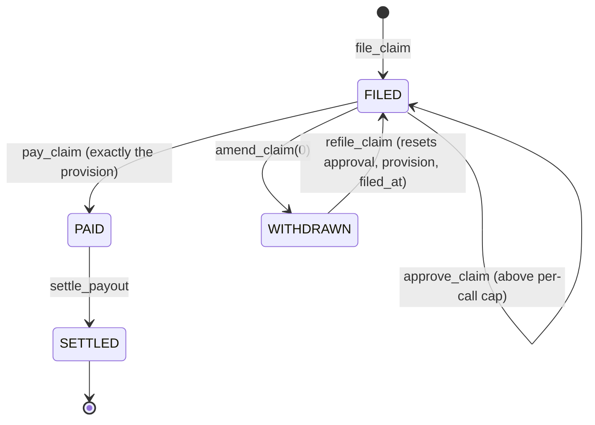
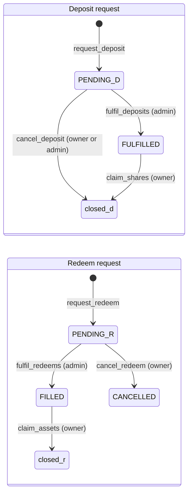

# Program reference

Every instruction of the `mutav` program in the devnet release design, grouped by the key that signs it. For each: arguments, key rules, effects and the event it emits. The signer matrix, events and errors close the page.

Addresses, seeds and parameter values are in [Configuration and reference](configuration-and-reference.md). Formulas are in [Math reference](math-reference.md).

## Common rules

These apply to every instruction.

- **Version guard.** An account whose `version` is above `PROGRAM_LAYOUT_VERSION` (1), or whose status, leg, kind or mode byte is unknown, is refused with `UnsupportedVersion`.
- **Checked transfers.** Every BRS transfer uses `transfer_checked` with the stored reserve mint and token program.
- **No delegates.** A debit from a capital provider requires the token account's owner to be the signer. Delegates are never used.
- **Seeds and owners.** Every program account is checked by seeds and canonical bump. Token accounts are checked for mint, owner and token program.
- **Math.** `u128` intermediates, checked, rounded in the reserve's favour. Overflow fails with `MathOverflow`.
- **Events.** Emitted with `emit_cpi!`. Every event carries `config: Pubkey` and `ts: i64`.
- **Owner token accounts.** `cancel_deposit`, `claim_shares`, `cancel_redeem` and `claim_assets` create the owner's associated token account idempotently. The caller pays its rent.
- **Names.** The ADRs fix the behaviour and the names they use. Where this page describes an event or error without a name, the name and fields are read from the IDL released with the first devnet deploy.

## Signer matrix

● may sign. "Under pause" says whether the instruction runs while the reserve is paused. "Solvency gate" says whether it is refused when the gate fails.

| Instruction | Admin | Operator | Pauser | Guardian | Owner | Anyone | Under pause | Solvency gate |
|---|---|---|---|---|---|---|---|---|
| `initialize` | Upgrade authority only | | | | | | n/a | No |
| `set_config` | ● | | | | | | Runs | No |
| `propose_role` / `accept_role` | ● propose (the proposed key accepts) | | | | | | Runs | No |
| `propose_admin` / `accept_admin` | ● propose (the proposed admin accepts) | | | | | | Runs | No |
| `cancel_pending` | ● | | | | | | Runs | No |
| Guardian appointment (one step) | ● | | | | | | Runs | No |
| `set_payments_account` | ● | | | | | | Runs | No |
| `set_treasury_account` | ● | | | | | | Runs | No |
| `set_allowlist_root` | ● | | | | | | Runs | No |
| `clear_fulfil_halt` | ● | | | | | | Runs | No |
| `pause` | ● | | ● | ● | | | n/a | No |
| `unpause` | ● | | | | | | n/a | No |
| `revoke_operator` | | | ● | | | | Runs | No |
| `fulfil_deposits` | ● | | | | | | Refused | No (see note) |
| `fulfil_redeems` | ● | | | | | | Refused | Yes |
| `approve_claim` | ● | | | | | | Runs | Never |
| `classify_unsolicited` | ● | | | | | | Runs | No |
| `book_unsolicited` | ● | | | | | | Runs | No |
| `return_unsolicited` | ● | | | | | | Runs | No |
| Surplus-share burn | ● | | | | | | Runs | No |
| `register_guarantee` | | ● | | | | | Refused | Yes |
| `close_guarantee` | | ● | | | | | Runs | No |
| `reinstate_guarantee` | | ● | | | | | Runs | No |
| `contribute_fees` | | ● | | | | | Runs | No |
| `sweep_income` | | ● | | | | | Runs | No |
| `file_claim` | | ● | | | | | Runs | Never |
| `amend_claim` | | ● | | | | | Runs | Never |
| `refile_claim` | | ● | | | | | Runs | Never |
| `pay_claim` | | ● | | | | | Runs | Never |
| `settle_payout` | | ● | | | | | Runs | Never |
| `request_deposit` | | | | | ● | | Refused | No |
| `cancel_deposit` | ● | | | | ● | | Runs | No |
| `claim_shares` | | | | | ● | | Runs | No |
| `request_redeem` | | | | | ● | | Refused | No |
| `cancel_redeem` / `claim_assets` | | | | | ● | | Runs | No |
| `refresh` | | | | | | ● | Runs | No |
| `advance_queue_head` | | | | | | ● | Runs | No |
| `skim` | | | | | | ● | Runs | No |

Note: `fulfil_deposits` is allowed while the reserve is under-covered, because it is the recapitalisation path. It is still refused with `ReserveUnderwater` when net assets are 0 with shares outstanding, and by the reserve-size cap.

Pause stops only capital flows and new guarantees: `request_deposit`, `request_redeem`, `fulfil_deposits`, `fulfil_redeems` and `register_guarantee`. Every other instruction runs under pause. It never stops a claim and never traps a holder's money. Only the admin unpauses. The solvency gate applies to `register_guarantee` and `fulfil_redeems` only ([ADR 0020](../decisions/0020-operator-admin-separation-and-recovery.md)).

## Upgrade authority

### `initialize(args)`

| | |
|---|---|
| Signer | The program upgrade authority, checked against ProgramData. Cannot be front-run. |
| Args | `admin`, `operator`, `pauser`, `mutav_capital_wallet`, `coverage_ratio_bps`, `fee_take_bps`, `caps`, and the treasury and payments accounts. |
| Rules | Reserve mint has 6 decimals and passes the mint guard (no permanent delegate, transfer hook, transfer fee or transfer-fee authority, non-transferable, default-frozen, scaled UI amount, interest-bearing or pausable extension). Roles set and distinct. Parameter bounds as `set_config`. Treasury and payments accounts hold the reserve mint, are distinct, and are owned by none of: the vault authority, the operator, the capital wallet. |
| Effects | Creates `VaultConfig`, an empty `VaultState`, the share mint, the tracked token accounts (`reserve`, `pending_deposits`, `pending_redemptions`, `claims`), the `unsolicited` account and, idempotently, the income inbox. Allowlist root, feature flags, `adapter_count`, `adapter_bitmap`, pending role keys and guardians start at zero. |
| Errors | `Unauthorized`, `UnsupportedMintExtension`, `InvalidMint`, `InvalidParameter`, `RolesNotDistinct`, `InvalidIncomeSource`, `InvalidTreasuryAccount`, `InvalidPaymentsAccount` |
| Event | `VaultInitialized { admin, operator, pauser, reserve_mint, share_mint }` |

## Reserve admin

The admin is the vault of the admin multisig. Every admin instruction goes through a Squads proposal and waits for the multisig's time lock. `pause` is also open to the pauser and guardians, who send it without delay.

### Configuration and roles

#### `set_config(params: Vec<ConfigParam>)`

| | |
|---|---|
| Args | A sparse list of `ConfigParam` values, at most 16. `ConfigParam` is an enum with one variant per configurable field: `coverage_ratio_bps`, `fee_take_bps`, `feature_flags`, `mutav_capital_wallet` and each field of `Caps` (`max_tvl`, `max_cover_per_guarantee`, `max_claim_per_call`, `max_claim_per_period`, `min_request`, `max_request`, `max_nav_move_bps`, `stress_buffer`, `max_queue_wait_secs`, `max_reinstate_age`). Variants are append-only: Borsh encodes an enum by variant index, so none is ever removed or reordered, and the `idl-compat` CI check enforces it. There is no payout SLA, no per-agency cap, no claim period length and no income take. |
| Rules | A duplicate variant is refused with `DuplicateParam`. The params are applied to a copy and the whole resulting config is validated: `1_000 ≤ coverage_ratio_bps ≤ 10_000`; `fee_take_bps ≤ 3_000`; flags inside `SUPPORTED_FEATURES` (fail-closed); `max_claim_per_call > 0`; `max_claim_per_period ≥ max_claim_per_call`; `max_tvl > 0`; `0 < min_request ≤ max_request`; bounded `stress_buffer`, `max_queue_wait_secs` and `max_reinstate_age`. `coverage_required` is recomputed. |
| Effects | Writes only the listed fields. A proposal touches only the fields it changes, and `/admin` lists the edited fields in the proposal memo. |
| Errors | `Unauthorized`, `InvalidParameter`, `DuplicateParam`, `FeatureNotSupported`, `MathOverflow` |
| Event | One `ConfigUpdated { field, old, new }` per changed field. |

Money accounts, the allowlist and roles are kept out of `set_config`, because their checks differ: `set_payments_account`, `set_treasury_account`, `set_allowlist_root` and the role and guardian instructions below ([ADR 0026](../decisions/0026-program-simplification-for-the-freeze.md)).

#### `propose_role(role, key)` and `accept_role(role)`

| | |
|---|---|
| Signer | Propose: admin. Accept: the proposed key. |
| Args | `role`: `OPERATOR` or `PAUSER`. An unknown role value fails. |
| Rules | Each role has its own pending key (`pending_operator`, `pending_pauser`) and its own expiry (`pending_operator_expires_at`, `pending_pauser_expires_at`), 72 hours after the proposal. An accept after expiry fails. Acceptance re-checks that the roles are distinct from each other and from the admin, that none is the default key, and that neither the payments nor the treasury account is owned by the new operator. |
| Effects | Propose stores the pending key and its expiry. Accept moves the signer's pending key into the live role and clears it. A typo can never appoint a key nobody holds. |
| Errors | `Unauthorized`, `RolesNotDistinct`, `InvalidParameter`; an expired handover has its own error in the IDL. |
| Event | A proposal event and `RolesUpdated { operator, pauser }` on acceptance. |

#### `propose_admin(key)`, `accept_admin()` and `cancel_pending(role)`

| | |
|---|---|
| Signer | `propose_admin` and `cancel_pending`: admin. `accept_admin`: the proposed admin. |
| Effects | Two-step rotation of `VaultConfig.admin` through `pending_admin`, with its own expiry (`pending_admin_expires_at`, 72 hours). `cancel_pending(role)` clears a pending operator, pauser or admin handover. Runbook: rotate Squads members while both keys are live. |
| Event | One event per proposal, acceptance and cancellation. |

These instructions replace a one-step `set_roles` ([ADR 0020](../decisions/0020-operator-admin-separation-and-recovery.md)).

#### Guardian appointment

| | |
|---|---|
| Signer | Admin, in one step: the guardian does not accept. |
| Rules | Up to 3 keys (`guardians[3]`). Refuses the default key and every current role key (admin, operator, pauser). An empty slot holds `Pubkey::default()` and never counts as a guardian. |
| Effects | Writes the guardian keys. In the pilot a guardian may call `pause` and nothing else. With the first adapter upgrade, guardians may also take the risk-reducing adapter actions of [ADR 0027](../decisions/0027-multi-asset-adapters-liquidity-floor-rebalancing.md). |
| Event | One event per appointment. The instruction name is fixed in the IDL. |

#### `set_payments_account()` and `set_treasury_account()`

| | |
|---|---|
| Rules | The new token account is inspected: it holds the reserve mint, differs from the other money account, and is owned by none of: the capital wallet, the operator, the vault authority. |
| Errors | `Unauthorized`, `InvalidMint`, `InvalidPaymentsAccount`, `InvalidTreasuryAccount` |
| Event | `PaymentsAccountUpdated { old, new }`; the treasury change emits its own event. |

#### `set_allowlist_root(root)`

| | |
|---|---|
| Effects | Replaces the Merkle root of allowlisted capital-provider wallets. Entry is gated by this root. Exit is not. |
| Event | `AllowlistRootUpdated { root }` |

#### `clear_fulfil_halt()`

| | |
|---|---|
| Accounts | Takes the seeds-checked `reserve`. |
| Rules | `fulfil_halted` is set. A frozen reserve counts as 0 BRS, and the instruction refuses with `ReserveFrozen`. |
| Effects | Clears the halt. Sets the guard baseline to the current published NAV. Resets `inflow_nav`. |
| Errors | `Unauthorized`, `InvalidParameter`, `ReserveFrozen` |
| Event | `FulfilHaltCleared { nav_per_share }` |

#### `pause()`, `unpause()`, `revoke_operator()`

| | |
|---|---|
| Signer | `pause`: admin, pauser or a guardian. `unpause`: admin only. `revoke_operator`: pauser or admin. |
| Effects | `pause` and `unpause` set or clear `paused`. `revoke_operator` sets the operator to `Pubkey::default()` at once and clears every pending operator and pauser key. The admin appoints the next operator with `propose_role`. Operator instructions fail from the next slot. |
| Events | `Paused { by }`, `Unpaused { by }`, `OperatorRevoked { by }` |

### Capital fills and cancels

#### `fulfil_deposits(count, nav_bounds)`

| | |
|---|---|
| Args | `count` from 1 to 8. `nav_bounds` is a `(min, max)` pair composed by the admin console when the proposal is created. |
| Rules | Strict FIFO from `deposit_head`, with the skip proof of `advance_queue_head` for dead seqs. Not paused. Not halted, and the NAV-move guard is evaluated inline (same rule as `refresh`, inflows counted per share). Reserve not frozen. The fill NAV is inside `nav_bounds`. `stable_assets + Σ assets ≤ max_tvl`. Refused with `ReserveUnderwater` when net assets are 0 with shares outstanding. Every fill mints more than 0 shares. |
| Effects | Per request: `shares_out = shares_for(assets)` at the live NAV, BRS moved from `pending_deposits` to `reserve`, status `FULFILLED`, head advanced. Shares are minted later by `claim_shares`. |
| Errors | `Unauthorized`, `Paused`, `FulfilHalted`, `ReserveFrozen`, `TvlCapExceeded`, `ReserveUnderwater`, `NavOutOfBounds`, `QueueOrderViolation`, and the zero-share refusal. |
| Events | `DepositFilled` per fill, `DepositsFulfilled { from_seq, to_seq, assets, shares, nav }` per batch, and a head-moved event when the head moves with no fill. |

#### `fulfil_redeems(count, max_assets, nav_bounds)`

| | |
|---|---|
| Rules | Up to 8 requests in strict FIFO from `redeem_head`. Not paused. Mode normal. Solvency gate passes. Not halted, guard evaluated inline. Fill NAV inside `nav_bounds`. Whole fills only in v1: a head that does not fit stops the batch. Budget before every fill: `min(max_assets − paid, free_capital, liquid_budget)`. A head whose value has fallen to 0 fills as a 0-asset fill: its shares are burned and the request closes, so it never blocks the queue. |
| Effects | Burns the escrowed shares, moves `assets_for(shares)` BRS from `reserve` to `claims`, status `FILLED`. A call that fills nothing fails. |
| Errors | `Paused`, `UnderCovered`, `FulfilHalted`, `ReserveFrozen`, `InsufficientFreeCapital`, `InsufficientLiquidBalance`, `NavOutOfBounds`, `RequestTooSmall`, `QueueOrderViolation` |
| Events | `RedeemFilled` per fill, `RedeemsFulfilled { from_seq, to_seq, shares, assets, nav, idle_free_capital }` per batch. |

The admin may also sign `cancel_deposit` for a pending deposit, for example when a wallet leaves the allowlist with a deposit pending. See [`cancel_deposit`](#cancel_deposit-and-claim_shares) under the capital provider.

### Claims

#### `approve_claim(notice_ref_hash, amount)`

| | |
|---|---|
| Rules | The filing is `FILED`. The admin approves the amount that may leave the reserve, not the claim's validity. |
| Effects | Records `approved_amount` on the filing. It binds an exact amount: `pay_claim` then pays exactly that. The threshold is `max_claim_per_call`; there is no separate parameter. Approved payments count toward the sliding 31-day cap. If the payment would not fit, the same proposal bundles a `set_config` raise of `max_claim_per_period`, and a later `set_config` lowers it back. Any later `amend_claim` or `refile_claim` resets the approval to 0. Not pause-gated. |
| Event | One approval event per call. |

### Unsolicited money

Unsolicited money is BRS, or another token, that arrived outside a booking path. It is the reserve admin's responsibility. No money gets stuck: it is returned to its source or booked into the reserve. A return never leaves from the income inbox or from `reserve`, so issuer income can never be returned. None of these instructions is pause-gated ([ADR 0024](../decisions/0024-unsolicited-money-and-backstop.md)).

#### `classify_unsolicited(amount)`

| | |
|---|---|
| Effects | Moves BRS from the income inbox into `unsolicited`. Used for money that is on no issuer statement, after the operator has swept every statement of the period. |
| Event | One event per call. |

#### `book_unsolicited(amount, ref_hash, kind)`

| | |
|---|---|
| Args | `kind`: `UNSOLICITED` (2) or `BACKSTOP` (3). Any other kind is refused. |
| Rules | Refused while `shares_outstanding == 0`. |
| Effects | Moves BRS from `unsolicited` into `reserve` as an inflow. `brs_balance` and NAV rise and the amount counts in `inflow_nav`. No shares are minted. Creates an `IncomeReceipt` of that kind. MUTAV's own backstop money is booked with `BACKSTOP` ([ADR 0022](../decisions/0022-coverage-stress-buffer-underwater-reserve.md)). |
| Event | One event per booking. |

#### `return_unsolicited(source, amount, destination, ref_hash)`

| `Source` | What leaves | From |
|---|---|---|
| `Unsolicited` | BRS | the `unsolicited` PDA |
| `PendingRedemptionsSurplus` | shares | the surplus of `pending_redemptions` above escrowed requests |
| `Foreign` | tokens of a classic SPL Token mint other than the BRS, share or adapter mints | a token account owned by the vault authority |
| `Lamports` | SOL above the rent-exempt minimum | an account owned by the program or the vault authority |

| | |
|---|---|
| Rules | Only to the source of the original transfer: `ref_hash` commits to that transaction's signature, and the admin console checks the source when it composes the proposal. Sources are screened first. A `Foreign` return checks that the mint is owned by the classic SPL Token program, never Token-2022. A `Lamports` return never takes an account below its rent-exempt minimum. |
| Event | One event per return. |

Surplus shares in `pending_redemptions` may instead be burned by the admin when they are not returned. Burning raises NAV per share for every holder, like a booking.

## Operator

The operator holds the contracts and runs the guarantee and claim cycle. Every registry action it takes can be reversed by another operator action. Only `pay_claim` is irreversible, and it is bounded by the admin's claim caps.

### Guarantees

#### `register_guarantee(id, agency_id, refs_hash, rent, default_multiplier_bps, exit_multiplier_bps, default_cover, exit_cover)`

| | |
|---|---|
| Accounts | `config`, `state`, `guarantee` (init), the seeds-checked `reserve`, operator, payer. |
| Rules | Not paused. Reserve not frozen (a frozen reserve counts as 0 BRS and the instruction refuses with `ReserveFrozen`). `rent > 0`. `default_cover + exit_cover > 0` and `≤ max_cover_per_guarantee`. Mode normal. `coverage_required` after the registration `≤ stable_assets`. |
| Effects | Creates the guarantee `ACTIVE`. Adds its cover to `remaining_cover_total` and increments `active_guarantees`. Recomputes `coverage_required`. The multipliers are for display only and never enter the math. |
| Errors | `Paused`, `ReserveFrozen`, `InvalidParameter`, `GuaranteeCapExceeded`, `UnderCovered`, `InsufficientFreeCapital`; account in use on a duplicate `id`. |
| Event | `GuaranteeRegistered { id, agency_id, refs_hash, rent, default_cover, exit_cover }` |

`agency_id` is stored on the guarantee. Per-agency figures are derived off-chain from guarantee accounts. There is no per-agency cap.

#### `close_guarantee(id, reason)`

| | |
|---|---|
| Args | `reason`: `RELEASED` (the fiança ended) or `VOID` (the lease never took effect, or the registration was an error). |
| Rules | `ACTIVE` and `open_claims == 0`. `VOID` also needs `default_paid + exit_paid == 0`. |
| Effects | Removes the remaining cover from the totals. `status = CLOSED`, `closed_at = now`. Never solvency-gated: it releases liability. Reversible with `reinstate_guarantee`. |
| Errors | `GuaranteeNotActive`, `OpenClaims`, `InvalidParameter`, and a refusal of `VOID` when something was paid. |
| Event | `GuaranteeClosed { id, released_cover, reason }` |

#### `reinstate_guarantee(id)`

| | |
|---|---|
| Rules | The guarantee is `CLOSED` and `now − closed_at ≤ max_reinstate_age` (30 days). No solvency gate and no cap check. Runs under pause. |
| Effects | `CLOSED → ACTIVE`. Remaining cover is restored to `remaining_cover_total`, `active_guarantees` is incremented, `closed_at = 0`, `coverage_required` is recomputed. Used by a newly appointed operator to undo a wrongful close. |
| Event | `GuaranteeReinstated` |

### Money in

#### `contribute_fees(invoice_ref_hash, amount)`

| | |
|---|---|
| Signer | Operator, who also signs the BRS transfer from its own account. |
| Rules | `amount > 0`. BRS mint and token program. Treasury matches the config. The fee receipt (an `IncomeReceipt` with `kind = FEE`, under the `"fee"` seed prefix) must not exist. Refused while `shares_outstanding == 0`: the first deposit must be filled first. Never paused, never solvency-gated. |
| Effects | `take = floor(amount × fee_take_bps / 10_000)` to the treasury; `net = amount − take` to `reserve`; `brs_balance += net`; lifetime counters; `inflow_nav` updated. Creates the `IncomeReceipt` with `kind = FEE`. Never mints shares. |
| Errors | `InvalidParameter`, `InvalidMint`, `InvalidTokenProgram`, `InvalidTreasuryAccount`, the no-shares refusal; account in use on a duplicate invoice. |
| Event | `FeesContributed { invoice_ref_hash, gross, take, net }` |

#### `sweep_income(income_ref_hash, period, amount)`

| | |
|---|---|
| Signer | Operator. The vault authority signs the transfers. |
| Rules | `amount > 0`. `period` is a valid `YYYYMM`. The inbox is the vault authority's associated token account for BRS. `amount ≤` inbox balance. Inbox and reserve not frozen. Receipt must not exist. No treasury account: there is no take on issuer income in v1. Refused while `shares_outstanding == 0`, so the money waits in the inbox. Never paused, never solvency-gated. |
| Effects | Moves the whole amount into `reserve`, checking post-CPI deltas. Creates an `IncomeReceipt` with `kind = NORA_STATEMENT`. Updates `income_total` and `inflow_nav`. This is the operator's only way to book issuer income. |
| Errors | `InvalidParameter`, `InvalidMint`, `InvalidTokenProgram`, `InvalidIncomeSource`, `IncomeExceedsInbox`, `ReserveFrozen`, `PostCpiCheckFailed` |
| Event | `IncomeSwept { income_ref_hash, period, amount, inbox_after }` |

### Claims

#### `file_claim(leg, amount, notice_ref_hash)`

| | |
|---|---|
| Signer | Operator, after MUTAV approved the payment request in its platform. |
| Rules | Guarantee `ACTIVE`. `amount > 0`. `amount ≤ leg_cover − leg_paid − leg_provision`. Never paused, never solvency-gated. |
| Effects | Creates `ClaimFiling { FILED, provision: amount }`. The leg's provision, `open_claims` and `state.provisions` rise. NAV reflects the claim at once. |
| Errors | `GuaranteeNotActive`, `InvalidParameter`, `ExceedsRemainingCover` |
| Event | `ClaimFiled { guarantee_id, leg, amount, notice_ref_hash }` |

#### `amend_claim(notice_ref_hash, new_amount)`

| | |
|---|---|
| Rules | The filing is `FILED`; refused on `PAID` and `SETTLED`. A higher amount may book more only up to the leg's unprovisioned cover (`leg_cover − leg_paid − leg_provision`). Never paused, never solvency-gated. |
| Effects | Lower: releases the difference from the leg's provision and `state.provisions`. Higher: books the difference. `new_amount = 0`: sets the status to `WITHDRAWN`, releases the whole provision, `open_claims −= 1`, and emits `ClaimWithdrawn`. Any amendment resets `approved_amount` to 0 and recomputes `coverage_required`. To settle for less than filed, amend down, then pay. |
| Event | `ClaimAmended { old, new }`; also `ClaimWithdrawn` when `new_amount = 0`. |

#### `refile_claim(leg, amount, notice_ref_hash)`

| | |
|---|---|
| Rules | Same arguments and checks as `file_claim`. Accepts only a `WITHDRAWN` filing. Never paused, never solvency-gated. |
| Effects | Returns the filing to `FILED` and resets `approved_amount`, `provision` and `filed_at`. An old approval is never reused. |
| Event | `ClaimFiled` |

#### `pay_claim(notice_ref_hash, expected_amount)`

| | |
|---|---|
| Signer | Operator. |
| Rules | (1) Filing `FILED`. (2) `expected_amount == filing.provision`: the payment is exactly the provision. (3) If `filing.provision > max_claim_per_call`, `approved_amount == filing.provision`. (4) The payments of the last 31 days plus this one `≤ max_claim_per_period`, approved payments included. (5) The ADR 0014 bound and the claim category check. (6) Destination is `payments_account`. (7) Reserve not frozen and `brs_balance ≥ provision`. No solvency, mode, pause or NAV-guard check. |
| Effects | Transfers BRS from `reserve` to the payments account. Leg paid rises by the provision and the leg's provision falls to 0. Filing `PAID` with `payments_account`, `paid_at` and `paid_amount` recorded, `open_claims −= 1`. `remaining_cover_total`, `provisions` and `brs_balance` fall. Today's bucket of the claim window and the lifetime counters rise. The stress term and the cached `coverage_required` write saturate and never fail. |
| Errors | `ClaimNotFiled`, `InvalidParameter`, `ClaimCallCapExceeded`, `ClaimPeriodCapExceeded`, `InvalidPaymentsAccount`, `InsufficientLiquidBalance`, `ReserveFrozen` |
| Event | `ClaimPaid { guarantee_id, leg, amount, notice_ref_hash, payments_account }` |

MUTAV may pay the agency by Pix from its own bank account first. The reserve then reimburses the payments account through `pay_claim`. This keeps payments on time while an above-cap approval waits for the time lock. Until `approve_claim` ships, claims above `max_claim_per_call` are paid this way; `file_claim` has no interim cap ([ADR 0021](../decisions/0021-claims-approval-amendment-exact-payment.md)).

#### `settle_payout(notice_ref_hash, pix_e2e_hash)`

| | |
|---|---|
| Signer | Operator, after MUTAV paid the agency by Pix. |
| Rules | The filing is `PAID`. The hash is non-zero. |
| Effects | Writes `pix_e2e_hash` and `settled_at = now` on the `ClaimFiling` and sets it `SETTLED`. There is no separate `Payout` account. A settlement record only. The program has no payout deadline; the service level lives in the operator platform. |
| Errors | `ClaimNotPaid`, `PayoutAlreadySettled`, `InvalidParameter` |
| Event | `PayoutSettled { guarantee_id, notice_ref_hash, pix_e2e_hash }` |

## Capital provider (owner)

Entry is allowlisted. Exit is open to any wallet that already holds shares. MUTAV's own capital uses the same queues with no special treatment.

#### `request_deposit(assets, proof)`

| | |
|---|---|
| Rules | Not paused. Merkle proof against the allowlist root. `min_request ≤ assets ≤ max_request`. |
| Effects | Escrows BRS in `pending_deposits` at a new tail `seq`. The request PDA is seeded by `seq`, so two requests sent at once race for the same seq; the client retries with the next seq. |
| Errors | `Paused`, `NotAllowlisted`, `RequestTooSmall`, `RequestTooLarge`, `InvalidMint`, `InvalidTokenProgram` |
| Event | `DepositRequested { owner, seq, assets }` |

#### `cancel_deposit()` and `claim_shares()`

| | |
|---|---|
| Signer | Cancel: the owner or the admin. Claim: the owner. |
| Rules | Cancel: `PENDING`. Claim: `FULFILLED`. Both run under pause. When the admin cancels, the owner is not a signer; the owner account is bound to the address stored in the request. Config and mint seeds are checked. |
| Effects | Cancel returns the BRS and the request's rent to the owner's associated token account for `reserve_mint`, created idempotently with the signer as payer, and closes the request. It removes a de-listed or unreachable investor's deposit from the queue head. Claim mints `shares_out` to the owner's share account and closes the request. If the owner's token account is frozen by the issuer, the cancel cannot complete; the runbook covers that case. |
| Errors | `InvalidRequestStatus` |
| Events | `DepositCancelled { owner, seq, assets, by }`, `SharesClaimed { owner, seq, shares }` |

#### `request_redeem(shares, proof)`

| | |
|---|---|
| Signer | Owner, never a delegate. |
| Rules | Not paused. `shares > 0`. The allowlist proof is skipped for a wallet that already holds shares (read from its share balance). Value at the current NAV: `min_request ≤ assets_for(shares) ≤ max_request`, except that a full exit skips `min_request` while still requiring a value above 0. A full exit means `shares` equals the balance of the owner's canonical share associated token account, and it is accepted only from that account. |
| Effects | Escrows shares in `pending_redemptions` at a new tail `seq`. |
| Errors | `Paused`, `NotAllowlisted`, `RequestTooSmall`, `RequestTooLarge`, `InvalidParameter`, `InvalidMint` |
| Event | `RedeemRequested { owner, seq, shares }` |

#### `cancel_redeem()` and `claim_assets()`

| | |
|---|---|
| Rules | Both run under pause. |
| Effects | Cancel returns unfilled shares and sets `CANCELLED`. Claim pays `assets_claimable` from `claims` to the owner's BRS account. Each closes the request when nothing is left. |
| Events | `RedeemCancelled { owner, seq, shares_returned }`, `AssetsClaimed { owner, seq, assets }` |

## Anyone

#### `refresh()`

| | |
|---|---|
| Effects | (1) Detects frozen reserve token accounts, emits `ReserveFrozenDetected`, and counts a frozen reserve as 0 BRS. (2) Recomputes stable assets, coverage required, surplus, free capital, net assets and the published NAV. (3) Runs the NAV-move guard net of `inflow_nav`. On a trip it sets `fulfil_halted` and emits `FulfilHaltRaised`. Resets `inflow_nav`. (4) Sets the mode and emits `ModeChanged` on a transition. |
| Event | `StateRefreshed { stable_assets, coverage_required, surplus, provisions, nav_per_share, mode }` |

#### `advance_queue_head(queue, max)`

| | |
|---|---|
| Args | `queue: u8` selects the deposit or the redemption queue. `max` bounds the seqs skipped. |
| Rules | Skip proof per seq: the account is the PDA for that seq, and it is closed, or it is a request with nothing left in the queue. Moves no money. |
| Effects | Advances one queue head over dead seqs. Stops at the first live one. |
| Event | One event with the queue and its new head. |

#### `skim(account)`

| | |
|---|---|
| Rules | Permissionless. `account` is `reserve`, `pending_deposits` or `claims`. Neither it nor `unsolicited` is frozen. |
| Effects | Moves `balance − tracked total` into `unsolicited`. Mechanical: it books nothing and moves no tracked money. Run by a monitor so untracked BRS leaves the reserve's accounts quickly. |
| Event | `UnsolicitedSkimmed` |

## Events

Every event carries `config` and `ts`. Existing events never change fields after the layout freeze. Indexers decode by discriminator and skip unknown events.

| Event | Fields (besides `config`, `ts`) |
|---|---|
| `VaultInitialized` | `admin, operator, pauser, reserve_mint, share_mint` |
| `ConfigUpdated` | `field: u16, old: [u8; 32], new: [u8; 32]`. Integers little-endian, zero-padded. Field ids are append-only, in step with the `ConfigParam` variants. A retired id is never reused. |
| `RolesUpdated` | `operator, pauser` |
| `OperatorRevoked` | `by` |
| `PaymentsAccountUpdated` | `old, new` |
| `AllowlistRootUpdated` | `root` |
| `Paused`, `Unpaused` | `by` |
| `GuaranteeRegistered` | `id, agency_id, refs_hash, rent, default_cover, exit_cover` |
| `GuaranteeClosed` | `id, released_cover, reason` |
| `GuaranteeReinstated` | `id`, restored cover |
| `FeesContributed` | `invoice_ref_hash, gross, take, net` |
| `IncomeSwept` | `income_ref_hash, period, amount, inbox_after` |
| `ClaimFiled` | `guarantee_id, leg, amount, notice_ref_hash` |
| `ClaimAmended` | `old, new` and the notice |
| `ClaimWithdrawn` | The notice and the released provision |
| Claim approval event | The notice and `approved_amount` |
| `ClaimPaid` | `guarantee_id, leg, amount, notice_ref_hash, payments_account` |
| `PayoutSettled` | `guarantee_id, notice_ref_hash, pix_e2e_hash` |
| `DepositRequested` | `owner, seq, assets` |
| `DepositCancelled` | `owner, seq, assets, by` |
| `SharesClaimed` | `owner, seq, shares` |
| `DepositFilled` | One per fill |
| Head-moved event | Emitted when the deposit head moves with no fill |
| `DepositsFulfilled` | `from_seq, to_seq, assets, shares, nav` |
| `RedeemRequested` | `owner, seq, shares` |
| `RedeemFilled` | `owner, seq, shares, assets, nav` |
| `RedeemsFulfilled` | `from_seq, to_seq, shares, assets, nav, idle_free_capital` |
| `RedeemCancelled` | `owner, seq, shares_returned` |
| `AssetsClaimed` | `owner, seq, assets` |
| Queue-head event | The queue and its new head |
| `StateRefreshed` | `stable_assets, coverage_required, surplus, provisions, nav_per_share, mode` |
| `ModeChanged` | `from, to, deficit` |
| `FulfilHaltRaised` | The NAV move that tripped the guard |
| `FulfilHaltCleared` | `nav_per_share` |
| `ReserveFrozenDetected` | `token_account` |
| `UnsolicitedSkimmed` | The account skimmed and the amount |
| Role, guardian, approval and unsolicited-money events | One per instruction; exact fields in the IDL |

Events of the planned claim-notice gate and of the adapter upgrade are appended when those features are built. Dead events were removed before the freeze ([ADR 0026](../decisions/0026-program-simplification-for-the-freeze.md)).

## Errors

Anchor numbers custom errors from 6000 in enum order. The list is append-only from the first devnet deploy: new errors go at the end, none is reordered or removed. The final codes are those of the IDL released with that deploy; read them from the generated client (`clients/js/src/generated/errors`).

| Error | Meaning |
|---|---|
| `Unauthorized` | The signer may not run this instruction. |
| `RolesNotDistinct` | Roles must be distinct keys. |
| `Paused` | The reserve is paused. |
| `InvalidParameter` | An argument or config value is out of bounds. |
| `InvalidMint` | Wrong mint. |
| `UnsupportedMintExtension` | The mint guard refused the reserve mint. |
| `ReserveFrozen` | A reserve token account is frozen. |
| `UnderCovered` | The reserve is under-covered. |
| `InsufficientFreeCapital` | Not enough free capital. |
| `InsufficientLiquidBalance` | Not enough liquid BRS. |
| `FulfilHalted` | The NAV-move guard halted fills. |
| `TvlCapExceeded` | The fill would exceed `max_tvl`. |
| `GuaranteeCapExceeded` | The cover exceeds `max_cover_per_guarantee`. |
| `GuaranteeNotActive` | The guarantee is not active. |
| `OpenClaims` | The guarantee has open claims. |
| `ExceedsRemainingCover` | The amount exceeds the leg's remaining unprovisioned cover. |
| `ClaimNotFiled` | No filed claim for this notice. |
| `LegMismatch` | The leg does not match the filing. |
| `ClaimCallCapExceeded` | Above the per-call cap without a matching approval. |
| `ClaimPeriodCapExceeded` | Above the sliding-window cap. |
| `InvalidPaymentsAccount` | Wrong or disallowed payments account. |
| `PayoutAlreadySettled` | The claim payment is already settled. |
| `NotAllowlisted` | The wallet is not in the allowlist. |
| `RequestTooSmall` | Below `min_request`. |
| `RequestTooLarge` | Above `max_request`. |
| `InvalidRequestStatus` | The request is not in the required status. |
| `QueueOrderViolation` | Not the queue head, or a bad skip. |
| `PostCpiCheckFailed` | Balances moved other than expected. |
| `MathOverflow` | Checked math failed. |
| `FeatureNotSupported` | A feature bit outside `SUPPORTED_FEATURES`. |
| `InvalidTreasuryAccount` | Wrong or disallowed treasury account. |
| `UnsupportedVersion` | Unknown layout version or status byte. |
| `InvalidIncomeSource` | The source is not the reserve's income inbox. |
| `IncomeExceedsInbox` | The amount exceeds the inbox balance. |
| `InvalidTokenProgram` | Not the reserve's token program. |
| `ClaimNotPaid` | `settle_payout` on a filing that is not `PAID`. |
| `ReserveUnderwater` | Deposit fill while net assets are 0 with shares outstanding. |
| `NavOutOfBounds` | The fill NAV is outside the proposal's `nav_bounds`. |
| `DuplicateParam` | `set_config` received the same `ConfigParam` variant twice. |
| Errors of the other new instructions | Zero-share fill, inflow while no shares exist, expired or unknown handover, reinstatement window passed, `expected_amount` not equal to the provision, a `VOID` close after a payment. Their exact names are read from the IDL. |

Dead errors (adapter, price and claim-notice errors that v1 never raises) and the per-agency cap error are removed before the freeze ([ADR 0026](../decisions/0026-program-simplification-for-the-freeze.md)). They return, appended, with the features that raise them.

## Sources

- [Specification §5 Instructions](../spec.md#5-instructions), [§9 Events](../spec.md#9-events), [§10 Errors](../spec.md#10-errors)
- Program: [`programs/mutav/src/lib.rs`](../../programs/mutav/src/lib.rs), [`errors.rs`](../../programs/mutav/src/errors.rs), [`events.rs`](../../programs/mutav/src/events.rs), [`instructions/`](../../programs/mutav/src/instructions/)
- Generated client instruction builders: [`clients/js/src/generated/instructions/`](../../clients/js/src/generated/instructions/)
- [Anchor `emit_cpi!` events](https://www.anchor-lang.com/docs/features/events)
- [SPL Token `transfer_checked`](https://spl.solana.com/token)

## Decisions

- [ADR 0003: Payments operated by MUTAV](../decisions/0003-payments-operated-by-mutav.md)
- [ADR 0005: Solvency gate scope](../decisions/0005-solvency-gate-scope.md)
- [ADR 0007: Fee take direct to treasury](../decisions/0007-fee-take-direct-to-treasury.md)
- [ADR 0008: Uniform capital flow and pause scope](../decisions/0008-uniform-capital-flow-and-pause-scope.md)
- [ADR 0009: Separate MUTAV money flows](../decisions/0009-separate-mutav-money-flows.md)
- [ADR 0010: Partial fills at the queue head](../decisions/0010-partial-fills-at-queue-head.md) (v1 fills whole requests only)
- [ADR 0012: Fiança-aligned guarantee lifecycle](../decisions/0012-fianca-aligned-guarantee-lifecycle.md)
- [ADR 0014: `pay_claim` bound with concurrent filings](../decisions/0014-pay-claim-bound-with-concurrent-filings.md) (amended by exact payment)
- [ADR 0015: Admin clears the fulfil halt](../decisions/0015-admin-clear-fulfil-halt.md)
- [ADR 0017: BRS income intake](../decisions/0017-brs-income-intake.md)
- ADR 0019: v1 layout for the devnet release (carved fields, payout SLA and per-agency cap removal)
- [ADR 0020: Operator/admin separation and operator-compromise recovery](../decisions/0020-operator-admin-separation-and-recovery.md) (two-step handover, guardians, `close_guarantee(reason)`, `reinstate_guarantee`, pause scope)
- [ADR 0021: Claims: approval, amendment and exact payment](../decisions/0021-claims-approval-amendment-exact-payment.md)
- [ADR 0022: Coverage: stress buffer and underwater reserve](../decisions/0022-coverage-stress-buffer-underwater-reserve.md) (amends 0016)
- [ADR 0023: Capital flows and exit rights](../decisions/0023-capital-flows-and-exit-rights.md) (`nav_bounds`, open exit, owner or admin cancel)
- [ADR 0024: Unsolicited money and backstop contributions](../decisions/0024-unsolicited-money-and-backstop.md)
- [ADR 0026: Program simplification for the freeze](../decisions/0026-program-simplification-for-the-freeze.md) (sparse `set_config`, `advance_queue_head`, removed state)
- [ADR 0027: Multi-asset adapters, liquidity floor and rebalancing](../decisions/0027-multi-asset-adapters-liquidity-floor-rebalancing.md) (Proposed; guardian emergency actions decided)
