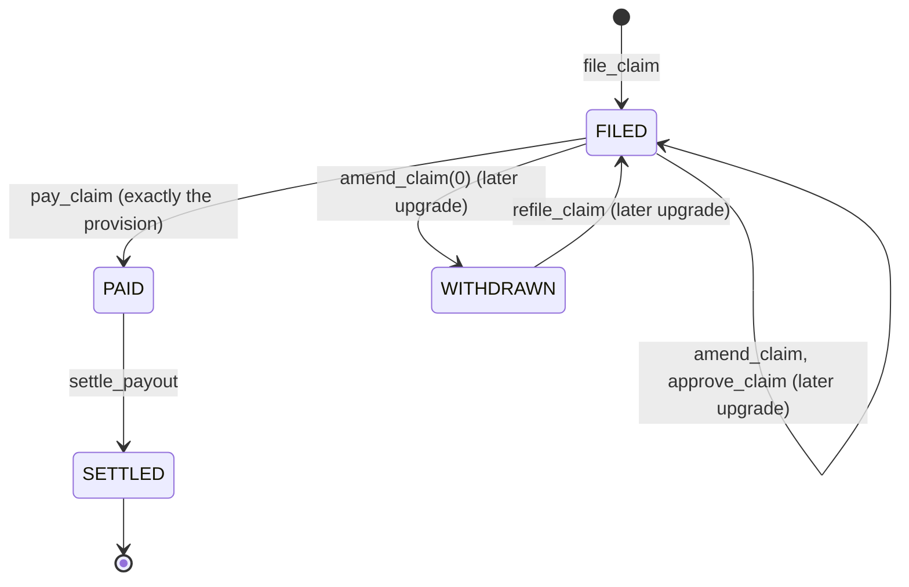
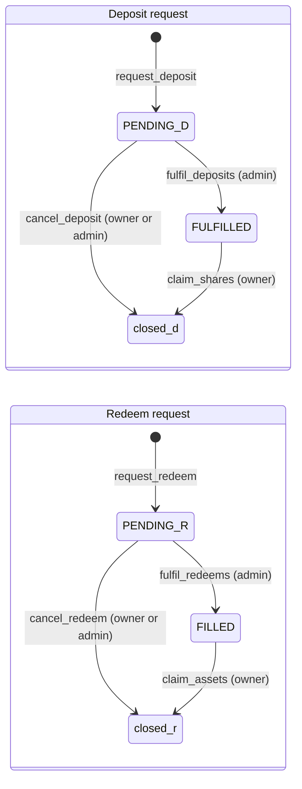

# Program reference

Every instruction of the `mutav` program as built in the devnet binary, grouped by the key that signs it. For each: arguments, key rules, effects and the event it emits. Instructions planned for later upgrades are marked as such: they are not in this binary. The signer matrix, events and errors close the page.

Addresses, seeds and parameter values are in [Configuration and reference](configuration-and-reference.md). Formulas are in [Math reference](math-reference.md).

## Common rules

These apply to every instruction.

- **Version guard.** An account whose `version` is above `PROGRAM_LAYOUT_VERSION` (1), or whose status, leg, kind or mode byte is unknown, is refused with `UnsupportedVersion`.
- **Checked transfers.** Every BRS transfer uses `transfer_checked` with the stored reserve mint and token program.
- **No delegates.** A debit from a capital provider requires the token account's owner to be the signer. Delegates are never used.
- **Seeds and owners.** Every program account is checked by seeds and canonical bump. Token accounts are checked for mint, owner and token program.
- **Math.** `u128` intermediates, checked, rounded in the reserve's favour. Overflow fails with `MathOverflow`.
- **Events.** Emitted with `emit_cpi!`. Every event carries `config: Pubkey` and `ts: i64`.
- **Owner token accounts.** `cancel_deposit`, `claim_shares`, `cancel_redeem` and `claim_assets` create the owner's associated token account idempotently. The caller pays its rent.
- **Names.** Instruction, event and error names are those of [`lib.rs`](../../programs/mutav/src/lib.rs), [`events.rs`](../../programs/mutav/src/events.rs) and [`errors.rs`](../../programs/mutav/src/errors.rs). `u8` selectors (role, leg, queue, close reason) start at 1; 0 is `InvalidParameter`.

## Signer matrix

● may sign. "Under pause" says whether the instruction runs while the reserve is paused. "Coverage gate" says whether it is refused when the reserve does not hold its required coverage.

| Instruction | Admin | Operator | Pauser | Guardian | Owner | Anyone | Under pause | Coverage gate |
|---|---|---|---|---|---|---|---|---|
| `initialize` | Upgrade authority only | | | | | | n/a | No |
| `set_config` | ● | | | | | | Runs | No |
| `propose_role` / `accept_role` | ● propose (the proposed key accepts) | | | | | | Runs | No |
| `propose_admin` / `accept_admin` | ● propose (the proposed admin accepts) | | | | | | Runs | No |
| `cancel_pending` | ● | | | | | | Runs | No |
| `set_guardians` | ● | | | | | | Runs | No |
| `revoke_pauser` | ● | | | | | | Runs | No |
| `set_payments_account` | ● | | | | | | Runs | No |
| `set_treasury_account` | ● | | | | | | Runs | No |
| `set_allowlist_root` | ● | | | | | | Runs | No |
| `clear_fulfil_halt` | ● | | | | | | Runs | No |
| `pause` | ● | | ● | ● | | | n/a | No |
| `unpause` | ● | | | | | | n/a | No |
| `revoke_operator` | ● | | ● | | | | Runs | No |
| `fulfil_deposits` | ● | | | | | | Refused | No (see note) |
| `fulfil_redeems` | ● | | | | | | Refused | Yes |
| `register_guarantee` | | ● | | | | | Refused | Yes |
| `close_guarantee` | | ● | | | | | Runs | No |
| `contribute_fees` | | ● | | | | | Runs | No |
| `sweep_income` | | ● | | | | | Runs | No |
| `file_claim` | | ● | | | | | Runs | Never |
| `pay_claim` | | ● | | | | | Runs | Never |
| `settle_payout` | | ● | | | | | Runs | Never |
| `request_deposit` | | | | | ● | | Refused | No |
| `cancel_deposit` | ● | | | | ● | | Runs | No |
| `claim_shares` | | | | | ● | | Runs | No |
| `request_redeem` | | | | | ● | | Refused | No |
| `cancel_redeem` | ● | | | | ● | | Runs | No |
| `claim_assets` | | | | | ● | | Runs | No |
| `refresh` | | | | | | ● | Runs | No |
| `advance_queue_head` | | | | | | ● | Runs | No |

Note: `fulfil_deposits` is allowed while the reserve is under-covered, because it is the recapitalisation path. It is still refused with `ReserveUnderwater` when the reserve is underwater (NAV per share below the smallest published unit while shares are outstanding), and by the reserve-size cap.

Pause stops only capital flows and new guarantees: `request_deposit`, `request_redeem`, `fulfil_deposits`, `fulfil_redeems` and `register_guarantee`. Every other instruction runs under pause. It never stops a claim and never traps a holder's money. Only the admin unpauses. The coverage gate (and the under-covered mode check) applies to `register_guarantee` and `fulfil_redeems` only ([ADR 0020](../decisions/0020-operator-admin-separation-and-recovery.md)).

Planned for later upgrades, not in this binary: `approve_claim`, `amend_claim`, `refile_claim`, claim withdrawal, `reinstate_guarantee`, the unsolicited-money instructions (`classify_unsolicited`, `book_unsolicited`, `return_unsolicited`, `skim`, the surplus-share burn), the adapter instructions and instant exit. Their planned design is kept below, marked as a later upgrade.

## Upgrade authority

### `initialize(args)`

| | |
|---|---|
| Signer | The program upgrade authority, checked against ProgramData. Cannot be front-run. |
| Args | `InitializeArgs { admin, operator, pauser, mutav_capital_wallet, coverage_ratio_bps, fee_take_bps, caps: CapsInput }`. The treasury and payments token accounts are passed as accounts. |
| Rules | Reserve mint has 6 decimals and passes the mint guard (no permanent delegate, transfer hook, transfer fee or transfer-fee authority, non-transferable, default-frozen, scaled UI amount, interest-bearing or pausable extension). Roles set and distinct. Parameter bounds as `set_config`. Treasury and payments accounts hold the reserve mint, are distinct, are plain accounts (no delegate, no close authority, not frozen), and are owned by none of: the vault authority, the operator, the capital wallet. |
| Effects | Creates `VaultConfig`, an empty `VaultState`, the share mint, the tracked token accounts (`reserve`, `pending_deposits`, `pending_redemptions`, `claims`), the `unsolicited` account and, idempotently, the income inbox. Allowlist root, feature flags, `adapter_count`, `adapter_bitmap`, pending role keys and guardians start at zero. |
| Errors | `Unauthorized`, `UnsupportedMintExtension`, `InvalidMint`, `InvalidParameter`, `RolesNotDistinct`, `FeatureNotSupported`, `InvalidIncomeSource`, `InvalidTreasuryAccount`, `InvalidPaymentsAccount` |
| Event | `VaultInitialized { admin, operator, pauser, reserve_mint, share_mint }` |

## Reserve admin

The admin is the vault of the admin multisig. Every admin instruction goes through a Squads proposal and waits for the multisig's time lock: 5 minutes on devnet, 24 hours for the real pilot ([ADR 0028](../decisions/0028-pilot-parameters.md)). `pause` is also open to the pauser and guardians, and `revoke_operator` to the pauser, who send them without delay.

### Configuration and roles

#### `set_config(params: Vec<ConfigParam>)`

| | |
|---|---|
| Args | A sparse list of `ConfigParam` values, at least 1 and at most 16. `ConfigParam` is an enum with one variant per configurable field: `CoverageRatioBps`, `FeeTakeBps`, `FeatureFlags`, `MutavCapitalWallet` and one per field of `Caps` (`MaxTvl`, `MaxCoverPerGuarantee`, `MaxClaimPerCall`, `MaxClaimPerPeriod`, `MinRequest`, `MaxRequest`, `MaxNavMoveBps`, `StressBuffer`, `MaxQueueWaitSecs`, `MaxReinstateAge`). Variants are append-only: Borsh encodes an enum by variant index, so none is ever removed or reordered, and the `idl-compat` CI check enforces it. There is no payout SLA, no per-agency cap, no claim period length and no income take. |
| Rules | An empty list or more than 16 params is `InvalidParameter`; a field set twice is refused with `DuplicateParam`. The params are applied and the whole resulting config is validated: `1_000 ≤ coverage_ratio_bps ≤ 10_000`; `fee_take_bps ≤ 3_000`; flags inside `SUPPORTED_FEATURES` (fail-closed); `max_nav_move_bps ≤ 10_000`; `max_tvl > 0` and `max_cover_per_guarantee > 0`; `max_claim_per_call > 0` and `max_claim_per_period ≥ max_claim_per_call`; `0 < min_request ≤ max_request`; `stress_buffer ≤ max_tvl` (0 turns the stress term off); `max_queue_wait_secs ≥ 0` and `max_reinstate_age ≥ 0`; `mutav_capital_wallet` set. The money-account owner rules are re-checked. A change of `coverage_ratio_bps`, `max_nav_move_bps` or `stress_buffer` needs a `refresh` in the same slot (`RefreshRequired`): the admin console puts `refresh` first in the same transaction. The cached `coverage_required` is recomputed; `mode` is left to `refresh`. |
| Effects | Writes only the listed fields. A refusal reverts every param of the call. A proposal touches only the fields it changes, and `/admin` lists the edited fields in the proposal memo. |
| Errors | `Unauthorized`, `InvalidParameter`, `DuplicateParam`, `FeatureNotSupported`, `RefreshRequired`, `InvalidMint`, `InvalidTreasuryAccount`, `InvalidPaymentsAccount`, `MathOverflow` |
| Event | One `ConfigUpdated { field, old, new }` per changed field. |

Money accounts, the allowlist and roles are kept out of `set_config`, because their checks differ: `set_payments_account`, `set_treasury_account`, `set_allowlist_root` and the role and guardian instructions below ([ADR 0026](../decisions/0026-program-simplification-for-the-freeze.md)).

#### `propose_role(role, key)` and `accept_role(role)`

| | |
|---|---|
| Signer | Propose: admin. Accept: the proposed key. |
| Args | `role`: `ROLE_OPERATOR` (1) or `ROLE_PAUSER` (2). Any other value is `InvalidParameter`. `key`: the proposed key. |
| Rules | Each role has its own pending key (`pending_operator`, `pending_pauser`) and its own expiry (`pending_operator_expires_at`, `pending_pauser_expires_at`), 72 hours after the proposal (`HANDOVER_WINDOW_SECS`). Propose: the key is not the default key, differs from the other two roles and is not a guardian; refused with `HandoverPending` while an unexpired handover for that role waits (the admin cancels it first, possibly in the same proposal; an expired one is replaced). Accept: the signer is the pending key (`NoPendingHandover` when none, `Unauthorized` for another key) and accepts before expiry (`HandoverExpired`). Acceptance re-checks the distinctness rules. For the operator, the payments and treasury accounts are passed and must not be owned by the new key. |
| Effects | Propose stores the pending key and its expiry. Accept moves the pending key into the live role and clears it. A typo can never appoint a key nobody holds. |
| Errors | `Unauthorized`, `InvalidParameter`, `RolesNotDistinct`, `HandoverPending`, `NoPendingHandover`, `HandoverExpired`, `InvalidTreasuryAccount`, `InvalidPaymentsAccount` |
| Event | `RoleProposed { role, key, expires_at }` on proposal, `RoleAccepted { role, old, new }` on acceptance, plus `ConfigUpdated` for each changed field. |

#### `propose_admin(key)`, `accept_admin()` and `cancel_pending(role)`

| | |
|---|---|
| Signer | `propose_admin` and `cancel_pending`: admin. `accept_admin`: the proposed admin. |
| Effects | Two-step rotation of `VaultConfig.admin` through `pending_admin`, with its own expiry (`pending_admin_expires_at`, 72 hours), under the same rules as `propose_role` / `accept_role` (role `ROLE_ADMIN` = 3). `cancel_pending(role)` clears a pending operator, pauser or admin handover (`ROLE_OPERATOR`, `ROLE_PAUSER` or `ROLE_ADMIN`). Runbook: rotate Squads members while both keys are live. |
| Errors | `Unauthorized`, `InvalidParameter`, `RolesNotDistinct`, `HandoverPending`, `NoPendingHandover`, `HandoverExpired` |
| Event | `RoleProposed` (role 3), `RoleAccepted`, `HandoverCancelled { role, key }`. |

These instructions replace a one-step `set_roles` ([ADR 0020](../decisions/0020-operator-admin-separation-and-recovery.md)).

#### `set_guardians(guardians: [Pubkey; 3])`

| | |
|---|---|
| Signer | Admin, in one step: the guardians do not accept. |
| Rules | Writes all three slots at once. `Pubkey::default()` empties a slot and never counts as a guardian. A set slot may not repeat another slot or hold the admin, operator or pauser key (`RolesNotDistinct`). |
| Effects | Writes the guardian keys. In the pilot a guardian may call `pause` and nothing else. With the first adapter upgrade, guardians may also take the risk-reducing adapter actions of [ADR 0027](../decisions/0027-multi-asset-adapters-liquidity-floor-rebalancing.md). |
| Errors | `Unauthorized`, `RolesNotDistinct` |
| Event | `GuardiansUpdated { guardians }`, plus `ConfigUpdated` per changed slot. |

#### `set_payments_account()` and `set_treasury_account()`

| | |
|---|---|
| Rules | The new token account is inspected: it holds the reserve mint, differs from the other money account, is a plain account (no delegate, no close authority, not frozen), and is owned by none of: the capital wallet, the operator, the vault authority. |
| Errors | `Unauthorized`, `InvalidMint`, `InvalidPaymentsAccount`, `InvalidTreasuryAccount` |
| Event | `PaymentsAccountUpdated { old, new }`, `TreasuryAccountUpdated { old, new }` |

#### `set_allowlist_root(root)`

| | |
|---|---|
| Effects | Replaces the Merkle root of allowlisted capital-provider wallets. Entry is gated by this root. Exit is not. |
| Event | `AllowlistRootUpdated { root }` |

#### `clear_fulfil_halt(nav_bounds)`

| | |
|---|---|
| Accounts | Takes the seeds-checked `reserve`. |
| Rules | `nav_bounds.min ≤ nav_bounds.max`. `fulfil_halted` is set (else `InvalidParameter`). A frozen reserve counts as 0 BRS, and the instruction refuses with `ReserveFrozen`. The new baseline, the published NAV now, lies inside `nav_bounds` (`NavOutOfBounds`), so a proposal that waits on the time lock never resets the guard to a NAV the admin did not review. |
| Effects | Clears the halt. Sets the guard baseline to the current published NAV. Resets `inflow_nav`. |
| Errors | `Unauthorized`, `InvalidParameter`, `ReserveFrozen`, `NavOutOfBounds` |
| Event | `FulfilHaltCleared { nav_per_share }` |

#### `pause()`, `unpause()`, `revoke_operator()`

| | |
|---|---|
| Signer | `pause`: admin, pauser or a guardian. `unpause`: admin only. `revoke_operator`: pauser or admin. |
| Effects | `pause` and `unpause` set or clear `paused`. `revoke_operator` sets the operator to `Pubkey::default()` at once and clears the pending operator key, so a key proposed before the incident cannot accept afterwards. It leaves the pending pauser alone. The admin appoints the next operator with `propose_role`. Operator instructions fail from the next slot. |
| Events | `Paused { by }`, `Unpaused { by }`, `OperatorRevoked { by }` |

#### `revoke_pauser()`

| | |
|---|---|
| Signer | Admin. |
| Effects | Sets the pauser to `Pubkey::default()` at once and clears the pending pauser key. The admin and the guardians can still `pause`. A new pauser is appointed with `propose_role` / `accept_role`, which may follow in the same proposal. |
| Event | `PauserRevoked { by }` |

### Capital fills and cancels

#### `fulfil_deposits(count, nav_bounds)`

| | |
|---|---|
| Args | `count` from 1 to 8 (`MAX_FULFIL_BATCH`), else `InvalidParameter`. `nav_bounds: NavBounds { min, max }`, composed by the admin console when the proposal is created; `min > max` is `InvalidParameter`. Request accounts are passed as remaining accounts. |
| Rules | Strict FIFO from `deposit_head`, with the skip proof of `advance_queue_head` for closed seqs and fulfilled requests. Not paused. Not halted (`fulfil_halted`). Refused with `ReserveUnderwater` when the reserve is underwater. The NAV-move guard is evaluated inline at batch start (same rule as `refresh`, net of `inflow_nav`): a move beyond `max_nav_move_bps` refuses with `FulfilHalted` but does not latch the halt; the next `refresh` does. Each fill's NAV is inside `nav_bounds`. A request that would mint 0 shares stops the batch (`RequestTooSmall`), and so does one whose shares fall below the owner's `min_shares_out` (`PriceLimitNotMet`); either fails the call only when nothing was filled. `stable_assets + Σ assets ≤ max_tvl`. `pending_deposits` and `reserve` not frozen. |
| Effects | Per request: `shares_out = shares_for(assets)` at the live NAV after the earlier fills, BRS moved from `pending_deposits` to `reserve`, status `FULFILLED`, head advanced. The batch that mints the first shares seeds the guard baseline (`nav_per_share`). Shares are minted later by `claim_shares`. |
| Errors | `Unauthorized`, `InvalidParameter`, `Paused`, `FulfilHalted`, `ReserveUnderwater`, `NavOutOfBounds`, `RequestTooSmall`, `PriceLimitNotMet`, `TvlCapExceeded`, `ReserveFrozen`, `QueueOrderViolation`, `FeatureNotSupported` (a reserve with adapters) |
| Events | `DepositFilled` per fill, `DepositsFulfilled { from_seq, to_seq, assets, shares, nav, deposited_assets_total, minted_shares_total }` per batch. |

#### `fulfil_redeems(count, max_assets, nav_bounds)`

| | |
|---|---|
| Args | `count` from 1 to 8. `max_assets`: the most BRS the batch may pay. `nav_bounds` as `fulfil_deposits`. |
| Rules | Up to `count` requests in strict FIFO from `redeem_head`; closed seqs and filled requests are skipped. Not paused. Mode normal and the coverage gate passes (`stable_assets ≥ coverage_required`), else `UnderCovered`. Not halted. Not underwater. NAV-move guard evaluated inline, as `fulfil_deposits`. Per head, valued at the current NAV: a head worth 0 BRS is never filled, and the batch stops with it untouched (the owner or the admin cancels it); budget before every fill `min(max_assets − paid, free_capital, liquid_budget)`, whole fills only, so a head that does not fit stops the batch; a value below the owner's `min_assets_out` stops it too (`PriceLimitNotMet`). Fill NAV inside `nav_bounds`. `reserve` and `claims` not frozen. |
| Effects | Burns the escrowed shares, moves `assets_for(shares)` BRS from `reserve` to `claims`, status `FILLED`. The batch that burns the last shares clears the guard baseline to 0. A call that fills nothing fails with the reason the head stopped. |
| Errors | `Unauthorized`, `InvalidParameter`, `Paused`, `UnderCovered`, `FulfilHalted`, `ReserveUnderwater`, `ReserveFrozen`, `InsufficientFreeCapital`, `InsufficientLiquidBalance`, `NavOutOfBounds`, `RequestTooSmall`, `PriceLimitNotMet`, `QueueOrderViolation` |
| Events | `RedeemFilled` per fill, `RedeemsFulfilled { from_seq, to_seq, shares, assets, nav, idle_free_capital, redeemed_shares_total, redeemed_assets_total }` per batch. |

The admin may also sign `cancel_deposit` for a pending deposit, for example when a wallet leaves the allowlist with a deposit pending, and `cancel_redeem` for a head that cannot fill. See [`cancel_deposit`](#cancel_deposit-and-claim_shares) and [`cancel_redeem`](#cancel_redeem-and-claim_assets) under the capital provider.

### Claims (later upgrade)

Not in this binary: `approve_claim` ships with a later upgrade. Until then `pay_claim` refuses a claim above `max_claim_per_call` (`ClaimCallCapExceeded`), and MUTAV pays it bank-first. Planned design:

#### `approve_claim(notice_ref_hash, amount)`

| | |
|---|---|
| Rules | The filing is `FILED`. The admin approves the amount that may leave the reserve, not the claim's validity. |
| Effects | Records `approved_amount` on the filing. It binds an exact amount: `pay_claim` then pays exactly that. The threshold is `max_claim_per_call`; there is no separate parameter. Approved payments count toward the sliding 31-day cap. If the payment would not fit, the same proposal bundles a `set_config` raise of `max_claim_per_period`, and a later `set_config` lowers it back. Any later `amend_claim` or `refile_claim` resets the approval to 0. Not pause-gated. |
| Event | One approval event per call. |

### Unsolicited money (later upgrade)

Not in this binary: `initialize` creates the `unsolicited` token account, and the instructions below come with a later upgrade. Planned design.

Unsolicited money is BRS, or another token, that arrived outside a booking path. It is the reserve admin's responsibility. No money gets stuck: it is returned to its source or booked into the reserve. A return never leaves from the income inbox or from `reserve`, so issuer income can never be returned. None of these instructions is pause-gated ([ADR 0024](../decisions/0024-unsolicited-money-and-backstop.md)).

#### `classify_unsolicited(amount)`

| | |
|---|---|
| Effects | Moves BRS from the income inbox into `unsolicited`. Used for money that is on no issuer statement, after the operator has swept every statement of the period. |
| Event | One event per call. |

#### `book_unsolicited(amount, ref_hash, kind)`

| | |
|---|---|
| Args | `kind`: `UNSOLICITED` (2) or `BACKSTOP` (3). Any other kind is refused. |
| Rules | Refused while `shares_outstanding == 0`. |
| Effects | Moves BRS from `unsolicited` into `reserve` as an inflow. `brs_balance` and NAV rise and the amount counts in `inflow_nav`. No shares are minted. Creates an `IncomeReceipt` of that kind. MUTAV's own backstop money is booked with `BACKSTOP` ([ADR 0022](../decisions/0022-coverage-stress-buffer-underwater-reserve.md)). |
| Event | One event per booking. |

#### `return_unsolicited(source, amount, destination, ref_hash)`

| `Source` | What leaves | From |
|---|---|---|
| `Unsolicited` | BRS | the `unsolicited` PDA |
| `PendingRedemptionsSurplus` | shares | the surplus of `pending_redemptions` above escrowed requests |
| `Foreign` | tokens of a classic SPL Token mint other than the BRS, share or adapter mints | a token account owned by the vault authority |
| `Lamports` | SOL above the rent-exempt minimum | an account owned by the program or the vault authority |

| | |
|---|---|
| Rules | Only to the source of the original transfer: `ref_hash` commits to that transaction's signature, and the admin console checks the source when it composes the proposal. Sources are screened first. A `Foreign` return checks that the mint is owned by the classic SPL Token program, never Token-2022. A `Lamports` return never takes an account below its rent-exempt minimum. |
| Event | One event per return. |

Surplus shares in `pending_redemptions` may instead be burned by the admin when they are not returned. Burning raises NAV per share for every holder, like a booking.

## Operator

The operator holds the contracts and runs the guarantee and claim cycle. Only `pay_claim` is irreversible, and it is bounded by the admin's claim caps. The planned `reinstate_guarantee`, `amend_claim` and `refile_claim` make the other registry actions reversible; until they ship, a wrong `close_guarantee` or `file_claim` stands.

### Guarantees

#### `register_guarantee(args)`

| | |
|---|---|
| Args | `RegisterGuaranteeArgs { id, agency_id, refs_hash, default_cover, exit_cover }`. |
| Accounts | `config`, `state`, `guarantee` (init), the seeds-checked `reserve`, operator, payer. |
| Rules | Not paused. Mode normal. Reserve not frozen (a frozen reserve counts as 0 BRS and the instruction refuses with `ReserveFrozen`). The reserve holds its required coverage before the registration (`UnderCovered`). `default_cover + exit_cover > 0` and `≤ max_cover_per_guarantee`. `coverage_required` after the registration `≤ stable_assets` (`InsufficientFreeCapital`). |
| Effects | Creates the guarantee `ACTIVE`. Adds its cover to `remaining_cover_total` and increments `active_guarantees`. Recomputes `coverage_required`. |
| Errors | `Unauthorized`, `Paused`, `UnderCovered`, `ReserveFrozen`, `InvalidParameter`, `GuaranteeCapExceeded`, `InsufficientFreeCapital`, `MathOverflow`; account in use on a duplicate `id`. |
| Event | `GuaranteeRegistered { id, agency_id, refs_hash, default_cover, exit_cover, remaining_cover_total, coverage_required, active_guarantees }` |

`agency_id` is stored on the guarantee. Per-agency figures are derived off-chain from guarantee accounts. There is no per-agency cap.

#### `close_guarantee(id, reason)`

| | |
|---|---|
| Args | `reason`: `CLOSE_RELEASED` (1, the fiança ended) or `CLOSE_VOID` (2, the lease never took effect, or the registration was an error). Any other value is `InvalidParameter`. |
| Rules | `ACTIVE` and `open_claims == 0`. `VOID` also needs `default_paid + exit_paid == 0`. |
| Effects | Removes the remaining cover from the totals. `status = CLOSED`, `closed_at = now`, `close_reason = reason`. Never coverage-gated: it releases liability; the cached `coverage_required` write saturates and never fails. Runs under pause. Reversible with `reinstate_guarantee` once that ships. |
| Errors | `Unauthorized`, `InvalidParameter`, `GuaranteeNotActive`, `OpenClaims`, `GuaranteeHasPayments` |
| Event | `GuaranteeClosed { id, reason, released_cover, remaining_cover_total, coverage_required, active_guarantees }` |

#### `reinstate_guarantee(id)` (later upgrade)

Not in this binary. `max_reinstate_age` is already in the config. Planned design:

| | |
|---|---|
| Rules | The guarantee is `CLOSED` and `now − closed_at ≤ max_reinstate_age` (30 days). No coverage gate and no cap check. Runs under pause. |
| Effects | `CLOSED → ACTIVE`. Remaining cover is restored to `remaining_cover_total`, `active_guarantees` is incremented, `closed_at = 0`, `coverage_required` is recomputed. Used by a newly appointed operator to undo a wrongful close. |
| Event | `GuaranteeReinstated` |

### Money in

#### `contribute_fees(invoice_ref_hash, amount)`

| | |
|---|---|
| Signer | Operator, who also signs the BRS transfer from its own account. |
| Rules | `amount > 0`. The source is the operator's own BRS token account (never a delegate). BRS mint and token program. Treasury matches the config. The fee receipt (an `IncomeReceipt` with `kind = FEE`, under the `"fee"` seed prefix) must not exist. Refused with `NoSharesOutstanding` while `shares_outstanding == 0`: the first deposit must be filled first. Never paused, never coverage-gated. Also MUTAV's interim recapitalisation path when the reserve is underwater: a fresh `invoice_ref_hash` records the backstop, no shares are minted, and the take applies, so MUTAV sends `needed / (1 − take)` ([ADR 0029](../decisions/0029-claims-and-capital-rules-in-the-program.md)). |
| Effects | `take = floor(amount × fee_take_bps / 10_000)` to the treasury; `net = amount − take` to `reserve`; `brs_balance += net`; lifetime counters; `inflow_nav` updated. Creates the `IncomeReceipt` with `kind = FEE`. Never mints shares. |
| Errors | `Unauthorized`, `InvalidParameter`, `InvalidMint`, `InvalidTokenProgram`, `InvalidTreasuryAccount`, `NoSharesOutstanding`; account in use on a duplicate invoice. |
| Event | `FeesContributed { invoice_ref_hash, gross, take, net, fees_in_total, fee_take_total, brs_balance }` |

#### `sweep_income(income_ref_hash, period, amount)`

| | |
|---|---|
| Signer | Operator. The vault authority signs the transfers. |
| Rules | `amount > 0`. `period` is a valid `YYYYMM`. The inbox is the vault authority's associated token account for BRS. `amount ≤` inbox balance. Inbox and reserve not frozen (a frozen inbox is `InvalidIncomeSource`). Receipt must not exist. No treasury account: there is no take on issuer income in v1. Refused with `NoSharesOutstanding` while `shares_outstanding == 0`, so the money waits in the inbox. Never paused, never coverage-gated. |
| Effects | Moves the whole amount into `reserve`, checking post-CPI deltas. Creates an `IncomeReceipt` with `kind = ISSUER_STATEMENT` (0). Updates `income_total` and `inflow_nav`. This is the operator's only way to book issuer income. |
| Errors | `Unauthorized`, `InvalidParameter`, `NoSharesOutstanding`, `InvalidMint`, `InvalidTokenProgram`, `InvalidIncomeSource`, `IncomeExceedsInbox`, `ReserveFrozen`, `PostCpiCheckFailed` |
| Event | `IncomeSwept { income_ref_hash, period, amount, inbox_after, income_total, brs_balance }` |

### Claims

In this binary a filing moves `FILED → PAID → SETTLED` only. `WITHDRAWN` (status 2) is reserved for the later upgrade.

#### `file_claim(leg, amount, notice_ref_hash)`

| | |
|---|---|
| Signer | Operator, after MUTAV approved the payment request in its platform. |
| Args | `leg`: `LEG_DEFAULT` (1) or `LEG_EXIT` (2); 0 or any other value is `InvalidParameter`. |
| Rules | Guarantee `ACTIVE`. `amount > 0`. `amount ≤ leg_cover − leg_paid − leg_provision`. Never paused, never coverage-gated. |
| Effects | Creates `ClaimFiling { FILED, provision: amount }`. The leg's provision, `open_claims` and `state.provisions` rise. NAV reflects the claim at once. The cached `coverage_required` write saturates and never fails. |
| Errors | `Unauthorized`, `GuaranteeNotActive`, `InvalidParameter`, `ExceedsRemainingCover`; account in use on a duplicate notice. |
| Event | `ClaimFiled { guarantee_id, leg, amount, notice_ref_hash, provisions_after, coverage_required_after }` |

#### `amend_claim(notice_ref_hash, new_amount)` (later upgrade)

Not in this binary. Planned design:

| | |
|---|---|
| Rules | The filing is `FILED`; refused on `PAID` and `SETTLED`. A higher amount may book more only up to the leg's unprovisioned cover (`leg_cover − leg_paid − leg_provision`). Never paused, never coverage-gated. |
| Effects | Lower: releases the difference from the leg's provision and `state.provisions`. Higher: books the difference. `new_amount = 0`: sets the status to `WITHDRAWN`, releases the whole provision, `open_claims −= 1`, and emits `ClaimWithdrawn`. Any amendment resets `approved_amount` to 0 and recomputes `coverage_required`. To settle for less than filed, amend down, then pay. |
| Event | `ClaimAmended { old, new }`; also `ClaimWithdrawn` when `new_amount = 0`. |

#### `refile_claim(leg, amount, notice_ref_hash)` (later upgrade)

Not in this binary. Planned design:

| | |
|---|---|
| Rules | Same arguments and checks as `file_claim`. Accepts only a `WITHDRAWN` filing. Never paused, never coverage-gated. |
| Effects | Returns the filing to `FILED` and resets `approved_amount`, `provision` and `filed_at`. An old approval is never reused. |
| Event | `ClaimFiled` |

#### `pay_claim(notice_ref_hash, expected_amount)`

| | |
|---|---|
| Signer | Operator. |
| Rules | (1) Filing `FILED` (`ClaimNotFiled`). (2) `expected_amount == filing.provision` (`ExpectedAmountMismatch`): the payment is exactly the provision. (3) The ADR 0014 bound: the other open filings of the leg still fit in the cover left (`ExceedsRemainingCover`). (4) If `filing.provision > max_claim_per_call`, `approved_amount == filing.provision` (`ClaimCallCapExceeded`); only `approve_claim` writes `approved_amount`, so until it ships such a claim is refused. (5) The payments of the last 31 UTC days (daily buckets, `CLAIM_WINDOW_DAYS`) plus this one `≤ max_claim_per_period` (`ClaimPeriodCapExceeded`). (6) Destination is `payments_account`. (7) `brs_balance ≥ provision` (`InsufficientLiquidBalance`) and reserve not frozen. No coverage, mode, pause or NAV-guard check. |
| Effects | Transfers BRS from `reserve` to the payments account. Leg paid rises by the provision and the leg's provision falls to 0. Filing `PAID` with `payments_account`, `paid_at` and `paid_amount` recorded, `open_claims −= 1`. `remaining_cover_total`, `provisions` and `brs_balance` fall. Today's bucket of the claim window and the lifetime counters rise. The stress term and the cached `coverage_required` write saturate and never fail. |
| Errors | `Unauthorized`, `ClaimNotFiled`, `ExpectedAmountMismatch`, `InvalidParameter`, `ExceedsRemainingCover`, `ClaimCallCapExceeded`, `ClaimPeriodCapExceeded`, `InvalidPaymentsAccount`, `InsufficientLiquidBalance`, `ReserveFrozen` |
| Event | `ClaimPaid { guarantee_id, leg, amount, notice_ref_hash, payments_account, provisions_after, coverage_required_after, window_paid, brs_balance_after, claims_paid_total }` |

MUTAV may pay the agency by Pix from its own bank account first. The reserve then reimburses the payments account through `pay_claim`. This keeps payments on time while an above-cap approval waits for the time lock. Until `approve_claim` ships, claims above `max_claim_per_call` are paid this way; `file_claim` has no interim cap ([ADR 0021](../decisions/0021-claims-approval-amendment-exact-payment.md)).

#### `settle_payout(notice_ref_hash, pix_e2e_hash)`

| | |
|---|---|
| Signer | Operator, after MUTAV paid the agency by Pix. |
| Rules | The filing is `PAID` (`PayoutAlreadySettled` if already `SETTLED`, else `ClaimNotPaid`). The hash is non-zero. |
| Effects | Writes `pix_e2e_hash` and `settled_at = now` on the `ClaimFiling` and sets it `SETTLED`. There is no separate `Payout` account. A settlement record only. The program has no payout deadline; the service level lives in the operator platform. |
| Errors | `Unauthorized`, `ClaimNotPaid`, `PayoutAlreadySettled`, `InvalidParameter` |
| Event | `PayoutSettled { guarantee_id, notice_ref_hash, pix_e2e_hash }` |

## Capital provider (owner)

Entry is allowlisted. Exit is open to any wallet that already holds shares: holders skip the allowlist ([ADR 0029](../decisions/0029-claims-and-capital-rules-in-the-program.md)). MUTAV's own capital uses the same queues with no special treatment.

#### `request_deposit(assets, min_shares_out, eligibility)`

| | |
|---|---|
| Args | `min_shares_out`: the owner's price limit, the fewest shares a fill may mint (0 = none). `eligibility`: `Eligibility::Merkle { proof }`, the only variant; a KYC attestation variant is appended when it is built. |
| Rules | Not paused. Merkle proof against the allowlist root. `min_request ≤ assets ≤ max_request`. The source BRS account is owned by the signer. |
| Effects | Escrows BRS in `pending_deposits` at a new tail `seq`. The request PDA is seeded by `seq`, so two requests sent at once race for the same seq; the client retries with the next seq. |
| Errors | `Paused`, `Unauthorized`, `NotAllowlisted`, `RequestTooSmall`, `RequestTooLarge`, `InvalidMint`, `InvalidTokenProgram` |
| Event | `DepositRequested { owner, seq, assets, min_shares_out }` |

#### `cancel_deposit()` and `claim_shares()`

| | |
|---|---|
| Signer | Cancel: the owner or the admin. Claim: the owner. |
| Rules | Cancel: `PENDING`. Claim: `FULFILLED`. Both run under pause. When the admin cancels, the owner is not a signer; the owner account is bound to the address stored in the request. Config and mint seeds are checked. |
| Effects | Cancel returns the BRS and the request's rent to the owner's associated token account for `reserve_mint`, created idempotently with the signer as payer, and closes the request. It removes a de-listed or unreachable investor's deposit from the queue head. Claim mints `shares_out` to the owner's share account and closes the request. If the owner's token account is frozen by the issuer, the cancel cannot complete; the runbook covers that case. |
| Errors | `Unauthorized`, `InvalidRequestStatus` |
| Events | `DepositCancelled { owner, seq, assets, by }`, `SharesClaimed { owner, seq, shares }` |

#### `request_redeem(shares, min_assets_out, eligibility)`

| | |
|---|---|
| Signer | Owner, never a delegate. |
| Args | `min_assets_out`: the owner's price limit, the least BRS a fill may pay (0 = none). `eligibility` as `request_deposit`. |
| Rules | Not paused. `eligibility` is checked only when the debited share account is empty: a holder skips the allowlist. `shares > 0`. Size rule on the value in BRS at the current NAV ([ADR 0029](../decisions/0029-claims-and-capital-rules-in-the-program.md)): 0 is refused; above `max_request` is refused; at or above `min_request` is a normal request. Below `min_request` only an exit of the balance is accepted: it debits the owner's canonical share associated token account, leaves a remainder worth less than `min_request`, and is worth at least `max(1, min_request / 10)` (R$100 at a R$1,000 minimum). Below that floor a balance waits: it stays transferable and valued in NAV. |
| Effects | Escrows shares in `pending_redemptions` at a new tail `seq`. |
| Errors | `Paused`, `Unauthorized`, `NotAllowlisted`, `InvalidParameter`, `RequestTooSmall`, `RequestTooLarge`, `InvalidMint` |
| Event | `RedeemRequested { owner, seq, shares, min_assets_out }` |

#### `cancel_redeem()` and `claim_assets()`

| | |
|---|---|
| Signer | Cancel: the owner or the admin. Claim: the owner. |
| Rules | Cancel: `PENDING`. Claim: `FILLED`. Both run under pause. When the admin cancels, the owner account is bound to the address stored in the request. |
| Effects | Cancel returns the escrowed shares to the owner's share associated token account, created idempotently with the signer as payer, and closes the request with its rent to the owner. The admin uses it to remove a head that cannot fill, for example one worth 0 BRS or with a `min_assets_out` no fill can meet. Claim pays `assets_out` from `claims` to the owner's BRS associated token account and closes the request. |
| Errors | `Unauthorized`, `InvalidRequestStatus` |
| Events | `RedeemCancelled { owner, seq, shares_returned, by }`, `AssetsClaimed { owner, seq, assets }` |

## Anyone

#### `refresh()`

| | |
|---|---|
| Effects | (1) Detects frozen reserve token accounts, emits `ReserveFrozenDetected`, and counts a frozen reserve as 0 BRS. (2) Recomputes stable assets, coverage required, surplus, free capital, net assets and the published NAV. (3) Runs the NAV-move guard net of `inflow_nav`. On a trip it sets (latches) `fulfil_halted` and emits `FulfilHaltRaised`; this is how a move first refused inline by a fill is recorded. Resets `inflow_nav`. (4) Sets the mode and emits `ModeChanged` on a transition. Records `last_refresh_slot`, which `set_config` checks. |
| Event | `StateRefreshed { stable_assets, coverage_required, surplus, provisions, nav_per_share, mode, prev_nav_per_share, inflow_nav, guard_nav, shares_outstanding, net_assets, fulfil_halted }` |

#### `advance_queue_head(queue, max)`

| | |
|---|---|
| Args | `queue`: `QUEUE_DEPOSIT` (1) or `QUEUE_REDEEM` (2); any other value is `InvalidParameter`. `max` bounds the seqs skipped. |
| Rules | Skip proof per seq: the account is the PDA for that seq, and it is closed, or it is a fulfilled deposit or filled redemption. Moves no money. Never paused. |
| Effects | Advances one queue head over dead seqs. Stops at the first live one. |
| Errors | `InvalidParameter`, `QueueOrderViolation`, `UnsupportedVersion` |
| Event | `QueueHeadsAdvanced { redeem_head, deposit_head }` |

#### `skim(account)` (later upgrade)

Not in this binary. Planned design:

| | |
|---|---|
| Rules | Permissionless. `account` is `reserve`, `pending_deposits` or `claims`. Neither it nor `unsolicited` is frozen. |
| Effects | Moves `balance − tracked total` into `unsolicited`. Mechanical: it books nothing and moves no tracked money. Run by a monitor so untracked BRS leaves the reserve's accounts quickly. |
| Event | `UnsolicitedSkimmed` |

## Events

Every event carries `config` and `ts`. Existing events never change fields after the layout freeze. Indexers decode by discriminator and skip unknown events.

| Event | Fields (besides `config`, `ts`) |
|---|---|
| `VaultInitialized` | `admin, operator, pauser, reserve_mint, share_mint` |
| `ConfigUpdated` | `field: u16, old: [u8; 32], new: [u8; 32]`. Integers little-endian, zero-padded. Field ids are append-only (`constants::field`). A retired id is never reused. Also emitted by the role, guardian, pause and money-account instructions for each field they change. |
| `RoleProposed` | `role, key, expires_at` |
| `RoleAccepted` | `role, old, new` |
| `HandoverCancelled` | `role, key` |
| `GuardiansUpdated` | `guardians` |
| `OperatorRevoked` | `by` |
| `PauserRevoked` | `by` |
| `PaymentsAccountUpdated` | `old, new` |
| `TreasuryAccountUpdated` | `old, new` |
| `AllowlistRootUpdated` | `root` |
| `Paused`, `Unpaused` | `by` |
| `GuaranteeRegistered` | `id, agency_id, refs_hash, default_cover, exit_cover, remaining_cover_total, coverage_required, active_guarantees` |
| `GuaranteeClosed` | `id, reason, released_cover, remaining_cover_total, coverage_required, active_guarantees` |
| `FeesContributed` | `invoice_ref_hash, gross, take, net, fees_in_total, fee_take_total, brs_balance` |
| `IncomeSwept` | `income_ref_hash, period, amount, inbox_after, income_total, brs_balance` |
| `ClaimFiled` | `guarantee_id, leg, amount, notice_ref_hash, provisions_after, coverage_required_after` |
| `ClaimPaid` | `guarantee_id, leg, amount, notice_ref_hash, payments_account, provisions_after, coverage_required_after, window_paid, brs_balance_after, claims_paid_total` |
| `PayoutSettled` | `guarantee_id, notice_ref_hash, pix_e2e_hash` |
| `DepositRequested` | `owner, seq, assets, min_shares_out` |
| `DepositCancelled` | `owner, seq, assets, by` |
| `SharesClaimed` | `owner, seq, shares` |
| `DepositFilled` | `owner, seq, assets, shares, nav, shares_outstanding_after, net_assets_after` |
| `DepositsFulfilled` | `from_seq, to_seq, assets, shares, nav, deposited_assets_total, minted_shares_total` |
| `RedeemRequested` | `owner, seq, shares, min_assets_out` |
| `RedeemFilled` | `owner, seq, shares, assets, nav` |
| `RedeemsFulfilled` | `from_seq, to_seq, shares, assets, nav, idle_free_capital, redeemed_shares_total, redeemed_assets_total` |
| `RedeemCancelled` | `owner, seq, shares_returned, by` |
| `AssetsClaimed` | `owner, seq, assets` |
| `QueueHeadsAdvanced` | `redeem_head, deposit_head` |
| `StateRefreshed` | `stable_assets, coverage_required, surplus, provisions, nav_per_share, mode, prev_nav_per_share, inflow_nav, guard_nav, shares_outstanding, net_assets, fulfil_halted` |
| `FulfilHaltRaised` | `prev_nav_per_share, guard_nav, inflow_nav, max_nav_move_bps, source` |
| `ModeChanged` | `from, to, deficit` |
| `ReserveFrozenDetected` | `token_account` |
| `FulfilHaltCleared` | `nav_per_share` |

Events of the later upgrades (claim approval, amendment and withdrawal, reinstatement, unsolicited money, the claim-notice gate, adapters) are appended when those features are built. Dead events were removed before the freeze ([ADR 0026](../decisions/0026-program-simplification-for-the-freeze.md)).

## Errors

Anchor numbers custom errors from 6000 in enum order. The list is append-only from the first devnet deploy: new errors go at the end, none is reordered or removed. The table follows the enum order of [`errors.rs`](../../programs/mutav/src/errors.rs); read the codes from the generated client (`clients/js/src/generated/errors`).

| Error | Meaning |
|---|---|
| `Unauthorized` | The signer may not run this instruction. |
| `RolesNotDistinct` | Roles (and guardians) must be distinct keys. |
| `Paused` | The reserve is paused. |
| `InvalidParameter` | An argument or config value is out of bounds. |
| `InvalidMint` | Wrong mint. |
| `UnsupportedMintExtension` | The mint guard refused the reserve mint. |
| `ReserveFrozen` | A reserve token account is frozen. |
| `UnderCovered` | The reserve is under-covered. |
| `InsufficientFreeCapital` | Not enough free capital. |
| `InsufficientLiquidBalance` | Not enough liquid BRS. |
| `FulfilHalted` | The NAV-move guard halted fills, or would halt them. |
| `TvlCapExceeded` | The fill would exceed `max_tvl`. |
| `GuaranteeCapExceeded` | The cover exceeds `max_cover_per_guarantee`. |
| `GuaranteeNotActive` | The guarantee is not active. |
| `OpenClaims` | The guarantee has open claims. |
| `ExceedsRemainingCover` | The amount exceeds the leg's remaining unprovisioned cover. |
| `ClaimNotFiled` | No filed claim for this notice. |
| `ClaimCallCapExceeded` | Above the per-call cap without a matching approval. |
| `ClaimPeriodCapExceeded` | Above the 31-day window cap. |
| `InvalidPaymentsAccount` | Wrong or disallowed payments account. |
| `PayoutAlreadySettled` | The claim payment is already settled. |
| `NotAllowlisted` | The wallet is not in the allowlist. |
| `RequestTooSmall` | Below `min_request` (or the sub-minimum exit rule), or a fill worth 0. |
| `RequestTooLarge` | Above `max_request`. |
| `InvalidRequestStatus` | The request is not in the required status. |
| `QueueOrderViolation` | Not the queue head, or a bad skip. |
| `PostCpiCheckFailed` | Balances moved other than expected. |
| `MathOverflow` | Checked math failed. |
| `FeatureNotSupported` | A feature bit outside `SUPPORTED_FEATURES`, or a reserve with adapters. |
| `InvalidTreasuryAccount` | Wrong or disallowed treasury account. |
| `UnsupportedVersion` | Unknown layout version or status byte. |
| `InvalidIncomeSource` | The source is not the reserve's income inbox, or the inbox is frozen. |
| `IncomeExceedsInbox` | The amount exceeds the inbox balance. |
| `InvalidTokenProgram` | Not the reserve's token program. |
| `ClaimNotPaid` | `settle_payout` on a filing that is not `PAID`. |
| `DuplicateParam` | `set_config` received the same field twice. |
| `ExpectedAmountMismatch` | `pay_claim`'s `expected_amount` is not the filing's provision. |
| `NavOutOfBounds` | The NAV is outside the proposal's `nav_bounds`. |
| `NoPendingHandover` | No handover is pending for this role. |
| `HandoverExpired` | The pending handover is past its 72-hour window. |
| `GuaranteeHasPayments` | A `VOID` close of a guarantee with claim payments. |
| `HandoverPending` | An unexpired handover already waits for this role. |
| `RefreshRequired` | `set_config` changed a coverage or NAV-guard field without a `refresh` in the same slot. |
| `PriceLimitNotMet` | The head request's `min_shares_out` or `min_assets_out` is not met. |
| `ReserveUnderwater` | A fill while the reserve is underwater (NAV per share below the smallest published unit, shares outstanding). |
| `NoSharesOutstanding` | `contribute_fees` or `sweep_income` while no shares exist. |

Dead errors (adapter, price and claim-notice errors that v1 never raises) and the per-agency cap error are removed before the freeze ([ADR 0026](../decisions/0026-program-simplification-for-the-freeze.md)). They return, appended, with the features that raise them.

## Sources

- [Specification §5 Instructions](../spec.md#5-instructions), [§9 Events](../spec.md#9-events), [§10 Errors](../spec.md#10-errors)
- Program: [`programs/mutav/src/lib.rs`](../../programs/mutav/src/lib.rs), [`errors.rs`](../../programs/mutav/src/errors.rs), [`events.rs`](../../programs/mutav/src/events.rs), [`instructions/`](../../programs/mutav/src/instructions/)
- Generated client instruction builders: [`clients/js/src/generated/instructions/`](../../clients/js/src/generated/instructions/)
- [Anchor `emit_cpi!` events](https://www.anchor-lang.com/docs/features/events)
- [SPL Token `transfer_checked`](https://spl.solana.com/token)

## Decisions

- [ADR 0003: Payments operated by MUTAV](../decisions/0003-payments-operated-by-mutav.md)
- [ADR 0005: Coverage gate scope](../decisions/0005-solvency-gate-scope.md)
- [ADR 0007: Fee take direct to treasury](../decisions/0007-fee-take-direct-to-treasury.md)
- [ADR 0008: Uniform capital flow and pause scope](../decisions/0008-uniform-capital-flow-and-pause-scope.md)
- [ADR 0009: Separate MUTAV money flows](../decisions/0009-separate-mutav-money-flows.md)
- [ADR 0010: Partial fills at the queue head](../decisions/0010-partial-fills-at-queue-head.md) (v1 fills whole requests only)
- [ADR 0012: Fiança-aligned guarantee lifecycle](../decisions/0012-fianca-aligned-guarantee-lifecycle.md)
- [ADR 0014: `pay_claim` bound with concurrent filings](../decisions/0014-pay-claim-bound-with-concurrent-filings.md) (amended by exact payment)
- [ADR 0015: Admin clears the fulfil halt](../decisions/0015-admin-clear-fulfil-halt.md)
- [ADR 0017: BRS income intake](../decisions/0017-brs-income-intake.md)
- [ADR 0019: v1 layout for the devnet release](../decisions/0019-v1-layout-for-the-devnet-release.md) (carved fields, payout SLA and per-agency cap removal)
- [ADR 0020: Operator/admin separation and operator-compromise recovery](../decisions/0020-operator-admin-separation-and-recovery.md) (two-step handover, guardians, `close_guarantee(reason)`, `reinstate_guarantee` as a later upgrade, pause scope)
- [ADR 0021: Claims: approval, amendment and exact payment](../decisions/0021-claims-approval-amendment-exact-payment.md)
- [ADR 0022: Coverage: stress buffer and underwater reserve](../decisions/0022-coverage-stress-buffer-underwater-reserve.md) (amends 0016)
- [ADR 0023: Capital flows and exit rights](../decisions/0023-capital-flows-and-exit-rights.md) (`nav_bounds`, open exit, owner or admin cancel)
- [ADR 0024: Unsolicited money and backstop contributions](../decisions/0024-unsolicited-money-and-backstop.md)
- [ADR 0026: Program simplification for the freeze](../decisions/0026-program-simplification-for-the-freeze.md) (sparse `set_config`, `advance_queue_head`, removed state)
- [ADR 0027: Multi-asset adapters, liquidity floor and rebalancing](../decisions/0027-multi-asset-adapters-liquidity-floor-rebalancing.md) (Proposed; guardian emergency actions decided)
- [ADR 0028: Pilot parameters](../decisions/0028-pilot-parameters.md) (time locks)
- [ADR 0029: Claims and capital rules in the program](../decisions/0029-claims-and-capital-rules-in-the-program.md) (stress buffer, underwater reserve, inline guard, exit size rule)
